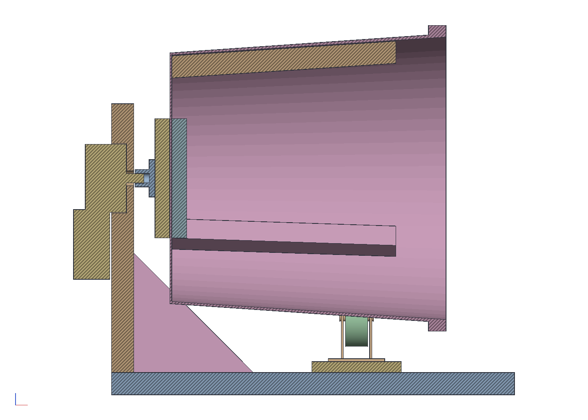

# Bucket parts tumbler

A tumbler built from a plastic bucket, for easing the edges of about
40 small wood inlay pieces (curly-Spectre jigsaw tiles) per batch to a
soft "pillowed" edge of roughly 0.3–0.5 mm radius. It is built around
a **Lowe's 2-gallon bucket**, which is plenty for a batch that size;
the brief's first design used a 5-gallon, which the script can still
build. The bucket is tilted about 25° and turned directly by a slow
12 V worm-gear motor bolted to the centre of its bottom. Two fixed casters under the upper
wall carry most of the weight. Everything mounts on one flat deck,
which is hinged at the motor end and propped up to set the tilt.

`build.py` makes the document through the MCP server and
`crates/ok-render/tests/bucket_tumbler.rs` checks it. **Status:** design
only, not built or tested.

    cargo build --release -p ok-mcp
    python3 examples/bucket-tumbler/build.py        # the document, pictures, sheet and numbers
    cargo test -p ok-render --test bucket_tumbler   # what CI runs

Every dimension is a named constant in inches at the top of
`build.py`. The bucket is chosen by `BUCKET` (`"2gal"` or `"5gal"`).
From the bucket's sizes the script works out the axis height (the
rim's radius plus 1.3 in, rounded up to the half inch), the deck's
length and width, the motor plate's height, the caster line (a set
distance below the rim), the riser thickness that puts the wheels on
the wall at ±35°, and the batten length. The document is in millimetres like the other examples.
The tab **on the deck** has the deck flat, with the bucket's axis on
the world x axis. **base** holds the base, the hinge and the prop
leg. **propped at 25 deg** turns the deck about the hinge.

## Why the 2-gallon

The model's numbers for the two buckets:

| | Lowe's 2 gal | 5 gal |
|---|---|---|
| Bucket (rim across × height) | 10.25 × 9.25 in | 12.4 × 14.5 in |
| Inside volume | 9.3 L | 22 L |
| Fill at a third, of which pieces a quarter | 3.1 L, up to **0.77 L of pieces** | 7.4 L, up to 1.85 L |
| Deck (length × width) | 13.5 × 12 in | 18.5 × 14 in |
| Axis above the deck; rim clearance | 6.5 in; 1.38 in | 7.5 in; 1.30 in |
| Casters apart; axles above the deck; riser | 6.49 in; 1.86 in; **3/8 in** | 7.71 in; 2.00 in; 1/2 in |
| Turning parts (bucket, battens, discs, coupling) | 0.85 kg | 1.5 kg |
| Axial load at 25° (with 1.5 kg of load) | 0.99 kgf | 1.28 kgf |
| Torque, worst case; margin on a 20 kg·cm motor | 6.1 kg·cm; 3.3× | 7.6 kg·cm; 2.6× |
| Speed for the same tumble | **28–39 rpm** | 25–35 rpm |

Forty tiles would have to be 19 cm³ each (say 50 × 50 × 8 mm) before
the 2-gallon ran out of room under the brief's fill rule, so it has
room to spare. It is lighter, so the torque and the load along the
motor's shaft both drop, and it fits on a smaller deck.

Two things change with the smaller bucket:

- **Speed.** The speed at which the load would ride round on the wall
  instead of tumbling goes as one over the square root of the
  diameter: 89 rpm for the 2-gallon against 80 for the 5-gallon. The
  same tumble needs about 11 % more speed: 28–39 rpm. A 40 rpm motor
  still covers that range on the PWM controller, but buy the 40 rpm
  one, not the 30.
- **Media.** The drop is shorter, so each piece hits less hard. Expect
  somewhat longer runs for the same edge; the first run's timing is
  still the measure.

## Why direct drive

A friction wheel on the bucket wall was considered and rejected for
three reasons:

- HDPE is slippery, so a single friction wheel is marginal on
  traction with this load.
- Buckets are tapered, so they walk sideways on rollers.
- A worm gearmotor at 30–40 rpm needs no further reduction. Its worm
  also holds the bucket still when it is stopped.

A fan motor was also rejected. It turns at around 1000 rpm or more
with very little torque, so it would need roughly 40:1 reduction. It
also relies on its own airflow for cooling, so it overheats when
enclosed and geared down.

## What the model checks

The build script prints the numbers below, and the test asserts them
on the regenerated bodies.

| Brief says | Model | |
|---|---|---|
| The rim clears the deck by about 1.3 in | 1.38 in on the 2-gallon (1.30 on the 5-gallon) | ✓ |
| Casters under the smooth wall, below the ribbed collar | 3.0 in below the rim on the 2-gallon *(fit)*, 5.2 on the 5-gallon | ✓ |
| Contact 35° either side of bottom centre | each wheel touches the wall without cutting into it (0.5 mm closer and it would) | ✓ |
| Shim the riser until the axis is parallel to the deck | the riser's thickness is worked out: 3/8 in for 2 in casters whose plate-to-axle height is 1.5 in | ✓ |
| Torque 0.7 N·m (7 kg·cm) worst case; a 20 kg·cm motor is about 3× | 6.1 kg·cm on the 2-gallon, 3.3×; on the 5-gallon 7.6 kg·cm, **2.6×** | ✓ |
| Axial load at 25° about 1.3 kgf | 0.99 kgf on the 2-gallon: the turning parts at the model's densities plus 1.5 kg of load, times sin 25° | ✓ |
| Prop leg for 25° | 5.6 in at its front edge on the 2-gallon's 13.5 in deck | ✓ |
| Three battens at 120° | at 0°, 120° and 240°, on the inside wall, flat backs bearing at their edges | ✓ |
| Nothing fixed touches the bucket | deck, plate, gussets, riser, casters and motor all clear | ✓ |

The model turned up three things the brief does not say:

1. **The motor shaft may not reach through 3/4 in plywood.** The
   listings for the 5840-31ZY give the gearbox (58 × 40 × 35 mm) and
   the motor can (31 × 57 mm), but not the length of the output
   shaft. If the gearbox sits on the plate's back face, the shaft has
   to cross 19 mm of plywood and still leave enough inside the
   coupling's hub to reach the set screws. In the model the gearbox
   sits in a **58 × 40 mm pocket, 1/2 in deep, in the back of the
   plate**. That leaves a 1/4 in web around the shaft hole, and with
   an assumed 15 mm shaft, 7.6 mm of shaft goes into the hub. Measure
   the real shaft, and skip the pocket if it is longer than about
   30 mm.
2. **The gussets go on the bucket side.** The plate stands on the
   deck's end, so nothing lies behind it for a gusset to sit on. The
   model puts the two 4 in gussets at the plate's ends, inside. The
   bucket's narrow end is 5.2 in in radius there and the gussets are
   5.25 in out on the 2-gallon's 12 in plate, so they are clear.
3. **The battens bear on their edges.** A flat 3/4 in batten on a
   wall of about 4.2 in inside radius stands 0.017 in off the wall in
   the middle. Screwed through the wall, it pulls the wall to it.
   Nothing needs doing.

## Measure these first *(fit)*

| What | In the model | How to check |
|---|---|---|
| Bucket wall radius at the floor and just under the rim | 4.2 in and 4.8 in (the floor is not listed) | Wrap a tape around the bucket and divide by 2π |
| Rim lip radius | 5.125 in (listed 10.25 across) | Callipers across the rim |
| Where the hoops below the rim end | the casters ride 3.0 in below the rim | Look; the wheels must ride on smooth wall |
| Gearmotor output shaft length past the gearbox face | 15 mm (not in the listings) | Callipers; this decides whether the plate needs the pocket |
| Coupling hub and flange | hub 15 × 12 mm, flange 32 × 5 mm | The coupling's listing |
| Caster height, mounting plate to axle | 1.5 in | Measure the caster; shim the riser to suit |

## Parts to buy

| Part | Spec | Notes |
|---|---|---|
| Gearmotor | 12 V DC worm-gear motor (5840-31ZY family or similar), 40 rpm no-load, rated torque ≥ 20 kg·cm, 8 mm D-shaft | The worm holds the bucket still when stopped |
| Speed control | PWM DC motor speed controller, 12 V, ≥ 5 A | Dial in 20–35 rpm |
| Power supply | 12 V DC, 5 A | Sized above stall current for margin |
| Flange coupling | Rigid flange coupling, 8 mm bore | Check the shaft size on the listing |
| Casters | 2 × fixed (non-swivel) 2 in casters, rubber or polyurethane wheel | Swivel casters will not track |
| Bucket | Lowe's 2-gallon general bucket, with lid | Remove the handle |
| Hardware | 4 × 1/4 in carriage bolts with nuts and washers; #8 × 3/4 in pan-head screws with washers; one hinge | |

Prices have not been checked. Expect the motor, controller and supply
to be most of the cost.

## Wood parts

| Part | Size | Material |
|---|---|---|
| Base | 12 × 15.5 in | 3/4 plywood |
| Deck | 12 × 13.5 in | 3/4 plywood |
| Motor plate | 12 wide × 9 tall, shaft hole 1/2 in at 6.5 in above the deck, gearbox pocket 58 × 40 mm × 1/2 in from the back | 3/4 plywood |
| Gussets | 2 × 4 × 4 in triangles, on the bucket side at the plate's ends | 3/4 plywood |
| Caster riser | 3 × 12 in, about 3/8 in thick *(fit)*, its centre 7.5 in from the plate's inner face | plywood |
| Prop leg | 3 in wide, 5.6 in tall, its top bevelled 25° | scrap, or a hinged leg with a stop |
| Bottom discs | 2 × 4 in diameter, four 1/4 in holes on a 3 in circle | 1/2 plywood |
| Battens | 3 × 3/4 × 3/4 × 7-1/2 in | hardwood, exposed edges rounded over |

## Assembly

1. **Battens.** Space three battens 120° apart on the inside wall,
   running from the bottom up. Screw them from outside with pan-head
   screws and washers, because HDPE will not hold glue. Check that no
   screw tips come through.
2. **Bottom flange.** Find the bucket's centre; the moulding dimple on
   the bottom marks it. Screw the flange coupling to one disc,
   centred. Sandwich the bucket bottom between the two discs and clamp
   with the four carriage bolts, domed heads inside.
3. **Motor plate.** Cut the gearbox pocket in the back of the plate
   and drill the shaft hole. Mount the motor with its shaft through
   the hole. Fix the plate square to the low end of the deck, with
   the gussets on the bucket side.
4. **Casters.** Screw the casters to the riser with their axles
   parallel to the bucket's axis. Leave the riser clamped, not
   screwed, for now.
5. **Align.** Slip the flange onto the motor shaft and rest the wall
   on the casters. Slide and shim the riser until the bucket turns by
   hand without wobbling or binding. Then screw the riser down and
   tighten the flange set screws on the shaft's flat.
6. **Tilt.** Hinge the low (motor) end of the deck to the base and
   prop the high end to 25°.
7. **Wiring.** Supply → PWM controller → motor. Add a switch if the
   controller has none.

## Running

- **Speed:** 28–39 rpm (25–35 on a 5-gallon). Count turns against a mark on the bucket.
- **Direction:** either; the battens are symmetrical.
- **Fill:** the pieces plus about 3× their volume in media, under one
  third of the bucket.
- **Media:** 2 in squares of 100–120 grit cloth-backed abrasive, plus
  a couple of handfuls of 3/4 in hardwood cubes.
- **Dust:** snap the lid on, or run it outside.
- **Species:** tumble maple and walnut separately.
- **First run:** five scrap pieces, checked every 15–20 minutes.
  Record the time that gives the edge you want.

## Things to watch

- **Axial load on the motor.** About 1.0 kgf along the shaft at 25°
  (1.3 on a 5-gallon). If the motor's listing gives a lower axial
  limit, reduce the tilt to 15° (0.6 kgf).
- **Pieces riding a batten.** Add more cubes, or make the battens
  lower.
- **Clatter** means the pieces are being thrown. Slow down or add
  media.
- **Bucket bottom flex.** If the bottom oil-cans around the discs, use
  larger (6 in) discs.

## Where the numbers came from

The design numbers are the owner's brief. The 2-gallon's size is
[Lowe's listing](https://lowes.com/pd/-/1000462837) (10.25 × 10.25 ×
9.25 in) and its wall radii are estimates; a Leaktite 2-gallon's lid is
listed at 9-3/4 in. The 5-gallon's are those of a common HDPE pail.
The motor's sizes are from its listings (for
example [RobotShop's 5840-31ZY page](https://www.robotshop.com/products/5840-31zy-12v-27rpm-high-torque-worm-gear-motor)).
The densities are typical: birch plywood 0.68, HDPE 0.95, hard maple
0.71 g/cm³. The motor body is an envelope at 1.6 g/cm³; the real
motor weighs about 0.5 kg.
