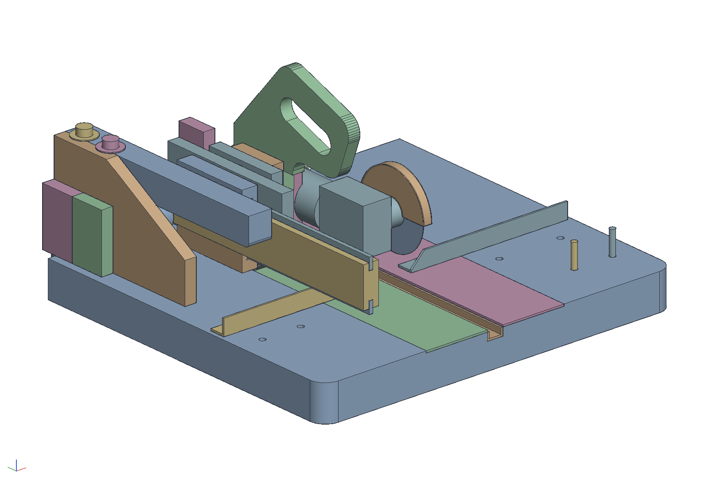
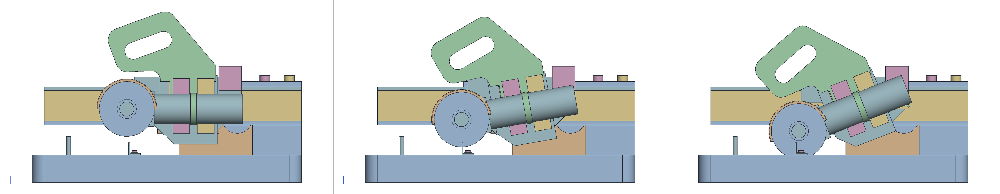
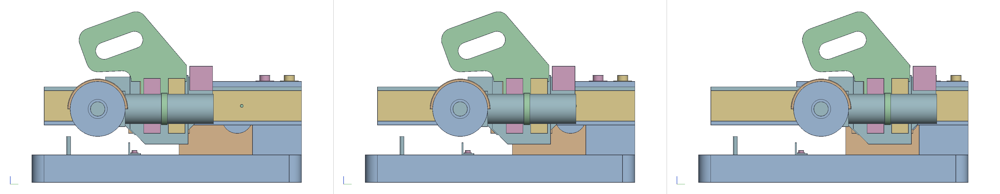

# A sliding cutoff grinder

A 4-1/2 in angle grinder turned into a small benchtop cutoff saw for
thin metal: the grinder rides a carriage that slides front to back on
a hardwood rail and pivots up and down on a plywood disc, the wheel
coming down into a steel channel let into a three-layer plywood base,
the stock held against a steel angle fence. The plan is Woodsmith
WS22134 (2015); this is that project adapted to the shop's grinder, the
orange Chicago Electric the chop saw carries, and the plan's drawings
re-read as an offkilter document with its mechanism checked.

```sh
cargo build --release -p ok-mcp
python3 examples/cutoff-grinder/build.py       # the document, pictures, sheets and parts list
cargo test -p ok-render --test cutoff_grinder  # what CI runs
```



## How it works

The support arm stands on a tab at the base's back left corner, bolted
down with two 1/2 in carriage bolts up through the base. The rail is
screwed to its side, 21 in long, cantilevered forward over the base,
with a resin slide epoxied into a groove in each edge. The carriage
plate carries two grooved hardwood guides that ride those slides, a
3 in plywood disc on its outer face, and a stop. The handle assembly is
a pivot plate with a plywood ring glued on, the ring over the disc, a
3/8 in carriage bolt through both; the handle stands on a spacer block
at the pivot plate's top, and two mounting blocks on the handle's outer
face are cut to the grinder body's round, which an aluminium strap holds
against them. The grinder lies along the rail with its wheel at the
far end of its gearhead, over the channel. A spring from the carriage
plate to the pivot plate lifts the grinder off the work until the
plate's top back corner meets the stop.

Pull the handle down and the wheel comes through the stock into the
channel; slide the carriage to run the cut along the stock. Steel
inserts either side of the channel take the sparks.





## What the test checks

`crates/ok-render/tests/cutoff_grinder.rs` sweeps the carriage to both
stops and the handle from the stop to full plunge, and at each
position checks no two parts that move differently intersect, the
wheel runs between the channel's walls, the gearhead stays over the
fence's leg, and at full plunge the wheel reaches below the base's top
without touching the channel's floor. It also finds the travel from
where the pins meet the slots' closed ends, the plunge angle, the
stop's catch just above rest, the stock capacity in front of the fence
and the handle's height. The numbers it found:

| | |
|---|---|
| travel | 4-5/8 in, the pins at 8-1/4 and 17-1/8 from the rail's front end |
| swing | 21.4 degrees from the stop to full plunge |
| wheel at rest | 1-1/2 in over the base |
| full plunge | the wheel 0.31 in below the base's top, 0.19 in off the channel's floor; the gearhead 1.5 mm over the fence's horizontal leg |
| capacity | stock up to 3.15 in wide against the fence's back position, any thickness that fits under the wheel at rest |
| handle | its top 14 in above the bench |

## What was adapted, and why

The plan's dimensions are kept for every part they fit. These changed:

- **The grinder is the shop's own**, modelled as in `examples/chop-saw`
  (the wheel's inner face, the gearhead and the body's axis measured
  from it). The wheel is at the far end of the gearhead from the handle,
  so the stack across the base, support arm, rail, carriage, disc and
  ring, pivot plate, spacer, handle, mounting blocks, body, puts the
  wheel 11.27 in from the base's left edge; the channel and the inserts
  are centred on it, not on the base.
- **The pivot plate hangs 3-1/8 below the pivot**, as drawn, which is
  7/8 in over the base. It would come down on a fence it passed over,
  so the fence's two positions are both ahead of the plate's reach at
  the forward stop, 5-7/8 and 7-7/8 from the front edge, and the plate's
  front bottom corner is cut at 45 degrees like the carriage plate's.
  The plan puts its rows at 5 in intervals from the back; with the
  carriage's reach that is not possible here.
- **The wheel is 5 in ahead of the pivot** (the plan's drawing suggests
  nearer 3-1/2), so that a 3 in plate fits between the fence and the
  wheel's forward reach. The mounting blocks sit 3-3/4 and 5-3/4 behind
  the spindle, on the handle's tab.
- **The travel is 4-5/8 in**, the pins 8-7/8 apart. The slots in the
  carriage plate are open at its ends, 2-3/8 deep, as drawn; the plan's
  pin positions are not legible enough to copy and this travel keeps the
  pivot plate off the fence.
- **The gearhead limits the plunge**, not the channel: it is 2.9 in
  below the spindle's axis against the wheel's 2.25 in radius, so it
  reaches the fence's horizontal leg 0.19 in before the wheel reaches
  the channel's floor. The left fence's vertical leg is cut away for
  2-1/2 in at the gap so the gearhead can come down beside the wheel;
  the plan notches it for the same reason. Full plunge still puts the
  wheel 0.31 in below the base's surface, through anything lying on it.
- **The stop** is a 1-7/8 x 2 block on the carriage plate's outer face
  behind the pivot plate, which the plate's top back corner meets 3
  degrees above level; the plan's 3-13/16 stop sits elsewhere on the
  plate, which this layout has no room for.
- **The handle** is the plan's full-size pattern, traced from the
  drawing and turned so the tab that sits on the spacer block is level.
  Its grip then leans forward over the wheel. `out/handle.dxf` is the
  outline at 1:1.
- **The small support arm's taper** is a guess (6 in at the back to
  2-1/2 at the front); its height at the front is not dimensioned.
- **The guides touch the rail's edges** in the model; in the shop the
  slides stand 5/16 proud and the guides ride on them with a hair of
  clearance to the rail, as the plan says.
- The spring, the screw eyes, the screws and the cord are in the parts
  list, not the model.

## The parts

`out/parts.csv` has the wood and the hardware; `out/cutoff_grinder.pdf`
is the assembly on an A2 with sections at the pivot, and the carriage
and handle assemblies have their own A3s. In short:

- **Base:** three layers of 3/4 birch ply, 23 x 21, 1 in radii on the
  front corners and a 6 x 1 tab on the back edge for the arm. A 1 in
  dado 5/8 deep under the wheel takes a 1/2 x 1 x 1/8 steel channel 17
  long, with a 1/8 x 4 steel insert in a rabbet either side, flush. Two
  rows of four 1/4-20 inserts for the fence, two 3/8 holes for dowel
  pegs at the front right.
- **Support arm:** two plies glued to 1-1/2, 6 x 14, a 4 in foot at the
  back and a 1-3/4 bar forward of it with a 1-1/4 radius under the root;
  a 3/4 small arm glued to its far side and two 3/4 x 2-1/4 x 3-5/8
  support blocks beyond that. Two 1/2-13 x 8 carriage bolts up through
  the base's counterbores, fender washers and lock nuts on top. Not
  glued to the base.
- **Rail:** 1 in maple, 2-1/2 x 21, a centred 1/4 groove 7/16 deep in
  each edge for the 1/4 x 3/4 resin slides, 1/4 holes for the stop
  pins, #8 x 1-3/4 screws into the arm.
- **Carriage:** 3/4 ply plate 4-3/4 x 8-3/4 with 45 degree lower
  corners and the slots; two 1 x 1 x 5 maple guides grooved 3/8 x 3/8;
  the 3 in disc of 1/4 ply; the stop; the 3/8-16 x 2 pivot bolt with
  its head counterbored into the plate's rail side.
- **Handle assembly:** 3/4 ply pivot plate 4-3/4 x 5-5/8, the 1/4 ply
  ring 4-7/16 outside and 3 inside, the 1-3/4 x 3-1/8 spacer, the handle
  from the pattern, two 1-3/8 x 4-1/2 mounting blocks cut to the body,
  the 1/16 x 1/2 x 9 aluminium strap.
- **Fence:** 1 x 1 x 1/8 steel angle in two lengths with a 2-1/2 gap at
  the wheel, the ends beveled, the left one's leg cut away at the gap;
  1/4-20 x 1/2 hex bolts into the inserts.
