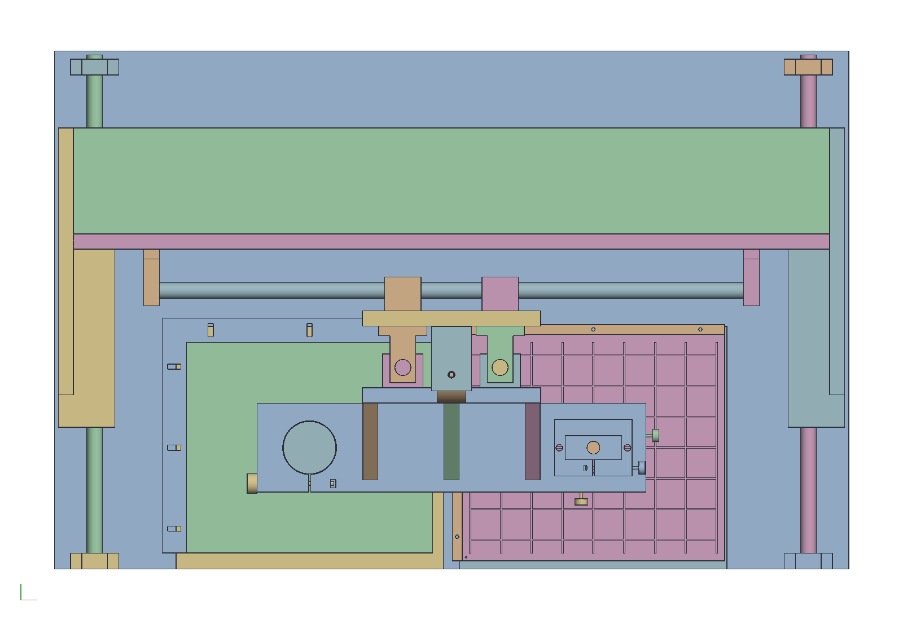
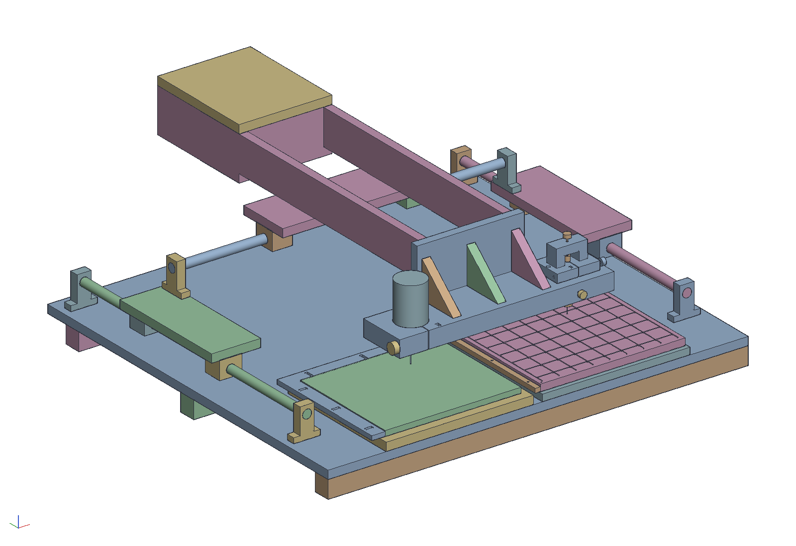
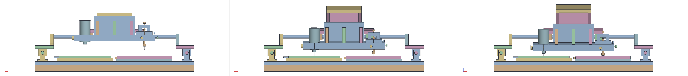

# A carving duplicator on round rail

The Woodsmith carving duplicator (plan SN12918) rebuilt on the 20 mm
round rail already bought for the router lift: SFC20 shafts, SK20
supports and SC20UU blocks in place of the plan's conduit and rollers.
A trim router and a pilot the size of its bit sit side by side on one
tool plate, the pilot in a collet chuck in a block that adjusts to the
bit; the pilot traces a pattern on one platform while the bit cuts the
same path in a blank on the other. The first use is the puzzle
top: the printed pattern plate from `examples/puzzle-top` has the gap
lattice as grooves, a 2 mm pilot rides them, and a 2 mm bit cuts every
piece out of one board, the kerf being the resin gap. After that, any
part printed as a master copies into wood the same way.

```sh
cargo build --release -p ok-mcp
python3 examples/duplicator/build.py          # the document, pictures and sheets
cargo test -p ok-render --test duplicator     # what CI runs
```

`out/duplicator.pdf` is the whole machine on an A2 with a parts list,
the three moving groups as single items; `gantry.pdf`, `x_slide.pdf`
and `z_slide.pdf` are those sub-assemblies on A3s at a larger scale,
each with its own balloons and list. The machine moves on four slider
mates (the gantry on a Y shaft, the X slide on the gantry's lower X
shaft, the Z slide on the X slide's left Z shaft, the stop screw in
the tool support's ear), whose parameters `build.py` reads off the
drawn pose; `motion_z.pdf` draws the depth sequence from the front
(raised, first pass on the stop screw, last pass with the screw backed
off and the pilot in the groove) and `motion_xy.pdf` the reach from
above (the bit at the blank's front-left corner with the pilot at the
reference hole, at the centre, and at the back-right corner).

## How it is built

- **Base and Y.** A 900 x 855 ply base on three battens (two plies
  glued, 38 x 40, the full width, clear of the Y supports' T-nuts), so
  it cannot sag over the bench. The two Y shafts (700 mm) run
  front to back at x = ±415 on SK20s standing straight on the ply, with
  two blocks 230 apart on each, 45 mm back of centre so the deck over
  them clears the carriage plate. The rails are that far out so the tool
  plate's ends pass over the front supports at the last pass with the
  bit at the blank's edge (at ±380 they clipped them by 1.5 mm), and
  the shafts are 700 rather than 600 because the Z pair only needs 250
  of the offcut, which buys 100 mm of Y travel for a job longer than
  the puzzle. The two work platforms (330 x 300) sit
  between the rails, the pattern's 3.5 mm lower so the plate's top is
  level with a 12 mm blank.
- **The gantry.** One piece on the four Y blocks: a deck (890 x 300,
  one ply) across both rails, a wall (890 x 270, one ply) standing on
  it, and a triangular gusset in each corner. Two separate
  beds with a post each would rack, one side running ahead of the
  other with only the X shafts' bending to stop it (about 90 N/mm for
  the pair, half a millimetre for a lopsided 50 N push); as an angle
  the deck takes racking as in-plane shear, the wall the fore-and-aft
  bending, and the gussets close each end into a triangle. The deck's
  front edge is 11 mm behind the Z carriage plate, which hangs from the
  X shafts to the board top and sweeps the whole X travel in front of
  it (an earlier version notched the deck round the plate, which would
  have pinned the X travel to the notch; the sweep test now resolves
  each pose from the sliders and intersects every pair of bodies from
  different instances, which is what catches that). The deck rides 45 mm above the blank and clears the Y supports
  at full travel. One bridge on two
  round rails needs them parallel to within the blocks' clearance: set
  the SK20s by sliding the finished gantry end to end before the last
  tightening.
- **X.** Two X shafts (760 mm) one above the other, 150 apart, on
  SK20s on the wall's front face.
- **Z.** The carriage plate (220 x 314, one ply) rides the X shafts on
  four blocks bolted to its back, no bed and no joint in bending. Two
  Z shafts (250 mm) stand on its face on SK20s, and the tool support
  rides them on four blocks: a support plate with the tool plate hung
  on three webs in front of it.
- **Tools.** The tool plate is two plies (38 mm) with a 66 mm bore for
  the router motor's barrel, a slit from it to the plate's front edge
  and an M6 knob bolt across the slit, the slit to the front so
  tightening shifts the router in y and never in x. The router is the
  fixed reference; the pilot is what adjusts.
- **The stylus block.** The pilot is a stylus in a straight-shank ER11
  collet chuck (C12-ER11A-100: a 12 mm shank 100 long, the nut on its
  nose, solid behind the collet pocket), so a rod or a bit put in until
  it stops has the same stick-out every time, and ER11 takes the 2 mm
  rod, a 3/16 and a 1/4 shank with about 0.01 mm of runout where a
  keyless chuck has 0.05 to 0.1. The chuck clamps in a block of two
  plies with a head of one more on top, the block through a 62 mm
  pocket in the tool plate beside the router with a millimetre of play
  each way, the head overhanging the pocket and bolted to the plate by
  two M6 through 8 mm holes. An M4 screw through an insert in the
  plate's right end and one through its front edge push the block
  against a 6 mm spring in the pocket's far wall each way, 0.09 mm an
  eighth of a turn; a bridge on two feet over the chuck's shank carries
  a third M4 screw the shank's top is pushed up to before its clamp is
  tightened, so the stylus's height is that screw's and repeats when
  the chuck comes out. The router's own collet is left alone: bits are
  not meant to bottom on the motor shaft, and whatever length a bit
  goes in to, the height screw takes up.
- **Depth.** An M8 stop screw through an ear on the tool support lands
  on a stop block on the carriage plate: set for a 4 mm first pass, it
  backs off 13 turns for the last, where the pilot bottoming in the
  12.5 mm groove is the limit.
- **Balance.** The Z slide weighs about 4.5 kg (1.6 of ply in the tool
  support, 0.75 in its four blocks, 1.5 for the Colt, 0.3 for the
  stylus block and its chuck, the rest knobs and screws). Left to gravity the pilot would ride the groove
  floor under 41 N, and its 12 N of drag would bend a 2 mm rod 18 mm
  out of the chuck by 0.15 mm, a tenth of the gap, reversing with
  every stroke. A retractable spring balancer (the 1 to 3 kg kind)
  hangs from a ply bracket on the carriage plate's face, its cable
  down to an eye on the stop ear, set to leave about half a kilogram
  on the pilot. A counterweight would double the moving mass and has
  nowhere to hang, an extension spring flat enough would be 350 mm
  long, and a gas spring's stiction is the force band in question. The
  reel sits between the upper Z shaft supports, above the support
  plate by 59 mm at the raised pose, and the cable passes 8 mm in
  front of the stop screw's knob; the sweep checks all of it.
- **Calibration for the puzzle.** An L fence on each platform, the
  blank's 30 mm wide with slots across its legs. The pattern plate has
  a 2 mm reference hole 5 mm inside its front-left corner, outside the
  board's outline: pilot in the hole, bit plunged into the blank
  platform, the mark should sit 5 mm outside the blank's corner both
  ways, and the slotted fence moves by the difference. A stylus-to-bit
  error only shifts the whole copy here, and the fence absorbs it.
- **Registration for the cage.** The Spectre cage
  (`examples/spectre-cage`) turns the master and the stack through
  twelve indices about their own axes, so an error across the axis
  between the stylus and the bit comes out as twice that error as a
  step between faces cut at opposite indices; with a 0.7 gap and fins
  0.3 off the profile, the stylus wants setting to the bit within about
  0.05 mm across the axis. Depth is benign by comparison: with the axis
  horizontal it is radial at every index, so it makes every piece
  uniformly fat or thin, which the stop screw trims. The cage's cradles
  carry a 90 degree cone in each rim at mid-length, 8 mm across, and
  the master's cradles and the cage's are the same print, so the cones
  sit the same off each trough's axis. To register: loosen the block's
  head bolts, drop the bit (not turning) and the stylus into the two
  cones, and turn the x and y screws until the stylus's ball sits in
  its cone the way the bit's does, no wall touching; for z, lay a 20 mm
  shaft offcut across both cradles and touch each tool to it at the
  same stop-screw setting (a continuity tester between the shank and
  the shaft reads the touch to a few hundredths), turning the height
  screw until the stylus touches where the bit did; tighten the head
  bolts, then the clamp. Confirm with one cut on the stack's spare
  blanks: cut index 0 and index 6, measure the step with calipers, and
  move the screw by half of it.

The pattern plate is also the example of the duplicator check, the
`duplicator_check` tool and `ok_brep::duplicate_check`: a body meant to
be printed and copied is sampled from above as a height field, the bit
is rolled over it (a flat disc or a ball) for the surface it can leave,
and the copy's shortfalls are reported: material under overhangs the
pilot never sees, concave corners tighter than the bit, depths beyond
its reach. `check_2mm.png` shows the plate with the 2 mm bit, which
rides every groove and leaves nothing; `check_3mm.png` with a 1/8 in
bit, which enters none of them and leaves the whole lattice red. The
first run of the check found that the plate as drawn was a pocket with
groove stubs at its edges: its grooves had been cut from one sketch of
overlapping rectangles, and a cut takes every region a sketch encloses,
the squares between the grooves included. Each groove is its own sketch
now.

The last pass cuts half a millimetre into the platform under the
blank and, where the pattern runs to the blank's edge, a half kerf into
the fence beside it; both are ply and both are meant to be marked.

## The portal variant

```sh
python3 examples/duplicator/build.py --portal   # the same outputs under out/portal/
```



Seen from above at the front of its travel, the gantry parks its whole
body behind the work: the tools hang 210 mm ahead of the front Y
blocks and 325 ahead of the back ones, so the base has to carry the
deck, the wall and the blocks that far behind the blank's back edge,
480 mm of the 855. The portal turns that
round. The Y rails run to the base's front edge, and the gantry's
front blocks sit 50 mm behind the tools instead of 210. Each side is a leg:
a foot of one ply on the rail's two blocks, and a cheek of one ply
standing on the foot's outer edge in front of the wall, the wall's
height, glued to the wall's end and to the end of a deck strip 150 mm
deep behind the wall. The cheek is the gusset that used to brace the
wall to the deck's back, moved in front where it ties the wall to the
foot under the tools; the strip keeps the shear plate that stops one
side running ahead of the other. Nothing in front of the wall changes:
the X and Z slides, the tools, the platforms and the pattern are the
same parts at the same places, and so are the X and Z travel.

| | gantry | portal |
|---|---|---|
| base | 900 x 855 | 980 x 640 |
| Y shafts | 700 | 630 |
| Y travel | ±192.5 | ±157.5 (20 past the reference hole, 25 past the blank's back edge) |
| front Y blocks behind the tools | 210 | 50 |
| deck | 300 deep | a strip 150 deep |

The 80 mm of width is the one cost. The stylus block's x knob stands
16 mm past the tool plate's right end, at x = 408 with the bit at the
blank's right edge, and the feet have to clear it, so the rails are at
±440 instead of ±415. The gantry's body still overhangs the base: its
cheeks reach to 35 mm past the back edge at full rearward travel, over
nothing, and at full forward travel the wall sits over the blank's back
half. The test regenerates the portal's document, places its 63
bodies, checks the base against the gantry's, the blocks against the
tools, the legs against the blocks, the wall between the cheeks, the
reach over the blank and the lattice, the x knob short of the right
foot, and runs the same sweep over the work as the gantry's: no two
bodies of different instances meet at any pose but the tools in the
work.

## The Woodsmith variant: the plan's machine, part for part

```sh
python3 examples/duplicator/build.py --woodsmith   # the same outputs under out/woodsmith/
```



The owner may unretire the duplicator, and asked for the Woodsmith
machine itself on the rail hardware on hand, nothing added: no Z
slide, no second rail, no extra pivot. This variant is that, part for
part. The plan's side rails are the two Y shafts on their SK20s. Its
short carriages are a foot of one ply on each rail's two blocks, 110
x 280, reaching in under the main rail's end with the main rail's
SK20 standing straight on it, 146 up. Its main rail is the one X
shaft, 760, between those two SK20s, which is also all that ties the
two feet, as the main rail is all that ties the plan's carriages. Its
long carriage, which rolls about the main rail and slides along it,
is two SC20UU blocks 300 apart under a saddle, since a ball bushing is
as free about its shaft as along it. Its two arms are two plies on
edge, 19 x 80, on the saddle, 780 long. Its tool support is the tool
plate the other variants have, 480 x 110 x 38 with the router in its
split clamp and the stylus chuck in its adjustable block, on a support
plate across the arms' front ends with three webs. Its sand-filled
pipe is a box of sand between the arms at the tail, 250 long with a
floor and a lid. The front Y blocks sit 20 further back than the
gantry's so the feet clear the tool plate's swing, and the rails 10
further out because the router clamp's knob swings 5 mm lower on the
arc than the Z slide took it and was clipping the front Y supports at
the last pass; the base is 940 wide for it.

Depth is the arc, and the passes are set as the plan sets them, by
the stylus. The tool tips hang 75 below the main rail and 450 ahead
of it. For the first pass the stylus is set 8.5 mm longer than the
bit (its height screw, twelve turns, the clamp loosened and
retightened), so it bottoms in the 12.5 deep groove with the bit 4 mm
into the blank, 5.7 degrees down; for the last it is matched to the
bit and bottoms with the bit through the board, 6.8 degrees down. The
bit tilts by the same angle, and the tips move back 12 mm from the
raised pose, 450 (1 − cos) for being ahead of the pivot and 75 sin
for hanging below it, both the same for the bit and the pilot, since
they are one rigid arm: the copy stays faithful, as the plan's does,
because the offset from pilot to bit is parallel to the rail and the
arc moves both alike. The walls of a 12.5 deep cut lean 1.5 mm over
their height, which the plan's do too, and nothing is adjusted away.



The balance. Everything that swings weighs 7.7 kg without the sand:
the tool plate and its support 2.9, the router and the stylus 1.9,
the two blocks 0.4, the arms, saddle and box 2.5. It is 2.4 kg
nose-heavy at the tool tips, and 2.9 kg of dry sand 50 mm deep (the
box holds 4.6) brings that to half a kilogram, read in `build.py`
from every part's volume and density (ply 0.65, the blocks and
supports aluminium, the shafts steel, the Colt 1.5 kg) and set on the
parts, so the test reads the same balance off the document. The whole
10.6 kg rides the main rail between supports 740 apart, which sags
about half a millimetre at the middle of the travel and nothing at
the ends; both tools go down with it, so the copy does not see it.

| | gantry | Woodsmith |
|---|---|---|
| depth | Z slide, 62.5 of travel on two 250 shafts | the arc about the main rail: 6.8 degrees for the last pass |
| passes | the stop screw, then the pilot bottoming | the stylus 8.5 long, then matched |
| the tips, raised to the last pass | straight down | 12 back on the arc, bit and pilot alike |
| the bit at the last pass | plumb | 6.8 degrees over, as the plan's |
| the gantry | a deck 890 x 300, a wall, two gussets | a foot on each rail's blocks, tied by the main rail alone |
| X travel | ±277.5 | ±185 (the saddle 2.5 short of the blocks' limit) |
| Y travel | ±192.5 | +210 −170 |
| base | 900 x 855 | 940 x 855; the tail reaches 590 behind the tools' line at mid travel, over the bench |
| swinging mass | the 4.5 kg Z slide on a spring balancer | 10.6 kg with 2.9 of sand |
| SK20 / SC20UU used | 12 / 12 | 6 / 6: Y 4 / 4, main rail 2 / 2 |
| shafts | all four 1000s cut | two cut, 700 + 300 each, and a third 760 + 240; the fourth whole |
| ply in the moving parts | 2.1 kg | 4.4 kg (the plan's arms are conduit) |

The test regenerates the variant's 22 studios and places its 44
bodies; reads the X travel off the supports, the blocks and the saddle
and the Y travel off the Y supports, the blocks and the feet, against
the blank and the reference hole; finds both passes by bisection on
the kernel (the arm swung until the bit's tip is 4 below the blank's
top, then 12.5 below the plate's) and checks the bit's axis is tilted
by the last pass's angle and the tips moved back 10 to 14; sums the
mass and the moment of every body of the Arm about the main rail from
their densities and checks the nose is 450 to 550 g heavy at the tool
tips; then runs the same sweep as the other variants over the work,
72 poses, every pair of bodies that move differently intersected:
nothing meets but the tools in the work. A shaft turned in a
bushing's bore is two faceted cylinders whose facets no longer line
up, which overlap by a cubic millimetre or two at every pose but the
drawn one; those pairs are allowed up to 5.

## Hardware

Bought parts bolt through the ply into T-nuts or threaded inserts,
never into wood screws: the rail supports are aligned by loosening and
sliding, and ply will not take a wood screw loosened and retightened
more than a couple of times. The loads on the rail hardware are tens
of newtons, so either fastening is far stronger than it needs to be;
the choice is access. Where the far face is open (the base's
underside, the wall's back) a T-nut goes there: M6 four-prong, the
flange thicker and wider than the three-prong kind, set in an 8 mm
hole with a 1.5 mm pilot drilled for each prong (mark them by tapping
the nut in place) so they do not split the face veneer, drawn home
with a bolt and a big washer rather than hammered, and a smear of
epoxy under the flange so the nut cannot push out or spin the one time
a bolt comes right out. Where the far face is not open, or a part will
be taken off and refitted more than a few times (the Z supports on the
carriage plate, whose far face is where the X blocks sit), an M6
hex-drive steel threaded insert goes into the face grain: a 9 mm hole,
driven with a hex key a millimetre below the surface so the support
sits on wood, a drop of epoxy on its threads, at least 15 mm from any
edge, and the bolt torqued to about 3 N m, the insert's limit in ply
and ten times what the rail needs. Inserts in ply edge grain are
unreliable in tension; the only ones here, the stylus block's M4
adjustment screws in the tool plate's end and front edge, are pushed
against springs and never pulled. Ply joints are glued, the screws
clamps and insurance: number 8, 32 mm into face grain, 50 mm into an
edge. The SK20's slots (6.6 mm, for M6) and the SC20UU's tapped holes
(M5 or M6 by maker) are what they usually are; measure the kit before
buying. `build.py` writes the same
schedule to `out/hardware.csv`.

| Joint | Fastener | Count |
|---|---|---|
| 8 SK20 supports: 4 Y on the base, 4 X on the wall | M6 x 40 hex bolt, washer, four-prong T-nut from the far face, prongs piloted, epoxied | 16 |
| 4 Z SK20 supports on the carriage plate's face | M6 x 30 hex bolt, washer, M6 hex-drive threaded insert in the plate's face, 3 N m | 8 |
| 4 Y blocks under the deck, from above | M5 x 30 (or M6) into the block | 16 |
| 4 X blocks on the carriage plate's back, from its front face | M5 x 30 (or M6) into the block | 16 |
| 4 Z blocks on the support plate's back, from its front face | M5 x 30 (or M6) into the block; the lower pair countersunk, before the tool plate goes on | 16 |
| Router clamp | M6 x 100 knob bolt, hex nut in the pocket | 1 |
| Stylus chuck | C12-ER11A-100 straight-shank collet chuck, ER11 collets 2 mm, 3/16 in, 1/4 in | 1 |
| Stylus clamp, across the head's slit | M4 x 50 knob bolt, hex nut in the pocket | 1 |
| Stylus block head to the tool plate, through 8 mm holes | M6 x 70 bolt and washer into a T-nut from the plate's underside | 2 |
| Stylus x and y adjustment, through the plate's right end and front edge | M4 x 50 knob screw in an M4 threaded insert | 2 |
| Springs opposite them, in 7 mm holes in the pocket's far walls | 6 x 20 compression spring | 2 |
| Stylus height, through the bridge | M4 x 35 knob screw through an M4 T-nut set into the bridge's top | 1 |
| Bridge feet to the head, bridge to its feet | no. 8 x 32, glued | 4 |
| Stylus block's plies and head laminated | no. 8 x 32, countersunk from below, clear of the bore | 4 |
| Stop screw | M8 x 90 with a knob, through an M8 T-nut set into the top of the ear so the load presses it into the wood, an M8 jam nut above the ear to lock the setting | 1 |
| Blank's slotted fence | M5 x 25 bolt and washer into a T-nut set into the platform from below, before the platform is screwed down | 6 |
| Balancer bracket leg to the carriage plate | M6 x 40 bolt and T-nut (the arm's 50 mm overhang turns the reel's 40 N into a prying load) | 2 |
| Cable eye on the ear | M4 screw eye | 1 |
| Balancer hook in the arm | 8 mm S-hook or shackle | 1 |
| Wall onto the deck's back edge, from below through the deck | no. 8 x 50, every 100 mm, glued | 9 |
| Gussets to the deck and the wall | no. 8 x 50, 3 each way, glued | 12 |
| Tool plate's two plies laminated | no. 8 x 32, countersunk from below, clear of the bores | 8 |
| Tool plate to the support plate, from behind | no. 8 x 50, glued | 4 |
| Webs to the support plate from behind and down into the tool plate | no. 8 x 50, 2 each way, glued | 12 |
| Stop ear to the support plate, from behind | no. 8 x 50, glued | 2 |
| Balancer bracket arm to its leg | no. 8 x 50, glued | 2 |
| Battens under the base | no. 8 x 32 from above, countersunk, every 150 mm, glued | 18 |
| Platforms to the base, countersunk flush | no. 8 x 32 | 12 |
| Pattern plate's L fence | no. 6 x 25 | 6 |

One order-of-assembly catch. The lower Z blocks' bolt heads land on
the support plate's front face inside the band the tool plate glues
over, so those two blocks are bolted with countersunk heads before the
tool plate goes on. (The Z supports used to need T-nuts in the back of
the carriage plate between the X blocks; the inserts in its face took
that catch away.)

## The numbers the test checks

| | |
|---|---|
| Travel | X ±277.5, Y ±192.5, Z 62.5 down from the drawn raised pose |
| Sweep | the sliders set so the bit is at the blank's edges and middle, every 25 mm in Y from the reference hole to the back edge, first and last pass (the stop screw backed off for the last), each pose resolved by the kernel: no two bodies of different instances meet but the tools in the work |
| Gantry | deck on all four Y blocks, wall on the deck full width, deck 45 above the blank and behind the carriage plate |
| Reach | bit over the 304 x 260 blank, pilot over the 304 x 260 lattice |
| Depth | tips 40 above the board raised; first pass 4 mm; last pass 12.5 mm, 52.5 of the 62.5 mm of travel |
| Clearance at the last pass | collet nut 5.5 mm above the plate; tool plate 36 mm above the blank |
| Stylus block | moves 1 mm each way in x and y in its pocket before it meets the plate, and not 1.3; the height screw's tip on the chuck's shank top |
| Shafts | X 760 x 2, Y 700 x 2, Z 250 x 2: the four 1000 mm shafts cut 760 + 240 and 700 + 300, Z from the 300s |

Every bought-part size (SK20, SC20UU, the router barrel, the chuck) is
a catalogue number to measure before cutting.
