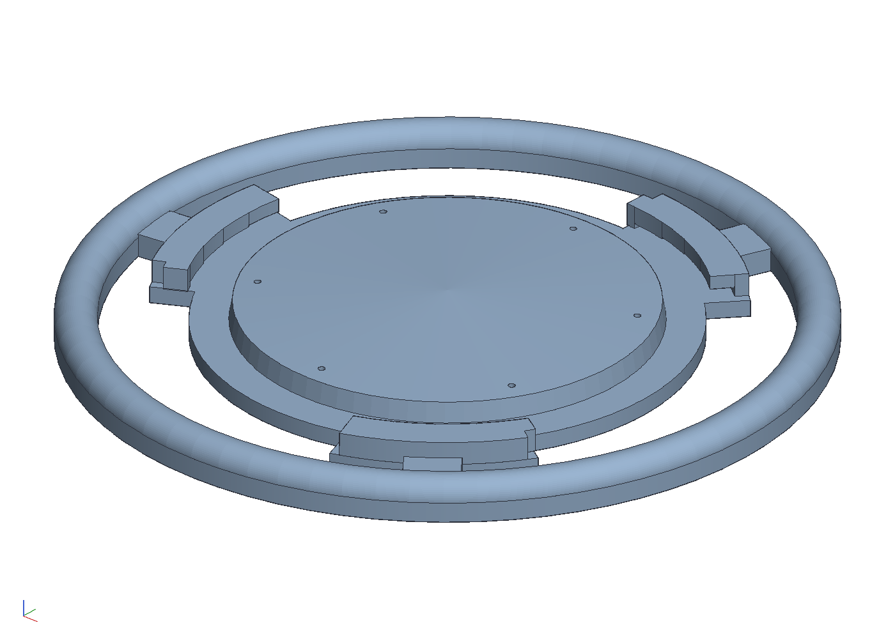
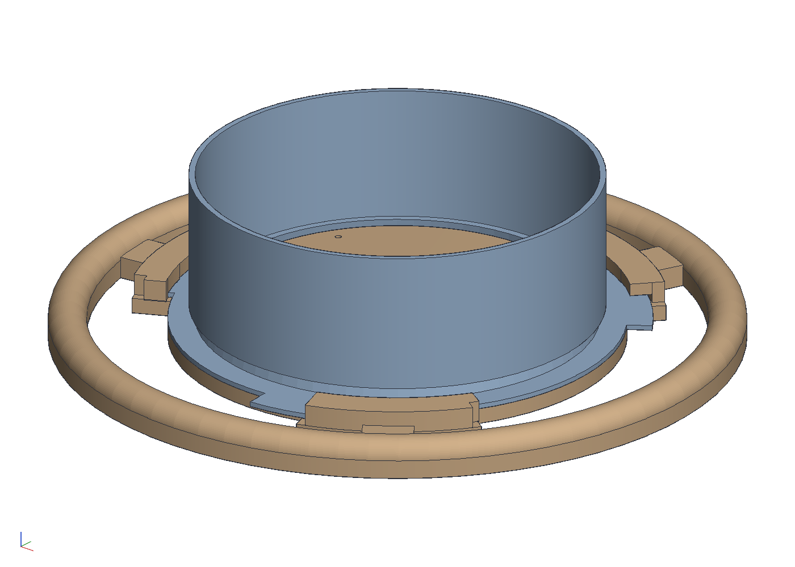
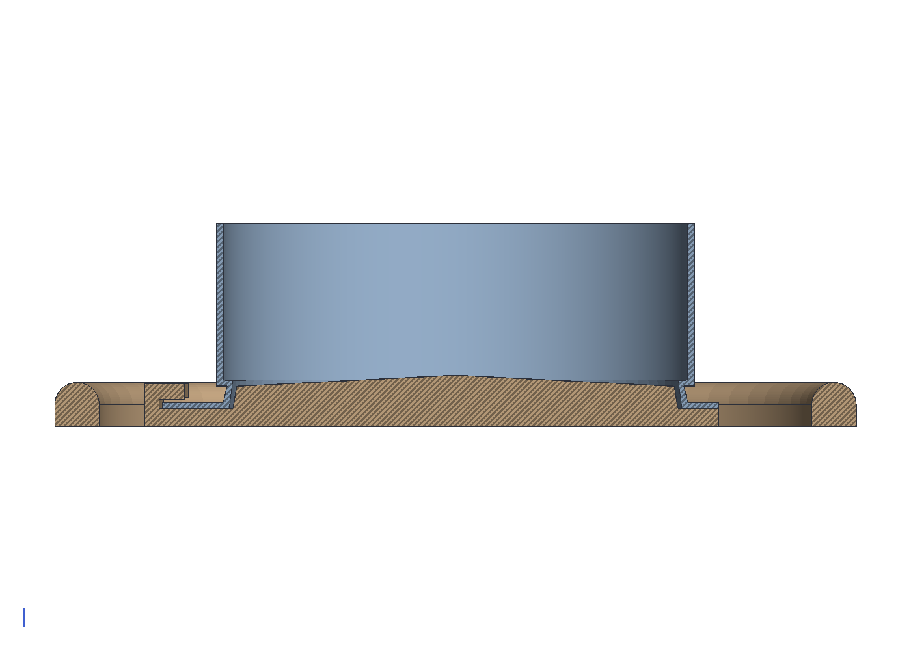

# The finch feeder cap with a perch ring

The bayonet cap in `examples/finch-plug` drops the feeder's tray, and
with it the perch the tray gave to birds that cannot cling to the
mesh: the juncos and sparrows, and the house finches that would rather
not. This is the same cap with a ring of perch round it for them,
sized so the Eurasian collared doves that fed off the tray cannot use
it. The original example stays as it was; this one builds its cap
through the original script's functions, so a change there (the ring's
numbers from calipers, the ramp's bite) carries into this one.

```sh
cargo build --release -p ok-mcp
python3 examples/finch-perch/build.py
cargo test -p ok-render --test finch_perch     # what CI runs
```







## The perch

- **A pencil of a perch.** 6 mm wide and 6 tall, a D in section: a
  flat bottom level with the plate's underside, straight sides and a
  round top. Finch feeders use 5 to 6.5 mm pegs and the ring perches
  on commercial finch feeders are 4 to 5 mm wire; a goldfinch's or a
  junco's foot closes round 6 mm the way a hand closes round a pencil.
- **108 across the outside,** the ring's centre line 51 from the axis,
  its inner edge 48: 15.75 off the mesh tube, 6 off the hooks' walls
  and 12.5 off the plate's edge. A bird on it faces the mesh with its
  chest at the tube and the lowest row of seed level with its feet,
  the rest of the tube above.
- **Three spokes,** 8 wide and 3.5 thick, one from each hook's lobe
  out into the ring, so the ring's load goes into the plate where the
  hook wall stiffens it. The spokes start under the hook walls and
  stand a millimetre proud of the plate outside them: a spoke flush
  with the plate shares its top face with the wall's underside, which
  the union could not take, and the extra millimetre is strength
  anyway.
- **Prints flat** as the plain cap does, plug up, hooks up, supports
  under the lips; the ring and the spokes sit on the bed. PETG, 32.8
  cm³ against the plain cap's 22.0.

## Why a dove cannot use it

A collared dove is 150 to 200 g, 30 cm long and 65 to 70 mm through
the body; doves sit on wires, so the perch's thinness alone would not
keep one off. What does is room. Standing on the ring, facing in, a
dove's chest would be where the mesh tube is: the ring stands 15.75
off the tube and a dove is four times that deep. It cannot lean back
to make the room, and it has no tray to land on instead: the plate is
the ring's own size, the gap between the plate's edge and the perch is
12.5 mm of air that seed falls through, and the hooks are 2 mm walls.
A finch is 25 to 30 mm through the body and feeds with its chest on
the mesh anyway.

If doves still work it out, the two numbers to change are `PERCH_R`
(bring the ring in; 48 puts it 12.75 off the tube, where a house finch
still fits) and `PERCH_W` (down to 5). If the small birds do not take
to it, go the other way: 54 and 6.5.

## What the test checks

`crates/ok-render/tests/finch_perch.rs` regenerates the cap as one
closed body with the perch all the way round at its radius and height,
a flat bottom level with the plate's, its width in a small bird's
range, its stand-off from the tube between 12 and 20 mm, the ring
under 110 across and clear of the hooks, nothing between the hooks and
the ring but the three spokes; that every sample point inside the plain
cap from `examples/finch-plug` is inside this one and the volume grew
by the ring and at most the spokes' bars; and that on the collar the
cap meets it only by the hooks' bite, locked, and nowhere offered up.
