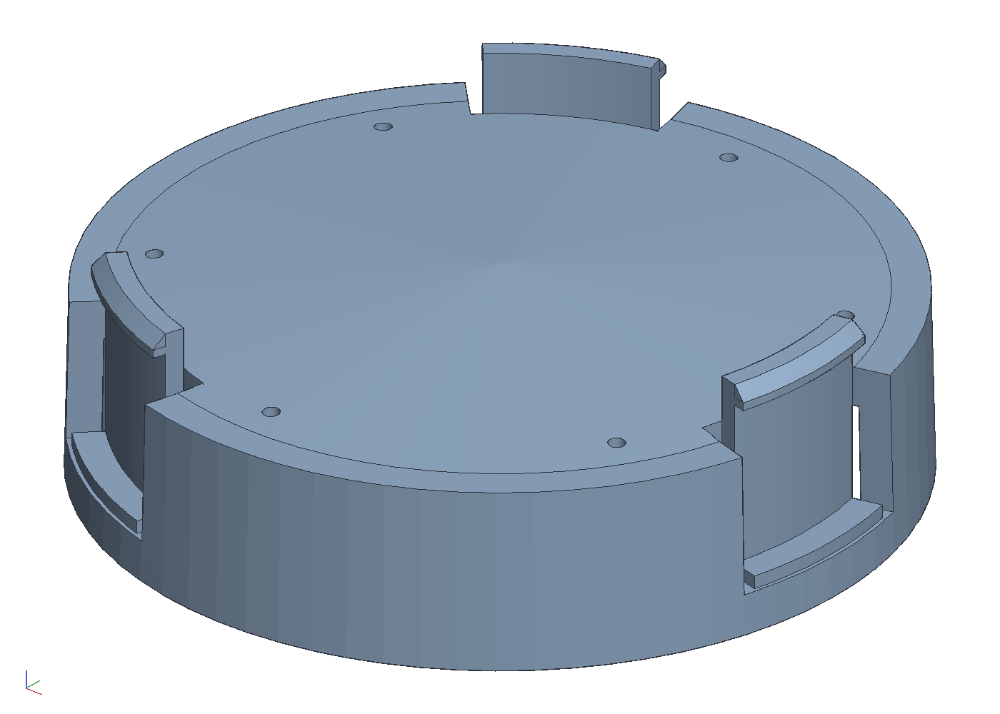
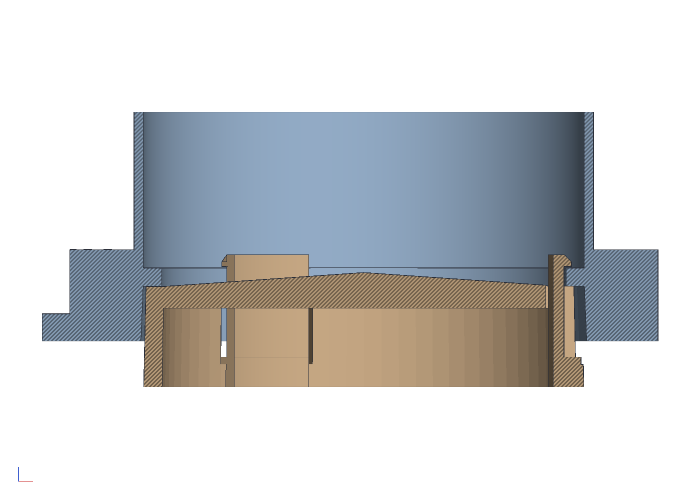

# A snap-in plug for a mesh finch feeder

The finch feeders' tubes end in a plastic collar with three ears
outside and a lip inside; a yellow tray twists onto the ears. The tray
collects rain, the seed that falls into it turns to ick, and it perches
birds that cannot cling, which the mesh never did. This is a plug in
its place: a cup that fills the collar's bore up to the lip, a domed
floor so water runs to the mesh, three snap tabs cut from the skirt
that pass the lip and catch over it, and nothing outside the tube for a
bird to stand on. Print it in PETG, press it in from below until the
tabs click.

```sh
cargo build --release -p ok-mcp
python3 examples/finch-plug/build.py
cargo test -p ok-render --test finch_plug      # what CI runs
```





## The collar's numbers, to confirm

The collar is modelled from photographs with a rule across it, so the
plug can be checked against it; these are the numbers the plug follows
and what to check them with. Calipers on the real collar, then change
the constants at the top of `build.py` and run it again.

| what | mm in the model | how read | check |
|---|---|---|---|
| bore at the mouth | 48.5 | rule across the opening | inside calipers at the mouth |
| bore at the lip | 48.0 | guessed from the visible draft | inside calipers as deep as they reach |
| mouth to the lip's underside | 6 | guessed | depth rod to the lip |
| lip thickness | 2 | guessed | depth rod to the mesh past the lip, less the above |
| lip inside diameter | 44 | guessed | inside calipers through the lip |
| inside the tube above the lip | 48 | the mesh looks the bore's size | not critical: the catches stop at 45.2 |
| collar outside, ears | 64, three 16 x 3 x 3 | rule across the collar and an ear | only drawn, the plug does not touch them |

The two that matter most are the lip's inside diameter and the depth
to it: the tabs are sized a hair inside the first and the floor sits at
the second.

## The plug

- **Cup.** The skirt follows the bore's draft 0.3 off it, 2 thick, from
  5 below the mouth up to the lip's underside; the floor 2.4 thick with
  its top rising 1.5 to the centre, so water runs to the edge where the
  mesh starts, and six 1 mm drain holes near the edge, under a nyjer
  seed's size. The 5 mm below the mouth is where the tabs get their
  length; it is flush with the bore, no ledge.
- **Tabs.** Three, 10 wide and 1.2 thick, cut from the skirt by 0.8
  slits from a 2.5 mm root band at the bottom, their faces 0.2 inside
  the lip's bore, standing 10.7 from the root to the catch. The catch
  reaches 0.6 over the lip's top with 0.15 play, a 0.5 band under a 45
  degree lead-in. Pushing the plug home bends each tab 0.8 inward,
  1.3 % strain, which PETG takes many times. The plug is then held
  between its floor's edge under the lip and its catches over it. To
  take it out, press the three catches inward through the mesh with a
  small screwdriver; a pull alone will not do it.
- **Nothing to stand on.** The plug's widest point is inside the bore,
  and below the mouth it is the skirt alone.

## What the test checks

`crates/ok-render/tests/finch_plug.rs` regenerates the plug as one
closed body no wider than the bore, hanging below the mouth by the
skirt only; the skirt the clearance off the bore at the mouth; nothing
above the lip's underside reaching past the lip's bore but the catches,
which reach over it by the engagement and sit above the lip's top; the
tab strain under 2 %; six drain holes of 1 mm; the floor's edge at the
lip's underside; and the plug home in the collar meeting it nowhere.
