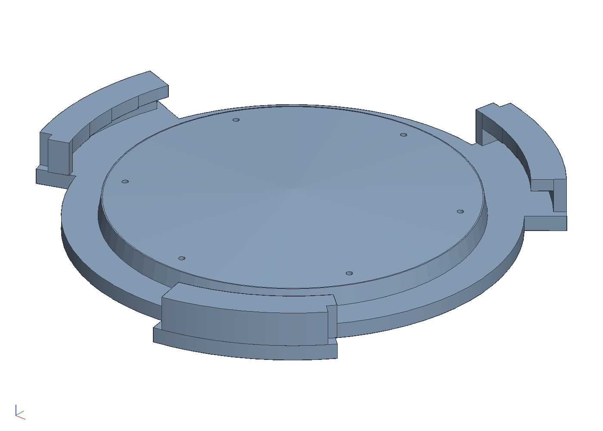
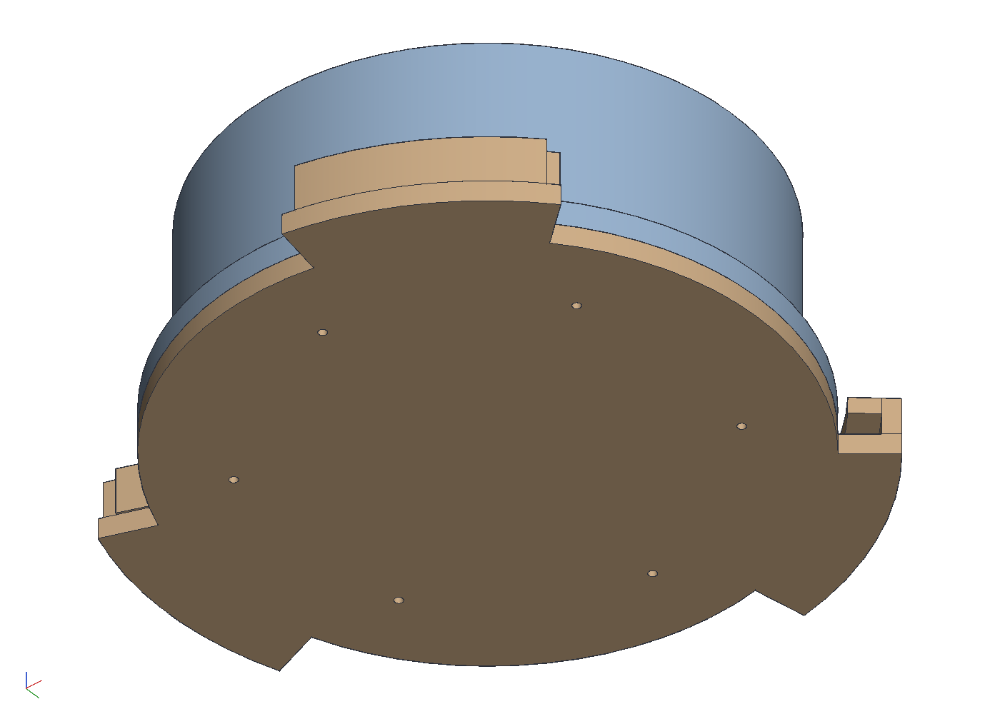
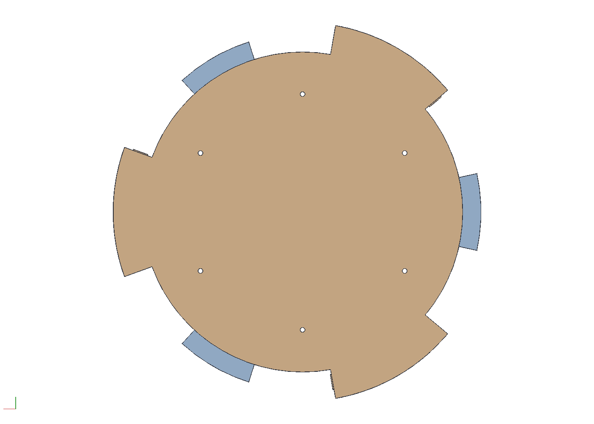

# A bayonet cap for a mesh finch feeder

The finch feeders' mesh tubes end in a thin plastic ring with three
ears outside; the yellow tray twists onto the ears. The tray collects
rain, the seed that falls into it turns to ick, and it perches birds
that cannot cling, which the mesh never did. This keeps the tray's lock
and drops the tray: a plate under the ring with a short plug up into
the ring's bore, level with its top and domed so water runs to the
mesh, and three hooks outside the ring that the ears twist under, each
hook's lip stepped down along its arc so the ear wedges tight the way
it did in the tray. Print it in PETG, offer it up with the ears
between the hooks, and turn it until the ears stop.

```sh
cargo build --release -p ok-mcp
python3 examples/finch-plug/build.py
cargo test -p ok-render --test finch_plug      # what CI runs
```







## The ring's numbers, to confirm

The ring is modelled from photographs with a rule across it, so the
cap can be checked against it; these are the numbers the cap follows
and what to check them with. Calipers on the real ring, then change
the constants at the top of `build.py` and run it again.

| what | mm in the model | check |
|---|---|---|
| bore at the mouth | 59.5 | inside jaws at the mouth, or the gauge |
| bore at the ring's top edge | 58.5 | inside jaws pushed in to the top edge, or the gauge |
| ring thickness, and the ears' | 3 | outside jaws on the flange's edge and on an ear |
| ring outside diameter | 70 | outside jaws between ears |
| across the ears' tips | 78 | outside jaws over an ear and the ring opposite, less the ring's radius, or a rule |
| an ear's width | 17 | outside jaws |
| inside the mesh above the ring | 61 | not critical: the plug stops at the ring's top |

The ones that set the lock are the ears: their thickness sets the
lips' height, their tips set the hook walls, their width sets the gaps
the ears pass through. The bore only sets the plug.

**The gauge.** `out/gauge.stl` finds the bore by feel: a stepped
tube, 56 at the top, every step 0.25 bigger than the one above it,
2 mm a step, down to 62, with a groove round the whole-millimetre
steps to count by. (A first gauge, 46.5 to 49.5 from the first
photographs' scale, fell straight through: the numbers above are the
second reading, from a rule across the ring, and still estimates.) Push the small end up into the mouth: the last step
that enters is the bore at the mouth, the last that drops through the
ring is the bore at its top edge. Print it small end up, one wall.

## The cap

- **Plate and plug.** A 2.5 mm plate out to the ring's edge, with
  three lobes out under the hooks; on it the plug, following the
  ring's drafted bore 0.3 off it, its top level with the ring's top at
  the edge and rising 1.5 to the centre so water runs out to the first
  row of mesh, and six 1 mm drain holes, under a nyjer seed's size.
  The lowest seed lies at the mesh, not in a tray.
- **Hooks.** Three, centred where the ears sit once turned home. Each
  is a wall 2 thick standing 0.4 outside the ears' tips over a 36
  degree arc, a lip 2 thick reaching 3 in over the ear, and a stop at
  the far end. The lip's underside comes down along the arc in four
  steps, 0.6, 0.4, 0.2 and 0 over the ear, so the ear slides in free
  and wedges as it turns, as the tray's ramped hooks had it. The ears
  pass between the hooks with 84 degrees of gap for a 26 degree ear;
  the turn to lock is about 60 degrees, until the ear meets the stop.
  To take it off, turn it back.
- **Nothing to stand on.** The plate is the ring's own size, and the
  hooks stand where the tray's did, 6 mm outside the ring at three
  places. If a finch finds those, the hook walls can lose their
  outside corners.

## What the test checks

`crates/ok-render/tests/finch_plug.rs` regenerates the cap as one
closed body with its plate at the ring's edge between the hooks, its
plug the clearance off the bore with its top level with the ring's,
each hook's wall outside the ears' tips and its lip reaching in over
them with the steps' undersides where the ramp says, down to touching;
six 1 mm drains; the cap meeting the ring nowhere when locked and,
turned by the gap, when offered up; and the gauge's steps reading their
diameters from the smallest at the top and bracketing the bore.
