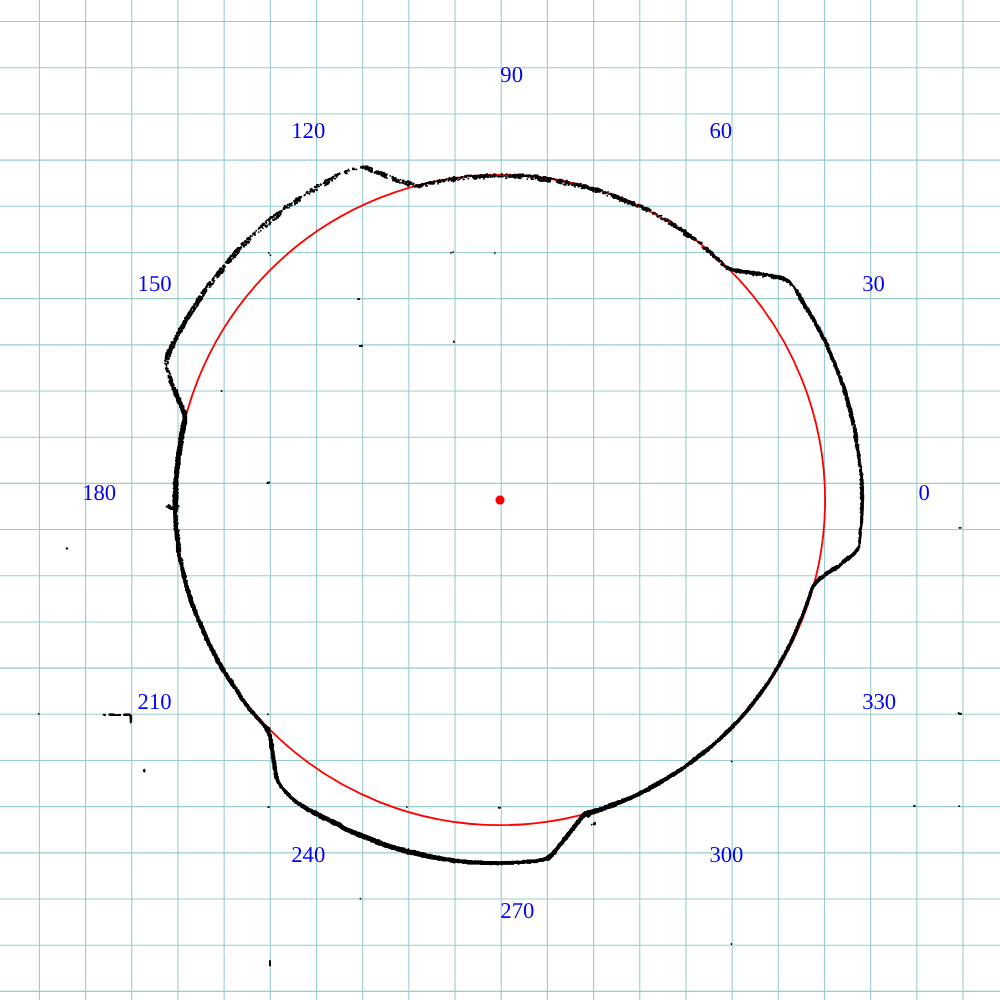
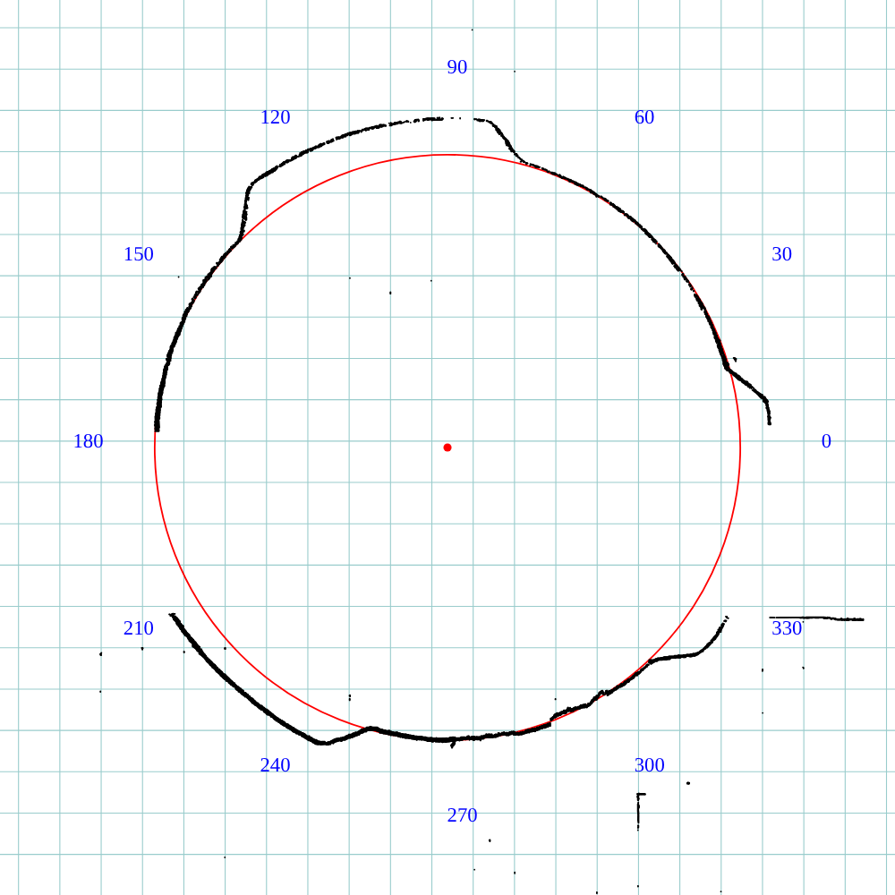

# A bayonet cap for a mesh finch feeder

The finch feeders' mesh tubes end in a thin plastic ring with three
ears outside; the yellow tray twists onto the ears. The tray collects
rain, the seed that falls into it turns to ick, and it perches birds
that cannot cling, which the mesh never did. This keeps the tray's lock
and drops the tray: a plate under the ring with a short plug up into
the ring's bore, level with its top and domed so water runs to the
mesh, and three hooks outside the ring that the ears twist under, each
hook's lip stepped down along its arc so the ear wedges tight the way
it did in the tray. Print it in PETG, offer it up with the ears
between the hooks, and turn it until the ears stop.

```sh
cargo build --release -p ok-mcp
python3 examples/finch-plug/build.py
cargo test -p ok-render --test finch_plug      # what CI runs
```


## The ring's numbers, to confirm

The ring is modelled from a pencil tracing of its flange on
engineering paper (5 squares to the inch) and a rule across its mouth,
so the cap can be checked against it; these are the numbers the cap
follows and what to check them with. Calipers on the real ring, then
change the constants at the top of `build.py` and run it again.





Two tracings (`trace/flange.jpg` and `trace/flange2.jpg`, the second
with a rule across it, measured by the scripts in `trace/`) read the
flange at 71.5 and 72.0 to the pencil's centre, so 71 across the
plastic; the ears 4.0 to 4.4 proud of it, 54 degrees wide (36 mm
across the tips to the pencil, 35 of plastic), 120 degrees apart. The
grid's pitch against the rule confirms 5 squares to the inch.

| what | mm in the model | check |
|---|---|---|
| bore at the mouth | 61 | inside jaws at the mouth, or the gauge (61 by rule) |
| bore at the ring's top edge | 60 | inside jaws pushed in to the top edge, or the gauge |
| the sheet: flange and ears | 0.8 | outside jaws on an ear (stamped steel, under a millimetre) |
| skirt, mouth to the ridge inside | 3 | depth gauge, or a rule in at the mouth to the ridge |
| ring outside diameter | 71 | outside jaws between ears (71.5 and 72 traced, less the pencil) |
| across the ears' tips | 79 | outside jaws over an ear and the ring opposite, less the ring's radius (4 proud, traced) |
| an ear's width | 35 | outside jaws (54 degrees traced; 33 to 35 by rule) |
| inside the mesh above the ring | 62.5 | not critical: the plug stops at the ring's top |

The ones that set the lock are the ears: the sheet's thickness sets the
lips' height, their tips set the hook walls, their width sets the gaps
the ears pass through. The bore only sets the plug.

**The gauge.** `out/gauge.stl` finds the bore by feel: three open
rings in one print, 60, 61 and 62 across, 6 mm tall with a 1.2 mm wall,
notched once, twice and three times on the rim. The 61 is the bore by
rule; one should drop in loose, one should not go, and the one that
just enters is the bore at the mouth. Print them as they come, no
supports; they are a gauge, not a part. (A first gauge, 46.5 to 49.5
from the first photographs' scale, fell straight through, and a second,
56 to 62 in quarter-millimetre steps, was more than was asked for.)

## The cap

- **Plate and plug.** A 2.5 mm plate out to the ring's edge, with
  three lobes out under the hooks; on it the plug, following the
  ring's drafted bore 0.5 off it, its top level with the ring's top at
  the edge and rising 1.5 to the centre so water runs out to the first
  row of mesh, and six 1 mm drain holes, under a nyjer seed's size.
  The lowest seed lies at the mesh, not in a tray.
- **Hooks.** Three, centred where the ears sit once turned home. Each
  is a wall 2 thick standing 0.4 outside the ears' tips over a 36
  degree arc, a lip 2 thick reaching 3 in over the ear, and a stop at
  the far end. The lip's underside comes down along the arc in four
  steps, 0.6, 0.4, 0.2 and 0 over the ear, so the ear slides in free
  and wedges as it turns, as the tray's ramped hooks had it. The ears
  pass between the hooks with 84 degrees of gap for a 51 degree ear.
  The hooks sit 8 degrees ahead of where the ears' centres land, so
  that locked, each ear's leading edge rests against its stop with the
  hook over its leading half; the turn to lock is about 52 degrees.
  To take it off, turn it back.
- **Nothing to stand on.** The plate is the ring's own size, and the
  hooks stand where the tray's did, 6 mm outside the ring at three
  places. If a finch finds those, the hook walls can lose their
  outside corners.

## What the test checks

`crates/ok-render/tests/finch_plug.rs` regenerates the cap as one
closed body with its plate at the ring's edge between the hooks, its
plug the clearance off the bore with its top level with the ring's,
each hook's wall outside the ears' tips and its lip reaching in over
them with the steps' undersides where the ramp says, down to touching;
six 1 mm drains; the cap meeting the ring nowhere when locked and,
turned by the gap, when offered up; and the gauge's three rings reading
their diameters and bracketing the bore.
