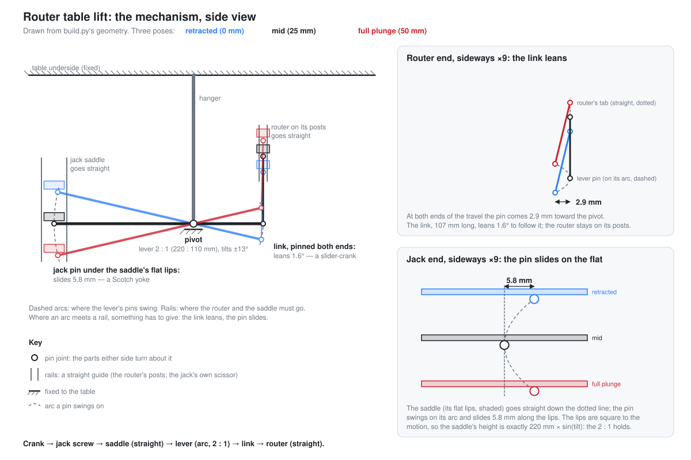
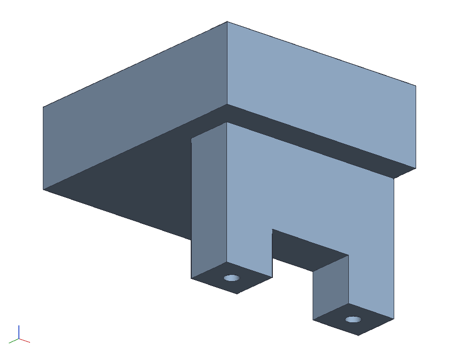

# The Edwardian Lift

A minimal router table with a scissor-jack lift, named for Ed Lane, who
first suggested lifting the router on a scissor jack (he had a lab jack
in mind; the Harbor Freight one won on price). The lever that lets the
jack hang beside the router, so the table stays no taller than the
router, is the author's own.

Preliminary. A plywood box (top, two sides, a back, and a front across
half of it) with the old Makita 3612BR plunge router screwed under the
top. A $23 Harbor Freight scissor jack (Haul-Master 1-1/2 ton) is bolted
upside down under the top beside the router. It lifts the router
through a lever:

1. Turning the crank drives the jack's head **down**. The saddle is off
   the jack; in its place a **printed head** carries one end of a
   birch-ply lever by a pin running in a slot.
2. The lever turns on a bolt through a hanger under the top, so its
   other end comes **up**.
3. That end pulls up a short **link** hung from a tab on a **printed
   replacement for the router's left handle**. This plunges the motor
   and raises the bit.

The crank is a 6 in socket extension that comes out through a slot in
the front. Turn it with a ratchet or a cordless drill.

```sh
cargo build --release -p ok-mcp
python3 examples/jack-table/build.py         # the document, pictures, sheets, parts list and poses
cargo test -p ok-render --test jack_table    # what CI runs
```


## Why it is laid out this way

- **The jack hangs from the top, beside the router.** A jack under the
  router would add its own height (3-3/4 in at least) to the table. Here
  the table is 14-1/4 in tall: the lever's jack end swings to 20 mm off
  the bench at full plunge, and the motor's end is 2-5/16 in up.
- **The lever is 2 to 1.** The pin in the jack head's slot is 220 mm
  from the pivot and the link's bolt is 110 mm. The jack therefore
  moves 100 mm for the router's 50 mm of plunge, and each turn
  moves the bit half as far as it moves the jack.
- **The jack works in its middle.** A scissor jack is fast and coarse
  when nearly closed and slow when open. Its rise per turn is the
  screw's pitch times the cotangent of the arms' angle. This table
  runs the jack from 7.1 to 11.0 in (its range is 3-3/4 to 15-1/8), so
  the arms stay between 17 and 38 degrees.
- **Both ends of the lever are captured.** The lever is three strips of
  1/2 in baltic birch glued up, the middle strip shorter, so each end
  is a fork.
  - **Router end.** The printed handle has a tab below it, and a 3/8
    bolt in the tab carries a 120 mm printed link. The link's other end
    sits in the lever's fork on a 3/8 bolt through both tines. Both
    bolts turn freely, so the router is held both ways and can't bounce
    off the lever.
  - **Jack end.** The jack's saddle (its jacking head) comes off: drill
    out the rivet that holds it and it lifts away, leaving the head seat,
    the channel riveted to the upper forks, with the rivet's hole through
    its face. A printed head bolts to the seat through that hole. Its
    tongue hangs down into the lever's fork, and a 3/8 bolt through the
    tines runs in a slot across the tongue. The slot is open at the
    bottom so the head can be dropped over the pin, then a printed
    keeper screws across the mouth. The jack pushes down on the pin
    through the slot's top; the keeper keeps the pin in if the router
    ever stops pushing back. A skirt round the seat's edges keeps the
    one bolt from letting the head turn.


(`python3 examples/jack-table/schematic.py` redraws it from `build.py`'s geometry.)

- **Straight paths, round lever.** The router and the jack's head move
  straight up and down, but the lever's pins swing on arcs about the
  pivot, so each pin also moves sideways, in toward the pivot, as the
  lever tilts away from level. The lever is level at mid-travel, which
  keeps that drift as small as it can be and the same at both ends: it
  tilts 13 degrees each way, so the router pin comes in 2.9 mm and the
  jack pin 5.8 mm. The router end takes it up by the link leaning,
  1.4 degrees at most; the jack end by the pin sliding along the
  slot's top. That is a Scotch yoke, closed: the slot is square to the
  head's motion, so the jack end's height is exactly 220 mm times the
  sine of the tilt, and the router end's is 110 mm times it less what
  the link's lean costs, under 0.04 % at its worst. The slot is 20 mm
  long, the pin's 5.8 mm of drift and a few to spare, and sits 2.9 mm
  toward the pivot from where the pin is with the lever level.
- **Why a printed handle.** The router's handle mount is a lug cast on
  the housing: a rectangular block standing out from it, with a
  threaded hole and a roll pin in its end. The original handle's
  rectangular stub is hollow. It slips over the lug, and its floor has
  a hole for the screw and one for the pin. The printed handle copies
  that, so it goes on exactly as the original does. The load goes
  through the lug, the pin and the screw, as it does in your hand. The
  tab is the only addition. Keep the original handle to put back for
  freehand work.
- **The crank moves.** The screw sits at the scissor's knuckles, halfway
  between the foot and the head, so it drops half as far as the
  head: 50 mm over the travel. It also moves 26 mm back as the
  knuckles close. The front's slot is vertical and 50 mm long, plus the
  extension's width, and the extension simply slides with the screw.
- **The front stops at the hanger.** The router's half of the box is
  open at the front for the switch, the plunge lock, the cord, and your
  hands at bit changes.

| Retracted | Fully plunged |
|---|---|
|  |  |
|  |  |
|  |  |

## What the numbers give

These are from the build's printout and the test:

| plunge | bit over the table | jack (foot to where its saddle was) | arms | bit per crank turn |
|---|---|---|---|---|
| 0 | 24 mm | 180 mm (7.09 in) | 17.5° | 2.3 mm |
| 12.5 | 37 | 205 (8.07) | 22.2° | 1.7 |
| 25 | 49 | 230 (9.06) | 27.1° | 1.4 |
| 37.5 | 62 | 255 (10.04) | 32.3° | 1.1 |
| 50 | 74 | 280 (11.03) | 37.8° | 0.9 |

The bit's heights are for a bit standing 50 mm out of the Yakamoz
2-1/4 in collet extension.

- **Use the collet extension.** Without it the bit reaches only 17 mm
  above the table: the collet nut sits 64 mm up inside the base, the
  plunge is 50 and the 3/4 ply top takes 19 more. The extension adds
  57 mm, so the travel is 50 mm wherever you want it: set how far the
  bit stands out of the extension so the cut you need falls inside
  it. With 50 mm out, the bit goes from 24 to 74 mm above the table;
  with 25 out, from just under the surface to 49 above. At full plunge
  the extension's own nut stands above the table, so bits change from
  on top, with a wrench through the 2 in hole.

- Going from retracted to fully plunged takes 37 turns: measured, from 7 to 11 in.
- One turn moves the bit 2.3 mm at the bottom of the travel and
  0.9 mm at the top; a quarter turn of a ratchet is a quarter to half
  a millimetre.
- The router's own plunge lock holds the height. Crank to height, then
  lock it; the lever only has to hold while you set it.
- **Both handles are printed short.** Under the table the handles
  stand beside the base with their wide ends up. The lug is 79.75 mm
  below the base face (89 on the bench, less the 9.25 sub-base that
  comes off), and the originals' wide ends reach about 30 mm above it.
  At the router's full 50 mm of plunge the originals would be a
  quarter of a millimetre from the table's underside. The printed
  handles stop 12 mm above the lug's centre, enough to close the stub
  over the lug, and stay 17.8 mm clear at full plunge. No depth stop
  is needed. Keep the originals for freehand work.

## The parts

`out/parts.csv` lists the wood and the hardware. In short:

- **Box:** 3/4 ply, glued and screwed.
  - **Top:** 28 x 24. Its 2 in hole over the bit is 7 in from the right
    edge.
  - **Sides:** 24 x 13-1/2.
  - **Back:** 26-1/2 x 13-1/2, between the sides.
  - **Front:** 10-1/4 x 13-1/2, across the jack's bay only, with the
    crank slot in it.
- **Router:** take off the clear sub-base and screw the base under the
  top through its own sub-base holes, with longer flat-head screws
  countersunk from above. The bit comes up through the 2 in hole; the
  collet extension passes through the 2 in hole, and at full plunge its
  nut stands above the table for bit changes.
- **Jack:** first drill out the rivet on top of the jacking head (part 1
  in the manual's diagram) and lift the saddle (2) off its seat (3);
  open the seat's hole out to 5/16. Then upside down, its foot bolted
  under the top with two 5/16 flat-head bolts through holes drilled in
  the foot's flat, 16 mm further back than the lever's plane so the
  printed head's bolt and nut clear its tongue. On the eye (the
  manual's rocker head), fit a scissor-jack drill adapter (a socket
  with a slot and a cross pin for the eye; any auto parts store has
  one), and on the adapter a 3/8 drive 6 in extension.
- **Hanger:** two 3/4 ply cheeks, 2-1/2 wide, with a hardwood spacer
  between them at the top, screwed down through the top. The pivot is
  a 3/8 x 3-1/2 bolt with a washer each side of the lever, 9-3/4 in
  below the top (the cheeks in `parts.csv` are cut to suit).
- **Lever:** 1/2 in baltic birch, three strips 1-1/2 wide glued up to
  1-1/2 square: two 14.65 in long and one 10.95 in the middle, set in
  52 mm from the jack end and 42 mm from the router end, so each end
  is a fork with a 12 mm gap. The jack head's tongue goes in one fork
  and the link in the other. Glue the two long strips to the short one
  with the short one's ends marked, clamp it straight, and drill the
  three 3/8 holes through all three on the centre line afterwards:
  - the pivot;
  - 110 mm one way, the router pin, through the link's lower hole;
  - 220 mm the other way, the jack pin, through the head's slot.

  Both pins are 3/8 x 2 bolts with nylocks, snug but free to turn.
- **Printed left handle** (`out/handle.stl`, PETG). It has:
  - the original's outline, cut off 12 mm above the lug's centre at
    the wide end;
  - a hollow stub that fits over the lug. The lug tapers, so the
    stub's pocket tapers to match, with 0.3 mm of clearance a side. The
    pocket is 16.37 mm deep, as the original handle's socket, so its floor seats on
    the lug's end and its rim stays clear of the housing;
  - in the stub's floor, a counterbored hole for the original screw and
    a hole for the roll pin;
  - a 10 mm tab 12 mm past the handle's narrow end (toward the motor),
    hanging under the handle just off its centre, for a 3/8 x 1-1/4
    bolt to the link beside it.

  Print it lying on its outer face, with 4 walls and 40 % infill.
- **Printed right handle** (`out/right_handle.stl`, PETG): the left
  one's mirror without the tab. On both lugs the screw is toward the
  front (the label's side) and the pin behind it, so the holes match.
- **Link** (`out/link.stl`, PETG): 11 mm thick, to run in the lever's
  12 mm fork, 20 wide, with 3/8 holes 120 mm apart. Print it flat.
- **Jack head** (`out/jack_head.stl`, PETG). A 12 mm plate the seat's
  face sits on, with a 6 mm skirt round the seat's edges (0.3 mm
  clearance a side) and a hex pocket under it for the head bolt's nut;
  and a tongue, 11 thick and 44 long, down into the lever's fork, with
  a 20 x 10.5 mm slot across it, open at the bottom, that the jack pin
  runs in. Two 3.3 mm holes up into the tongue's legs take the keeper's
  M4 screws. Print it plate down, tongue up, 4 walls, 40 % infill.
  The load path is the seat's face onto the plate and the slot's top
  onto the pin, all in compression; the bolt only holds it on.
- **Keeper** (`out/keeper.stl`, PETG): a 6 mm bar the tongue's size
  that screws across the slot's mouth with two M4 x 16, leaving the pin
  1 mm of room. Print it flat.

- **Fit test** (`out/fit_test.stl`, PETG): the stub alone on a 10 mm
  floor, with the screw hole and the pin hole. Print it first and try
  it on the lug. It should slide on with a little play and seat on the
  lug's end, with the pin in its hole and the screw hole over the
  threaded one. If it's tight or loose, change `CLEAR` in `build.py`;
  if the holes don't line up, change `PIN_SPACING` or `SCREW_SIDE`.

| Outer face | Inner face, over the lug | Fit test | Jack head |
|---|---|---|---|
|  |  |  |  |

`out/jack_table.pdf` is the A3 sheet. `out/lift.pdf` (and `lift.png`)
shows the table from the front at retracted, half plunged and fully
plunged. The front panel hides the jack there; the sections above show
it. `out/jack_table.okpart` is the document. It has:

- one part studio per part;
- the router motor, bit and printed handle as a sub-assembly on a slider
  (`plunge`) along a post;
- the link on a revolute (`link`) about the handle's tab bolt;
- the lever on a revolute (`lever`) about the pivot bolt;
- the jack's arms, head seat, screw and nut trunnion on revolutes about
  their pins, chained from the foot, with the printed head fastened to
  the seat and the keeper to the head.

`out/poses.json` holds every mate's value at five plunge positions. The
script computes them from the link, the lever and the scissor geometry.
The test sets them and checks that the parts agree:
- the link's lower hole lands on the lever's pin;
- the rear arms meet and the screw stays level;
- the printed head bears on the lever's jack pin without passing into
  it, and the keeper sits within a millimetre under the pin.

## What is measured and what is guessed

Every dimension of the router and the jack is a named constant at the
top of `build.py`, each marked S (the maker's specification), M
(measured) or G (guessed from the photos). Replace a guess with a
reading, rebuild, and the test says whether it still works. The
guesses that matter:

| | value | from | what it moves |
|---|---|---|---|
| plunge | 50 mm | M: on this router (the manual says 65) | the jack's travel, at 2 to 1, and how high the bit comes |
| collet nut's end above the base face, retracted | 63.75 mm | M: 73 from the sub-base's face, less its 9.25 | how high the bit comes |
| collet extension | 3-1/4 overall, 1 in of shank in the collet, so 2-1/4 (57 mm) longer; 20, 25 and 36 mm across in steps | M: the listing; G: the diameters, from its photo | how high the bit comes; its 36 mm nut must pass the 2 in hole |
| base face to motor end | 283.75 mm | M: 293 on the sub-base, less its 9.25 | the table's height |
| across the handles | 276 mm | S | where the link goes |
| the lug across (long side) | 26.34 by the housing, 22.8 by the end, 13.4 apart | M: calipers, at two marker lines | the stub's pocket |
| the lug along the router's axis (short side) | 12.9 by the housing, 11.5 by the end | M: calipers, at the same lines | the stub's pocket |
| the end line from the lug's end | 2.8 mm | G: from the photo of its side | the pocket's floor size |
| how far the lug stands out | 17 mm | G: from the photo of its side; it must be more than the original's 16.37 socket | the lever's position |
| lug end face to lug end face | 200 mm | M | where the handles sit, and the lever, hanger and jack with them |
| the original handle's socket depth | 16.37 mm | M: calipers | the printed handle's pocket |
| screw to roll pin, centre to centre | 13.0 mm | M: calipers, in the original handle's socket | the two holes in the stub's floor |
| which side the screw is on | the front (the label's side), the pin behind it, on both lugs | M: photos | the two holes |
| roll pin: diameter, out from the lug | 5.05 mm, 9.9 mm | M: calipers | the pin's hole (5.65, 11.9 deep) |
| handle outline | 91 tall, 48 wide tapering to 39 | M: calipers | the printed handle |
| handle thickness | 50 overall, 33.63 outer face to socket floor | M: calipers | the printed handle |
| the hollow stub, outside | 32 x 18.5 | the pocket's mouth and a 3 mm wall (the earlier 41 x 21 by eye was too big for this lug) | the printed handle |
| the screw | M6 x 39.7, 10.26 head, 12.6 into the lug | M: calipers | the printed handle's hole (6.5), counterbore (11) and the 27.1 mm of plastic under the head, as the original |
| the stub from the handle's middle | 16 mm toward the wide end | M: by eye | where the tab is |
| which end of the handle is toward the base | the wide end, with the lug | M: photo | where the tab is: off the narrow end, toward the motor |
| the lug's centre above the base face, retracted | 79.75 mm | M: 89 from the bench on the 9.25 sub-base, which comes off | the link's length (120 mm now), and the handles' clearance under the table |
| motor diameter, posts | 100 mm, 20 mm at ±64 | G | clearances only |
| jack arm (fork), rivet to the nut's pivot | 160 mm | M | turns per mm, the slot |
| foot and head rivets from the foot's face and where the saddle's was | 42 mm | G: with 160 arms, 15-1/8 high needs about 84 between them | the jack's heights |
| jack screw | the knuckles close 1.42 mm a turn | M: fitted to 37 turns from 7 to 11 in | turns per mm only |
| the head seat's face | 43 along the lever x 50 across, along the screw | M: calipers, the saddle off | the printed head's skirt |
| the seat's face from its rivets to the forks | 23 mm | M: calipers | where the lever and the jack's working band sit |
| the seat's rivet hole | 8.9 mm as drilled out, centred on the face | M | the head bolt, 5/16 with 1 mm of room |

The router, the lever and the seat are measured. What is left to
guesses moves only clearances, or, for the jack's rivets (42 mm from the
foot's face and from where the saddle's was, worked back from its 15-1/8
in height), the turns per mm.

## Open

- [ ] **The jack head.** Print it and try its skirt on the seat before
      building the rest; if it is tight, raise `HEAD_CLEAR` in
      `build.py`.
- [ ] **One-sided push.** The link pulls on one handle, beside one post.
      If the motor cocks and binds on the posts, print a second handle
      for the right side and fork the lever's router end into a yoke
      under both.
- [ ] **Print the fit test** (`out/fit_test.stl`) and try it on the lug
      before the full handle.
- [ ] **A depth stop for repeat setups:** the router's own turret stop
      still works upside down.
