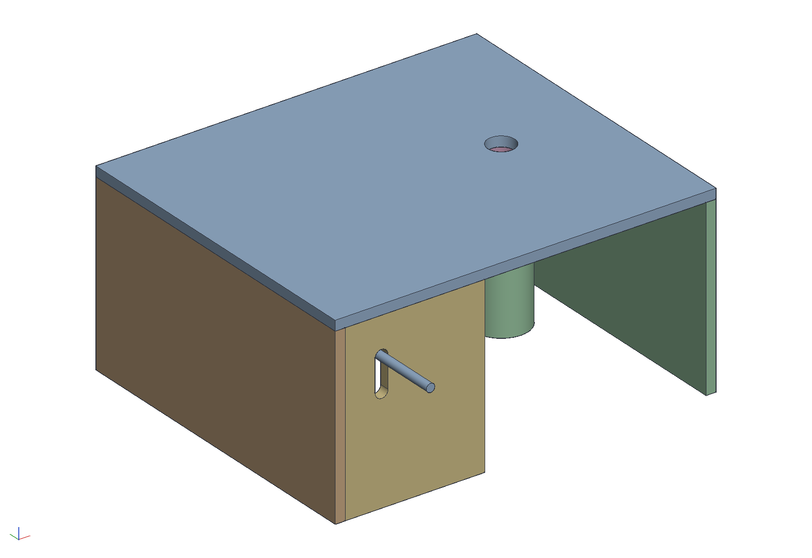
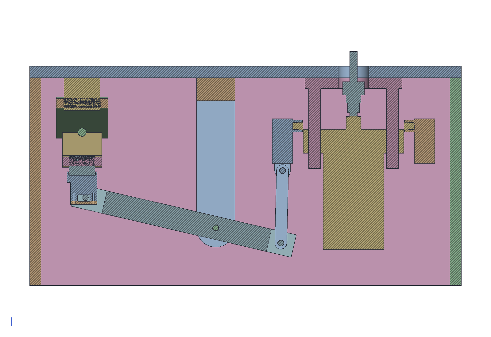
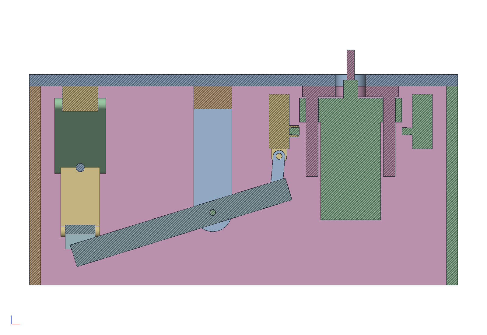
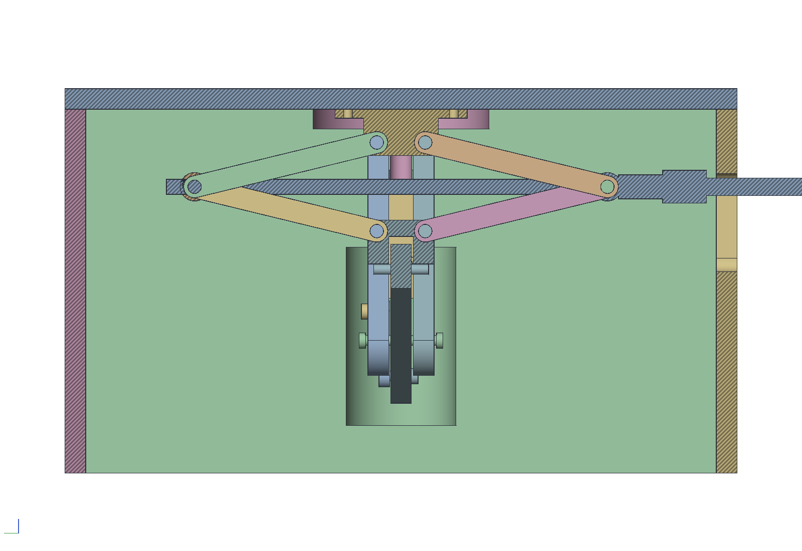
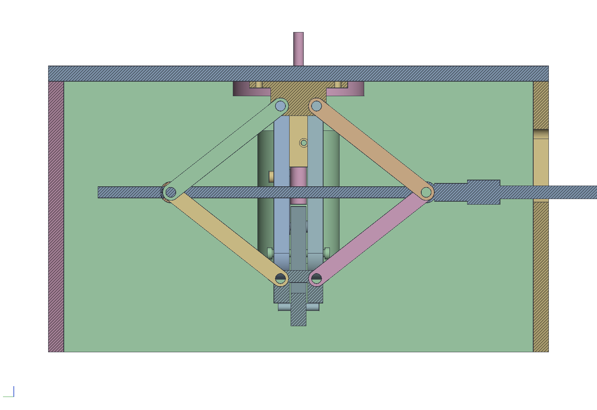
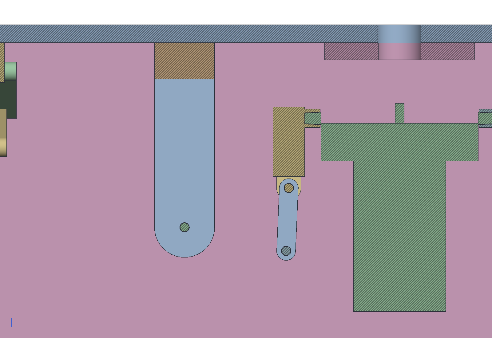
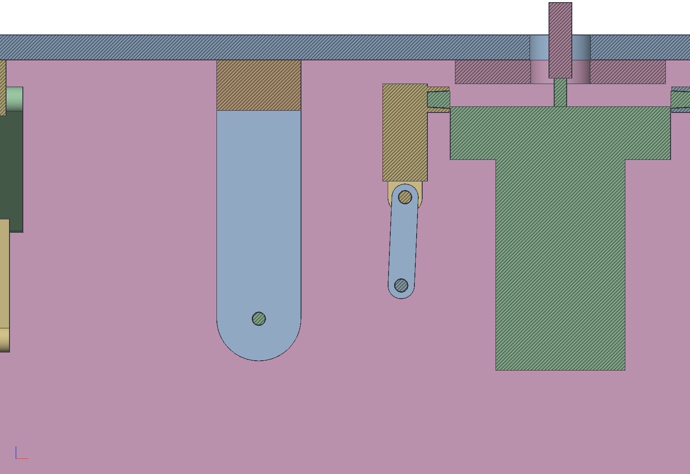
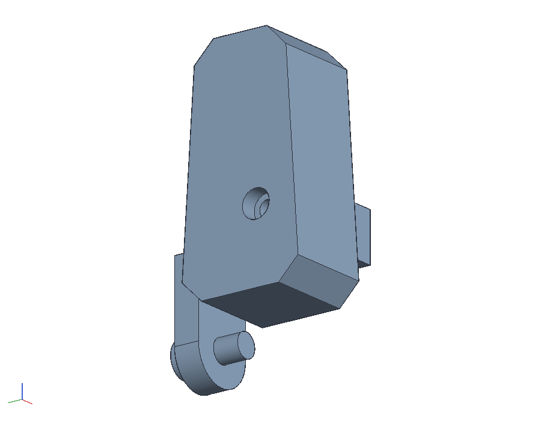
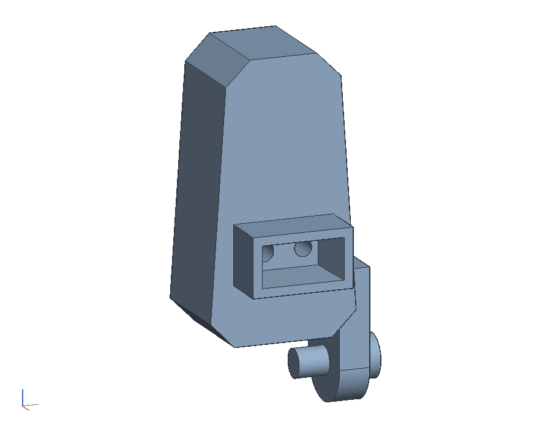
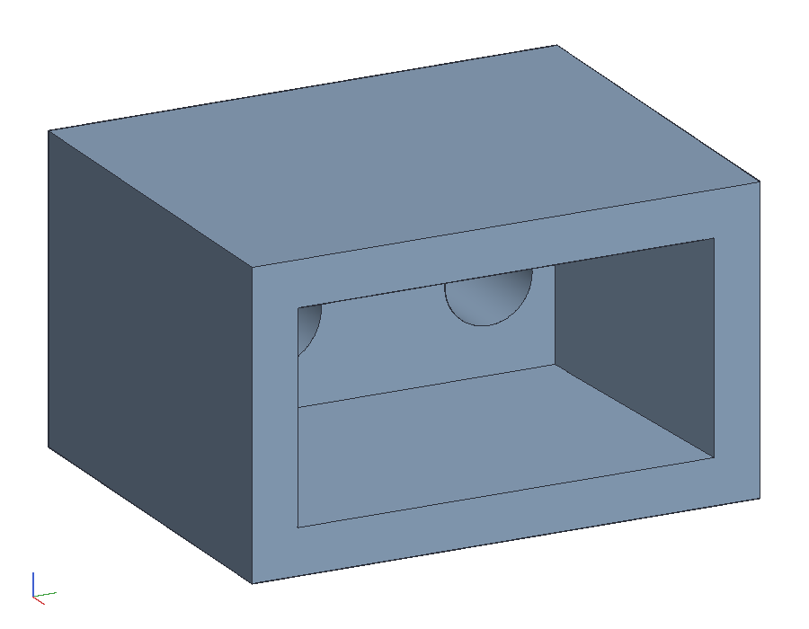

# A minimal router table with a scissor-jack lift

Preliminary. A plywood box (top, two sides, a back, and a front across
half of it) with the old Makita 3612BR plunge router screwed under the
top. A $23 Harbor Freight scissor jack (Haul-Master 1-1/2 ton) is bolted
upside down under the top beside the router. It lifts the router
through a lever:

1. Turning the crank drives the jack's saddle **down** onto one end of a
   hardwood lever.
2. The lever turns on a bolt through a hanger under the top, so its
   other end comes **up**.
3. That end pulls up a short **link** hung from a tab on a **printed
   replacement for the router's left handle**. This plunges the motor
   and raises the bit.

The crank is a 6 in socket extension that comes out through a slot in
the front. Turn it with a ratchet or a cordless drill.

```sh
cargo build --release -p ok-mcp
python3 examples/jack-table/build.py         # the document, pictures, sheets, parts list and poses
cargo test -p ok-render --test jack_table    # what CI runs
```



## Why it is laid out this way

- **The jack hangs from the top, beside the router.** A jack under the
  router would add its own height (3-3/8 in at least) to the table. Here
  the table is 13-3/4 in tall, set by the router: the motor's end is
  1-3/4 in off the bench when it is retracted.
- **The lever is 2 to 1.** The pin under the saddle is 220 mm from the
  pivot and the link's bolt is 110 mm. The jack therefore
  moves 130 mm for the router's whole 65 mm of plunge, and each turn
  moves the bit half as far as it moves the saddle.
- **The jack works in its middle.** A scissor jack is fast and coarse
  when nearly closed and slow when open. Its rise per turn is the
  screw's pitch times the cotangent of the arms' angle. This table
  runs the jack from 5.5 to 10.6 in (its range is 3-3/8 to 15-1/8), so
  the arms stay between 14 and 38 degrees.
- **The router end is linked; the jack end is not.**
  - **Router end.** The printed handle has a tab below it, and a 3/8
    bolt in the tab carries a 59 mm printed link. The link's other end
    is on a 3/8 bolt through the lever. Both bolts turn freely, so the
    router is held both ways and can't bounce off the lever. The link
    takes up the lever end's sideways drift as it swings, about 5
    degrees.
  - **Jack end.** The saddle's groove straddles the lever, and its lips
    sit on the ends of a 3/8 bolt across it. The router's weight
    (5.5 kg) and its plunge springs hold the lever up against the
    saddle. The pin slides about 10 mm under the saddle as the lever
    turns, and the groove keeps the lever in line.
- **Why a printed handle.** The router's handle mount is a lug cast on
  the housing: a rectangular block standing out from it, with a
  threaded hole and a roll pin in its end. The original handle's
  rectangular stub is hollow. It slips over the lug, and its floor has
  a hole for the screw and one for the pin. The printed handle copies
  that, so it goes on exactly as the original does. The load goes
  through the lug, the pin and the screw, as it does in your hand. The
  tab is the only addition. Keep the original handle to put back for
  freehand work.
- **The crank moves.** The screw sits at the scissor's knuckles, halfway
  between the foot and the saddle, so it drops half as far as the
  saddle: 65 mm over the travel. It also moves 34 mm back as the
  knuckles close. The front's slot is vertical and 65 mm long, plus the
  extension's width, and the extension simply slides with the screw.
- **The front stops at the hanger.** The router's half of the box is
  open at the front for the switch, the plunge lock, the cord, and your
  hands at bit changes.

| Retracted | Fully plunged |
|---|---|
|  |  |
|  |  |
|  |  |

## What the numbers give

These are from the build's printout and the test:

| plunge | bit over the table | jack (foot to saddle) | arms | bit per crank turn |
|---|---|---|---|---|
| 0 | −24 mm | 140 mm (5.53 in) | 13.7° | 4.1 mm |
| 16 | −8 | 172 (6.79) | 19.3° | 2.9 |
| 32.5 | 8 | 205 (8.07) | 25.2° | 2.1 |
| 49 | 25 | 238 (9.35) | 31.5° | 1.6 |
| 65 | 41 | 270 (10.65) | 38.2° | 1.3 |

- Going from retracted to fully plunged takes about 32 turns, with a
  2 mm screw pitch guessed.
- Where bits are usually set (around the table's surface), one turn
  moves the bit about 2 mm. A quarter turn of a ratchet is half a
  millimetre.
- The router's own plunge lock holds the height. Crank to height, then
  lock it; the lever only has to hold while you set it.

## The parts

`out/parts.csv` lists the wood and the hardware. In short:

- **Box:** 3/4 ply, glued and screwed.
  - **Top:** 28 x 24. Its 2 in hole over the bit is 7 in from the right
    edge.
  - **Sides:** 24 x 13.
  - **Back:** 26-1/2 x 13, between the sides.
  - **Front:** 10-1/4 x 13, across the jack's bay only, with the crank
    slot in it.
- **Router:** take off the clear sub-base and screw the base under the
  top through its own sub-base holes, with longer flat-head screws
  countersunk from above. The bit comes up through the 2 in hole; the
  collet nut's top reaches 9 mm under the surface at full plunge.
- **Jack:** upside down, its foot bolted under the top with two 5/16
  flat-head bolts through holes drilled in the foot's flat. On the eye,
  fit a scissor-jack drill adapter (a socket with a slot and a cross pin
  for the eye; any auto parts store has one), and on the adapter a 3/8
  drive 6 in extension.
- **Hanger:** two 3/4 ply cheeks, 2-1/2 wide, with a hardwood spacer
  between them at the top, screwed down through the top. The pivot is
  a 3/8 bolt with a washer each side of the lever, about 8-1/4 in below the
  top.
- **Lever:** hardwood, 3/4 x 1-1/2 x 14-3/4. It has three 3/8 holes on
  its centre line:
  - the pivot;
  - 110 mm one way, the router pin;
  - 220 mm the other way, the jack pin.

  The jack pin is a 3/8 x 2 bolt with a nut. The router pin is a 3/8 x
  1-1/4 bolt, its head on the lever's back face, through the lever and
  the link, with a nylock.
- **Printed handle** (`out/handle.stl`, PETG). It has:
  - the original's outline;
  - a hollow stub that fits over the lug. The lug tapers, so the
    stub's pocket tapers to match, with 0.3 mm of clearance a side. The
    pocket is 16.37 mm deep, as the original handle's socket, so its floor seats on
    the lug's end and its rim stays clear of the housing;
  - in the stub's floor, a counterbored hole for the original screw and
    a hole for the roll pin;
  - a 10 mm tab 12 mm below the handle's wide end, on the lever's side,
    for a 3/8 x 1-1/4 bolt to the link.

  Print it lying on its outer face, with 4 walls and 40 % infill.
- **Link** (`out/link.stl`, PETG): 10 mm thick, 20 wide, with 3/8 holes
  59 mm apart. Print it flat.

- **Fit test** (`out/fit_test.stl`, PETG): the stub alone on a 10 mm
  floor, with the screw hole and the pin hole. Print it first and try
  it on the lug. It should slide on with a little play and seat on the
  lug's end, with the pin in its hole and the screw hole over the
  threaded one. If it's tight or loose, change `CLEAR` in `build.py`;
  if the holes don't line up, change `PIN_SPACING` or `SCREW_SIDE`.

| Outer face | Inner face, over the lug | Fit test |
|---|---|---|
|  |  |  |

`out/jack_table.pdf` is the A3 sheet. `out/lift.pdf` (and `lift.png`)
shows the table from the front at retracted, half plunged and fully
plunged. The front panel hides the jack there; the sections above show
it. `out/jack_table.okpart` is the document. It has:

- one part studio per part;
- the router motor, bit and printed handle as a sub-assembly on a slider
  (`plunge`) along a post;
- the link on a revolute (`link`) about the handle's tab bolt;
- the lever on a revolute (`lever`) about the pivot bolt;
- the jack's arms, saddle, screw and nut trunnion on revolutes about
  their pins, chained from the foot.

`out/poses.json` holds every mate's value at five plunge positions. The
script computes them from the link, the lever and the scissor geometry.
The test sets them and checks that the parts agree:
- the link's lower hole lands on the lever's pin;
- the rear arms meet and the screw stays level;
- the lever touches the saddle without passing into it.

## What is measured and what is guessed

Every dimension of the router and the jack is a named constant at the
top of `build.py`, each marked S (the maker's specification), M
(measured) or G (guessed from the photos). Replace a guess with a
reading, rebuild, and the test says whether it still works. The
guesses that matter:

| | value | from | what it moves |
|---|---|---|---|
| plunge | 65 mm | S: the manual | the jack's travel, at 2 to 1 |
| base face to motor end | 287 mm | S: overall height | the table's height |
| across the handles | 276 mm | S | where the link goes |
| the lug across (long side) | 26.34 by the housing, 22.8 by the end, 13.4 apart | M: calipers, at two marker lines | the stub's pocket |
| the lug along the router's axis (short side) | 12.9 by the housing, 11.5 by the end | M: calipers, at the same lines | the stub's pocket |
| the end line from the lug's end | 2.8 mm | G: from the photo of its side | the pocket's floor size |
| how far the lug stands out | 17 mm | G: from the photo of its side; it must be more than the original's 16.37 socket | the lever's position |
| the original handle's socket depth | 16.37 mm | M: calipers | the printed handle's pocket |
| screw to roll pin, centre to centre | 13.0 mm | M: calipers, in the original handle's socket | the two holes in the stub's floor |
| which side the screw is on | the front | G | the two holes |
| roll pin: diameter, out from the lug | 5.05 mm, 9.9 mm | M: calipers | the pin's hole (5.65, 11.9 deep) |
| handle outline | 91 tall, 48 wide tapering to 38 | M: 91 and 48 by calipers; G: the narrow end | the printed handle |
| handle thickness | 50 overall, 33.63 outer face to socket floor | M: calipers | the printed handle |
| the hollow stub, outside | 32 x 18.5 | the pocket's mouth and a 3 mm wall (the earlier 41 x 21 by eye was too big for this lug) | the printed handle |
| the screw | M6 x 39.7, 10.26 head, 12.6 into the lug | M: calipers | the printed handle's hole (6.5), counterbore (11) and the 27.1 mm of plastic under the head, as the original |
| the stub from the handle's middle | 16 mm toward the wide end | M: by eye | where the tab is |
| which end of the handle is toward the motor | the wide end | G | where the tab is |
| the lug's centre below the base face, retracted | 140 mm | G: higher, and the handles come up into the table at full plunge (11.5 mm under it now) | the link's length (59 mm now) |
| motor diameter, posts | 100 mm, 20 mm at ±64 | G | clearances only |
| jack arm, pin to pin | 170 mm | G: from 17 in long, 15-1/8 high | turns per mm, the slot |
| foot and saddle pins from their faces | 30 mm | G | the jack's heights |
| jack screw pitch | 2 mm | G | turns per mm only |
| saddle groove across the screw, 22 wide x 25 deep | | G | whether the lever fits between the lips |

To measure on the router, have it retracted (posts fully out) and the
base on a flat surface:

1. The height of the lug's centre above the base's face, and which end
   of the handle (wide or narrow) is toward the base.
2. The original handle's width at its narrow end (the lug, the pin,
   the socket, the screw, the thickness, the height and the wide end
   are done).
3. With calipers on the original handle: its height, its width at both
   ends, its thickness, and the stub's outside.
4. The distance across from one lug's end to the other.
5. The plunge from fully out to fully in.

On the jack:

1. The distance between the arm pins.
2. The number of crank turns to go from 5-1/2 in to 10-5/8 in.
3. Which way the saddle's groove runs, and how wide and deep it is.

## Open

- [ ] **The saddle.** If the groove runs along the screw rather than
      across it, or it is narrower than 7/8 in, bolt a hardwood shoe with
      a 7/8 slot across it under the saddle. Two hose clamps round the
      saddle's lips will hold it.
- [ ] **One-sided push.** The link pulls on one handle, beside one post.
      If the motor cocks and binds on the posts, print a second handle
      for the right side and fork the lever's router end into a yoke
      under both.
- [ ] **Print the fit test** (`out/fit_test.stl`) and try it on the lug
      before the full handle.
- [ ] **A depth stop for repeat setups:** the router's own turret stop
      still works upside down.
