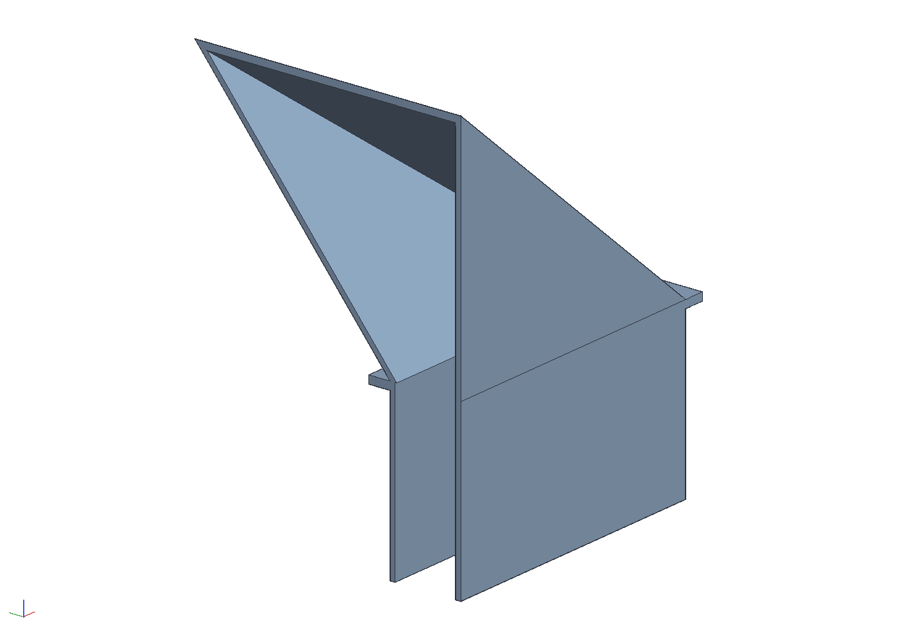

# A leaf blower adapter for an LG dryer's lint duct

Xypher2000's [Samsung Dryer Lint Trap Leaf Blower
Adapter](https://www.thingiverse.com/thing:7021003) jams a leaf
blower's nozzle into a tapered socket and spreads the air through a
thin-walled wedge into a half-moon end the size of the Samsung filter,
which goes down the filter's slot and blows the lint out through the
dryer's own blower and vent hose. An LG dryer's filter (ADQ56656401)
is a near-square frame that drops into a straight slot at the bottom
of the door opening, so this redraws the end for that slot and keeps
the socket: a rectangular stub the slot's size with 2 mm walls, open at
the bottom, a flange that stops on the slot's lip, and the wedge
lofting from it up to the Samsung part's socket, measured off its STL.
One printed part, `out/adapter.stl`, or the same in three for a 256 mm
bed, and a comb of teeth, `out/slot_gauge.stl`, that prints first to
find the slot's width.

```sh
cargo build --release -p ok-mcp
python3 examples/lint-blower/build.py
cargo test -p ok-render --test lint_blower      # what CI runs
```


## Measure these first

The LG numbers in `build.py` are the published ones for the filter;
the slot itself is not published anywhere, and LG made two widths of
filter (11.88 and 11.24 in), so measure before printing 300 g of
plastic. Change the constants at the top of `build.py` and run it
again.

| what | mm in the model | check |
|---|---|---|
| `SLOT_L`, the slot along the door opening, filter out | 303 (11-15/16 in, the filter's width) | a rule across the slot; the stub is this less 2 |
| `SLOT_W`, across the slot | 28.6 (1-1/8 in, the filter's top bar) | the gauge, or a rule; the stub is this less 2 |
| `STUB_D`, how far the stub goes down | 60 | a rule down the slot to the first thing in the way (the guide, a sensor bar) |
| `FLANGE_OUT`, the flange past the stub at the front and the ends | 8 | that the lip round the slot is flat that far; the back stays flush with the stub |
| the blower's nozzle | 65 at the throat opening to 86, 19° half angle | the nozzle's diameter where it should seat; it is the Samsung part's socket, so a nozzle that fits that fits this |

The slot's width is the number that matters and the one a photograph
cannot give. The three parts photographed on the supplier's inch grid
(the cover guide with the grille, the filter and the filter guide)
read 12.4 in across the filter's frame, 4 per cent over the published
11-15/16 because the grid lies behind the part; the top bar's
thickness is into the picture and invisible. If the slot takes only
the filter's thin frame and the top bar sits above it, `SLOT_W` will
be nearer 10 than 28, and the stub's bore shrinks to a 6 by 299 mm
slit, which still passes a blower's air, faster.

**The gauge.** `out/slot_gauge.stl` is a comb: a spine with eleven
teeth under it, 10 to 30 mm thick in steps of 2, 8 wide, 20 long, the
thinnest at the notched end. Lower it into the slot thin end first;
the teeth that fit go down and the rest sit on the lip, and the last
tooth down is the slot's width to within 2 mm. Print it as it comes,
spine on the bed, any infill.

## What it is

Coordinates are the dryer's: x along the slot, y from the back face
toward the user, z up with the slot's lip at zero.

| part | size | what it does |
|------|------|--------------|
| stub | 301 × 26.6 outside, 60 down, 2 mm walls, open at the bottom | drops into the slot in place of the filter and sends the air down the duct |
| flange | 3 thick, 8 past the stub at the front and both ends, flush at the back | stops on the slot's lip; the back face is flat from the stub to the socket, for printing |
| wedge | a loft, 90 tall, from the stub's section to the socket's 90 × 100 | the Samsung part's wedge, drawn longer so the front leans 39° and the ends 50° instead of 59°; the walls are inset 2.6 and 3.1 in the plane so they are 2 through |
| socket | a box 90 along the slot by 100, 53 tall at the back and 18 at the front | the Samsung part's: the mouth tilts 19° toward the user, and behind the axis the box is hollow, as in the STL (`BACK_OPEN`) |
| cone | 65 where it meets the wedge, 19° half angle, to 86 at the end walls | the Samsung part's funnel: a nozzle between 65 and 86 across jams in it |

## Where the numbers came from

The Samsung STL (1108 facets, 253 × 100 × 310 mm, 293 cm³) sectioned
every millimetre with `trimesh`:

| feature | in the STL | here |
|---|---|---|
| back face | the plate at y 48..50, flat across the whole part | y 0, flat from the stub to the socket's top |
| socket box | z 110..200 (90) by y −50..50 (100), x −126.5..−73 at the back, −91..−73 at the front | 90 × 100, 53 at the back, 18 at the front |
| bore | radius 32.5 at x −74 growing 0.345 per mm (19°) to 38.4 at x −91 | 65 at the throat, 19° |
| behind the axis | hollow, a box y 0..48 by z 112..198 | hollow, 2 mm walls |
| wedge | x −73 to −8, from the box's section to 53.5 × 310 | 90 tall, from 90 × 100 to 26.6 × 301 |
| end | a D 310 across and 134 deep, 2 mm plate behind, 2 mm skin in front on a D 73 deep, open round the arc | a stub 301 × 26.6, 60 deep, open at the bottom |

The D is the Samsung filter's outline (DC97-16742A, 12.2 × 5.5 in);
the open crescent between the two arcs is what lets the air out into
the housing below the slot, which the stub's open bottom does here.

## Printing

The parts are modelled standing as they sit in the dryer, stub down,
and print that way: the stub's open end on the bed with a brim, the
wedge leaning 39° at the front and 50° at the ends, which prints
without support, the cone widening upward at 19°, and one bridge to
support, the underside of the socket's front block over the wedge
(86 by 48) and the 8 mm flange lip. Nothing goes inside the duct, so
nothing has to come out of it. PETG, 0.2 mm layers, three perimeters,
which makes the 2 mm walls solid.

**One piece** (`out/adapter.stl`) is 317 wide, so it wants a bed over
320 mm, lying on its back if the printer is low; 276 cm³, about 350 g
in PETG.

**Three pieces** (`out/middle.stl`, `out/left_wing.stl`,
`out/right_wing.stl`) for a 256 mm bed such as a Bambu P1S: the cuts
are at the socket box's ends, so the socket, the part the nozzle jams
into, stays whole in the middle piece (110 × 100, 206 tall) and the
wings (114 × 100, 153 tall) are only wedge, flange and stub. The
middle piece carries four tabs, 2 mm thick, down its back and front
inner walls, fused 10 mm into its own walls and reaching 10 mm into
the wings 0.2 mm inside theirs, so the wings slide on, line up on
their own, and glue along four strips of 130 mm. The tabs stop below
the wedge's end walls and above the stub's bottom edge. Standing, the
tabs are vertical sheets and need no support. Glue with CA or epoxy
and let it cure before the first blow. The three together are 298 cm³.



