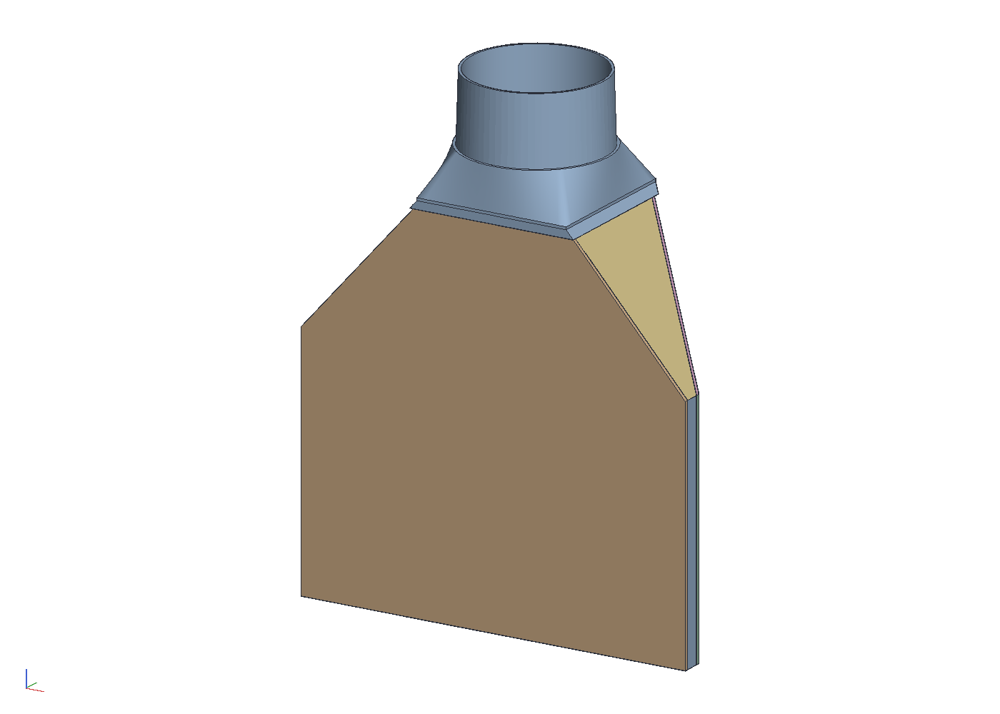
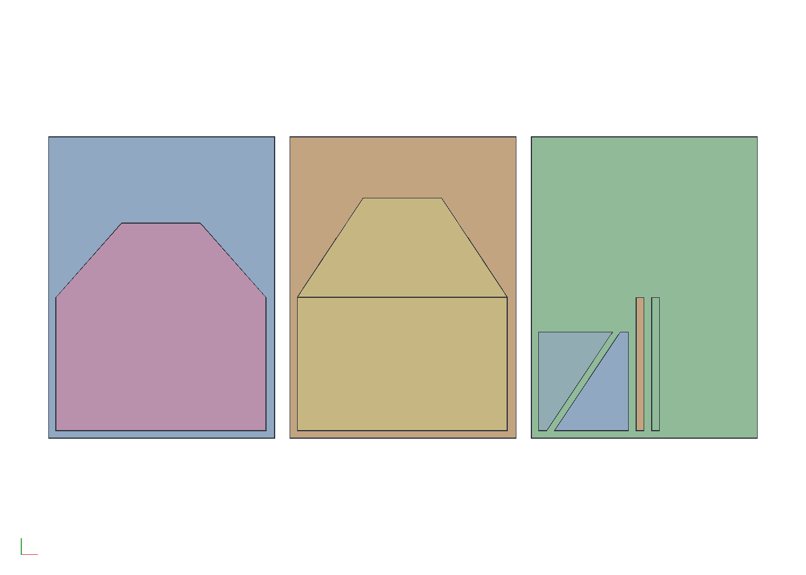
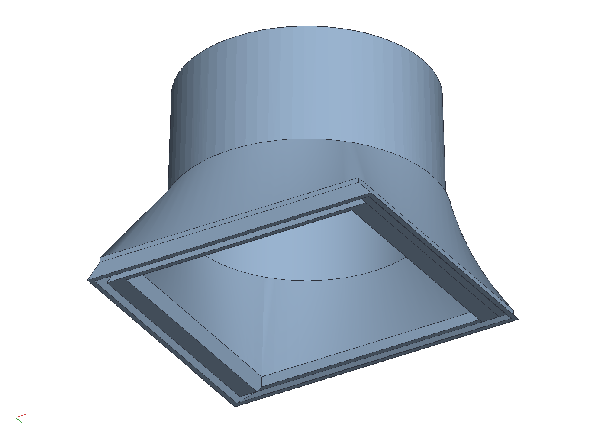

# A leaf blower adapter for an LG dryer's lint duct

Xypher2000's [Samsung Dryer Lint Trap Leaf Blower
Adapter](https://www.thingiverse.com/thing:7021003) jams a leaf
blower's nozzle into a tapered socket and spreads the air through a
thin-walled wedge into a half-moon end the size of the Samsung filter,
which goes down the filter's slot. That end is the part that matters:
its full plate blanks the housing's grille, so the air has no way back
into the drum and goes down the duct, out through the dryer's own
blower and vent hose. An LG dryer's filter (ADQ56656401) is a
near-square frame 18 mm thick standing in a straight slot at the
bottom of the door opening, so this redraws the end for that slot: a
blade the frame's width and thickness less clearance, 180 deep, an
inch past the grille's last holes, a closed box open only at its top
and its bottom edge so it goes in either way round, up into a sleeve
under the wedge. And since the owner connects the blower through a
length of leaf vac hose, not by its nozzle, the Samsung part's funnel
becomes a tapered round spigot the hose jams onto. Two
printed parts, `out/adapter.stl` and `out/blade.stl`, or the same in
five for a 256 mm bed.

```sh
cargo build --release -p ok-mcp
python3 examples/lint-blower/build.py
cargo test -p ok-render --test lint_blower      # what CI runs
```


## How it works

Pull the filter out. The slot it stood in has two ways out: down the
duct to the blower, and straight back through the grille into the drum
and the open door. The blade goes down the slot in the filter's place
and blanks the grille from inside; the sleeve and flange sit on the
lip where the filter's top edge was flush; the blower's air comes down
the wedge into the blade's open top and leaves at its open bottom edge,
below the grille, with nowhere to go but the duct. Both faces of the
blade are solid, so there is no wrong way to put it in.

## The numbers, and where they came from

| what | mm | from |
|---|---|---|
| `FRAME_T`, the frame's thickness | 18, the same everywhere | caliper |
| `FRAME_W`, the frame's width, rim to rim | 285 | a steel rule across it, read off photographs, gave 285 to 286; the fit test's two slices at 284 together were a little wider than the frame, so 285; the field photograph had read 288 to 294, the frame's 18 mm height adding parallax the tool does not know about |
| `EARS_W`, across the ears at the top corners | 306 | the field photograph; LG publishes 11-15/16 in |
| `FRAME_H`, bottom edge to the ears | 287 | the field photograph |
| `LIP_DIP`, how far the top edge's arc dips below the ears at the centre | 47 (R 218) | the field photograph; the lip is that arc |
| `HOSE_ID`, the hose's inside diameter | 100 | a rule across its end; it is corrugated to the end, no cuff |
| `GRILLE_D`, how far below the lip's ends the grille's last holes reach | 152 | 6 in by the owner's eye; 130 to 135 at the arc's centre on the cover guide's supplier photo on its inch grid, less at the ends |
| the frame's bottom corners | R 80, starting 80 above the bottom edge | the field photograph; the blade ends 100 above them, so they do not figure |

The field photograph is the filter on the 2x2 measuring field
(`out/measuring_field_2x2.pdf`: four Letter pages at 100 %, cut on the
dashed lines, overlapped and taped into one 467 × 354 mm field, marks
every 50 mm). `measure_photo` squared it up on all 39 marks at 0.31 mm
per pixel but did not pick the light grey frame off the white paper as
a part, so the outline was traced off its rectified picture; a filter
this size covers the marks of a single sheet, which is what the field
is for.

The first right half was printed at 144 from the joint, from the
field photograph's 290, and laid on the frame it showed the frame to
be narrower; a rule put the frame at 286. So the blade's right rail is
pinned where that half put it (`RIGHT_HALF_W`) and the frame's width
sets the left half alone, the joint 2.5 mm off centre.

Tried in the dryer, the two halves at 283 together go down the slot
and stop where the housing's left corner begins to turn, which on this
dryer is higher than the right one, so 180 is the depth to keep: the
blade seats on the housing's own corner, with the flange on the lip
above it.

The blade is drawn 1 mm inside the frame's width each side and 0.5
inside its thickness each face: the frame is what fits the slot, so
the blade copies it with room for a print's error. If the blade binds,
`CLEAR_W` and `CLEAR_T` at the top of `build.py` are the numbers to
open; if it rattles, close them.

## What it is

Coordinates are the dryer's: x along the slot, y from the back face
toward the user, z up with the slot's lip at zero.

| part | size | what it does |
|------|------|--------------|
| blade | 283 × 17 outside, 2 mm walls, 180 below the lip and 19 up the sleeve, two ribs face to face, square corners | the dummy filter: blanks the grille, carries the air down, open at the top and the bottom edge only |
| sleeve | 292.4 × 21.4 outside, 20 tall, standing on the lip | the blade slides up into it 0.2 a side and glues |
| flange | 3 thick, 8 past the sleeve at the front and both ends, flush at the back | rests on the lip's ends, where the filter's ears do |
| wedge | a loft, 100 tall, from the sleeve's section to a 106 square, the spigot's foot and a wall | the Samsung part's wedge, drawn longer so the front leans 40° and the ends 43°, under the 45° a print without support allows; the walls are inset 2.6 and 2.8 in the plane so they are 2 through |
| square to round | a loft, 30 tall, from the square to a circle of 106 | the corners come in 22 mm over 30, 36° |
| spigot | a cone 50 tall, 99 across at the tip and 102 at the foot (1.7°), 2 mm wall at the tip over a straight 95 bore | the 100 hose starts over the tip freely, screws on a few ribs and wedges before the foot, the square's shoulder the stop |

The Samsung STL (1108 facets, 253 × 100 × 310 mm, 293 cm³) sectioned
every millimetre with `trimesh` gave its socket, which the first
drafts kept: a box z 110..200 by y −50..50, x −126.5..−73 at the back
and −91..−73 at the front; a bore of radius 32.5 at x −74 growing
0.345 per mm, 19°, to 38.4 at x −91, a funnel a nozzle jams into; the
back half of the box hollow; the back face one flat plate. Its end is
a D 310 across and 134 deep, the Samsung filter's outline, a plate
behind and a shorter skin in front, open round the arc: the plate is
what blanks that dryer's grille, and the blade here does its job.

## In sheet, with printed joints

`build_sheet.py` is the same adapter made from 3 mm ABS sheet (12 ×
16 in pieces, six to a pack) with only the joints printed, an exercise
in how much printing flat stock saves after the all-printed middle
piece, 200 mm tall on a 2 mm-wall foot, fell over on the plate.

```sh
python3 examples/lint-blower/build_sheet.py
cargo test -p ok-render --test lint_blower_sheet
```





**Sheet, from three of the six pieces** (`out/panels.dxf` is 1:1,
`out/panels.pdf` the overview):

| piece | edges | sheet |
|---|---|---|
| back | 283 along the bottom, 180 up the blade, 133.5 up the wedge's corner, 106 across the top: one piece, vertical, no bend | 1 |
| front | the same below the lip, 160.5 up the wedge's corner above it: one piece, bent 42° at the lip on the scored line, with a heat gun over a straightedge | 2 |
| two ends | 11 at the bottom, 100 at the top, 133.5 up the back corner and 160.5 up the front one: the left is the right flipped, so cut it face down; they nest | 3 |
| two ribs | 11 × 180 strips | 3 |

The front is one piece because the sheet heat-forms and a bend is the
best joint there: a printed fold bar for a 138° fold presents one leg
at a 48° overhang whichever way it lies on the plate, so there is none.
The ends sit between the back and the front, inside their faces, and
glue to them along the corners with CA or acetone; tape as well if you
like.

**Printed:** four bars 10 × 11 × 180 (`out/bar.stl`, print four) that
the faces glue to, two at the blade's ends and two as ribs a third of
the way in, which set the blade's 17 mm; and the cap (`out/cap.stl`),
a skirt round the panels' tops with a 3.2 × 6 groove in its underside
they go up into, leaning as the panels lean, the square rounding to
the spigot's circle and the tapered spigot above, 121 × 110 × 88,
standing on its skirt. About 20 cm³ a bar and 130 for the cap, against
560 for the all-printed adapter and blade.



Glue the bars to one face first, the ribs a third of the way in, then
the other face on; bend the front before the bars go on. Panels into
the cap's groove with the glue, the corners last. Nothing stops on the
lip but the blade's own corner, as the fit test found.

## Printing

The parts are modelled as they sit in the dryer and print standing
that way, which puts nothing inside the ducts.

**The adapter** (`out/adapter.stl`, 303 wide, 195 tall) stands on the
sleeve's foot with a brim; the wedge leans 40° at the front and 43° at
the ends, the square rounds to the spigot at 36°, the spigot widens
downward at under 2°, and the tabs start on the bed: nothing needs support
but the flange lip, 8 mm out at 3 mm up. **The blade** (`out/blade.stl`, 283 × 199 × 17) stands
on its bottom edge too, as exported, so nothing bridges: both faces,
the rails, the ribs and the halves' lap strips are vertical and start
on the bed. Lying on a face would make the upper face a bridge the
width of a bay. PETG, 0.2 mm layers,
three perimeters, which makes the 2 mm walls solid. About 217 and
249 cm³, 280 and 320 g in PETG.

**Five pieces for a 256 mm bed** such as a Bambu P1S:

| piece | size | |
|---|---|---|
| `out/middle.stl` | 124 × 104 × 195 | the spigot, the square and the wedge's middle and the sleeve's, with four tabs |
| `out/left_wing.stl`, `out/right_wing.stl` | 97 and 102 × 104 × 120 | the wedge's ends, the sleeve's and the flange's |
| `out/left_blade.stl`, `out/right_blade.stl` | 139 and 152 × 17 × 199 | the blade halves, standing, the right one with two lap strips |

The wedge's cuts are at the square's sides, under the spigot. The middle piece
carries four 2 mm tabs down its back and front inner walls, fused
10 mm into its own walls and reaching 10 mm into the wings 0.2 inside
theirs, so the wings slide on and glue along four strips. The blade's
halves meet at the middle; the right half's two lap strips, 8 wide
and 1.2 thick inside each face, go under the left half's plates and
glue, and the sleeve holds both halves at the top. Glue with CA or
epoxy, the blade's halves first, then the wings to the middle, then
the blade up the sleeve, and let it cure before the first blow.

**Fit test first.** `out/fit_test.stl` is the bottom 20 mm of both
halves, standing 12 mm apart in two rows on the plate, 32 g and under half an
hour: slide them together on the laps, drop them in the slot, and the
width and the thickness are tried before the halves are printed.


