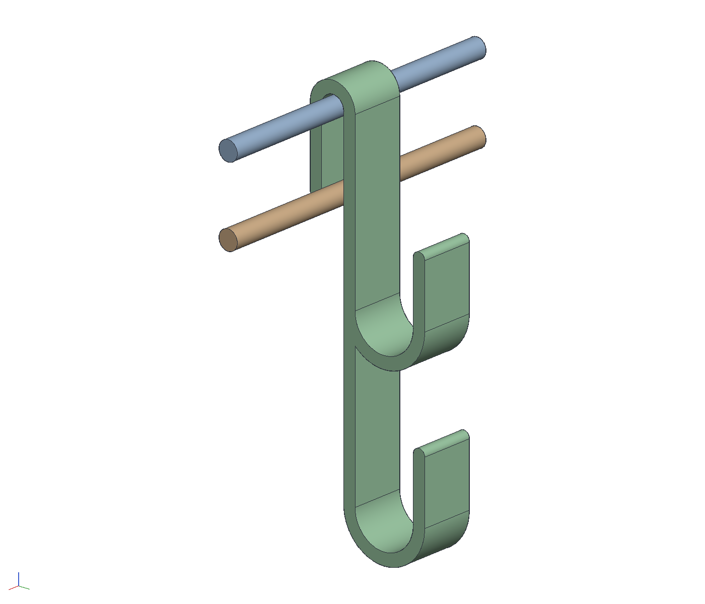
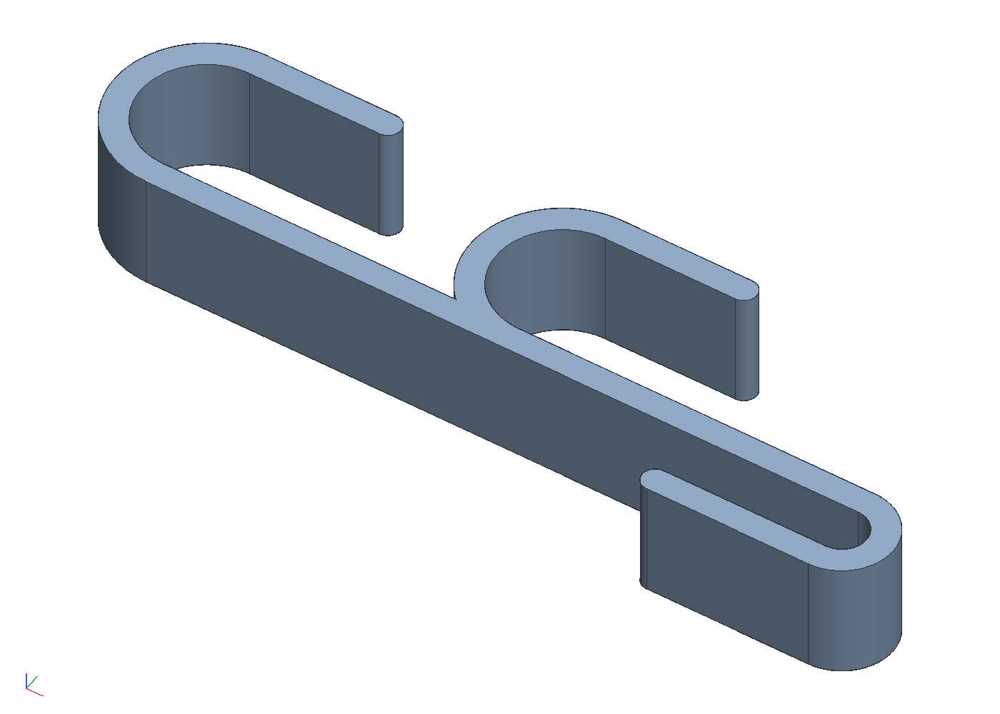

# Coat hook for a wire rack's rail

The over-the-door coat hook, redrawn to hang on the front rail of a
wire shelving rack: the 1-1/4 in door slot becomes a 1/4 in slot that
drops over the rail wire, and the rest of the shape stays. One printed
band, `out/hook.stl`.

    cargo build --release -p ok-mcp
    python3 examples/rack-hook/build.py       # the document, the STL, pictures and sheets
    cargo test -p ok-render --test rack_hook  # what CI runs

## What it is

A band 18 mm wide and 4 mm thick, its side profile extruded along the
rail:

| part | size | what it does |
|------|------|--------------|
| U | 7.5 inside, 15.5 outside, about the rail's axis | drops over the top rail: a 1/4 in wire with 1.15 of room |
| leg behind | 25 down from the rail's axis | inside the shelf's edge, under the deck wires, to keep the U on |
| leg down the front | 110 down from the rail's axis | hangs in front of the lower rail, 25 below the top one, and leans on it when a coat pulls |
| hooks | two J hooks, R10 inside, tips 20 up, at 55 and 110 down the leg | a hanger's hook or a coat loop; the lower one is the end of the leg |
| ends | rounded, R2 | the three free ends |

Why 18 wide: the deck wires are an inch apart on a standard rack and
the band passes between two of them over the rail. Why the front leg
is where the load goes: a coat on a hook pulls the leg down and tips
the band about the top rail; the lower rail, in the same plane 1 in
below, stops the leg, as the door's face does for the original. The
leg hangs 0.6 mm in front of it empty.

Measure the rail before printing: `RAIL` at the top of `build.py` is
1/4 in and `SLOT` is 7.5. A rack with a heavier wire wants the slot
opened to the wire plus about a millimetre.

Printing: PETG (PLA is fine indoors), 0.2 layers, four perimeters and
any infill, which makes a 4 mm band solid. `out/hook.stl` lies on its
side, the profile on the bed and the band standing 18 tall, so every
layer is the whole profile and a hook's load runs along the layers,
not across them; nothing overhangs, no supports. The slot's inside is
a vertical half-cylinder on the bed, which prints clean.

## The model

- `hook`: the profile in the y-z plane extruded 18 along x, built
  from discs and rectangles: a disc about the rail's axis with the
  slot's disc cut out and its lower half between the legs cut away is
  the U; each hook is a disc whose inner band is the front leg, its
  inside and upper half cut away and a tip and a rounded end added.
  One body, PETG.
- `rails`: the top rail along x and the lower one 25 below it.
- `on the rail`: the hook over the top rail.
- `print`: the hook turned onto its side, the STL exported from here.
- Outputs in `out/`: `rack_hook.okpart`, `hook.stl` (on its side),
  `hook.png`, `hook_profile.png` (the side view), `on_the_rail.png`,
  `hook_print.png`, `hook.pdf` (right, front, iso) and
  `on_the_rail.pdf` (with a section through the band).
- The test checks the band's envelope, the U's two cylinders on the
  rail's axis, the hooks' at their centres, every bend a cylinder
  along the rail, the three rounded ends, the volume against the
  profile; on the rail, nothing in common with either rail by the
  booleans, the leg just in front of the lower rail and reaching past
  it; and the STL on its side.
