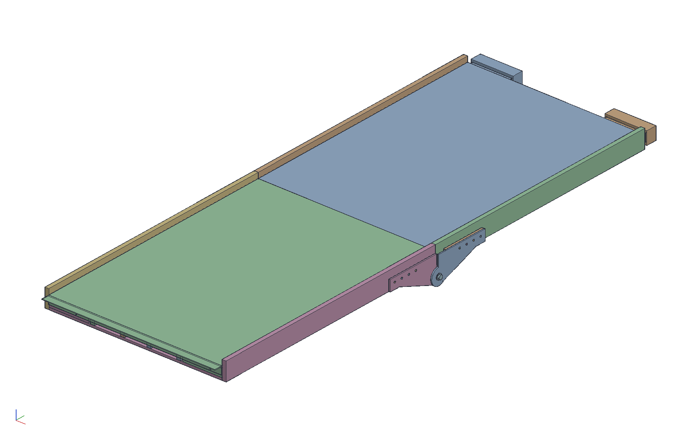
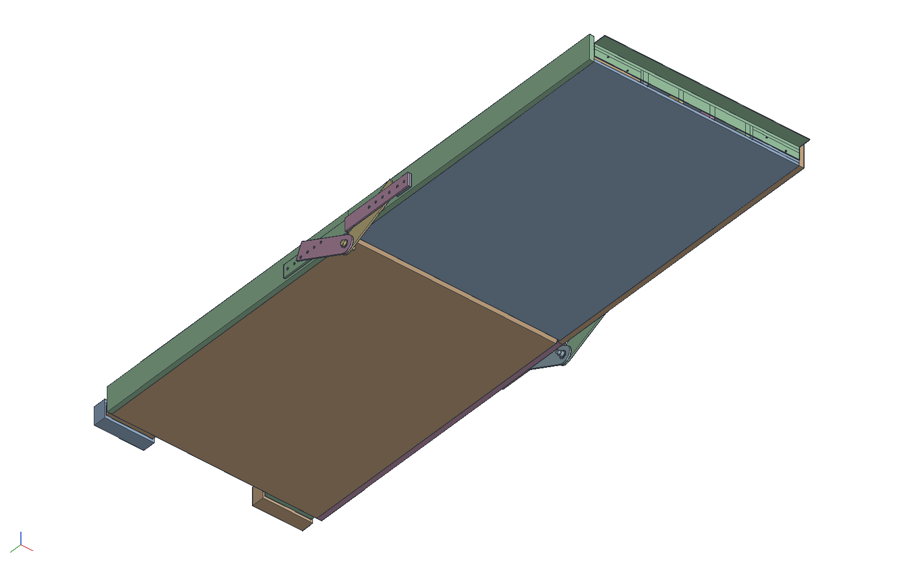

# Folding torsion-box truck ramp

A two-piece folding loading ramp for a Hyundai Santa Cruz, built for a
29 in lawn aerator: two torsion-box panels of 7/16 in OSB skins on
3/4 in birch ribs, 31-7/8 x 48 x 2-13/16 each, hinged on two 1/2 in
bolts through steel straps screwed to the outside of the rails, a
band and a strut a side cut from flat bar. It folds bottom-to-bottom,
the bolts pull to separate the halves, and nothing but the bars
stands past the rails. `build.py`
makes the document through the MCP server;
`crates/ok-render/tests/ramp.rs` checks it.

    cargo build --release -p ok-mcp
    python3 examples/ramp/build.py            # the document, pictures, sheets, cut sheets and cut list
    cargo test -p ok-render --test ramp       # what CI runs

The shop works in inches and the document in millimetres like the
other examples: every dimension is a named constant in inches at the
top of `build.py`, and the helpers convert. Sections 1 to 7 describe
the ramp as it is; section 8 is how it got here.

## 1. What it is

- Replaces two loose 8 ft 2x8 planks with end plates, which work but
  are too long to leave in the bed.
- Two panels, alike but for the free end, each a torsion box: two
  7/16 OSB skins, strength axis along the ramp, on 1-15/16 tall 3/4
  birch ribs on edge, a 2x4 flat across the hinge end and 2x8 stubs
  at the free end, each with a strip of the OSB over it to make up the
  core. 2-13/16 thick, 31-7/8 wide over the box, 48 long. Rails of
  3/4 birch outside the box on both long sides stand 1 in above the
  deck as curbs: 33-3/8 over the rails.
- Joined by a **bar hinge outside the rails**: on each rail at the
  hinge end a 2 x 1/4 steel band flat along the rail's face and a
  2-1/2 x 1/4 strut from the pivot hole up onto it, both straight
  bar; the band inside and the strut outside on the left, the other
  way about on the right, so turned end for end the two panels'
  struts meet on a 1/2 in bolt with nothing between. The pivot sits
  1-1/2 in below the bottom skin, so under load the decks butt in
  compression and the bolts carry the tension at the longest lever
  arm available. Six screws a side go through the bars, the rail, the
  edge rib and a two-ply block glued behind it: 3 in of plywood,
  every ply crossed.
- **Folds bottom-to-bottom** like a drop-leaf table, decks out,
  bottoms 3 in apart: a package 33-3/8 x 49-1/4 x 10-5/8 over the
  rails, 34-3/8 over the bars.
- Pull the two bolts and the halves separate: two panels of about
  50 lb.
- The tailgate end keeps the existing aluminium ramp end plates,
  which clamp a bare 1-1/2 x 7-1/4 board end, so that panel's 2x8
  stubs run 3 in past the skins. The ground end stops flush, bevelled
  30 degrees, with an aluminium angle as the lip.
- Lives under a bed cover or in the garage, painted with sand in the
  top coat for grip. Not a weather-exposed design.

## 2. Stock

`out/cutlist.csv` is the cut list the script writes; this is the
shopping list behind it.

| item | spec | qty | notes |
|------|------|-----|-------|
| skins and shims | 7/16 OSB sheathing, 4x8 (sized 95-7/8 x 47-7/8) | 2 sheets | rip each 31-7/8 along its length so the strength axis runs along the ramp, crosscut two 45s from the rip: a top and a bottom skin a sheet (`out/cut_sheet_osb.pdf`); the first sheet's 16 in offcut gives the two joint shims and four stub shims; rough face up on the top skins, sanded |
| rails, ribs, cross blocks, hinge blocks | 3/4 birch plywood, 4x8 | 1 sheet | 42 % of it (`out/cut_sheet_birch.pdf`) |
| joint blocks | 2x4 flat | 2 x 31-7/8 | across the hinge end between the skins under a 3-1/2 x 31-7/8 OSB shim; the decks butt on it under load |
| stubs | 2x8 | 2 x 12 (tailgate panel), 2 x 9 (ground panel) | outer rib positions at the free end under a 7-1/4 x 9 OSB shim; the tailgate panel's run 3 in bare past the skins for the end plates, the ground panel's stop flush with the skins |
| hinge bands | 2 x 1/4 mild steel flat bar | 4 x 11-3/4 | flat along each rail's outer face from the joint back; six 11/32 holes; deburred and painted |
| hinge struts | 2-1/2 x 1/4 mild steel flat bar | 4 x 10-3/4 | from the pivot hole up at 25 degrees onto the band; a 17/32 hole 1-1/4 from one end, that end rounded, four 11/32 holes; the two struts' pivot holes drilled stacked |
| hinge packers | 2 x 1/4 flat bar, offcuts | 2 x 2-1/2 | under each right band's far end, where the strut is not behind it |
| hinge screws | 5/16 x 3-1/8 structural screws (GRK RSS or equal), washer head | 24 | six a side, through the bars, the rail, the edge rib and the hinge block |
| hinge bolts | 1/2-13 x 1-1/2 grade 5 hex, nylock nut, two SAE washers | 2 | the pivots, through the two struts |
| ground edge | 1/8 x 2 aluminium angle | 1 x 31-7/8 | one leg screwed to the ground panel's flush end, the other out past it as the lip; four #10 x 2 pan heads |
| end plates | existing Erickson-type 2x8 ramp end plates | 2 pr | tailgate end only; a ghost in the model |
| adhesive | PL Premium polyurethane | | every rib and block face |
| brads | 18 ga, 1-1/4 and 2 | | the box is glued and brad-nailed throughout and weighted while it cures; the only screws are the hinge's and the angle's |
| finish | OSB primer, then exterior latex with sand broadcast into the second top coat; the edges and the chamfer sealed too | | |

## 3. Panel geometry

Frame of a panel: x across the width (0 to 31-7/8 over the box), y
along the length (0 at the hinge end, 48 at the free end), z up from
the bottom face of the bottom skin. Panel B is the same frame turned
180 degrees about z and moved 31-7/8 in x, so its x runs 31-7/8 to 0
and its y 0 to -48.

- **Width 31-7/8.** 1-7/16 each side of the 29 in aerator, a rip
  along the OSB sheet that leaves 16 in of it for the shims. `W` in
  the script, and everything across the width follows it.
- **Box** 31-7/8 x 48 x 2-13/16 (0.4375 + 1.9375 + 0.4375). The core
  is 1-15/16 because the lumber in it is 1-1/2 and a 7/16 strip of
  the skin stock over it makes it up; the birch ribs are ripped to
  the full 1-15/16.
- **Skins** 31-7/8 x 45 x 7/16, the strength axis along the ramp,
  both stopping at y = 45 so the stubs
  run bare from 45 to 48 on the tailgate panel (the ground panel's
  stubs stop at 45 with them). The bottom skin's hinge-end bottom
  edge is chamfered 3/8 since it sweeps a 1-1/2 in radius about the
  pivot.
- **Ribs** 3/4 birch strips on edge, 1-15/16 tall, six of them: one
  flush with each side of the box (centred at 3/8 and 31-1/2, behind
  the rails, so the hinge screws pass through them) and four at 8,
  13-1/2, 18-3/8 and 23-7/8 (symmetric about the middle; the second
  and fifth clear the stubs by 3/8). The four inner ribs run from the
  joint block to the skins' end (41-1/2), the two edge ribs stop at
  the stubs (32-1/2).
- **Cross blocks** of the same strip between the ribs at y = 16 and
  32: 6-7/8, 4-3/4, 4-1/8, 4-3/4, 6-7/8.
- **Joint block** 2x4 flat across the full width at y = 0 to 3-1/2,
  between the skins with its 7/16 OSB shim on top: what the deck
  compresses against under load.
- **Hinge blocks** two more 3/4 strips glued face to face behind each
  edge rib from the joint block back to y = 11-3/4 (1-15/16 x 8-1/4),
  so behind each rail at the hinge end there is 3 in of plywood for
  the hinge screws: rail, rib, two blocks, the screws crossing every
  ply.
- **Stubs** 2x8 flat at the outer rib positions (x 0 to 7-1/4 and
  24-5/8 to 31-7/8) from y = 36, each with a 7/16 OSB shim over it
  from 36 to 45: 12 long on the tailgate panel, 3 of it bare for the
  end plates; 9 long on the ground panel, flush with the skins, with
  a 30 degree bevel across the whole end (shim included) so the end
  face stands plumb on the ground.
- **Rails** 3/4 birch on edge outside the box on both long sides, 45
  long and 3-13/16 tall (the 2-13/16 box plus a 1 in curb), plain and
  flush on both panels, ending flat on the joint plane.

## 4. Hinge

The hinge axis is parallel to x at y = 0, the joint plane where the
panels' skins and joint blocks butt, at z = -1-1/2 (`PIN_DROP`).

- **Bands.** Four alike, 2 x 1/4 flat bar, 11-3/4 long, flat along
  the rail's outer face from the joint back, the bar's bottom 0.4
  above the panel's bottom so it lies over the core. Six 11/32 holes
  at 4-1/2, 5-3/4, 7, 8-1/4, 9-3/4 and 11 from the joint, level with
  the middle of the ribs, all behind the joint block.
- **Struts.** Four alike, 2-1/2 x 1/4 flat bar, 10-3/4 long with one
  end rounded about a 17/32 hole 1-1/4 from it. The hole is the pivot,
  1-1/2 below the bottom skin on the joint plane, and the bar runs up
  from it at 25 degrees onto the band's face, lapped over it from
  about 1 in behind the joint to 9, so the band's first four screws
  pass through 11/32 holes in the strut too. Nothing in a strut is
  cut but its end, and the four pivot holes are drilled with the bars
  stacked so they agree.
- **Where they sit.** On each panel's left side the band is against
  the rail and the strut outside it; on the right side the strut is
  against the rail and the band outside it, with a 2-1/2 in packer of
  the same bar under the band's far end where the strut has ended.
  Turned end for end, panel B's right strut lands exactly beside
  panel A's left one on the left of the ramp, and A's right beside
  B's left on the right, the two struts of a pair touching on the
  bolt: a half inch of steel outside each rail, 34-3/8 over all four,
  and no spacer anywhere. The bands of a pair are a bar apart, the
  strut of one beside the band of the other, and the sweep finds
  nothing meeting.
- **Screws.** Six 5/16 x 3-1/8 structural screws a side, head on the
  outer bar at each one, through the band (and the strut at the first
  four), the rail (3/4), the flush edge rib (3/4) and into the two-ply
  hinge block (1-1/2), the point an inch or more into the block and
  short of its far face; 3 in of plywood with the screw crossing every
  ply, which is the direction a screw in plywood holds. The strut's
  pull goes into the band through those four screws' shanks and the
  clamp, steel to steel, before anything reaches the wood.
- **Bolts.** A 1/2-13 x 1-1/2 grade 5 bolt through each pair of
  struts, head out, a washer under the head and the nut, a nylock nut
  inboard under the box, left a hair loose. Pull the two and the
  halves separate.
- **Fold.** One revolute between the left bolt and panel B's right
  strut on it. The fold goes under: B's free end drops, and at 180
  degrees it lies under A, bottoms 3 in apart. The test finds no
  interference at 0, 5, 10, 20, 45, 90, 135, 170 and 180 degrees.

## 5. Loads

The case is a 230 lb person walking a 300 lb aerator up the open 93 in
ramp: the machine at the fold with the person a couple of feet behind
it is about 9,000 in·lb at the hinge standing still, and a wheel
dropping off the lip of the joint makes it 13,500 for an instant.
The numbers below are at that 13,500 peak.

- **The box.** With the skins 2-3/8 apart (centre to centre) and the
  strength axis along the ramp the OSB works at about 430 psi, under a
  third of its allowable, and the ramp sags about 0.15 in under the
  static case. Cut as thirds of the sheet, strength axis across, the
  same skins would be at their allowable; on 1-1/2 ribs, half again
  more. The ribs as shear webs are good for about the same as a 2x2
  of spruce.
- **The hinge.** With the pivot 1-1/2 below the bottom skin the lever
  arm from pivot to the compression at the top of the deck is 4-5/16,
  so the bolts together carry about 3,100 lb of tension, 1,550 lb a
  strut. The strut's net section round the hole sees 2,500 psi, the
  bolt in single shear 7,900 psi with the struts touching (no spacer,
  so no couple to speak of) and the bolt bearing on the 1/4 bar
  12,000 psi: nothing for steel. The strut hands its pull to the band
  through the four screws that cross both, about 390 lb each in
  bearing on the strut's holes, 6,600 psi.
- **The screws.** The pull sits 2.9 in below the screw line, so the
  screw group into the wood also takes a moment of about 4,500 in·lb
  in the bars' plane; building the plate from two bars changes
  nothing there. Over six screws from 4-1/2 to 11 the outer one sees
  about 560 lb in shear, which over 3 in of ply is 600 psi of bearing
  on the wood, well inside what a 5/16 structural screw and birch ply
  take. Four screws on a 10 in band would put 1,000 lb on the outer
  one, which is why the band is 11-3/4 with six.

Lag screws into the hinge block were the question. Into the edge of
plywood a lag holds poorly, which is why the box is brad-nailed; but
these screws run across the plies of the rail, the rib and the
block, the direction plywood holds a screw as well as solid wood
does, and the hinge block is there to make that run 3 in long. So
yes: the block and the long structural screws are the right call, and
they replace through-bolts, which would want a nut and washer inside
the box.

## 6. The model

- **Parts.** One studio per part, every part built in place in the
  panel's frame. The skins, ribs, cross blocks, joint block with its
  shim, rails, hinge blocks and the two sides' hinge bars (band,
  strut and six screws each, the right side with its packer) are
  shared by both panels;
  only the stubs, each with its shim, differ. The bodies carry their
  names and material (OSB 0.62, birch 0.68, steel 7.85, aluminium
  2.7 g/cm3) so the parts lists read "rib · 1.9375 x 32.5". The ground stub's bevel is a suppressed
  feature: on in `out/stub.pdf`, off in the ramp.
- **Assemblies.** `panel A` and `panel B` are assemblies of fixed
  instances (a panel is one glued box; a mate per part would say
  nothing); the `ramp` places B turned and moved, the two bolts (one
  body each with their washers and nuts), the end plates (ghosts on
  A's bare stubs) and the ground angle on B's flush end, with the one
  revolute, `fold`.
- **Tunables.** `skin`, `rib`, `curb` and `pin_drop` are
  document variables; the skin and rib extrude depths are bound to
  the first two. The rest live in sketched profiles, which the script
  redraws from the constants at the top.
- **Cut sheets.** Three assemblies lay the real bodies flat on their
  sheets, long way along x: each OSB sheet ripped 31-7/8 along its
  length with a top and a bottom skin end to end in the rip, the
  first sheet's offcut strip carrying the two joint shims and four
  stub shims; the birch in rips along the sheet, the four rails end
  to end in two 3-13/16 rips, then 1-15/16 in strips for the twelve
  ribs, twenty cross blocks and eight hinge blocks packed first-fit
  by length. Each piece sits a kerf from the
  next; the script checks every piece lies flat on and inside its
  sheet, and the test that no two overlap.
- **Outputs**, all in `out/`: `ramp.okpart`; `ramp_iso`,
  `ramp_front`, `ramp_side`, `ramp_below`, `ramp_angle` (the ground
  angle on B's end), `ramp_folded`, `ramp_folded_side`,
  `panel_a_below` and `panel_b_below` (bars, stubs),
  `panel_a_cutaway` and `panel_b_cutaway` (from below with the bottom
  skin cut away: the edge ribs and hinge blocks behind the rails, the
  joint block, the top skin intact), `ramp_lug_section` (through a
  strut on the pivot axis), `ramp_hinge_section` (folded to 90
  degrees, cut through panel A's left strut and fitted to the hinge)
  with `hinge_section.pdf` the same cut as a sheet, hidden lines
  dashed, each side's band, strut and screws drawn by themselves
  below it; `cut_sheet_osb.pdf`,
  `cut_sheet_osb_2.pdf` and `cut_sheet_birch.pdf`, numbered against a
  list; `panel_a.pdf` and `panel_b.pdf` with a section across the
  width at mid-length and one along the length through the edge rib
  and hinge block; `ramp.pdf` with each panel as one item;
  `stub.pdf`; `fold.pdf` and `fold.png` at 0, 45, 90, 135 and 180
  degrees from the side; `cutlist.csv`.
- **The test** regenerates every part closed and places every
  instance; finds the four struts' pivot holes and rounded ends on
  the two bolts' axis within a hundredth of a millimetre and their
  faces at 25 degrees; checks the bands and struts 1/4 steel in the
  planes above, the struts of a pair touching and 34-3/8 over all
  four, each packer in its strut's plane, every screw 3-1/8 long
  through its band, the strut for the first four, a rail, a rib and
  both hinge blocks of its own panel with an inch or more in the
  block, and each bolt's head the washer's thickness off the outer
  strut; checks the core
  is a 1-1/2 lumber under a 7/16 shim that meets the top skin, the
  ribs 1-15/16 in one piece, and the ground angle's screws in the
  stubs' end grain under the shim; sweeps the fold; measures the open
  ramp at 93 long and 33-3/8 over the rails, the folded package the
  same over the rails and 10-5/8 thick with the bottoms 3 in apart;
  and reads the sheet yield off the parts: the four skins two rips of
  OSB, two to a sheet with 16 in over, the birch about 40 % of a
  sheet.

## 7. Shop sequence

1. Cut the OSB per `cut_sheet_osb.pdf`: rip each sheet 31-7/8 along
   its length, the strength axis (the stamp on the sheet says which
   way; it is along the 8 ft), and crosscut two 45s from the rip.
   From the first sheet's offcut, two 3-1/2 x 31-7/8 joint shims and
   four 7-1/4 x 9 stub shims. Chamfer the bottom skins' hinge-end
   bottom edge 3/8.
2. Rip the birch per `cut_sheet_birch.pdf`: rails at 3-13/16, then
   the 1-15/16 strips for the ribs, cross blocks and hinge blocks.
   Glue the hinge blocks to the edge ribs, two plies behind each from
   3-1/2 to 11-3/4. Glue the shims to the joint blocks and the stubs
   (the stub shims from 36 to 45 only).
3. Cut the bars: four bands 11-3/4 from 2 x 1/4, four struts 10-3/4
   from 2-1/2 x 1/4, two packers 2-1/2 from the 2 x 1/4 offcut. Round
   one end of each strut and drill the 17/32 pivot holes 1-1/4 from
   it with the four stacked and clamped. Lay a band on the rail's
   face with its bottom 0.4 up, the strut over it from the pivot
   point at 25 degrees, mark and drill the six 11/32 holes through
   both at once. Deburr, paint.
4. On a flat surface: bottom skin, PL on every rib face, the edge
   ribs with their blocks flush with the sides, the inner ribs, cross
   blocks, shimmed joint block and shimmed stubs down, brads through
   the skin; then PL and the top skin, rough face up. Weight it.
   24 h.
5. Glue and brad the rails on, flush both sides, ending flat at the
   joint plane.
6. On each panel's left rail: band against the rail, strut over it,
   the pivot hole 1-1/2 below the skin on the joint plane; on the
   right rail: strut against the rail, band over it, the packer under
   the band's far end. Clamp, drill 1/4 pilots through the holes,
   drive the screws. Dry-fit both panels on the bolts, check the
   fold. Bevel
   the ground panel's end 30 degrees across the whole end, screw the
   angle to it, fit the end plates to the other.
7. Prime (OSB primer, edges and chamfer too); paint; sand into the
   second top coat; a third thin coat over it.

## 8. Open questions

- A carrying handle: the pin used to be one pipe whose bare middle
  was the handle, and the bolted bars leave none. A webbing loop
  screwed to a rail at the balance point, or a hand hole.
- The bars stand 1/2 past the rails each side for the hinge-end
  12 in; whether that catches on the tailgate opening, and whether
  the struts, which touch on the bolt, want a thin nylon washer and
  a longer bolt.
- Curb height 1 in. Drop it if the folded package (10-5/8) needs to
  be thinner.
- Whether the end plates clamp cleanly with the rail ending 3 in
  short of the tailgate end.
- Rib pitch (5 to 6-1/2 under 7/16 skin), and whether the cross
  blocks at 16 and 32 are enough.
- OSB and water: the ground end sits on grass. If it lives wet, go
  back to CDX; the model only changes its material name.

## 9. How it got here

The brief (2026-10-04) was two identical 21 x 48 panels on one 3/4
pipe, lugs laminated to 1-1/2 in the rails and inside, a 3/4 spacer
under one rail so the rail lugs could pass. What changed, and why:

- **Pin drop and lug radius 1-1/2**, not 1: the 7/16 wall a 1 in
  radius leaves is one pin diameter of end distance, and the radius
  cannot exceed the pin drop without the half-round meeting the other
  panel's bottom.
- **Lugs one ply.** With the 1-1/2 radius the wall is enough; the
  doubling was buying back the thin wall the radius already fixed.
- **Ribs from the birch, and brads** (2026-10-05): 3/4 birch strips
  on edge instead of 2x2s, straight and 1-1/2 lb lighter a panel; a
  screw into the edge of 3/4 ply holds poorly, so the box is glued
  and brad-nailed.
- **Ground end flush** (2026-10-06): the ground panel's stubs stop
  with the skins and the angle hangs on that end face, its leg 1-1/2
  so both screw rows clear the top skin.
- **Bushings** (2026-10-08): rings of 1 in pipe in the lug bores and
  a 1/2 in pin, in place of bare ply on a 3/4 pipe.
- **Width 31-7/8** (2026-10-08): the aerator measured 29 in; a third
  of a CDX sheet. Six ribs instead of five.
- **All lugs alike, inside the rails** (2026-10-08): the rail lugs,
  the lug stubs, the cheeks, the spacer and the step at the joint all
  go; four identical lugs a panel on the far side of symmetric ribs
  interleave by themselves.
- **Two 10 in nipples** (2026-10-09): the store's precut nipples come
  24 and 36, and a one-piece pin wanted 33-3/8 threaded both ends.
  Each side's four lugs get their own nipple; the outer caps end
  flush with the rails, and the handle became an open question.
- **Steel plate hinge** (2026-10-12): strap hinges were asked about
  and rejected (a 2-5/8 lever arm against the plates' 3-7/8, and
  their screws in 15/32 sheathing), and the eight interleaved ply
  lugs with their bushings and nipples went for four 1/4 steel plates
  bolted outside the rails, one flat and one on a 3/8 spacer so a
  pair passes side by side on a 1/2 bolt. The lug notches in the
  bottom skin go with them; the edge ribs move flush with the sides
  and get a two-ply block behind them, so the 5/16 structural screws
  run through 3 in of plywood across the plies rather than into an
  edge.
- **OSB, cut lengthwise, 1-15/16 ribs, six screws** (2026-10-12): the
  loads were restated as a 230 lb person walking a 300 lb aerator,
  about 9,000 in·lb at the hinge and 13,500 with a wheel dropping off
  the joint, against the 7,000 the box was sized to. The thirds cut
  had put the sheathing's strength axis across the ramp, so the skins
  were at their allowable; ripping the sheets lengthwise halves that
  for nothing. 7/16 OSB replaces the 15/32 CDX because it costs a
  third as much and, by the panel design values, is as stiff and
  strong for what a skin does here. The core grows from 1-1/2 to
  1-15/16: the lumber stays 1-1/2 with a strip of the OSB offcut over
  it, the birch is ripped to the full height, and the box is half
  again stiffer. The plates grow to a 12-3/4 band with six screws,
  since four carried 1,000 lb on the outer screw at the peak; the
  ground angle's legs go to 2 in so its screws stay in the stubs'
  end grain under the shim.
- **Bar hinge** (2026-10-17): the cut lug plates become two straight
  bars a side, a 2 x 1/4 band flat on the rail with the six screws
  and a 2-1/2 x 1/4 strut from the pivot up at 25 degrees onto it,
  lapped so four of the band's screws clamp both. A fan of three
  straps meeting at the pivot was considered first, and dropped: its
  six-high knuckle is easier on the bolt but stands 1-3/8 proud of
  each rail and needs packers in every plane, and the screws into
  the wood see the same prying moment however the plate is built.
  Swapping which bar is against the rail between the left and right
  sides puts the two struts side by side on the bolt with no spacer,
  so the hinge stands 1/2 proud instead of 5/8 and the 1/8 washer
  goes. The band grew from the 10 first proposed to 11-3/4 to keep
  six screws, and the strut from 7 to 10-3/4 so four of them cross
  it clear of its end.
