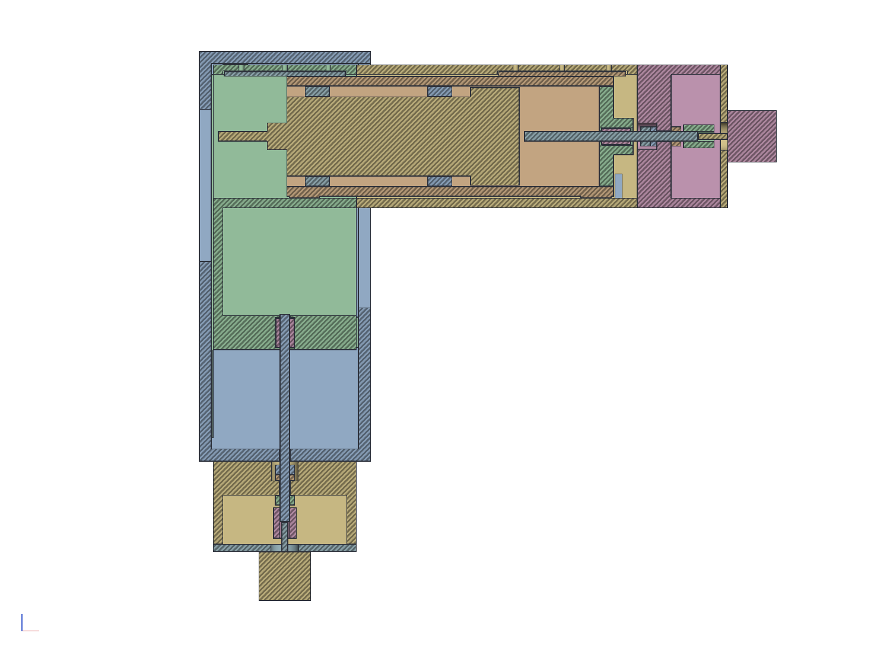

# A two-axis router positioner: boxes in boxes

A module that holds a trim router on its side and places it on two
axes under stepper control: along the bit (X, plunge) and up and down
(Z, bit height). Three boxes, one inside the next, each sliding in the
one outside it, with one lead screw down the middle of each moving box.
First meant as the head of a horizontal mortiser.

[BRIEF.md](BRIEF.md) is the design brief this is built from: the
decisions already made, the rules of thumb, and the questions still
open. This is the first pass it asks for: proportions derived from a
handful of numbers, the rules enforced, the four corners of the travel
checked, and the envelope reported, so the trade-offs can be looked at
before anything is detailed.

```sh
cargo build --release -p ok-mcp
python3 examples/router-positioner/build.py
cargo test -p ok-render --test router_positioner   # what CI runs
```


Nothing here is built, and every dimension of the router is a guess.

## What is in it

| | home: drawn back, up | plunged, down |
|---|---|---|
| cut through the bit's axis, from the front |  |  |

From the outside in, as the brief has it:

- **Outer box**, fixed. Its inside is the Z guide. A slot in its left
  face for the bit, a slot in its right wall for the X column.
- **Z stage**, sliding up and down in it. A square sleeve runs through
  its top from left to right; under the sleeve is the room the Z screw
  comes up into; the Z nut is in its floor.
- **X quill**, a square tube through the sleeve, the router clamped in
  its front. Behind the router is empty tube as long as the travel,
  where the X screw goes as the quill is drawn back; across its back
  end is the spider, a rim and four ribs with the X nut on the centre.
- **X column**, the sleeve carried on out of the stage's right side,
  moving up and down with it. The quill's back end runs in it.
- **A drive housing on the end of each column**, the same part twice:
  a recess for a collar and a thrust bearing, the bulkhead the bearing
  sits against, a chamber for the coupling, and the cap the motor is
  on. The Z one hangs under the outer box.

## What came out

With 60 mm of X, 80 mm of Z, 8 mm walls and an M8 screw:

| | mm |
|---|---|
| the module, long x deep x tall | 472 x 172 x 449 |
| of its length, column and motor out of the box's right side | 332 |
| behind the router's back cap, drawn back | 210 |
| the outer box | 140 x 172 x 335 |
| the Z stage | 117 x 149 x 233 |
| the quill | 98 square x 267 |
| the X column | 117 square x 229 |

The 210 mm behind the router is, in order: 4 to the screw's tip, 63 of
screw for the travel, the 24 mm nut in its boss, 3 of air, 16 of collar
and thrust bearing, the 12 mm bulkhead, 40 of coupling chamber, the
6 mm cap and 40 of motor. Only the 63 scales with the travel.

| the brief's rule | here |
|---|---|
| a box in its guide by 1.5 to 2 of its widths, everywhere | the quill 2.7 (sleeve and column together guide it), the stage 1.56 |
| the bit close to the sleeve's mouth at full plunge | the quill's front is level with the mouth |
| the X screw's tip short of the router's back cap, drawn back | 4 mm |
| the Z screw clear of the sleeve, the stage down | 7 mm under the sleeve's floor |
| each screw right through its nut at the far end | 3 mm through |
| the X column clear of the outer box across Z | 1 mm top, 1.5 mm bottom and sides |

## What the proportions showed

Four things the brief could not have known before the boxes had sizes.

1. **The outer box's right wall is cut away just where the stage needs
   it.** The router's weight and the plunge both tip the stage with its
   top to the right, and the column's slot takes all of that wall above
   116 mm. So the stage is 16 mm wider than the column on each side,
   front and back, and the wall keeps a rail either side of the slot
   for the stage to bear on. That is 32 mm of the module's depth.
2. **Two parts are longer than the printer's 256 mm:** the outer box
   (335 tall) and the quill (267 long). They print in two lengths, or
   are plywood. The quill is over by 11 mm, which a shorter router
   than the 190 mm guessed, or 50 mm of travel, would cure.
3. **The collet nut is only 4.5 mm out of the box's face at full
   plunge.** That is not room for a wrench, and the Colt's spindle
   lock is inside three boxes. Bit changes need the side door the
   brief mentions, more X travel, or the router out of the back.
4. **The quill's gibs in the sleeve are inside the outer box.** Their
   set screws are drawn but nothing reaches them once the stage is
   in. The two in the column are outside and easy.

## What the open questions were taken to be

| the brief's question | this model takes | to change it |
|---|---|---|
| 1. the router | a Bosch Colt PR20EVS: housing 65 across (what `examples/router-lift` uses), 80 across its cap, 190 long. Bosch publishes none of it | `ROUTER_*` in `build.py` |
| 2. travel | X 60, Z 80 | `X_TRAVEL`, `Z_TRAVEL` |
| 3. screw | M8 x 1.25 rod, a 13 across-flats coupling nut 24 long: 0.00625 mm a full step | `SCREW_*`, `NUT_*`; a T8 goes in the same bores |
| 4. motor | NEMA 17, 40 long | `MOTOR` |
| 5. material | not chosen; 8 mm walls, 10 on the outer box | `WALL`, `OUTER_WALL` |
| 6. the router's clamp | two collars round the housing, a close fit in the quill; how they tighten is not drawn | |
| 7. Z screw and sleeve | checked: 7 mm apart at the worst | |
| 8. reference faces | the quill bears down and back, gibs over it and before it; the stage bears on the two rails and the back wall, gibs in the left and front walls | `Z_GIBS` and the strips in `build.py` |
| 9. dust | nothing drawn | |

Back is the side the feed is taken to push the bit toward.

## Measure these first

| what | in the model | check |
|---|---|---|
| the router's housing | 65 mm across | callipers; the quill's collars are bored to it |
| the widest thing on the router | 80 mm, the cap and switch | it sets the quill's bore, and so every box outside it |
| the router's length, nut seat to back cap | 190 mm | it sets the quill's length, 1 for 1 |
| the round housing's length | 150 mm | where the collars can grip |
| the collet nut | 22 across, 16 long | sets how far it stands out at full plunge |
| where the cord and the vents are | the cord out of the back, air in at the back | the quill and column have a slot for the cord and vents over the back |

## Parts

| part | size, mm | |
|---|---|---|
| outer box | 140 x 172 x 335, walls 10 | bit slot 44 x 124; the column's slot; three gib pockets; a pocket in the lid for the Z home switch |
| Z stage | 117 x 149 x 233 | the sleeve, 101 square; the Z screw's room, 88 high; the Z nut's pocket; bearing strips on its right and back |
| X column | 117 square x 229 | the cord's slot, two vents, two gib pockets |
| X quill | 98 square x 267, bore 82 | bearing strips underneath and behind, at each end; the cord's slot |
| spider | 82 square x 12, boss 30 across x 28 | the X nut's pocket |
| drive housing, 2 | 117 square x 68 | and an end cap, 6 |
| gibs, 7 | 4 x 20 strips | three for the stage, four for the quill |
| router clamps, 2 | 82 square x 20 | bored 65.6 |
| bought, per axis | M8 rod, a brass coupling nut, an F8-16M thrust bearing, two collars, a rigid 5 to 8 coupling, a NEMA 17, a limit switch | |

Not drawn yet: any fastener, how the column is fixed to the stage and
the spider to the quill, the nuts' retainers, the second thrust face
(drawing the quill back pulls the screw against a plain collar), the
connector panel, and the datum faces' bolt patterns.

## What the test checks

`crates/ok-render/tests/router_positioner.rs` regenerates every part
from the document and, with the kernel's solids:

- at each of the four corners of the travel, no part is through
  another, over some 67 pairs of parts that are near each other; and
  run past either end of either travel, something is hit, so the
  check can tell;
- the quill is wholly between the sleeve's mouth and the column's end,
  and the stage wholly inside the outer box, each by more than a width
  and a half, at both ends of both travels;
- each screw is through its nut at one end and short of what it runs
  toward at the other, the Z screw's distance to the sleeve's floor
  found with a post stood on its tip;
- the envelope, the length behind the router and the parts too long
  for the printer are what the build reported.
