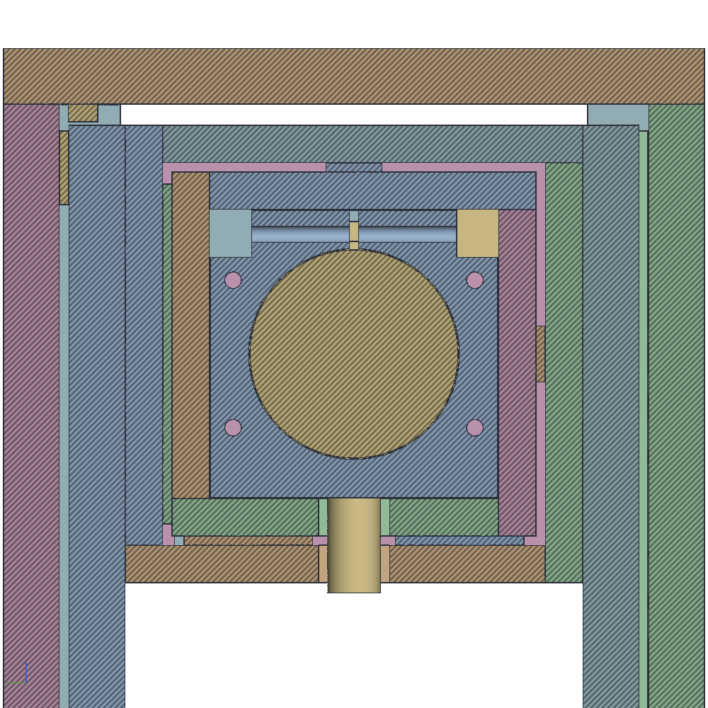
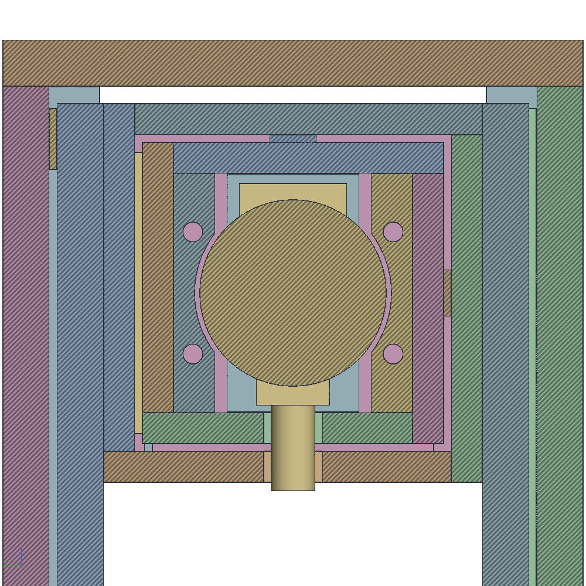
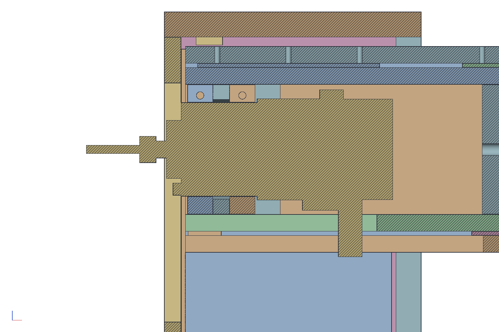
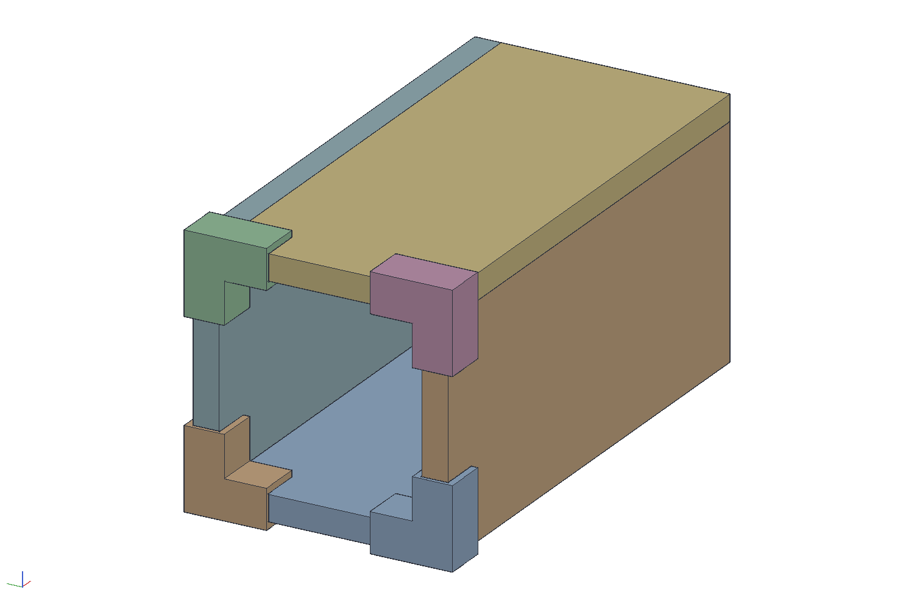

# A two-axis router positioner: boxes in boxes

A module that holds a trim router on its side and places it on two
axes under stepper control: along the bit (X, plunge) and up and down
(Z, bit height). Three boxes, one inside the next, each sliding in the
one outside it, with one lead screw down the middle of each moving box.
First meant as the head of a horizontal mortiser.

[BRIEF.md](BRIEF.md) is the design brief this is built from: the
decisions already made, the rules of thumb, and the questions still
open. This is the first pass it asks for: proportions derived from a
handful of numbers, the rules enforced, the four corners of the travel
checked, and the envelope reported, so the trade-offs can be looked at
before anything is detailed.

It is drawn in plywood, as the owner asked: every box is flat panels
of 1/2 in or 3/4 in sheet, and the build writes the
[cut list](out/cutlist.csv). There is no joinery in it. Every joint is
one panel's edge on another's face, glued and nailed with an air brad
nailer; nothing is grooved, rebated or let in. What is not plywood is
thin or bought.

```sh
cargo build --release -p ok-mcp
python3 examples/router-positioner/build.py
cargo test -p ok-render --test router_positioner   # what CI runs
```


Nothing here is built. The router is the owner's Bosch Colt, out of
its base: its body is 70.71 mm across by the owner's callipers, and
the rest of it was read off three photographs the owner took for the
purpose: the nose from the side, the whole router lying on the
measuring sheet, and the rear end on. The six sizes the mount hangs
on were then marked on those photographs and the owner put callipers
on each. [The router, as measured](#the-router-as-measured) has the
numbers and [The router's mount](#the-routers-mount) what holds it.

Its second use is already drawn: the [stick sled](../stick-sled/) lays
it on its lid beside a turning stick and reads its sizes from
`out/positioner.json`, so that example is built again after this one.
What that job asks of it is in the sled's README.

## What is in it

| | home: drawn back, up | plunged, down |
|---|---|---|
| cut through the bit's axis, from the front |  |  |

From the outside in:

- **Outer box**, fixed, six panels. Its inside is the Z guide. A slot
  in its left face for the bit, a slot in its right wall for the tube.
  The face is 1/2 in so that the collet nut comes out of it; the rest
  is 3/4.
- **The tube**, 1/2 in, four panels the same width each lapping the
  next. One piece from the sleeve's mouth to the X motor: the quill's
  guide where it passes through the stage, the column beyond, and the
  motor's housing at its end, with a bulkhead glued in for the thrust
  bearing and a cap for the motor. Its being one piece is what joins
  the column to the stage.
- **Z stage**: what is glued to the tube to make it slide up and
  down. A 3/4 in cheek on the tube's front and one on its back, the
  stage's whole height, and between them at the bottom a foot of four
  1/2 in layers with the Z nut caged in the middle two. The cheeks'
  edges are the stage's bearing faces, left and right.
- **X quill**, a square tube of 1/2 in, the router in its front in a
  block that comes out with it. Behind the router is empty tube as
  long as the travel, where the X screw goes as the quill is drawn
  back; across its back end is a 3/4 in bar with the X nut caged
  behind it.
- **Z motor housing**, under the outer box: the tube's end over
  again, stood up.

## What came out

With 80 mm of X, 80 mm of Z, the two plywoods and an M8 screw:

| | mm |
|---|---|
| the module, long x deep x tall | 496 x 238 x 533 |
| of its length, tube and motor out of the box's right side | 303 |
| behind the router's rear end, drawn back | 244 |
| the outer box | 193 x 238 x 416 |
| the Z stage | 155 x 193 x 290 |
| the quill | 123 square x 242 |
| the tube | 155 square x 428, and its cap |

The 244 mm behind the router is, in order: 4 to the screw's tip, 83 of
screw for the travel, the nut's cage and its keeper, 37, 3 of air, 16
of collar and thrust bearing, the 12.7 bulkhead, 35.5 for the coupling,
the 12.7 cap and 40 of motor. Only the 83 scales with the travel.

| the brief's rule | here |
|---|---|
| a box in its guide by 1.5 to 2 of its widths, everywhere | the quill 1.96, the stage 1.50: the stage is made 290 tall for it |
| the bit close to the sleeve's mouth at full plunge | the quill's front is level with the mouth; the router's nose stops 1.7 mm inside the box's face and the collet nut, tightened on a bit, is 1.6 clear of it |
| the X screw's tip short of the router's rear end, drawn back | 4 mm |
| the Z screw clear of the tube, the stage down | 14.4 mm under its floor |
| each screw right through its nut at the far end | 3 mm through |
| the tube clear of the outer box across Z | 1.5 mm below and at the sides; above it is the home switch's room under the lid |

The plunge was 60 mm. It is 80 at the owner's word: 20 mm more of
quill, tube and screw, so that a bit may sit deeper or shallower in
the collet than the one job it was drawn for, and for whatever the
module is put to next.

## The router, as measured

| | mm | from |
|---|---|---|
| the aluminium ring at the front, across | 70.71 | callipers |
| how far back the ring goes | 18, the spindle lock's red button flush in its side | side photo |
| the plastic body behind the ring, across | 69: the metal stands 0.85 proud of it all round | callipers |
| how far back the body stays round and bare | 51 on the cord's side, some 10 more on the other | callipers; the photo had 54 |
| the rubber grip behind, across, and where it ends | 76.5, 105 back | side and rear photos |
| the vented cap behind that, across | 76: a true circle from the rear but for the next two | rear photo |
| from the speed dial's housing to the chin the cord comes out of, across the rear | 90 | callipers; the photo had 91 |
| the dial's housing | 44.5 of that 90 from the axis, 101 to 119 back, 44 wide, on the button's side | side and rear photos |
| the chin | 45.5 from the axis, 88 to 130 back, opposite the dial | side photo |
| the cord's boot | leaves the chin 124 back, leaning to the rear; 18 across | side photo |
| rim to rear end | 156 | side photo |
| the bearing's boss in front of the rim | 44 across, 14.2 high | nose photo |
| the collet nut's face from the rim, tightened on a 1/4 in bit | 30. Slack and with no bit in it, as photographed, 34.5 | callipers |
| the collet nut | a 17 mm hexagon, 12.5 long | nose photo |
| the spindle's flats, between the boss and the nut | 9.49 across: a 3/8 in wrench, which is 9.525 | callipers |
| how far a 1/4 in shank goes into the collet | 32 from the nut's face, the bit bottomed and the nut then tightened | callipers |
| on the front face: three screw heads, and a sprung block on the cord's side | 3.2 proud, and 9.4 | nose photo |

Lengths are from the rim, the front edge of the aluminium ring. The
nose photograph is scaled by the ring and checked against the
router's own millimetre scale, which is in the picture: half a
millimetre. The side photograph has the router lying on the
[measuring sheet](../measuring-sheet/); the camera's place is worked
out from the sheet's grid, so that the router's height off the paper
is allowed for: 2 mm.

What the callipers found that the photographs had not: the plastic
is 1.7 mm smaller across than the ring, which no photograph good to
2 mm would show; the bare round is 3 mm shorter than it looked; and a
nut tightened on a bit sits 4.5 mm nearer the rim than a slack one.
Each of the three changed the mount or the sled.

The quill's bore is 98 mm, where it was 86 with the first two
photographs: twice the chin's 45.5, and 2.5 for not knowing how the
90 is shared between the chin and the dial's housing, and a
millimetre each side. Every box outside it grew by the same 12.

## The plywood

Two thicknesses and no other, nominal: 12.7 and 19.05 mm. Sheet goods
run thin, so measure the sheets and put what they are in `T12` and
`T34` at the top of `build.py`; every size follows. 40 pieces: 0.43 m2
of 3/4 in, 14 % of a sheet, and 0.64 m2 of 1/2 in, 22 %.

**3/4 in**

| part | piece | long x wide, mm | how many |
|---|---|---|---|
| Outer box | front | 378.0 x 193.3 | 1 |
| Outer box | back | 378.0 x 193.3 | 1 |
| Outer box | right wall | 378.0 x 199.7 | 1 |
| Outer box | floor | 237.8 x 193.3 | 1 |
| Outer box | lid | 237.8 x 193.3 | 1 |
| Z stage | front cheek | 290.0 x 155.2 | 1 |
| Z stage | back cheek | 290.0 x 155.2 | 1 |
| X quill | stop plate | 98.0 x 17.0 | 2 |
| Spider | bar | 97.6 x 54.0 | 1 |
| Router block | front land | 97.6 x 97.6 | 1 |
| Router block | back land | 97.6 x 97.6 | 1 |

**1/2 in**

| part | piece | long x wide, mm | how many |
|---|---|---|---|
| Outer box | face | 378.0 x 199.7 | 1 |
| Z drive housing | motor's cap | 155.2 x 155.2 | 1 |
| Z drive housing | right | 142.5 x 64.2 | 1 |
| Z drive housing | back | 142.5 x 64.2 | 1 |
| Z drive housing | left | 142.5 x 64.2 | 1 |
| Z drive housing | front | 142.5 x 64.2 | 1 |
| Z drive housing | bulkhead | 129.8 x 129.8 | 1 |
| X tube | lid | 427.6 x 142.5 | 1 |
| X tube | back | 427.6 x 142.5 | 1 |
| X tube | floor | 427.6 x 142.5 | 1 |
| X tube | front | 427.6 x 142.5 | 1 |
| X tube | motor's cap | 155.2 x 155.2 | 1 |
| X tube | bulkhead | 129.8 x 129.8 | 1 |
| Z stage | foot under the nut | 155.2 x 155.2 | 1 |
| Z stage | foot beside the nut | 155.2 x 70.6 | 4 |
| Z stage | foot over the nut | 155.2 x 155.2 | 1 |
| X quill | lid | 242.3 x 110.7 | 1 |
| X quill | back | 242.3 x 110.7 | 1 |
| X quill | floor | 242.3 x 110.7 | 1 |
| X quill | front | 242.3 x 110.7 | 1 |
| Spider | keeper | 54.0 x 40.0 | 1 |
| Spider | beside the nut | 40.0 x 20.0 | 4 |

A tube's four panels are one width, bore and a thickness, so each tube
is one rip. "Beside the nut" pieces are glued up two thick. Every
piece is a rectangle off the saw; the stop plates and the block's
two squares are then cut further, as [The router's
mount](#the-routers-mount) says.

Not plywood: the seven gibs, lengths of 1/8 x 3/4 in bar; the bearing
strips, 1/8 in thick, of UHMW or hardboard; and what is bought, per
axis: M8 rod, a brass coupling nut, an F8-16M thrust bearing and a
steel washer under it, two collars, a rigid 5 to 8 coupling, a NEMA 17,
a limit switch. And for the router's mount: two M5 x 80 bolts with a
washer each end and a locking nut, four M5 x 60 screws with washers,
four M5 threaded inserts, the kind the gibs' set screws go in, and
one printed liner.

## How it goes together

Glue and an air brad nailer, and nothing else to make a joint. Every
joint is an edge on a face.

- **Nail from the outside in.** The inside faces are where things
  slide. A brad through the lapping panel into the next one's edge has
  its head outside and its point in the edge. Set the heads.
- **Brads:** 18 gauge, 1-1/4 in through 1/2 in plywood, 1-1/2 in
  through 3/4, and 1 in for a cheek onto the tube, so that the point
  stops short of the tube's bore.
- **A tube is a pinwheel:** each of its four panels laps the next
  one's edge and is lapped by the one before. Glue it up round a
  spacer cut to the bore.
- **Nothing is grooved.** The boxes stand 1/8 in apart all round. On
  two sides of each that gap is filled by bearing strips glued to the
  sliding box, one near each end. On the other two a gib lies loose
  in it, pushed by three set screws through the wall, whose points
  sit in dimples drilled in the gib's back and keep it in place.
- **What is cut out, with a jigsaw or a drill:** the bit slot in the
  face; the tube's way in the right wall, open to its top edge; the
  cord's slot in the quill's floor and in the tube's, each open at
  its front end; a hole for each screw, each motor's boss and each
  set screw; six 25 mm air holes in the tube's lid; and the router's
  block: its bore, its kerf, its two notches.
- **What is screwed, not glued,** because it has to come off: the
  outer box's lid, the two motors' caps, and the router's block
  against its stop plates.
- **The order.** The quill, with the nut's bar and cage at its back
  and the nut in the cage, and the two stop plates glued in behind
  where the block comes to. The tube round a spacer, with its
  bulkhead glued in; then the cheeks and the foot onto it, the Z nut
  in the foot. The quill into the tube from the mouth. The outer box
  without its lid; the stage lowered into it, the tube down the right
  wall's slot. Then the screws, the motors' caps, the gibs, and the
  lid. The router goes in last, from the front.

## The router's mount

| cut through the back land, from the bit's side | cut through the stop plates | cut down the middle, at full plunge |
|---|---|---|
|  |  |  |

The brief's sixth question was how the router is clamped, and whether
it comes out without taking the module apart. It is clamped by the
bare round of its body and nothing else, and it comes out of the
front.

- **The block** is two squares of 3/4 in glued face to face, 97.6
  across and 38.1 long, bored 71.3 right through. Its front face is
  1 mm behind the rim, so the front land is on the aluminium ring,
  17 mm of it, and the back land is over the plastic. A saw kerf
  opens its top from the bore out, and a bolt across the kerf in the
  middle of each layer closes it: M5 x 80, a washer each end, a
  locking nut. The top corners are notched 14 x 16 so that the bolts'
  heads and nuts have a face to bear on and room inside the quill;
  the lug left between the notches is 70 wide.
- **The liner.** The plastic is 69 mm across and the ring 70.71. A
  land that has passed the ring cannot close on the plastic: the kerf
  would have to take up 5 mm of circumference. So a printed band,
  [`liner.stl`](out/liner.stl), 0.8 mm thick and 32 long, goes round
  the plastic first and brings it up to the ring's size; the back
  land closes on that. It has a gap 24 mm wide, which goes over the
  slotted metal plate let into the body's side: if that plate is
  level with the ring the liner stops either side of it, and if it is
  level with the plastic the land spans the gap. PETG, standing on
  its end, two walls. Callipers over it on the router should read
  70.7; sand it or print it again at another thickness if not. Tape
  wound on to the same size does the same job less well.
- **Two stop plates** of 3/4 in are glued to the quill's side walls,
  the bore's whole height and 17 wide, their front faces 39.1 mm
  behind the quill's mouth. They are hollowed to an 80.5 circle: the
  grip, 76.5 across, passes between them, and so do the dial's
  housing and the chin, which are 10 mm inside the plates' edges.
  Each has two M5 inserts in its face.
- **On the bench:** the liner sprung over the plastic and pushed back
  against the rubber; the block over the router's nose and onto its
  body until the rim stands 1 mm out of the block's front face; the
  router turned in it until the cord points square down from the
  block's bottom edge, the kerf at the top; the two bolts tightened.
- **Into the quill, from the front,** with the stage up and the
  quill at full plunge. The cord first: through the bit slot under
  the tube, across the stage's open room and out under the tube
  through the right wall. Then the router, rear end first: the cord's
  boot rides in along the slot in the quill's floor and the one in
  the tube's, both open at the front, until the block is against the
  stop plates. Four M5 x 60 screws through the block into the
  inserts.
- **Out again** the same way: four screws, and the router and its
  block come out through the bit slot, which is 100 mm wide for that,
  1.2 mm more than the block each side. The stage has to be in the
  top 49 mm of its travel: lower than that the boot meets the face
  under the slot's end.
- **A bit is changed with two wrenches**, at full plunge. The
  spindle has two flats 9.49 mm across between the boss and the nut:
  a thin 3/8 in wrench. Tightened on a bit the nut's back is 1.6 mm
  out of the box's face, so its wrench is outside; the flats are in
  the slot's mouth, and the wrench on them lies in the slot with its
  handle down it. The spindle lock's button is in the aluminium
  ring, under the front land, and cannot be reached.

Making the block. Glue the two squares, bore them, then saw the
kerf and the notches. The bore is the one cut here that is not a
straight line: a circle cutter, or a jigsaw and a drum, to a hole the
ring pushes into by hand. The kerf closes on up to half a millimetre
of slack; more than that and the block bends instead of gripping.
Glue the stop plates in with the block itself as the jig: the block
in the quill's mouth 1 mm in, waxed paper behind it, the plates
pushed up against it.

What is not known. Whether the slotted plate in the body's side is
level with the ring or with the plastic: the liner's gap is drawn for
either. How the 90 mm across the rear is shared between the dial's
housing and the chin: the photograph has it even to a millimetre, and
the bore allows 2.5 either way. How wide the chin is: it is drawn 30,
and the stop plates stand 64 apart. And the block is tightened on the
bench, not in the quill, so the router's height off the quill's floor
is the block's fit in the bore, 0.2 mm a side.

## Clips to hold it while it is nailed



Printed caps that push onto the ends of two panels where they meet
and hold them square until the joint is nailed. The owner's idea. An
L for a corner, a T for an edge on the middle of a face. Each is a
plate with walls standing on it: the outer walls are the square the
panels are pushed against, and ribs on the inner walls nip each sheet
by a tenth of a millimetre, which is the friction.

| clip | for | print | size, mm | file |
|---|---|---|---|---|
| L 12-12 | a corner of two 1/2 in | 8 | 40 x 40 x 22 | [`clip_L_12_12.stl`](out/clips/clip_L_12_12.stl) |
| L 12-19 | a corner of 1/2 in and 3/4 in | 4 | 46 x 46 x 22 | [`clip_L_12_19.stl`](out/clips/clip_L_12_19.stl) |
| L 19-19 | a corner of two 3/4 in | 4 | 46 x 46 x 22 | [`clip_L_19_19.stl`](out/clips/clip_L_19_19.stl) |
| T 12-12 | a 1/2 in edge on the middle of a 1/2 in face | 4 | 61 x 40 x 22 | [`clip_T_12_12.stl`](out/clips/clip_T_12_12.stl) |
| T 12-19 | a 1/2 in edge on the middle of a 3/4 in face | 4 | 61 x 46 x 22 | [`clip_T_12_19.stl`](out/clips/clip_T_12_19.stl) |
| T 19-19 | a 3/4 in edge on the middle of a 3/4 in face | 4 | 67 x 46 x 22 | [`clip_T_19_19.stl`](out/clips/clip_T_19_19.stl) |

- **Use:** glue the joint, push a clip over each end of it, nail
  between the clips, pull them off. A tube takes four at each end.
  They are used again for the next box, so eight L clips for 1/2 in
  do all three tubes.
- **Printing:** flat on the plate, walls up, no supports. PETG, or
  wax them: wood glue lets go of either.
- **They fit one thickness.** A slot is its sheet and 0.4 mm; the ribs
  stand 0.5 into it and stop 3 mm short of its mouth, so a sheet
  starts easily and then tightens. A sheet 0.3 mm thinner than the
  build was told slides free and one 0.6 thicker does not go in. So
  print one first and try it on the plywood: it is a gauge for `T12`
  and `T34` as well as a clip. If it is loose or will not go on, put
  the sheet's real thickness in and print again.
- **Where they do not reach:** the corner of a box where three panels
  meet. Nail the four walls into a ring with clips at both ends of
  each corner, then lay the ring on the floor panel.

The sled's box and uprights are 3/4 in on 3/4 in: the L 19-19 and the
T 19-19 are theirs too. Nothing here is queued to print.

## What the proportions showed

1. **The outer box's right wall is cut away just where the stage needs
   it.** The router's weight and the plunge both tip the stage with its
   top to the right, and the tube's slot takes all of that wall above
   134 mm. So the stage is the tube and a 3/4 in cheek each side, and
   the cheeks' right edges bear on the 21 mm of wall left either side
   of the slot. Their left edges take two of the stage's three gibs,
   straight across.
2. **Plywood makes it bigger, not harder.** Printed walls were 8 and
   10 mm and stood 1.5 apart; 12.7 and 19 standing 1/8 in apart add
   19 mm to its length, 50 to its depth and 62 to its height. Nothing in it
   is longer than 428 mm, and all of it comes out of offcuts of two
   sheets.
3. **The bit slot is as wide as the router's block, and both come
   out through it.** It was the body's width and a little, 77 mm,
   which let a bit be changed and nothing else: the router went in
   before the stage went into the outer box and stayed there. At
   100 mm the block passes, and the rear of the router with it, whose
   two widest things stand up and down, the way the slot is long. The
   face is the thin plywood so that the collet nut, whose face is
   30 mm out of the quill with a bit in it, is 1.6 mm clear of it at
   full plunge.
4. **The quill's front gibs are inside the outer box.** Their set
   screws are drawn, through the tube and the stage's front cheek, but
   nothing reaches them once the stage is in: set them before it goes
   in. The two at the back are outside and easy.
5. **The body is bare and round for only 51 mm, and not all one
   size.** The first 18 are the aluminium ring; the plastic behind it
   is 1.7 mm smaller. Behind that is a rubber grip 76.5 across, and
   behind that the cap with the dial's housing and the chin. The
   block is on 38 of those 51 mm, and 117 mm of router overhangs
   behind it, 3.5 mm clear of the quill's bore at the chin. Nothing
   steadies the rear.
6. **The cord leaves the chin and comes down through two floors.**
   The router is turned in its block so the cord points down. It is
   the one way open: to the front and the back are the stage's
   cheeks, and above is the lid. The quill's floor has a slot from
   its front end to 8 mm past the boot; the tube's floor has one from
   its mouth to 8 mm past where the boot is with the quill drawn
   back, 224 mm. Both are open at the front so that the boot rides in
   and out with the router. The quill's front bearing strip is in two
   pieces, either side of its slot. Near full plunge the boot is over
   the stage's own room, at its open side, and the cord trails out
   under the tube through a notch in the right wall; drawn back, the
   boot is outside the box. That room has the Z screw turning in it,
   46 mm from the boot at the nearest and right under the slot: tie
   the cord to the tube's underside.
7. **What plywood asks for that printing did not.** A thrust bearing
   on plywood wants a steel washer under it. A NEMA 17's shaft through
   a 12.7 cap has 10.8 mm left for the coupling, which is why the
   coupling is drawn right up to the cap. A gib's set screws want
   threaded inserts. A nut in a pocket becomes a nut in a cage: two
   strips two layers thick either side of its flats, a keeper each
   end, and half a millimetre of float. And the Z home switch, which
   sat in a pocket in the lid, is screwed under the lid, with the
   stage stopping 7 mm short of it.
8. **Plywood moves.** The boxes are 1/8 in apart all round and bear on
   strips and gibs, so a change in the weather is taken up at the
   gibs, not in the fit. Expect to set them again when the season
   turns. That is my caution, not a measurement.

## What the open questions were taken to be

| the brief's question | this model takes | to change it |
|---|---|---|
| 1. the router | the owner's Bosch Colt, base off, as [measured](#the-router-as-measured) | `ROUTER_*`, `HUMP`, `CHIN`, `NOSE_*`, `COLLET_*`, `CORD_*` in `build.py` |
| 2. travel | X 80, Z 80 | `X_TRAVEL`, `Z_TRAVEL` |
| 3. screw | M8 x 1.25 rod, a 13 across-flats coupling nut 24 long: 0.00625 mm a full step | `SCREW_*`, `NUT_*`; a T8 goes in the same holes |
| 4. motor | NEMA 17, 40 long | `MOTOR` |
| 5. material | plywood, 1/2 in and 3/4 in, butted, glued and brad-nailed, the owner's choice | `T12`, `T34` |
| 6. the router's clamp | a split block of two layers on the body's bare 51 mm, the front one on the aluminium ring and the back one on a printed liner over the plastic; closed by two bolts on the bench, screwed against two stop plates in the quill; block and router come out of the front | `BLOCK_*`, `LINER`, `KERF`, `NOTCH`, `PINCH`, `STOP_*`, `HOLD` |
| 7. Z screw and tube | checked: 8.4 mm apart at the worst | |
| 8. reference faces | the quill bears down and back, gibs over it and before it; the stage bears on the right wall and the back wall, gibs in the face and the front wall | `Z_GIBS` and the strips in `build.py` |
| 9. dust | nothing drawn | |

Back is the side the feed is taken to push the bit toward.

## What is measured and what is estimated

Measured on the router by the owner: the ring's 70.71 mm, the
plastic's 69, the 51 of bare round, the 90 across the rear, the nut's
face 30 from the rim on a bit, the 9.49 flats and the 32 of shank,
marked at the nut's face with the bit bottomed and the nut tight.
The rest of the router is read off the three photographs. What is
left to check is listed for whoever has callipers in hand before
cutting.

| what | in the model | if it is wrong |
|---|---|---|
| the two plywoods | 12.7 and 19.05 mm | measure the sheets first: every size follows from these two |
| how the 90 mm across the rear is shared | 44.5 to the dial's housing and 45.5 to the chin. The bore is 98 | up to 48 either way from the axis still goes in |
| the slotted metal plate in the body's side | not drawn; the liner has a gap over it | nothing: see the liner |
| the liner on the plastic | 0.8 thick, to callipers at 70.7 over it | too thin and the back land does not grip; too thick and the front one does not |
| where the cord's boot leaves the chin | 124 mm back from the rim, leaning to the rear; 18 across | the slots are 3 mm wider each side and run 8 mm past it |
| the rim to the rear end | 156 mm | the X screw's tip is 4 mm behind it, drawn back: a longer router wants the quill longer by as much |
| the bearing's boss | 44 x 14.2 | with the nut's face, how much of the spindle's flats is in the slot's mouth |

Not drawn yet: any fastener but the holes for the mount's, the second thrust face (drawing the quill back pulls the screw
against a plain collar), the connector panel, and the datum faces'
bolt patterns.

## What the test checks

`crates/ok-render/tests/router_positioner.rs` regenerates every part
from the document and, with the kernel's solids:

- at each of the four corners of the travel, no piece is through
  another, over some 45 pairs that are near each other, the router
  with its boss, its dial's housing, its chin and its cord's boot
  among them; and
  run past either end of either travel, something is hit, so the
  check can tell;
- the quill is wholly between the tube's mouth and the screw's collar,
  and the stage wholly inside the outer box, each by a width and a
  half or more, at both ends of both travels; and the tube is the
  stage's top, one piece of work;
- each screw is through its nut at one end and short of what it runs
  toward at the other, the Z screw's distance to the tube's floor
  found with a post stood on its tip, wider than the cord's slot
  that is now over it;
- the router's block is on the body's bare round and nowhere else,
  two layers face to face, a little under the quill's bore, the front
  one on the aluminium ring; the liner is as far out as the ring,
  under the whole of the back land, and 0.80 mm thick by its volume;
  the stop plates are against the block's back; a pin where each of
  the four
  screws goes is through block and plate without touching wood, and
  8 mm aside it is in the wood of all of them; the same for the two
  bolts across the kerf, which squeeze 66.6 mm of lug; and with the
  quill at full plunge and the stage up, router and block go out of
  the front 20 mm at a time for 260 mm and share nothing with
  anything that stays, while with the stage down the cord's boot
  meets the face, so the check can tell;
- the envelope and the length behind the router are what the build
  reported;
- every body of every box is a piece of one of the two plywoods, or
  two layers of one, and is on the cut list at its size, with nothing
  on the list left over;
- each clip is one piece that prints flat; a sheet of the thickness a
  slot is for is nipped by its ribs, one 0.3 mm thinner slides free
  and one 0.6 thicker does not go in; and four L clips on the end of
  the quill's four panels each hold two of them.
