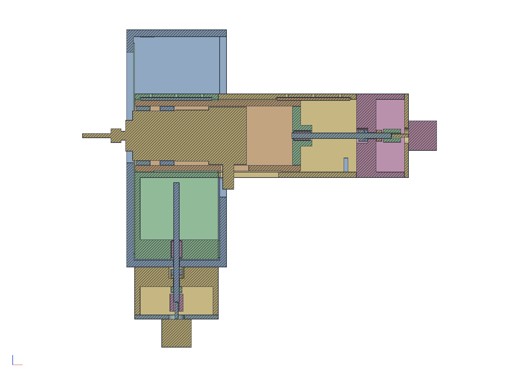

# A two-axis router positioner: boxes in boxes

A module that holds a trim router on its side and places it on two
axes under stepper control: along the bit (X, plunge) and up and down
(Z, bit height). Three boxes, one inside the next, each sliding in the
one outside it, with one lead screw down the middle of each moving box.
First meant as the head of a horizontal mortiser.

[BRIEF.md](BRIEF.md) is the design brief this is built from: the
decisions already made, the rules of thumb, and the questions still
open. This is the first pass it asks for: proportions derived from a
handful of numbers, the rules enforced, the four corners of the travel
checked, and the envelope reported, so the trade-offs can be looked at
before anything is detailed.

```sh
cargo build --release -p ok-mcp
python3 examples/router-positioner/build.py
cargo test -p ok-render --test router_positioner   # what CI runs
```


Nothing here is built. The router is the owner's Bosch Colt, out of
its base: its body is 70.71 mm across by the owner's callipers, and
every other dimension of it is read off the owner's two photographs of
it, one from the side and one end on, scaled by that body. That is
good to 2 or 3 mm, and across the cap only one way.

Its second use is already drawn: the [stick sled](../stick-sled/) lays
it on its lid beside a turning stick and reads its sizes from
`out/positioner.json`, so that example is built again after this one.
What that job asks of it is in the sled's README.

## What is in it

| | home: drawn back, up | plunged, down |
|---|---|---|
| cut through the bit's axis, from the front |  |  |

From the outside in, as the brief has it:

- **Outer box**, fixed. Its inside is the Z guide. A slot in its left
  face for the bit, a slot in its right wall for the X column.
- **Z stage**, sliding up and down in it. A square sleeve runs through
  its top from left to right; under the sleeve is the room the Z screw
  comes up into; the Z nut is in its floor.
- **X quill**, a square tube through the sleeve, the router clamped in
  its front. Behind the router is empty tube as long as the travel,
  where the X screw goes as the quill is drawn back; across its back
  end is the spider, a rim and four ribs with the X nut on the centre.
- **X column**, the sleeve carried on out of the stage's right side,
  moving up and down with it. The quill's back end runs in it.
- **A drive housing on the end of each column**, the same part twice:
  a recess for a collar and a thrust bearing, the bulkhead the bearing
  sits against, a chamber for the coupling, and the cap the motor is
  on. The Z one hangs under the outer box.

## What came out

With 60 mm of X, 80 mm of Z, 8 mm walls and an M8 screw:

| | mm |
|---|---|
| the module, long x deep x tall | 440 x 174 x 451 |
| of its length, column and motor out of the box's right side | 298 |
| behind the router's back cap, drawn back | 210 |
| the outer box | 142 x 174 x 337 |
| the Z stage | 119 x 151 x 235 |
| the quill | 100 square x 236 |
| the X column | 119 square x 196 |

The 210 mm behind the router is, in order: 4 to the screw's tip, 63 of
screw for the travel, the 24 mm nut in its boss, 3 of air, 16 of collar
and thrust bearing, the 12 mm bulkhead, 40 of coupling chamber, the
6 mm cap and 40 of motor. Only the 63 scales with the travel.

| the brief's rule | here |
|---|---|
| a box in its guide by 1.5 to 2 of its widths, everywhere | the quill 2.4 (sleeve and column together guide it), the stage 1.56 |
| the bit close to the sleeve's mouth at full plunge | the quill's front is level with the mouth, the router's nose 1.5 mm out of the box's face |
| the X screw's tip short of the router's back cap, drawn back | 4 mm |
| the Z screw clear of the sleeve, the stage down | 7 mm under the sleeve's floor |
| each screw right through its nut at the far end | 3 mm through |
| the X column clear of the outer box across Z | 1 mm top, 1.5 mm bottom and sides |

## What the proportions showed

Four things the brief could not have known before the boxes had sizes,
and two more once the router was in the picture.

1. **The outer box's right wall is cut away just where the stage needs
   it.** The router's weight and the plunge both tip the stage with its
   top to the right, and the column's slot takes all of that wall above
   116 mm. So the stage is 16 mm wider than the column on each side,
   front and back, and the wall keeps a rail either side of the slot
   for the stage to bear on. That is 32 mm of the module's depth.
2. **One part is longer than the printer's 256 mm:** the outer box,
   337 tall. It prints in two lengths, or is plywood. The quill was
   over too while the router was guessed at 190 mm long; at the 159
   the photograph gives, it is 236 and fits.
3. **The bit slot is as wide as the router's body, and a bit is
   changed through it.** The end-on photograph shows what stands out
   of the body's front face at its rim: three screw heads, the red
   spindle lock, and the end of the depth rack, 12 mm proud. At full
   plunge that face is 1.5 mm behind the box's wall, so a slot only as
   wide as the boss would have met all three. At 77 mm everything on
   the face passes and the lock is under a thumb from the front. The
   collet nut's face is 34 mm out of the quill, so the whole nut is
   7.5 mm clear of the box's face for the wrench. The cost is a face
   with a 77 x 157 hole in it, 14 mm from each of the stage's two
   gibs there.
4. **The quill's gibs in the sleeve are inside the outer box.** Their
   set screws are drawn but nothing reaches them once the stage is
   in. The two in the column are outside and easy.
5. **The body is round for only 58 mm.** Behind that is a rubber grip
   73 across and the cap, 81. Both collars are on those 58 mm, pushed
   on from the front, and 100 mm of router overhangs behind them a
   millimetre clear of the quill's bore. Something to steady the cap
   is not drawn. The router goes in from the front, cap first, so it
   goes in before the stage goes into the outer box.
6. **The cord leaves the cap's side, and at full plunge that is in
   the thickness of the outer box's right wall.** The router is
   turned in its collars so the cord points down, at the Z drive. It
   is the one way open: to the front and the back are the rails the
   stage bears on, and above is the lid. So the quill's floor has a
   slot between its two bearing strips, long enough to feed the plug
   through; the column's floor has one as long as the travel; and the
   right wall has a notch 26 mm deeper than the column's slot. The
   boot passes 6 mm from the stage at full plunge and 8 mm short of
   where the quill's back strip runs, drawn back. Where the boot
   leaves the cap is the least sure reading of the photograph, and
   10 mm either way uses up one of those.

## What the open questions were taken to be

| the brief's question | this model takes | to change it |
|---|---|---|
| 1. the router | the owner's Bosch Colt, base off. Body 70.71 across, measured. From the photographs: round for 58, a grip 73 across, the cap 82, 159 from the body's front face to the cap's top, and 193 with the boss, spindle and collet nut | `ROUTER_*`, `NOSE_*`, `COLLET_*`, `CORD_*` in `build.py` |
| 2. travel | X 60, Z 80 | `X_TRAVEL`, `Z_TRAVEL` |
| 3. screw | M8 x 1.25 rod, a 13 across-flats coupling nut 24 long: 0.00625 mm a full step | `SCREW_*`, `NUT_*`; a T8 goes in the same bores |
| 4. motor | NEMA 17, 40 long | `MOTOR` |
| 5. material | not chosen; 8 mm walls, 10 on the outer box | `WALL`, `OUTER_WALL` |
| 6. the router's clamp | two collars round the body's 58 mm, a close fit in the quill; how they tighten is not drawn | |
| 7. Z screw and sleeve | checked: 7 mm apart at the worst | |
| 8. reference faces | the quill bears down and back, gibs over it and before it; the stage bears on the two rails and the back wall, gibs in the left and front walls | `Z_GIBS` and the strips in `build.py` |
| 9. dust | nothing drawn | |

Back is the side the feed is taken to push the bit toward.

## Measure these first

The body's 70.71 mm is measured. These are the photographs', most
important first:

| what | in the model | check |
|---|---|---|
| the widest thing on the router, both ways across | 82 mm, the cap | the photo sees 81 one way and nothing the way the brush caps face; it sets the quill's bore, and so every box outside it |
| where the cord's boot leaves the cap | on the side, 127 mm back from the body's front face, leaning back; 16 across, 35 long | it has 6 mm one way and 8 the other |
| the body's front face to the top of the cap | 159 mm | it sets the quill's length, 1 for 1 |
| how far back the body stays round and bare | 58 mm | both collars are on it |
| in front of the body: boss, spindle, collet nut | 44 x 13, 13 x 6, 20 x 15: the nut's face 34 out | where the nut is at full plunge; in the stick sled, how far the positioner stands from the stick |
| on the front face's rim: the rack's end, the lock, three screw heads | the rack 18 wide and 12 proud, about 100° round from the cord; the rest 3 proud | the slot is as wide as the body so that they pass, wherever round they are |
| whether a thumb through the slot works the lock | not tried | how a bit is changed |

## Parts

| part | size, mm | |
|---|---|---|
| outer box | 142 x 174 x 337, walls 10 | bit slot 77 x 157; the column's slot and the cord's notch under it; three gib pockets; a pocket in the lid for the Z home switch |
| Z stage | 119 x 151 x 235 | the sleeve, 103 square; the Z screw's room, 88 high; the Z nut's pocket; bearing strips on its right and back |
| X column | 119 square x 196 | the cord's slot in its floor, 22 x 82; two vents, two gib pockets |
| X quill | 100 square x 236, bore 84 | bearing strips underneath and behind, at each end; the cord's slot in its floor, 22 x 40 |
| spider | 84 square x 12, boss 30 across x 28 | the X nut's pocket |
| drive housing, 2 | 119 square x 68 | and an end cap, 6 |
| gibs, 7 | 4 x 20 strips | three for the stage, four for the quill |
| router clamps, 2 | 84 square x 20 | bored 71.3 |
| bought, per axis | M8 rod, a brass coupling nut, an F8-16M thrust bearing, two collars, a rigid 5 to 8 coupling, a NEMA 17, a limit switch | |

Not drawn yet: any fastener, how the column is fixed to the stage and
the spider to the quill, the nuts' retainers, the second thrust face
(drawing the quill back pulls the screw against a plain collar), the
connector panel, and the datum faces' bolt patterns.

## What the test checks

`crates/ok-render/tests/router_positioner.rs` regenerates every part
from the document and, with the kernel's solids:

- at each of the four corners of the travel, no part is through
  another, over some 68 pairs of parts that are near each other, the
  router with its boss, its rack's end and its cord's boot among them; and run past
  either end of either travel, something is hit, so the check can
  tell;
- the quill is wholly between the sleeve's mouth and the column's end,
  and the stage wholly inside the outer box, each by more than a width
  and a half, at both ends of both travels;
- each screw is through its nut at one end and short of what it runs
  toward at the other, the Z screw's distance to the sleeve's floor
  found with a post stood on its tip;
- the envelope, the length behind the router and the parts too long
  for the printer are what the build reported.
