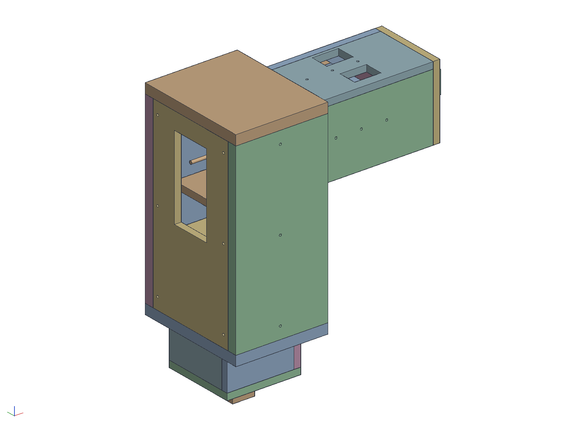

# A two-axis router positioner: boxes in boxes

A module that holds a trim router on its side and places it on two
axes under stepper control: along the bit (X, plunge) and up and down
(Z, bit height). Three boxes, one inside the next, each sliding in the
one outside it, with one lead screw down the middle of each moving box.
First meant as the head of a horizontal mortiser.

[BRIEF.md](BRIEF.md) is the design brief this is built from: the
decisions already made, the rules of thumb, and the questions still
open. This is the first pass it asks for: proportions derived from a
handful of numbers, the rules enforced, the four corners of the travel
checked, and the envelope reported, so the trade-offs can be looked at
before anything is detailed.

It is drawn in plywood, as the owner asked: every box is flat panels
of 1/2 in or 3/4 in sheet, butted and glued, and the build writes the
[cut list](out/cutlist.csv). What is not plywood is thin or bought.

```sh
cargo build --release -p ok-mcp
python3 examples/router-positioner/build.py
cargo test -p ok-render --test router_positioner   # what CI runs
```



Nothing here is built. The router is the owner's Bosch Colt, out of
its base: its body is 70.71 mm across by the owner's callipers, and
every other dimension of it is read off the owner's two photographs of
it, one from the side and one end on, scaled by that body. That is
good to 2 or 3 mm, and across the cap only one way.

Its second use is already drawn: the [stick sled](../stick-sled/) lays
it on its lid beside a turning stick and reads its sizes from
`out/positioner.json`, so that example is built again after this one.
What that job asks of it is in the sled's README.

## What is in it

| | home: drawn back, up | plunged, down |
|---|---|---|
| cut through the bit's axis, from the front |  |  |

From the outside in:

- **Outer box**, fixed, six panels. Its inside is the Z guide. A slot
  in its left face for the bit, a slot in its right wall for the tube.
  The face is 1/2 in so that the collet nut comes out of it; the rest
  is 3/4.
- **The tube**, 1/2 in, four panels the same width each lapping the
  next. One piece from the sleeve's mouth to the X motor: the quill's
  guide where it passes through the stage, the column beyond, and the
  motor's housing at its end, with a bulkhead let in for the thrust
  bearing and a cap for the motor. Its being one piece is what joins
  the column to the stage.
- **Z stage**: what is glued to the tube to make it slide up and
  down. A 3/4 in cheek on the tube's front and one on its back, the
  stage's whole height, and between them at the bottom a foot of four
  1/2 in layers with the Z nut caged in the middle two. The cheeks'
  edges are the stage's bearing faces, left and right.
- **X quill**, a square tube of 1/2 in, the router clamped in its
  front by two 3/4 in collars. Behind the router is empty tube as
  long as the travel, where the X screw goes as the quill is drawn
  back; across its back end is a 3/4 in bar with the X nut caged
  behind it.
- **Z motor housing**, under the outer box: the tube's end over
  again, stood up.

## What came out

With 60 mm of X, 80 mm of Z, the two plywoods and an M8 screw:

| | mm |
|---|---|
| the module, long x deep x tall | 457 x 219 x 504 |
| of its length, tube and motor out of the box's right side | 283 |
| behind the router's back cap, drawn back | 224 |
| the outer box | 175 x 219 x 387 |
| the Z stage | 140 x 178 x 267 |
| the quill | 111 square x 225 |
| the tube | 140 square x 391, and its cap |

The 224 mm behind the router is, in order: 4 to the screw's tip, 63 of
screw for the travel, the nut's cage and its keeper, 37, 3 of air, 16
of collar and thrust bearing, the 12.7 bulkhead, 35.5 for the coupling,
the 12.7 cap and 40 of motor. Only the 63 scales with the travel.

| the brief's rule | here |
|---|---|
| a box in its guide by 1.5 to 2 of its widths, everywhere | the quill 2.0, the stage 1.50: the stage is made 267 tall for it |
| the bit close to the sleeve's mouth at full plunge | the quill's front is level with the mouth; the router's nose stops 1.2 mm inside the box's face and the collet nut is 4.8 clear of it |
| the X screw's tip short of the router's back cap, drawn back | 4 mm |
| the Z screw clear of the tube, the stage down | 6.8 mm under its floor |
| each screw right through its nut at the far end | 3 mm through |
| the tube clear of the outer box across Z | 1 mm top, 1.5 mm bottom and sides |

## The plywood

Two thicknesses and no other, nominal: 12.7 and 19.05 mm. Sheet goods
run thin, so measure the sheets and put what they are in `T12` and
`T34` at the top of `build.py`; every size follows. 38 pieces: 0.36 m2
of 3/4 in, 12 % of a sheet, and 0.53 m2 of 1/2 in, 18 %.

**3/4 in**

| part | piece | long x wide, mm | how many |
|---|---|---|---|
| Outer box | front | 349.0 x 174.6 | 1 |
| Outer box | back | 349.0 x 174.6 | 1 |
| Outer box | right wall | 349.0 x 180.9 | 1 |
| Outer box | floor | 219.0 x 174.6 | 1 |
| Outer box | lid | 219.0 x 174.6 | 1 |
| Z stage | front cheek | 267.0 x 139.8 | 1 |
| Z stage | back cheek | 267.0 x 139.8 | 1 |
| Spider | bar | 85.6 x 54.0 | 1 |
| Router clamps | collar | 85.6 x 85.6 | 2 |

**1/2 in**

| part | piece | long x wide, mm | how many |
|---|---|---|---|
| Outer box | face | 349.0 x 180.9 | 1 |
| Z drive housing | motor's cap | 139.8 x 139.8 | 1 |
| Z drive housing | right | 127.1 x 64.2 | 1 |
| Z drive housing | back | 127.1 x 64.2 | 1 |
| Z drive housing | left | 127.1 x 64.2 | 1 |
| Z drive housing | front | 127.1 x 64.2 | 1 |
| Z drive housing | bulkhead | 114.4 x 114.4 | 1 |
| X tube | lid | 390.6 x 127.1 | 1 |
| X tube | back | 390.6 x 127.1 | 1 |
| X tube | floor | 390.6 x 127.1 | 1 |
| X tube | front | 390.6 x 127.1 | 1 |
| X tube | motor's cap | 139.8 x 139.8 | 1 |
| X tube | bulkhead | 114.4 x 114.4 | 1 |
| Z stage | foot under the nut | 139.8 x 139.8 | 1 |
| Z stage | foot beside the nut | 139.8 x 62.9 | 4 |
| Z stage | foot over the nut | 139.8 x 139.8 | 1 |
| X quill | lid | 225.3 x 98.7 | 1 |
| X quill | back | 225.3 x 98.7 | 1 |
| X quill | floor | 225.3 x 98.7 | 1 |
| X quill | front | 225.3 x 98.7 | 1 |
| Spider | keeper | 54.0 x 40.0 | 1 |
| Spider | beside the nut | 40.0 x 20.0 | 4 |

A tube's four panels are one width, bore and a thickness, so each tube
is one rip. "Beside the nut" pieces are glued up two thick. Sizes are
the blanks: the slots, grooves and holes are cut after, and the tests
and pictures show where.

Not plywood: the seven gib strips, 4 x 20, in hardwood or UHMW; the
bearing strips, 1.5 thick; and what is bought, per axis: M8 rod, a
brass coupling nut, an F8-16M thrust bearing and a steel washer under
it, two collars, a rigid 5 to 8 coupling, a NEMA 17, a limit switch.

## What the proportions showed

1. **The outer box's right wall is cut away just where the stage needs
   it.** The router's weight and the plunge both tip the stage with its
   top to the right, and the tube's slot takes all of that wall above
   127 mm. So the stage is the tube and a 3/4 in cheek each side, and
   the cheeks' right edges bear on the 19 mm of wall left either side
   of the slot. Their left edges take two of the stage's three gibs,
   straight across.
2. **Plywood makes it bigger, not harder.** Printed walls were 8 and
   10 mm; 12.7 and 19 add 17 mm to its length, 43 to its depth and 51
   to its height. Nothing in it is longer than 391 mm, and all of it
   comes out of offcuts of two sheets.
3. **The bit slot is as wide as the router's body, and a bit is
   changed through it.** The end-on photograph shows what stands out
   of the body's front face at its rim: three screw heads, the red
   spindle lock, and the end of the depth rack, 12 mm proud. A slot
   77 mm wide passes all of it and puts the lock under a thumb. The
   face is the thin plywood so that the collet nut, whose face is
   34 mm out of the quill, is still 4.8 mm clear of it at full plunge.
4. **The quill's front gibs are inside the outer box.** Their set
   screws are drawn, through the tube and the stage's front cheek, but
   nothing reaches them once the stage is in. The two at the back are
   outside and easy.
5. **The body is round for only 58 mm.** Behind that is a rubber grip
   73 across and the cap, 81. Both collars are on those 58 mm, pushed
   on from the front, and 100 mm of router overhangs behind them,
   2.5 mm clear of the quill's bore. Something to steady the cap is
   not drawn. The router goes in from the front, cap first, so it
   goes in before the stage goes into the outer box.
6. **The cord leaves the cap's side and comes down through two
   floors.** The router is turned in its collars so the cord points
   down. It is the one way open: to the front and the back are the
   stage's cheeks, and above is the lid. The quill's floor has a slot
   long enough to feed the plug through; the tube's floor has one as
   long as the travel and 12 mm more each way, because where the boot
   leaves the cap is the least sure reading of the photograph. Near
   full plunge the boot is over the stage's own room, at its open
   side, and the cord trails out under the tube through a notch in
   the right wall. That room has the Z screw turning in it, 55 mm
   away: tie the cord to the tube's underside.
7. **What plywood asks for that printing did not.** A thrust bearing
   on plywood wants a steel washer under it. A NEMA 17's shaft through
   a 12.7 cap has 10.8 mm left for the coupling, which is why the
   coupling is drawn right up to the cap. A gib's set screws want
   threaded inserts. A nut in a pocket becomes a nut in a cage: two
   strips two layers thick either side of its flats, a keeper each
   end, and half a millimetre of float.
8. **Plywood moves.** The boxes are 1.5 mm apart all round and bear on
   strips and gibs, so a change in the weather is taken up at the
   gibs, not in the fit. Expect to set them again when the season
   turns. That is my caution, not a measurement.

## What the open questions were taken to be

| the brief's question | this model takes | to change it |
|---|---|---|
| 1. the router | the owner's Bosch Colt, base off. Body 70.71 across, measured. From the photographs: round for 58, a grip 73 across, the cap 81 with 84 allowed for, 159 from the body's front face to the cap's top, and 193 with the boss, spindle and collet nut | `ROUTER_*`, `NOSE_*`, `COLLET_*`, `CORD_*` in `build.py` |
| 2. travel | X 60, Z 80 | `X_TRAVEL`, `Z_TRAVEL` |
| 3. screw | M8 x 1.25 rod, a 13 across-flats coupling nut 24 long: 0.00625 mm a full step | `SCREW_*`, `NUT_*`; a T8 goes in the same holes |
| 4. motor | NEMA 17, 40 long | `MOTOR` |
| 5. material | plywood, 1/2 in and 3/4 in, the owner's choice | `T12`, `T34` |
| 6. the router's clamp | two 3/4 in collars round the body's 58 mm, a close fit in the quill; a saw kerf and a bolt across it would tighten one, and is not drawn | |
| 7. Z screw and tube | checked: 6.8 mm apart at the worst | |
| 8. reference faces | the quill bears down and back, gibs over it and before it; the stage bears on the right wall and the back wall, gibs in the face and the front wall | `Z_GIBS` and the strips in `build.py` |
| 9. dust | nothing drawn | |

Back is the side the feed is taken to push the bit toward.

## What is measured and what is estimated

The body's 70.71 mm is measured, and the collet is 1/4 in. Everything
else about the router is read off the two photographs, and the owner
has said to go with those readings. So the two that the design is
most sensitive to carry an allowance, and the rest are listed for
whoever has the router and callipers in hand before cutting.

| what | in the model | if it is wrong |
|---|---|---|
| the two plywoods | 12.7 and 19.05 mm | measure the sheets first: every size follows from these two |
| the widest thing on the router, both ways across | the cap: 81 mm as the photo sees it one way, 84 allowed, the bore 86 | up to 85 either way still goes in; past that the quill and every box outside it grow |
| where the cord's boot leaves the cap | on the side, 127 mm back from the body's front face, leaning back; 16 across, 35 long | the slots take it 12 mm further forward or back |
| the body's front face to the top of the cap | 159 mm | the X screw's tip is 4 mm behind the cap, drawn back: a longer router wants the quill longer by as much |
| how far back the body stays round and bare | 58 mm | both collars are on it; under 42 they do not both fit |
| in front of the body: boss, spindle, collet nut | 44 x 13, 13 x 6, 20 x 15: the nut's face 34 out | where the nut is at full plunge; in the stick sled, how far the positioner stands from the stick |
| on the front face's rim: the rack's end, the lock, three screw heads | the rack 18 wide and 12 proud, about 100° round from the cord; the rest 3 proud | nothing: the slot is as wide as the body, wherever round they are |
| whether a thumb through the slot works the lock | not tried | how a bit is changed |

Not drawn yet: any fastener, the nuts' and bolts' places in the
joints, the second thrust face (drawing the quill back pulls the screw
against a plain collar), the connector panel, and the datum faces'
bolt patterns.

## What the test checks

`crates/ok-render/tests/router_positioner.rs` regenerates every part
from the document and, with the kernel's solids:

- at each of the four corners of the travel, no piece is through
  another, over some 46 pairs that are near each other, the router
  with its boss, its rack's end and its cord's boot among them; and
  run past either end of either travel, something is hit, so the
  check can tell;
- the quill is wholly between the tube's mouth and the screw's collar,
  and the stage wholly inside the outer box, each by a width and a
  half or more, at both ends of both travels; and the tube is the
  stage's top, one piece of work;
- each screw is through its nut at one end and short of what it runs
  toward at the other, the Z screw's distance to the tube's floor
  found with a post stood on its tip;
- the envelope and the length behind the router are what the build
  reported;
- every body of every box is a piece of one of the two plywoods, or
  two layers of one, and is on the cut list at its size, with nothing
  on the list left over.
