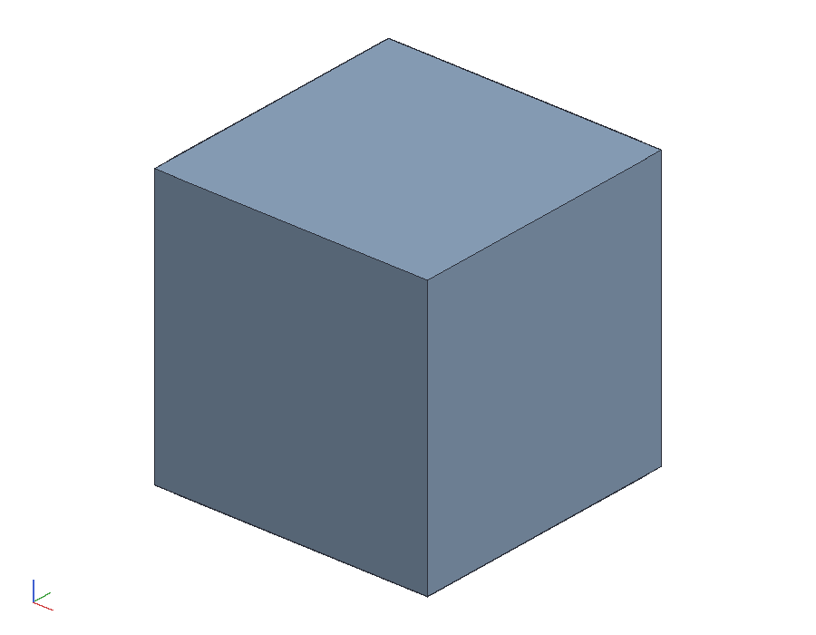

# Scan supports: 20 mm cubes and 40 mm posts

Three blocks to stand an object on for a turntable scan
(`examples/turntable-scan/`), and three taller ones for the same object
turned over. Set each on a bullseye mark of the measuring field and it
is a block of known height at a known place.

    cargo build --release -p ok-mcp
    python3 examples/scan-supports/build.py       # the document, the STLs, pictures, numbers
    cargo test -p ok-render --test scan_supports  # what CI runs

## Why

- **The lift.** The scanner takes everything under `min_height` as
  the table, and the lowest centimetre of an object standing on the
  paper is lost to the table's glow and to the line meeting the paper
  at a grazing angle. On 20 mm blocks the base is at 20 mm; set
  `min_height` to 22 and the blocks and the table drop out of the
  cloud entirely, since the blocks are 20 mm tall.
- **The second pose.** Turned over onto the blocks and scanned again,
  the object's underside is seen and `merge_scans` with
  `placed: "upside down"` joins the two. A pumpkin turned over rests
  on its shoulders with the stem down, and stems run to 35 mm, so the
  posts are 40 mm; `min_height` is then 42.
- **The check on the laser's plane.** A block centred on a mark has
  its top face at exactly 20 (or 40) mm at a place the field knows to
  the millimetre, and its vertical faces 10 mm each way from the
  mark's centre. The laser's line on that top face, triangulated,
  should come out at that height; where it does not, the plane is off,
  which the line on the paper alone cannot say. This is the
  calibration object the scanner's roadmap asks for.

## What it is

| part | size | what it does |
|------|------|--------------|
| cube | 20 x 20 x 20 mm | one of three supports under the object, standing on a mark |
| post | 20 x 20 x 40 mm | the same for the object turned over, with room for a stem |

Both are plain blocks: every face square to the axes, so they print
flat on any side and their heights are what the scanner checks. Print
them white or light grey and matte: the marks are read as dark ink
against their surroundings, and a black block is a dark blob with
edges; a red line reads on light PLA as it does on the paper. Three of
each, `out/cube20.stl` and `out/post40.stl`.

## Placing them

Pick the three marks nearest the turntable's centre that form a
triangle inside the object's outline, say the marks printed
`200, 150`, `250, 150` and `200, 200` (every mark's coordinates are
printed beside it), which spread the supports 50 and 71 mm apart.
Centre each block on its bullseye by eye: the dot is 5 mm across and
the block 20, so the ring shows round all four sides when it is
centred, which is within a millimetre. Tell the scan which marks the
blocks stand on.

## Measure these first

| what | in the model | how to check |
|------|--------------|--------------|
| the cube's height | 20.00 mm | calipers across the print; the scanner checks the laser's plane against this number, so a printer that runs 0.2 mm tall is 0.2 mm of error at the top of the object too |
| the post's height | 40.00 mm | the same |
