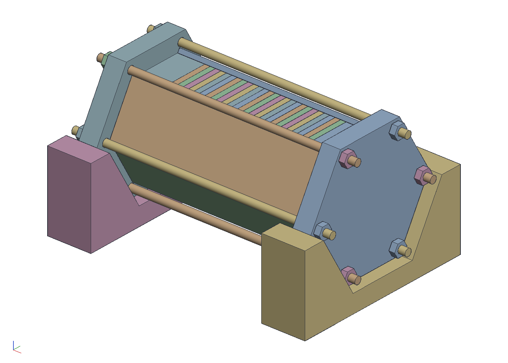
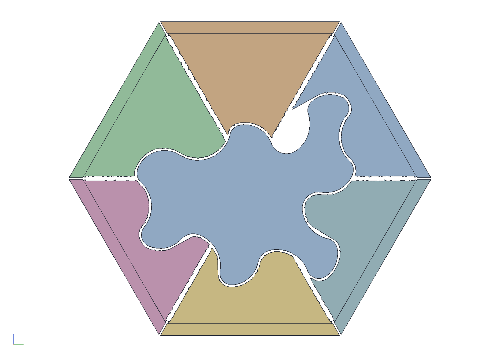

# A cage for routing a stack of Spectre pieces

Every tile of a Spectre top is the same shape, so the top's pieces can
be cut as one prism. Each piece is a hex blank of 1.5 mm veneer glued
to a 1.5 mm ply backer; the blanks are stacked dry, nothing glued
across the stack, in a hexagonal tube and clamped end to end by six
M4 rods along its corners. The tube's six sides come off one at a time:
through the open window a ball-nose bit on the duplicator routs the
profile, following a printed master indexed in the same hex, and the
side goes back with fins that fill what was cut, so the stack is never
unsupported. When the rods come out, the pieces fall apart finished,
with the faces they were glued up with.

```sh
cargo build --release -p ok-mcp
python3 examples/spectre-cage/build.py
cargo test -p ok-render --test spectre_cage     # what CI runs
```





## What the script does

- Asks the kernel for the master with `spectre_tile`: the spectre-box's
  tile (9 mm edge, arcs of sagitta 0.3) with its four inside corners
  filleted to the 3/16 in bit, eroded by half the 0.7 mm gap the top's
  pieces will have between them, and its ten convex corners rounded to
  the bit as well (`ROUND`; 0 keeps the Spectre's own corners). A piece
  routed to its template has the corners that seat in a neighbour's
  fillet rounded and the rest sharp, which corners depending on where
  the tile sits; one master cannot do that, so it rounds all of them,
  which is the softer knob, at the cost of a sliver of resin where three
  tiles meet, which a top with a gap has anyway. The tile comes back
  centred on its smallest circle, 41.9 mm across, and the blank hex is
  that plus a margin: 48 mm across flats.
- Clocks the profile in the hex. The two cradles give twelve indices:
  on the flat one a panel's window faces straight up, on the V one the
  hex rests on a corner and the window either side of the top corner
  is 30 degrees off vertical, so the bit comes down a corner's
  direction through one of two panels. For each turn of the profile
  the script checks every edge of the outline: the edge must not face
  away from the bit, and with the ball on the edge the column its
  shank sweeps up to the window must be clear of the profile and of
  the five panels still in place. It keeps the turn that reaches the
  whole outline. Six flat indices alone do not: the tile's deep bays
  open toward the hex's corners.
- Lays out the top itself (`add_spectre`, four woods, no two
  neighbours alike) to count the pieces and read their woods, and
  writes the stack order, one laminate per piece plus two spares, to
  `out/stack.txt`.
- Builds the master (the profile over the stack's length with a hex
  end at each end, the flanges' hex, for the cradles), the loaded cage
  (five panels with the top window open, the plugs, the rods and nuts,
  the laminates by wood, the flat cradles under the flanges), the six
  finned panels round the master, and the two cradles on their own.
- Exports the printable parts as STL and the numbers as `out/cage.json`.

## The parts

| | |
|---|---|
| blank | hex 48 across flats, 3 mm: 1.5 veneer on 1.5 ply |
| stack | 26 laminates (24 pieces and 2 spares), 78 mm |
| panels | 2 mm plates, edges mitred at 60 degrees, a hair short of each other |
| rods | M4, in the V between two panels' outer faces at each corner, nuts outside the flanges |
| plugs | a hex boss 15 deep into the tube, a 10 mm flange outside it, 66 across flats |
| master | the profile over 78 mm, a 25 mm hex end each side, 66 across flats |
| cradles | a flat socket (the lower half of the 66 hex) and a 120 degree V, 24 long |
| fins | 0.3 mm off the profile every way, and off each other at the sector lines |

## The sequence

For each panel: take it off, set the cage in the flat cradle with the
window up and rout; set it in the V cradle leaning one way and rout,
then the other way; put the finned panel on. Eighteen settings, six
panel changes. The master sits in its own pair of cradles beside the
cage at the same index every time.

## What the test checks

`crates/ok-render/tests/spectre_cage.rs` reads the document and
`out/cage.json` and checks that the master is the top's tile centred
in a hex that holds it, with the body's volume that profile over the
stack plus its ends; that every edge of the clocked profile is
reachable at one of the twelve indices, by its own sweep of the ball
and its shank down from the window, and that six flat indices alone
are not enough; that from above a ball bit leaves no residual on the
profile, the fillets being its own; that every finned panel clears the
master and the other five fins and fills its sector's column to within
the clearance; and that the loaded cage reads back as the stack with
its woods, the rods clear of the panels, the stack and the plugs, the
flanges the master's hex, resting on the cradles' floors, and the two
cradles' troughs half a hex and a corner.

## Notes

- The spares are at the ends on purpose: a pilot cannot reach into the
  corner where the profile meets the master's hex end, so the copy
  carries a fillet there, on the first and last laminate.
- A ball-nose bit and pilot, not a flat one. A flat bit can only leave
  vertical walls and flat floors; the profile's curves, seen from
  above, would come out as steps.
- Fins thinner than 1.5 mm at their thickest are left off; they would
  not print and would not support anything.
