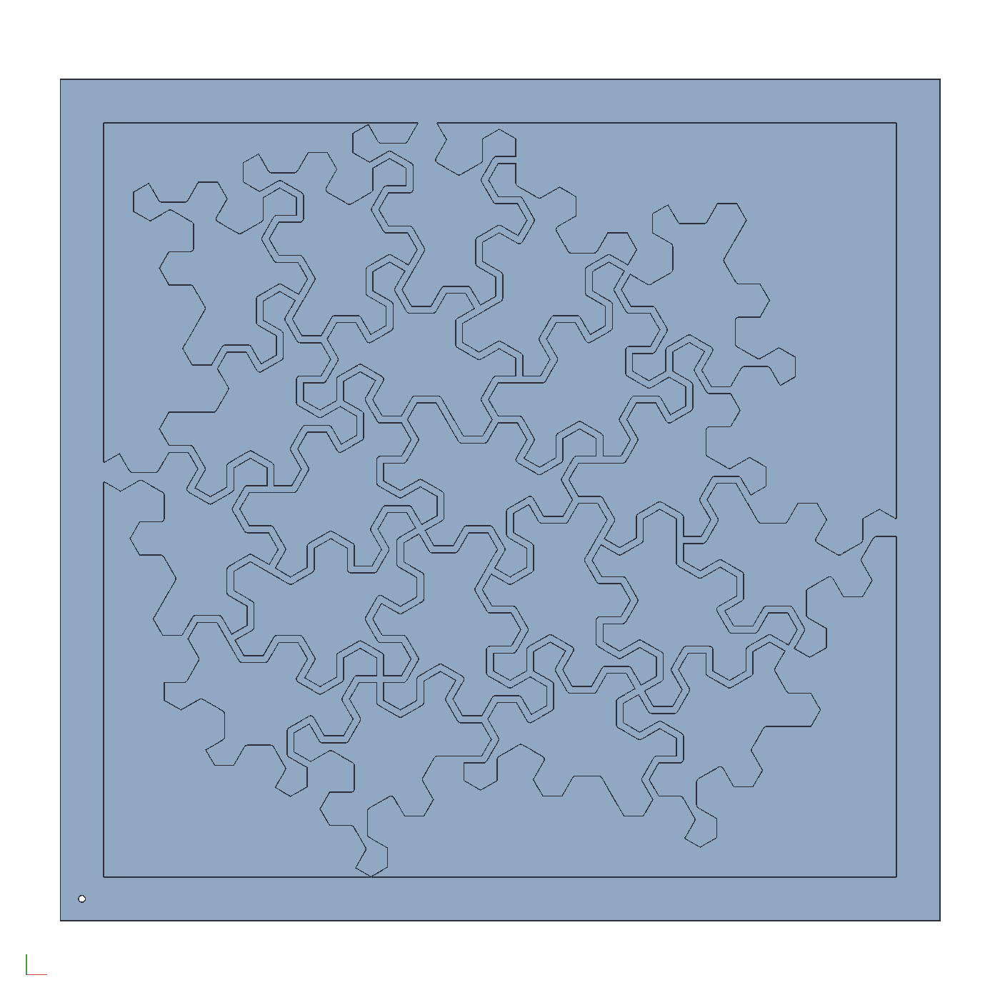

# Clamping cauls for a Spectre tile stick

The tile sticks of the hex-edged Spectre glued tight instead of
cast: the sticks of one tile (the lattice triangles and halves of
`examples/spectre-mosaic`) are laid lengthwise into a printed cradle
whose pocket is the tile's own outline, glued, and a printed plunger
is pressed down on them, so the tile comes out as one solid stick with
no resin in it. The stick is sliced into tiles, and the tiles go into
the pattern plate, whose webs are the 1.5 mm lines between tiles, for
the resin that joins them.

```sh
cargo build --release -p ok-mcp
python3 examples/spectre-cauls/build.py
cargo test -p ok-render --test spectre_cauls   # what CI runs
```


## Why the lid takes one bump

A lid that comes down onto a bundle is a negative of the part of the
outline above the split, and it only comes down if that part does
nothing but narrow going up: a dent above the split makes the outline
widen again, and the lid's material under that overhang would have to
pass through the sticks. Every turn of the Spectre has a dent close
under its top, so the search (every degree of turn, every split at a
corner, the lowest split that works at each turn, the turn whose lid
takes the most) ends the same way at every turn: the lid takes one
bump, 4 % of the tile, three sticks. That is still the right clamp.
The cradle's pocket enforces the other 96 % of the outline exactly,
since the sticks go into it one at a time from above and a bay under
an overhang is reached by sliding the stick in sideways before the
sticks above it are placed; and the plunger's force spreads through
the lattice at 60°, so by the floor it covers the tile's width. The
plunger is the slot's full width for stiffness and the clamps, with
the bump's negative in its middle; beside the bump it stops a play
above the split, over the cradle's own material.

| | |
|---|---|
| turn | 30°, split 36.8 mm up of the tile's 41.3 |
| pocket | the outline plus 0.1 mm each side, for the saw's error over a few sticks |
| cradle | 56 x 55 x 50 mm, walls 6, floor 6, the walls 8 above the bundle |
| plunger | 43 x 24 x 50, 0.15 short of the walls each side, 12 above them when down |
| per stick | three of each along a 200 mm stick, like the ladder's stands |

The tile's mirror image needs no second set: a prism's mirror is the
prism turned end for end, so the same cauls make both chiralities.

## The pattern plate

`pattern.okpart` is the plate the sliced tiles are laid in for the
resin: `add_spectre` with the hex curve, the 4 in board, every tile
the board reaches kept whole, the `pattern` layout, grooves 6 deep
and the 1.5 mm gap as the webs between pockets. The sliced tiles drop
into the pockets, the resin fills the lines, and the square is trimmed
from the glue-up.



## What the test checks

`crates/ok-render/tests/spectre_cauls.rs` regenerates the cauls'
document and reads `cauls.json`: the cradle's volume is its block less
its pocket and the plunger's is its block less the bump's negative, at
the length; the pocket's lower part and the negative together are the
tile's area plus the clearance; the part of the outline above the
split only narrows going up, within the slot; the plunger fits the
slot with its play; and the pattern plate regenerates into one body.
