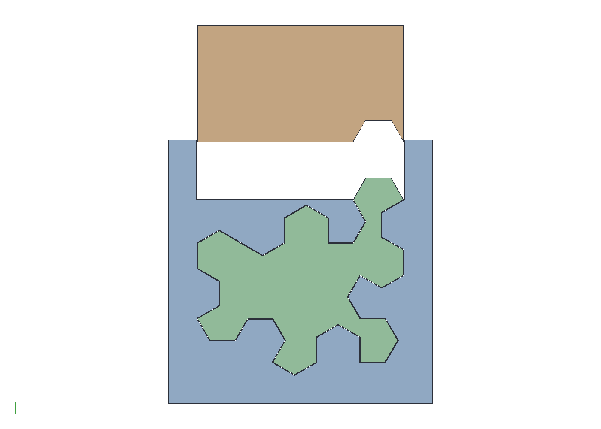
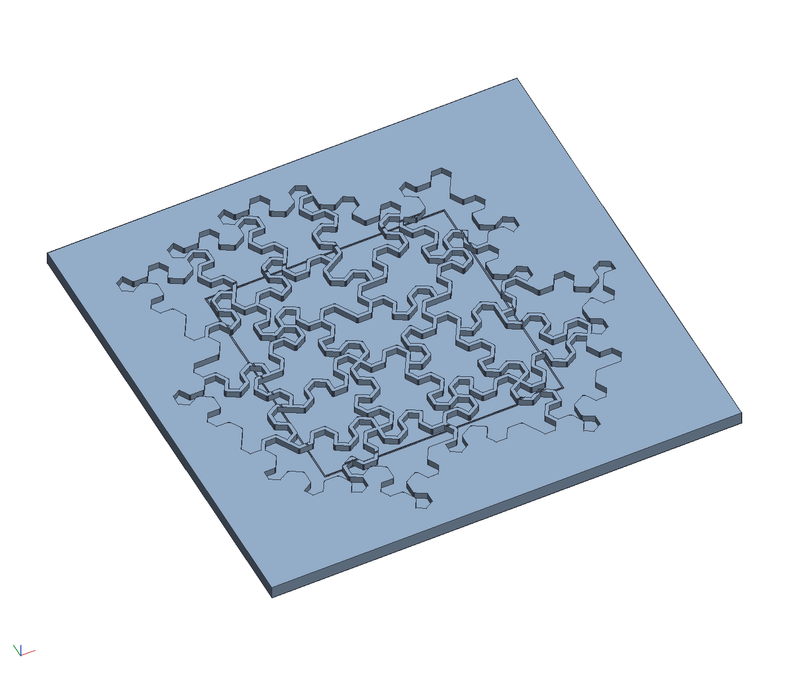
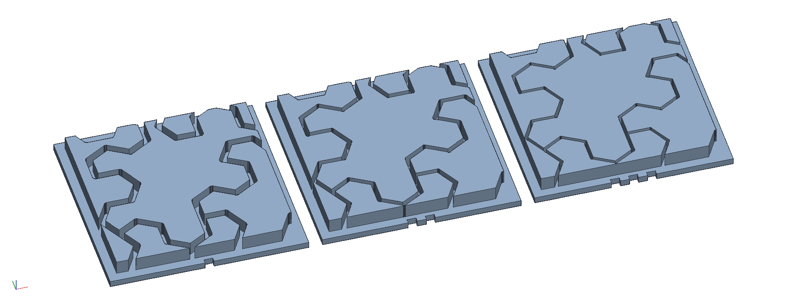
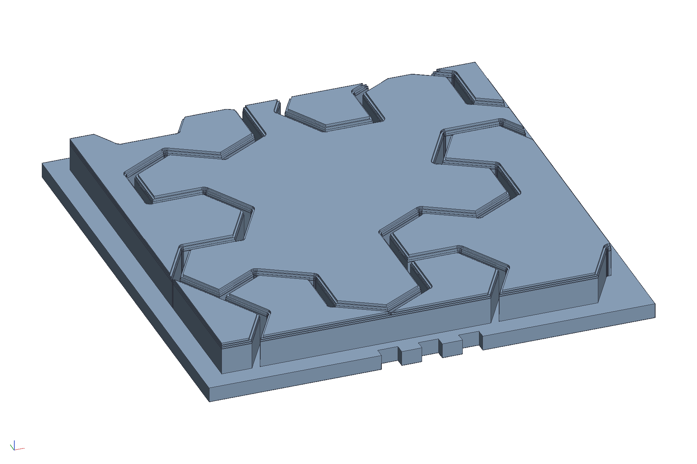

# Clamping cauls for a Spectre tile stick, and the layout template

The tile sticks of the hex-edged Spectre glued tight instead of cast,
and the tiles kept as separate units. The sticks of one tile (the
lattice triangles and halves of `examples/spectre-mosaic`) are laid
lengthwise into a printed cradle whose pocket is the tile's outline,
glued with the thinnest line, and a printed plunger is pressed down on
them, so the tile comes out as one solid stick. The stick is sliced
into tiles. The tiles are laid out on a printed template, a pocket
per tile with the 1.5 mm lines standing between them as ridges, taped
across their tops to hold the layout, lifted off, and glued and
clamped to a substrate, the dark glue or a coat of dark resin showing
in the lines. Keeping the tiles separate is what lets a later version
push them.

```sh
cargo build --release -p ok-mcp
python3 examples/spectre-cauls/build.py
cargo test -p ok-render --test spectre_cauls   # what CI runs
```



## The tile is the tile less half the line

Tiles that stand 1.5 mm apart on the tiling are not the tile: they
are the tile eroded by 0.75 all round, which is what every layout in
this repository has drawn as a piece since the puzzle top. So the
cradle's pocket is the eroded outline (plus 0.1 of clearance for the
saw's error over a few sticks), and the sticks along the tile's
boundary are the lattice shapes with that side moved in by 0.75. A
side moved in leaves a triangle a triangle and a half a half, only
smaller, so the cut list stays short. For one tile at a 10.56 mm edge,
with a 0.1 mm glue line between sticks:

| count | stick | sides, mm |
|---|---|---|
| 32 | triangle, one side on the tile's edge | 4.30 |
| 28 | triangle, inside | 5.11 |
| 19 | small half, inside | 1.18, 2.05, 2.37 |
| 17 | half, inside | 2.50, 4.34, 5.01 |
| 4 | half, one side on the edge | 1.80, 3.12, 3.61 |
| 2 | trapezoid, inside | 1.24, 2.19, 2.50, 2.52 |
| 1 | half, its long side on the edge | 2.10, 3.64, 4.20 |
| 2 | two more cut-back shapes, one stick each | |

105 sticks in nine shapes, seven of them with more than one stick. The small halves are the ones to drop if
they are too fiddly to saw; they become glue and dust, 2 % of the tile.

## Why the lid takes one bump

A lid that comes down onto a bundle is a negative of the part of the
outline above the split, and it only comes down if that part does
nothing but narrow going up: a dent above the split makes the outline
widen again, and the lid's material under that overhang would have to
pass through the sticks. Every turn of the Spectre has a dent close
under its top, so the search (every degree of turn, every split at a
corner, the lowest split that works at each turn, the turn whose lid
takes the most) ends with the lid taking one bump, 7 % of the eroded
tile. That is still the right clamp. The cradle's pocket enforces the
other 93 % exactly, since the sticks go into it one at a time from
above and a bay under an overhang is reached by sliding the stick in
sideways before the sticks above it are placed; and the plunger's
force spreads through the lattice at 60°, so by the floor it covers
the tile's width. The plunger is the slot's full width for stiffness
and the clamps, with the bump's negative in its middle; beside the
bump it stops a play above the split, over the cradle's own material.

| | |
|---|---|
| turn | 330°, split 37.3 mm up of the tile's 45.0 |
| pocket | the eroded outline plus 0.1 mm each side |
| cradle | 59 x 59 x 50 mm, walls 6, floor 6, the walls 8 above the bundle |
| plunger | 47 x 28 x 50, 0.15 short of the walls each side, 12 above them when down |
| per stick | three of each along a 200 mm stick, like the ladder's stands |

The tile's mirror image needs no second set: a prism's mirror is the
prism turned end for end, so the same cauls make both chiralities.

## The template



`template.stl` is `add_spectre` with the hex curve, the 4 in board,
every tile the board reaches kept whole, and the `template` layout:
a slab 200 x 192 with a 3 mm pocket per tile, 21 of them, the 1.5 mm
lines between them standing as ridges and the slab a margin wider
than the tiles. The sliced tiles drop into the pockets, which puts
every one at its exact place and spacing; tape across the tops holds
them; the taped sheet lifts off and goes down on the glue. The
pockets are shallow so the tape reaches most of a 10 mm tile and the
sheet does not bind on the ridges. A faint scribe, 0.5 wide and 0.4
deep, runs round the lid's trim rectangle across the pocket floors
and the ridge tops, so which part of a tile ends up in the lid is
plain while it is being laid.

## The line sample



`gap_sample.py` writes `gap_sample.stl`, a 138 mm strip of three
samples of the lid, the same 40 mm patch of tiles in each, with the
line between tiles at 1.5 mm (the current width), 1.0 and 0.7, left
to right. Every tile is a 3 mm pad on a 1.5 mm base, sunk 0.3 into
it, so the gaps between pads are the lines; printed in a dark filament
they read as the dark glue will. Notches in each base's front edge
count the samples, one for the current line, three for the
narrowest. Change `GAPS` in the script for other widths; the one the
eye picks goes into `GAP` here and in the mosaic.

The owner picked 0.7. `gap_sample.py --round` writes
`gap_sample_round.stl`, the 0.7 sample again with every tile's top
edges rounded over by 0.6 mm, as a tile eased with a sanding block
would be, so the line reads deeper than it is. The kernel's fillet
rolls a true radius, but across three hundred facet edges of eroded
corners and the slivers the board's edge leaves it breaks on one of
them, so the roundover is built the way the printer builds it at its
0.2 mm layers: the pad stops its radius short of the top and the last
three layers are each the piece eroded to where the circle stands at
that height. The print is the same stair a sliced fillet would be.



## What the test checks

`crates/ok-render/tests/spectre_cauls.rs` regenerates the cauls'
document and reads `cauls.json`: the cradle's volume is its block less
its pocket and the plunger's is its block less the bump's negative, at
the length; the pocket's lower part and the negative together are the
eroded tile plus the clearance; the part of the outline above the
split only narrows going up, within the slot; the plunger fits the
slot with its play; the template regenerates to one body with a pocket
floor per tile and the trim scribe in its floors and ridges; the line sample strip is three samples long at the three widths; and the cut list is a few shapes, triangles the
commonest, every triangle equilateral and every half a 30-60-90.
