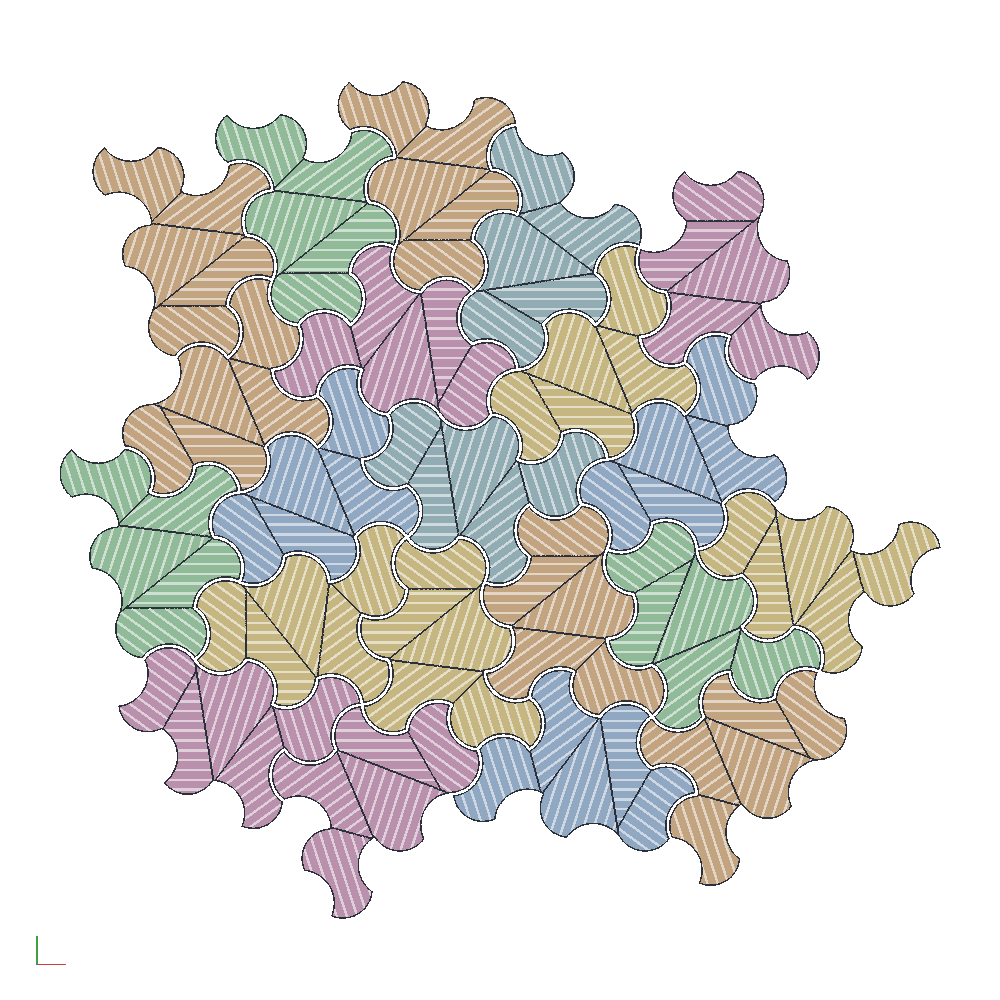

# A Spectre lid from glued-up prisms, built through MCP

The 4 in puzzle box's lid again, this time made the way thirty of them
can be: the curvy Spectre at a 10.56 mm edge, its edges arcs of five
sixteenths of a circle, which is exactly what a 1/4 in bullnose cuts on
the bumps and a 1/2 in core box on the flutes. The tile is split along
four glue lines into five convex prisms; each prism is a stick ripped
on the table saw and run past the two bits on the router table, the
five sticks are glued into one tile stick, and the stick is sliced
into pieces. Every tile the board reaches is kept whole, the glue-up is
made a tile larger all round, and the square is trimmed from it after.
Maple for the field and walnut for the mystic pairs, a 0.7 mm gap for
the glue line.

```sh
cargo build --release -p ok-mcp
python3 examples/spectre-lid/build.py
cargo test -p ok-render --test spectre_lid     # what CI runs
```



- `build.py`: `spectre_prisms` first, for the fewest glue lines that
  satisfy the curve, then one `add_spectre` op with `curve: "arc"`,
  `bulge: 0.2673`, `whole: true` and those lines as `prisms`. Ten
  slides of the tiling are tried and the one with the fewest whole
  tiles is kept. Then the screenshots, the sheet, the templates, the
  stick profiles and the sample piece. The gap is the one constant
  `GAP`; change it there.
- `out/spectre_lid.okpart`: the document. Open it in the web app: the
  Spectre panel has the board, the edge, the curve, the gap, the
  whole-tiles box and the prism planner with the glue lines on their
  grid.
- `out/lid.pdf`: the glue-up at 1:1 on A3 (it overflows A4), every
  piece outline with its glue lines, each tile one shade of gray
  (walnut darker) and each prism within it striped at its own angle,
  the board drawn on it as the dashed TRIM rectangle. Print at 100 %
  and lay the pieces out on it.
- `out/templates.dxf`: every piece outline at 1:1.
- `out/prisms.dxf`: the five stick profiles at 1:1, one layer each,
  with half the gap off their outside faces and the glue faces full:
  what to rip and rout each stick to.
- `out/sample_piece.stl`: one whole tile as the pieces come off the
  stick, 0.35 mm inside the tile all round, 3 mm thick (enough to be
  stiff, quick to print) with the four glue lines engraved in its
  top. Print it, and a second, and see how they sit against each
  other before any stick is glued.
- `out/lid.json`: the numbers the test reads.

## The numbers

| | |
|---|---|
| Board | 101.6 x 101.6 x 12 mm, trimmed from a 173 x 171 glue-up |
| Tile edge | 10.56 mm; a tile is 914 mm², about 41 x 34 |
| Curve | arcs of sagitta 0.2673 edge: radius 6.35 mm (1/4 in), 112.5° of circle |
| Bits | 1/4 in bullnose (or a 1/2 in bullnose by diameter) and a 1/2 in core box |
| Gap | 0.7 mm; the sample piece is 853 mm² of the tile's 914, 3 mm thick |
| Prisms | 5 per tile from 4 glue lines, 5 shapes, 142 to 228 mm² |
| Tiles | 21 whole: 14 maple, 7 walnut (the mystic pairs) |
| Pieces | 105; 192 cm² of tiles for a 103 cm² lid, the rest past the trim line |

## Measure these first

| What | In the model | How to check |
|---|---|---|
| The bullnose's radius | 6.35 mm | the bit's own spec; a 6.5 mm bit wants `EDGE` 10.81, a 6 mm one 9.98 (radius / 0.6013) |
| The core box's radius | 6.35 mm | the same bit radius, or the flute is not the bump's mate |
| The gap | 0.7 mm | the printed sample against a second print, and then against the first real pieces |
| The saw's kerf and the planer | | the five profiles in `prisms.dxf` are the finished sticks; rip and plane to them |

## What the shop decides

- **Why five sixteenths.** Matched roundover and cove bits come in
  standard radii, so the curve has to be an arc of one radius, and
  the arc's share of a circle fixes how the tile decomposes. A
  quarter circle (bulge 0.2071, radius 0.707 edge) splits into four
  prisms; at a 1/4 in radius that is an 8.98 mm edge. Five sixteenths
  (bulge 0.2673, radius 0.601 edge) needs five prisms but puts the
  same 1/4 in bits on a 10.56 mm edge, a bigger tile, and the five
  looked better. A 3/8 in pair on a 9 mm edge needs eight prisms and a
  semicircle nine.
- **The shoulder rule.** A bullnose leaves its arc tangent to the
  cutter's shoulder, so at every corner where a bump ends the prism
  can be no wider than 180° less the arc's end angle, 123.7° here, or
  the shoulder would take the next face off. A flute, cut by the core
  box, asks nothing of its corners. No glue line may land part way
  along a bump, since no bit cuts half a bump; a flute shared across
  a glue line is two core box passes that have to register, and the
  search avoids it when it can. `spectre_prisms` reports all of this
  per prism, and the panel's planner shows it as you cut.
- **Whole tiles, trimmed after.** A stick cannot yield a part tile,
  so the lid is every tile the square touches, entire, and the square
  is cut from the glue-up. That is 86 % more wood than the lid, most
  of it the outer tiles' far halves, which is the price of the
  method; the slide with the fewest tiles was kept. The sheet draws
  the trim line, and the pieces past it are the clamping margin.
- **The glue line.** 0.7 mm is a glue line with a little contrasting
  filler, as the earlier tops had; a tight glue-up wants 0.2 or so,
  and `GAP` is where to change it. The prisms' glue faces are left
  full width: the gap comes off a piece's outside only.

## What building it found

- The first lid came out with seven pieces per tile instead of five:
  where a glue line ends on the tile's boundary it meets the eroded
  outline a hair off the corner, and the half-edge walk closed a
  sliver of a twentieth of a square millimetre there. Those are the
  gap's, and `split_piece` now drops anything under a ten-thousandth
  of the piece.
- The glue-up of whole tiles around a 4 in square is 173 x 171 mm,
  which does not fit A4 at 1:1 with the sheet's frame, so the sheet
  is A3. The script tries A4 first and takes the refusal.
- The search's fifth prism has a 2.3 mm glue face where a grid ray
  from vertex 13 stops on the diagonal from vertex 1. It is a real
  face, a sliver of stick two millimetres wide, and the planner in
  the panel lets a different fifth cut be tried by hand.
