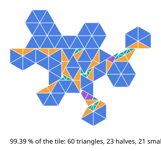
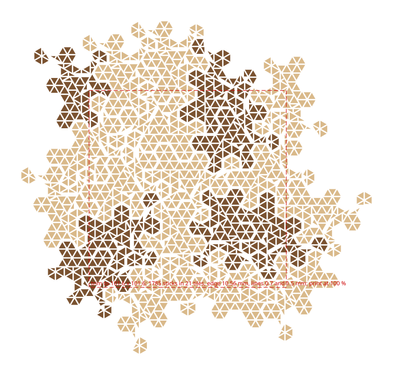

# A Spectre lid from triangular sticks, and the comb that holds them

The 4 in puzzle box's lid a third way: no routed curve at all. With
half a regular hexagon on every edge, out then in, every corner of
the Spectre lies on the triangular lattice of half-edge triangles,
and the tile is a bundle of sawn triangular sticks: four shapes, all
from the table saw. The sticks stand end-on in a comb at the pattern,
resin is poured through the bundle, and the bundle is sliced into
lids. The comb is silicone, cast in a printed box over a printed
positive of the lid, so one comb serves every bundle and nothing bonds
to it. Two lines show: 0.7 mm between a tile's sticks, the texture of
what the piece is built from, and 1.5 mm between tiles, the pieces.

```sh
cargo build --release -p ok-mcp
python3 examples/spectre-mosaic/build.py
cargo test -p ok-render --test spectre_mosaic   # what CI runs
```



## The cover

The tile's fourteen edges are not all on one lattice: eight run on
the 0°-60°-120° lattice and six on the 30°-90°-150° one, in three
runs each, and a 30° edge moves the 60° lattice by a fraction of a
step, so the three runs of a family do not agree where their lattice
sits. No single lattice covers the tile. The kernel covers it from
the six lattices the runs define with four sticks:

| stick | sides at a 10.56 mm edge | area | per tile |
|---|---|---|---|
| triangle, equilateral | 5.28 | 12.1 mm² | 60 |
| half, 30-60-90 | 2.64, 4.57, 5.28 | 6.0 | 25 |
| small, the quarter triangle's half | 1.32, 2.29, 2.64 | 1.5 | 22 |
| trapezoid, a half less its small apex | 1.32, 2.29, 2.64, 2.64 | 4.5 | 0 |

That is 107 sticks covering 99.39 % of the tile, found by a search
(every placement of every stick on every lattice inside the tile is a
candidate; greedy biggest first and boundary first; then six thousand
rounds of clearing a disc and refilling it in a jittered order,
keeping the result if it covers no less; then every two halves that
make a lattice triangle become one) from a fixed seed, so it repeats.
The slivers along the seams between lattices, 0.6 % of the tile, are
the resin's. The small sticks are too narrow to keep their lines: at
0.7 mm between sticks they come out under a millimetre wide and are
dropped, 22 per tile, and become resin too.

## The lid



The board is the prism lid's: a 4 in square at a 10.56 mm edge, the
tiling slid by the same (2, 5) mm, every tile the board reaches kept
whole and the square trimmed after the bundle is sliced. That is 21
tiles, 1785 sticks (1260 triangles and 525 halves), maple for the
field and walnut for the mystic pairs by the tile's wood, each stick
pulled in by half its line on every side, 0.35 inside a tile and
0.75 on the tile's edge. `lid.svg` is the lid at 1:1, every stick,
for a check against a print.

The lines cost wood. A 0.7 mm line round a 5.28 mm triangle takes two
fifths of its area (the inradius goes from 1.52 to 1.17), so the lid
is 48 % wood and the rest resin, which is a choice to make with the
line width and the edge: a 0.4 line keeps 75 % of a triangle, a 14 mm
edge keeps 68 % at 0.7. The tool takes `inner`, `gap` and `edge` for
that.

## The comb

The sticks stand end-on in a comb that holds the pattern while the
resin is poured. It is silicone, cast in two printed parts, both for
an FDM printer:

- `positive.stl`: a plate 4 mm thick, 192 x 183, with every stick of
  the lid standing on it as a bar 10 mm tall, sunk half a millimetre
  in and tapering 1° so the silicone releases. The channels between
  the bars are the lines, 0.7 and 1.5 mm of air, which a 0.4 nozzle
  prints; the bars' sides carry layer lines, on faces nothing sees.
- `box.stl`: the tray the silicone is poured in, 193 x 184 and 18
  tall with 3 mm walls and floor. The plate rests on its rim, bars
  down, so the bars stop 5 mm above the floor: that is the silicone
  backing under the comb. Lift the plate out and the comb stays in the
  box, slots up, the box its rigid backing for every pour after.

The comb holds only the sticks' ends, 10 mm deep; the resin fills the
lines above it, and that end of the bundle is sawn off with the first
slice. A second comb at the far end keeps the far ends on the
pattern. Shore 40 silicone or harder: a 0.7 mm wall folds in a soft
one. Pour a thin epoxy from the top of a standing bundle, slowly from
one corner, so the air leaves ahead of it.

## What the test checks

`crates/ok-render/tests/spectre_mosaic.rs` reads `out/mosaic.json`
and the two STLs: the hex tile has 42 pieces of half an edge and the
straight tile's area; the cover's pieces have the four sticks' sides
and areas, sum to the coverage, and the kernel's search at the same
rounds and seed gives the same cover; the lid's sticks come to the
tile count times the cover less the dropped, every one counter-
clockwise and no wider than a lattice triangle, and within a tile no
two closer than the inner line; the wood is the cover less the lines,
against what a triangle keeps inside its lines; and the positive has
a bar per stick of the right height on the plate, and the box the
plate rests on is as tall as the backing and the bars together.
