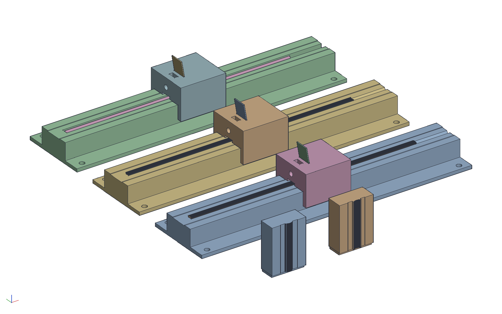
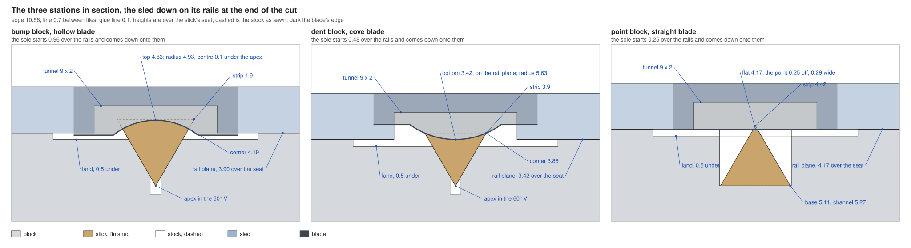
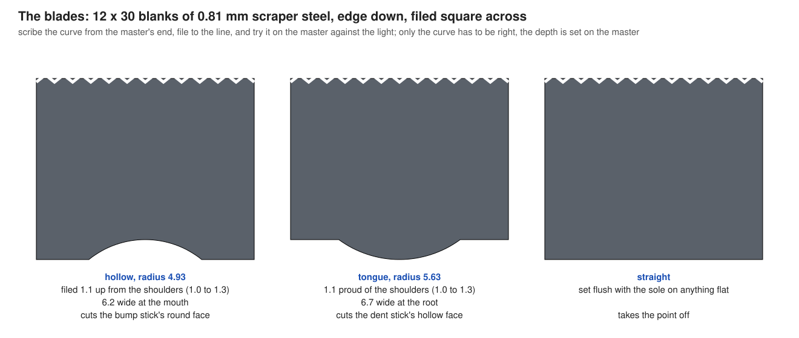

# Scratch-stock stations for the Spectre's sticks

The hex-edged Spectre of `examples/spectre-mosaic` puts half a hexagon
on every edge so the whole tile is sawn triangular sticks. That half
hexagon is inscribed in a circle: half an edge in radius, about the
edge's middle. Bow each of its three flats out to that circle and the
edge is a true semicircle, a bump or a dent, and the tile is a curvy
Spectre still built of the same sticks. Only the sticks along the
outline change, and only their outer face: on a bump it becomes a
convex arc, in a dent a hollow.

Those faces are scraped. The stick lies in a printed block, apex down
in a V, and a printed sled carrying a filed scraper blade is pushed
along it. The block's rails are the depth stop and its sides the
fence, so the stick's size is the block's geometry and not the hand's.
A third block holds a stick point up for a straight blade, which
takes off the points the flat-edged tile's cut list already asks for
(`examples/spectre-cauls`, a third of the sticks).

```sh
cargo build --release -p ok-mcp
python3 examples/spectre-planes/build.py
cargo test -p ok-render --test spectre_planes   # what CI runs
```





## The faces

Tiles stand 0.7 mm apart, so the arcs are the eroded tile's: the
circle of half an edge drawn in by half the line on a bump and out by
half the line in a dent. At a 10.56 mm edge with a 0.1 mm glue line:

| stick | per tile | its face | sawn from a strip | scraped off |
|---|---|---|---|---|
| bump: a 60° sector | 21 | convex, radius 4.93 about a centre 0.1 under the stick's own apex; top 4.83 over the apex, corners 4.19 | 4.9 thick | 0.71 at the corners, 0.07 at the top |
| dent: a triangle, hollowed | 12 | concave, radius 5.63; bottom 3.42 over the apex, corners 3.88 | 3.9 thick | 0.48 in the middle, 0.02 at the corners |
| point: the 5.11 triangle | 21 | a flat 0.25 down from the point, 0.29 wide | 4.42 thick, as now | the point |

The kernel's cover of the tile puts a triangle with its apex at the
edge's middle on every chord of every bump, so the 21 bump sticks are
one shape: three sectors make a bump's half disc. In the dents 12 of
the 21 chords have a whole triangle on them; the other 9 lie on
halves and odd sticks, which this fixture has no seat for yet.

## How a station works

The stick drops into the block's seat against the stop at the far
end. The sled goes over it, its skirts down the block's sides, its
heel on the rails and its blade resting on the stick, so it starts
nose up. Push it toward the stop, bring it back, and again: each
stroke scrapes a few hundredths of a millimetre, the nose comes down,
and when the sole lies flat on both rails the blade stops cutting.
That is the whole depth setting. Expect tens of strokes on a bump
stick, fewer on the others; that is an estimate, not a measurement.

Three things are built in so that nothing has to be held by eye:

- **The blade leans 10° toward the cut** in its slot. A scraper wants
  that lean, and a tool that has to sit flat at the end of the cut
  cannot be tipped by hand to get it.
- **The top between the rails is 0.5 lower.** No blade's shoulder ever
  touches the block, so the rails stay the size they were printed.
- **The stick's way through the sole is a 9 x 2 tunnel.** The blade
  hangs free for those 2 mm and is backed by the slot's wall above
  them; the dust goes out the front.

Keep the sled against the same side of the block every stroke. Its
skirts have 0.15 mm of play each side, and a face scraped 0.15 to one
side is 0.08 high at one corner.

## The parts

| part | size, mm | print | what it does |
|---|---|---|---|
| bump block, one notch in its foot | 240 x 60 x 18 | as exported | 60° V, its apex 3.90 under the rails |
| dent block, two notches | 240 x 60 x 18 | as exported | 60° V, its apex 3.42 under the rails |
| point block, three notches | 240 x 60 x 18 | as exported | a channel 5.27 wide, its floor 4.17 under the rails |
| sled, three of | 40 x 38.3 x 28 | as exported, sole up | one body for all three blades |
| bump master | 30 x 14.9 x 42 | as exported, on end | the bump stick's face over a pair of rail edges |
| dent master | 30 x 14.9 x 42 | as exported, on end | the dent stick's face, the same |

Hardware: three M4 x 16 screws and three M4 nuts for the sleds, and
four wood screws per block through its foot. A block takes a 200 mm
stick and is 240 long so it goes on a 256 mm bed without being turned.

## The blades



A 2.5 x 5 in card scraper of 0.81 mm (0.032 in) blue spring steel
gives twenty 12 x 30 mm blanks. Score with a cutoff wheel and snap.

1. Hone both faces of the blank's working end on a stone.
2. Lay it on the end of the master, where the face is drawn as an
   outline, and scribe the curve.
3. File to the line with a round or half-round file, square across.
   No burr is turned; the square arris scrapes.
4. Stand the blade on the master's face and look for light. Only the
   curve has to match. How far it is filed up from the shoulders does
   not matter between 1.0 and 1.3 mm, since the depth is set next.

Setting: lay the master on its back, put the sled on its rail edges
pushed to one side, drop the blade down the slot until it sits on the
face, and tighten the M4 from the front. The hollow blade now has its
arc exactly where the block's rails will put the bump stick's face,
and the cove its tip on the rail plane. The straight blade is set the
same way on anything flat. A master is printed on end so that its
face and its rail edges are one outline in the plane the printer
draws best; printed lying down, a 0.93 mm step would round to a layer.

## Measure these first

| what | in the model | check |
|---|---|---|
| the scraper's thickness | 0.81, in a 1.1 slot | a blank drops down the slot and the screw holds it |
| the block's width in the sled | 30.0 in 30.3 | the sled slides without rocking; wax both |
| the first bump stick | 4.83 from its apex to the top of its arc | calipers; if it is thick, set the blade again with paper under the sole of that thickness, if thin with the paper on the master's face |
| the strips | 4.9, 3.9 and 4.42 thick | the sled starts 0.96, 0.48 and 0.25 over the rails; a thicker strip only means more strokes |
| the nut | 7.0 across flats, in a 7.2 trap | it drops in from the sled's top and does not turn |

A printed V seats a stick a little high or low, by twice whatever the
walls are off, which is why the first stick is measured and the blade
reset once. After that every stick from that block is the same.

## What it does not do yet

- The kernel does not draw the arcs. The cradle, the layout template
  and the cut list of `examples/spectre-cauls` are still the
  flat-edged tile's; a curvy tile needs them redrawn with the arcs,
  which is the next increment.
- Nine dent chords per tile lie on halves and odd sticks. They need
  seats of their own, or a cover searched to put a triangle on every
  dent chord as it already does on every bump chord.
- The point block is drawn for the flat-edged tile, where a point is
  taken off square to the stick. With arcs the eroded outline runs
  straight through a dent's inner corners, so the points there come
  off square to one face instead.
- A leaning blade's edge is seen 1.5 % shallower by the stick than it
  is filed. Over a face that is 0.01 mm, and it is not corrected.

## What the test checks

`crates/ok-render/tests/spectre_planes.rs` reads the kernel's own hex
tile and checks that every edge is three chords of a semicircle of
half an edge, seven bumps and seven dents, and that the cover has a
sector on all 21 bump chords. It recomputes the sticks' faces from
the edge, the line and the glue line. It regenerates every body and
compares its volume with what its section gives: the blocks with
their seats, screws and notches, the sled with its slot, bore and nut
trap, the masters and the sticks. It probes each block for an open
seat, a stop, rails and a land under them, and checks the finished
stick sits in it without passing through. For each blade it checks
that its edge at its set is the stick's finished face to within 0.01
across the face, that it stays over the land, and that its body
neither enters the block nor bites the finished stick. For the sled
it checks the fit on the block, the clearance over the foot, the
tunnel over the stock at the start of the cut, that the screw's bore
reaches the slot without marking the wall the blade lies on, and that
the block fits the bed with rail under the sled's heel at the stick's
near end. For the masters it checks the arc's top and the hollow's
bottom over the rail edges and that the hollow blade lies along the
bump master.
