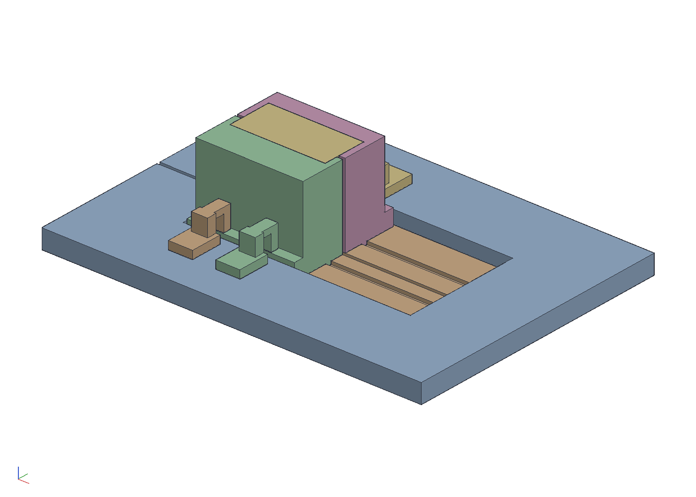
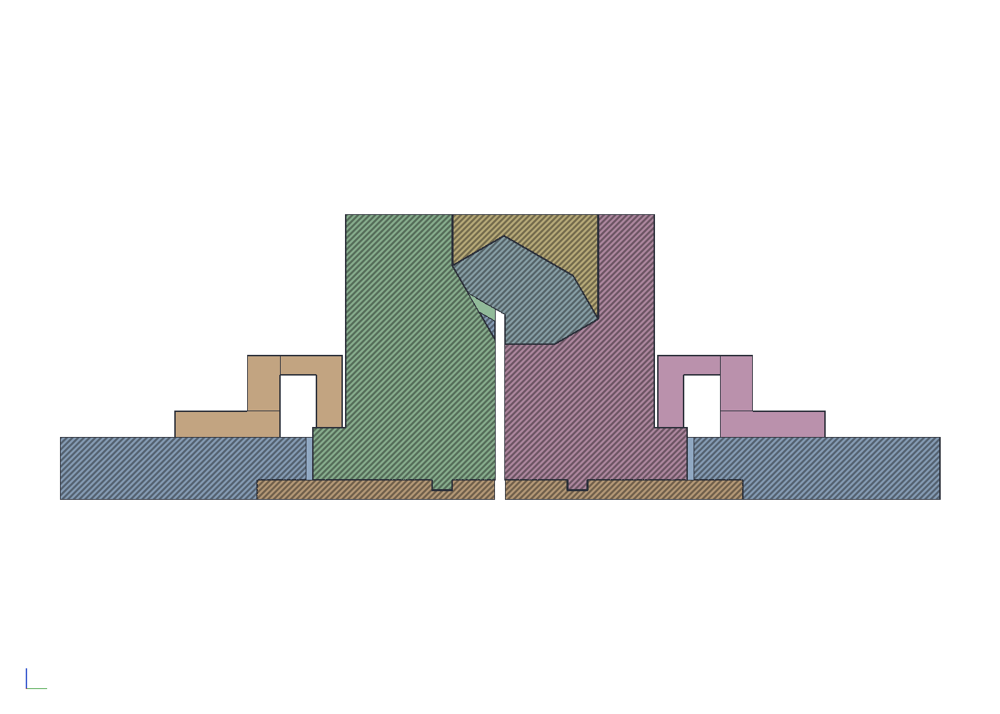

# A table saw sled for the straight Spectre stick

The straight Spectre can be made by rips alone. Every face of the tile
is a plane along the stick, and a vertical blade makes any plane the
stick can present standing up: a face the tile lies wholly to one side
of is a through rip, a face that ends at an inside corner is a rabbet,
the blade coming up from the open end and stopping at the corner, and
no face lies between two inside corners. Two of the through faces are
parallel and a third is square to them, so a blank planed to the
tile's thickness between them and ripped to its width has three faces
before the saw sees it. The rest is ten rips: two through, then the
four inside corners as pairs.

The station is a sled with the blade set once, at 50.5 mm over a
printed plate for a 9 mm edge, 56.5 mm over the saw table, and a
printed cassette per cut. Each cassette is the negative of the stick
as the earlier cuts left it, turned so the face stands vertical with
the open end down and placed so the face's line falls on the blade's
near side, with a floor whose thickness puts the inside corner at the
blade's top. The stick is the spectre-cage's dry stack, veneer on ply
one laminate per piece, between two sacrificial plugs the blade cuts
with it; it drops into the base, the lid comes down on it, and after
the pass what came off is still in the nest. The stick only fits each
cassette the way the cut wants it, so nothing is set or measured at
the saw: ten cassettes, ten pushes.

Every cassette's base is two halves, one each side of the blade, and
every half stands on the plate the same way:

- **The plate** is 6 mm thick, printed once and screwed for good into
  a pocket routed in the underside of the 3/4 in sliding bed, flush
  with it underneath so the saw table carries it. The halves stand in
  an opening through the bed, on the plate, which is what takes the
  blade's height down from 69.5 mm over the table (on the ply) to
  56.5. Its lip is screwed up into the bed through slots across the
  blade, for setting the plate to the blade once.
- **A tongue along the feed** under each half, in a groove in the
  plate, sets the half across the bed in both directions, toward the
  blade included. It is the one fit that decides where the face lands.
  The left tongue is 16 mm from the blade and the right one 22, so a
  half fits its own side only.
- **A cross key** under each half's front end, in a cross groove, sets
  it along the feed. Turned end for end, a half has nothing over the
  cross groove and will not seat.
- **A flange along each half's outer edge** has its top 16 mm over the
  plate on every cassette, so one setting of the bed's four toggle
  clamps holds down any of them.
- **The halves' inner edges** stand a quarter millimetre into the
  blade's path: the first pass trims them to zero clearance and never
  cuts a half apart. The lid spans both halves above the blade.

```sh
cargo build --release -p ok-mcp
python3 examples/spectre-saw/build.py
cargo test -p ok-render --test spectre_saw     # what CI runs
```






## What the script does

- Asks the kernel for the program with `spectre_saw`: the straight
  tile at a 9 mm edge, eroded by half the 0.7 mm gap, a 1/8 in kerf,
  2 mm of blank past the notched end, a 4 mm floor at the thinnest and
  the rabbets aimed 0.1 mm past their corners. The kernel simulates
  the ten rips in order with a polygon clipper and reports each: the
  turn, where the blank's frame lands, which side the kerf is on, the
  bed, the stock before and after, what came off, and the stock with
  its open kerfs filled, with the lower and upper envelopes the
  cassette is the negative of.
- Builds a cassette per cut, in the sled's frame (the blade fixed,
  each cut's frame shifted by the kerf when its waste is on the left):
  two halves, each a block from its outer face to a quarter millimetre
  into the blade's path with its end walls, the region over the
  stick's lower envelope taken out so the stick drops in, the flange
  along its outer edge and the tongue and cross key under it; and a
  lid from the stick's upper envelope up, between the halves' walls,
  less a groove over the blade's path up past its top. The nest and
  the lid stand 0.15 mm off the stick. Each tab holds the cassette on
  the plate with the stick after the cut and the offcuts where they
  were freed.
- Builds the station: the bed with its opening, the pocket under it
  and the blade's path, the plate with its grooves, screw slots and
  slot, the fourth cut's cassette, and four toggle clamps on the bed,
  closed on the flanges. The blade's path runs from the bed's front
  edge to where the blade's circle reaches when the sled stops, the
  stick's rear end 5 mm past the blade's top; at the table that is
  105 mm further on, so the plate runs past it by a 26 mm bridge and
  the bed by 86, and both stay one piece.
- Lays the ten sections out in two rows with the blade drawn at each,
  for reading the program, and exports the halves, the lids and the
  plate as STL and the numbers as `out/saw.json`.

## The numbers

| | |
|---|---|
| blank | 36.18 thick (faces 5 and 11), 30.26 wide (face 6 to 2 mm past the notch) |
| stick | 26 laminates of 3 mm and two 8 mm plugs, 94 mm |
| blade | 50.47 over the plate, set once; a 1/8 in kerf |
| cuts | 2 through (faces 2 and 9, 10 lying on 9's line), 8 rabbets (corners 1, 4, 8, 13) |
| beds | 4 under the through cuts, 29 to 41.5 under the rabbets |
| cassettes | two halves, 114 across with their flanges, 106 long, 58 to 90 tall; 0.15 off the stick, the lid 1 mm off the blade |
| keys | 6 wide, 3 deep, 0.1 clear each side in the grooves, which are 0.2 deeper; tongues 16 and 22 from the blade |
| plate | 148 x 254 x 6, a 15 mm lip under the bed all round |
| bed | 3/4 in ply, 268 x 374, an opening 118 x 224 |
| clamps | four vertical toggle clamps, two a side, on flanges 16 over the plate |
| section | the tile less 1.3 mm² of nicks past the corners, nothing left over |

## What the test checks

`crates/ok-render/tests/spectre_saw.rs` recomputes the program from
the stored settings and checks it is ten rips, two through and the
four corners' pairs together, on a blank that is the tile's thickness
and its width plus the margin, every turn on the 30° grid, every bed
at least the floor, every rabbet's corner on the blade's near face the
bias under its top with the stock standing above the blade and every
through cut's stock wholly under it, nothing coming off thinner than
2 mm, the first cassette taking the blank either way round and no
other, and the section the tile less the nicks and nothing else, with
the nicks gone when the bias is. Then, in the document, each cassette
is two halves, each one piece, standing on the plate on its keys, its
tongue and cross key filling their volume in its own grooves and
nothing of it in the other side's, the flange's top at the clamps'
height under every pad with nothing over it, holding its stick and
offcuts as the program's sections with nothing overlapping anything,
the stick on its bed, the lid, the wood and the plate clear of the
blade's path, and each half in it by its trim and no more, but in it,
so the first pass trims it. At the station, the bed and the plate are
one piece each with bridges of at least 20 mm behind the blade's path,
the plate is in the bed's pocket on the table, the blade stands under
a 10 in saw's reach, and the clamps are clear of everything and the
blade, each pad down on its flange.

## Notes

- A rabbet is two stopped cuts meeting at the corner, each kerf
  ending square to its own face. A blade stopping short of the corner
  leaves a sliver of waste of that size in it, square at the 90°
  corners and a wedge at the 120° ones; a blade past it nicks the far
  face a kerf wide and the overshoot deep, under the gap. So the
  rabbets aim past the corner by the setup's error, 0.1 mm here, and
  the section comes out the tile less those nicks.
- The offcuts are captured, not kicked: the lid comes down on both
  sides of the blade, so a freed strip stays in the nest until the lid
  comes off.
- The blank is a rectangle, so the first cassette takes it either way
  round, and end for end mirrors every piece. The leading plug is
  marked. After the first cut the stock is chiral and every later
  cassette refuses it the wrong way.
- The through cut of face 2 stands the blank on its diagonal, which
  sets the blade's height and the beds under every rabbet: 56.5 mm
  over the table, which a 10 in saw reaches.
- The plate is the station's one precise part. Its grooves are printed
  with it, so their spacing is exact; the one setting by hand is where
  the plate sits against the blade, done once with the lip's slotted
  screws. Where a half sits against its own tongue is the print's
  accuracy, so cut a test stick through each cassette and shim the
  tongue side of any that is off. If PLA wears in the grooves, glue an
  aluminum key bar into a wider groove.
- The plate is 254 mm along the feed, because the blade's circle runs
  105 mm past its top at the table. That is at the edge of a 250 mm
  print bed; a smaller blade or a shorter stop shortens it.
- For a dry stack, two thumbscrews through a half's rear wall press the
  trailing plug, so the stack is clamped end to end as in the cage; the
  feed force goes into that wall and the cross keys.
- Not modelled: the sled's runners and its stop, the lid's own hold
  (two pins on each half, or magnets, against a freed strip flicking
  up), and ganging several stacks end to end in one long cassette.
