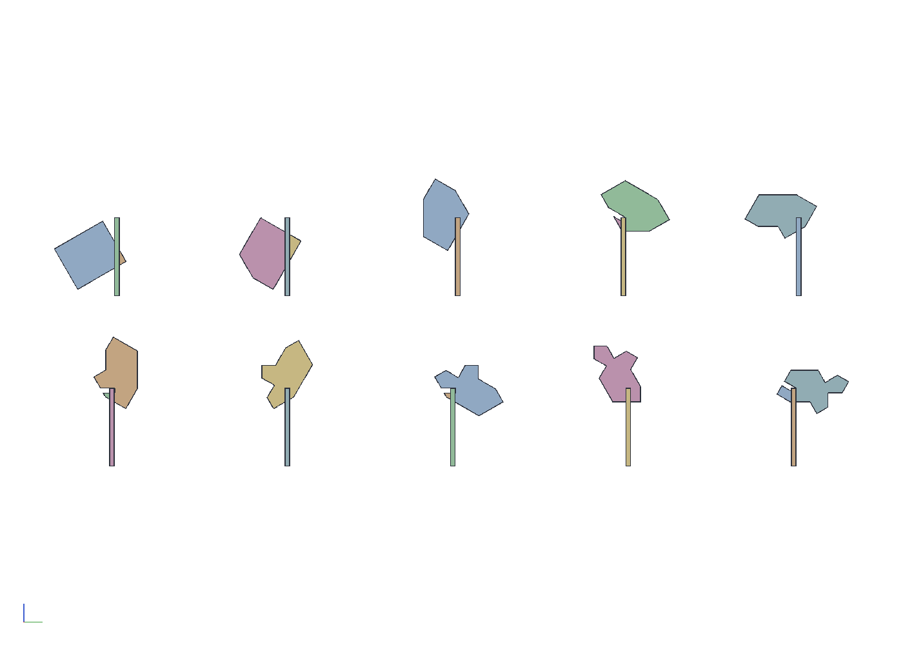
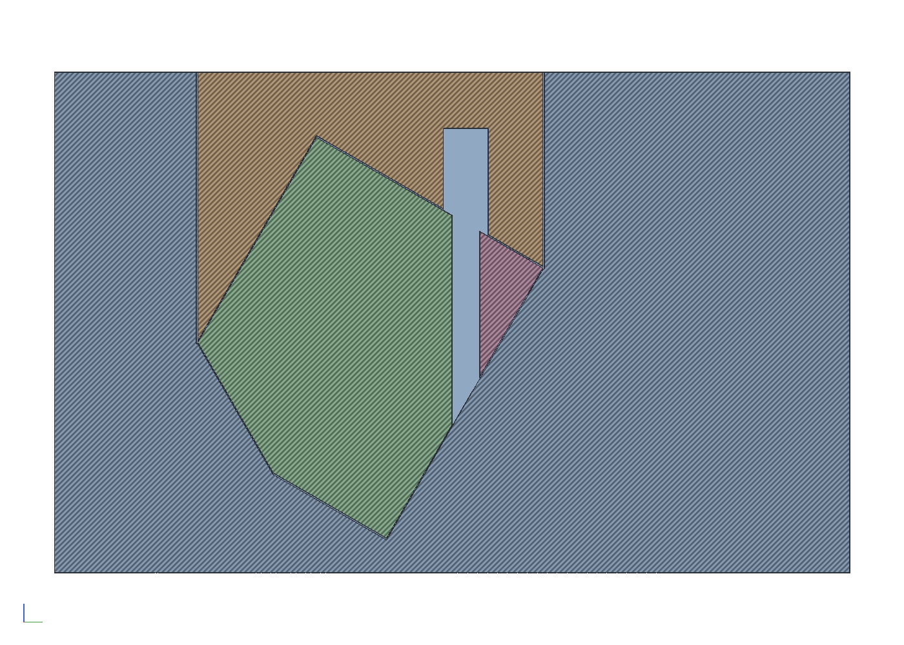
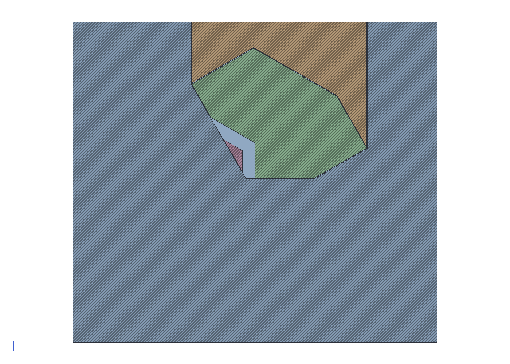
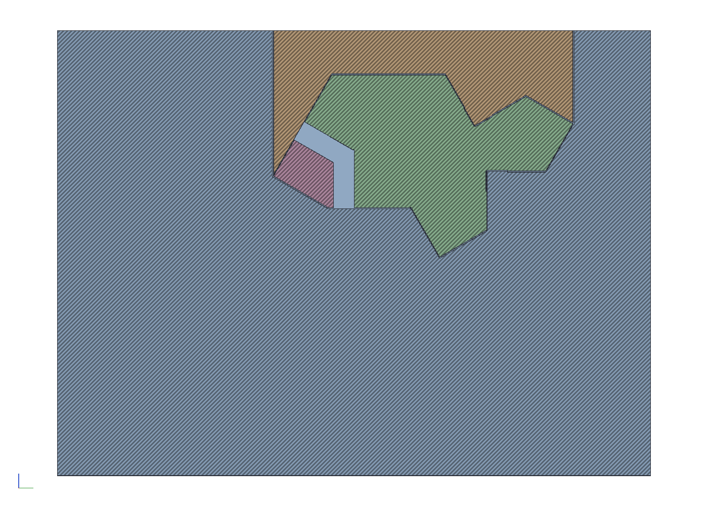

# A table saw sled for the straight Spectre stick

The straight Spectre can be made by rips alone. Every face of the tile
is a plane along the stick, and a vertical blade makes any plane the
stick can present standing up: a face the tile lies wholly to one side
of is a through rip, a face that ends at an inside corner is a rabbet,
the blade coming up from the open end and stopping at the corner, and
no face lies between two inside corners. Two of the through faces are
parallel and a third is square to them, so a blank planed to the
tile's thickness between them and ripped to its width has three faces
before the saw sees it. The rest is ten rips: two through, then the
four inside corners as pairs.

The station is a sled with the blade set once, at 50.5 mm over the
sled's plate for a 9 mm edge, and a pocket that takes a printed
cassette per cut. Each cassette is the negative of the stick as the
earlier cuts left it, turned so the face stands vertical with the
open end down and placed so the face's line falls on the blade's near
side, with a floor whose thickness puts the inside corner at the
blade's top. The stick is the spectre-cage's dry stack, veneer on ply
one laminate per piece, between two sacrificial plugs the blade cuts
with it; it drops into the base, the lid comes down on it, and after
the pass what came off is still in the nest. The stick only fits each
cassette the way the cut wants it, so nothing is set or measured at
the saw: ten cassettes, ten pushes.

```sh
cargo build --release -p ok-mcp
python3 examples/spectre-saw/build.py
cargo test -p ok-render --test spectre_saw     # what CI runs
```









## What the script does

- Asks the kernel for the program with `spectre_saw`: the straight
  tile at a 9 mm edge, eroded by half the 0.7 mm gap, a 1/8 in kerf,
  2 mm of blank past the notched end, a 4 mm floor at the thinnest and
  the rabbets aimed 0.1 mm past their corners. The kernel simulates
  the ten rips in order with a polygon clipper and reports each: the
  turn, where the blank's frame lands, which side the kerf is on, the
  bed, the stock before and after, what came off, and the stock with
  its open kerfs filled, with the lower and upper envelopes the
  cassette is the negative of.
- Builds a cassette per cut: a base, a block with the region over the
  stick's lower envelope taken out so the stick drops in, with walls
  either side and at both ends; and a lid from the stick's upper
  envelope up, between the base's walls, less a groove over the kerf
  up past the blade's top. Both stand 0.15 mm off the stick. The blade
  cuts its own slit through the base's floor and end walls on the
  first pass, so every cassette is zero clearance along its own cut.
  Each tab holds the cassette with the stick after the cut and the
  offcuts where they were freed.
- Lays the ten sections out in two rows with the blade drawn at each,
  for reading the program, and exports the cassettes as STL and the
  numbers as `out/saw.json`.

## The numbers

| | |
|---|---|
| blank | 36.18 thick (faces 5 and 11), 30.26 wide (face 6 to 2 mm past the notch) |
| stick | 26 laminates of 3 mm and two 8 mm plugs, 94 mm |
| blade | 50.47 over the plate, set once; a 1/8 in kerf |
| cuts | 2 through (faces 2 and 9, 10 lying on 9's line), 8 rabbets (corners 1, 4, 8, 13) |
| beds | 4 under the through cuts, 29 to 41.5 under the rabbets |
| cassettes | 92 across, 106 long, 58 to 90 tall; 0.15 off the stick, 1 mm off the blade |
| section | the tile less 1.3 mm² of nicks past the corners, nothing left over |

## What the test checks

`crates/ok-render/tests/spectre_saw.rs` recomputes the program from
the stored settings and checks it is ten rips, two through and the
four corners' pairs together, on a blank that is the tile's thickness
and its width plus the margin, every turn on the 30° grid, every bed
at least the floor, every rabbet's corner on the blade's near face the
bias under its top with the stock standing above the blade and every
through cut's stock wholly under it, nothing coming off thinner than
2 mm, the first cassette taking the blank either way round and no
other, and the section the tile less the nicks and nothing else, with
the nicks gone when the bias is. Then, in the document, each cassette
holds its stick and offcuts as the program's sections over the stick's
length with nothing overlapping, the stick on its bed, the lid clear
of the blade's sweep, and the base in the sweep only under the stick's
lower envelope, to the clearance, which is the slit the blade cuts.

## Notes

- A rabbet is two stopped cuts meeting at the corner, each kerf
  ending square to its own face. A blade stopping short of the corner
  leaves a sliver of waste of that size in it, square at the 90°
  corners and a wedge at the 120° ones; a blade past it nicks the far
  face a kerf wide and the overshoot deep, under the gap. So the
  rabbets aim past the corner by the setup's error, 0.1 mm here, and
  the section comes out the tile less those nicks.
- The offcuts are captured, not kicked: the lid comes down on both
  sides of the blade, so a freed strip stays in the nest until the lid
  comes off.
- The blank is a rectangle, so the first cassette takes it either way
  round, and end for end mirrors every piece. The leading plug is
  marked. After the first cut the stock is chiral and every later
  cassette refuses it the wrong way.
- The through cut of face 2 stands the blank on its diagonal, which
  sets the blade's height and the beds under every rabbet. A 10 in saw
  reaches it over a 3/4 in plate with room to spare.
- For a dry stack, two thumbscrews through the base's rear wall either
  side of the kerf press the trailing plug, so the stack is clamped
  end to end as in the cage; the feed force goes into that wall.
