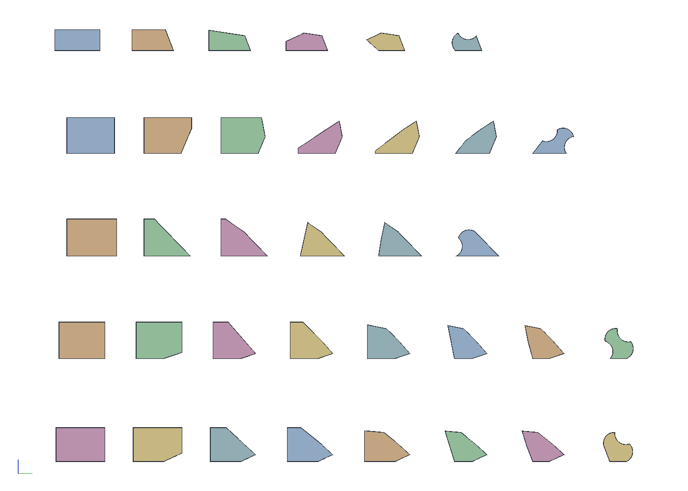
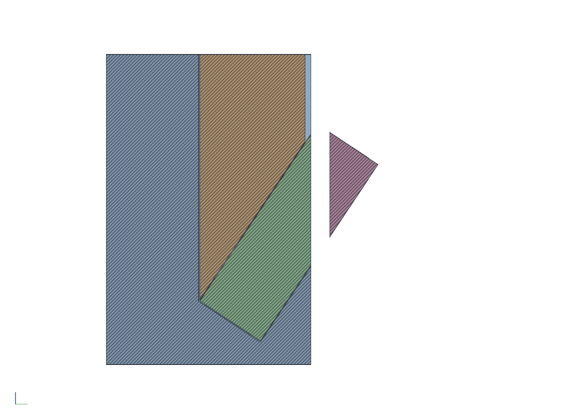
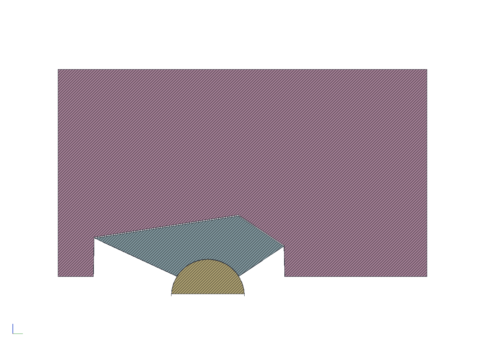
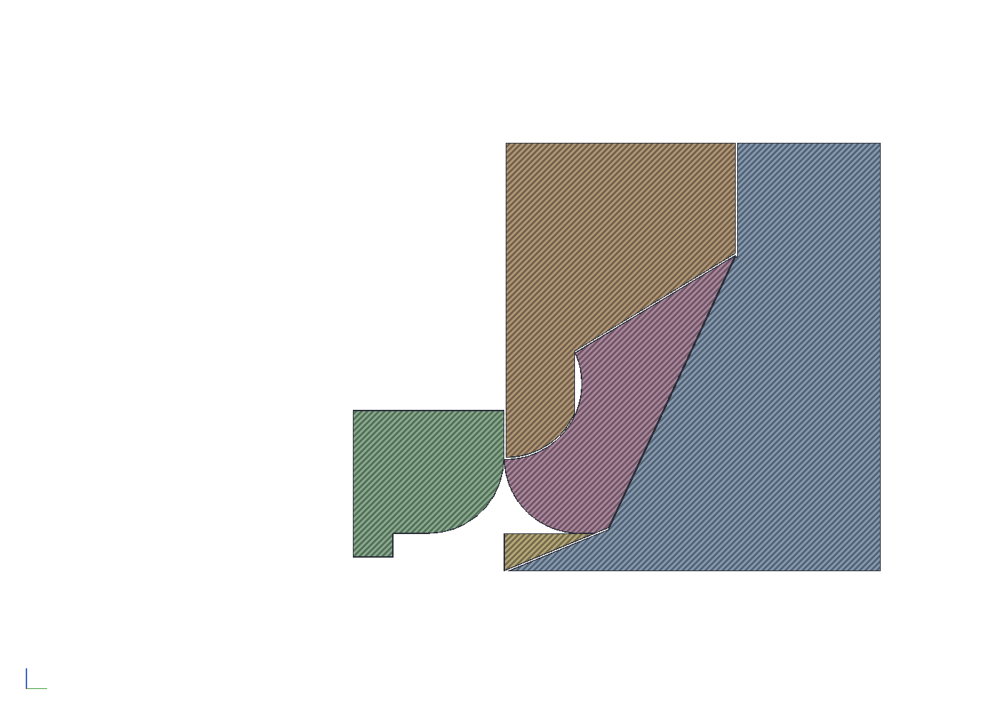

# Cutting the Spectre lid's five sticks

The lid in `examples/spectre-lid/` is made of five prisms per tile.
Each prism is a stick: a straight section the length of a board, with
glue faces where it meets the other prisms of its tile and arcs where
it meets the next tile, out on the bumps and in on the flutes. This
example is how each stick is cut, and the fixtures that cut it.

The blade stands at 90° for good. A prism is convex, so every one of
its faces is a plane the whole section lies on one side of: a through
rip, with the stick tilted so the face stands vertical and the offcut
falling away on the far side of the blade. The sled is one-sided: it
carries nothing past the blade, and a printed cassette per cut, the
negative of the stick as the earlier cuts left it, so the stick only
fits the way the cut wants it and nothing is set at the saw. The kept
stock is the part on the sled's side, down in its nest; the stick goes
through as it is or end for end, whichever leaves the offcut above the
kept stock, so it falls away rather than wedging under it. The bumps are sawn as gables, two flats
at the arc's end angle (56°) to the chord, each tangent to the arc at
its end, meeting at a ridge 7.9 mm over the chord; the flutes are
sawn at their chords.

On the router table a flute is one pass of a 1/2 in core box with the
stick lying chord down in a cradle, the bit up 3.0 mm (the arc's
2.8 mm sagitta plus the 0.2 mm glue clearance). A bump is two passes
of a 1/4 in roundover, one from each gable flat: the stick stands in a
cradle with the flat against the fence, the bit's arc starts at the
flat's foot, where the flat is tangent to the arc, sweeps a quarter
circle past the apex, and its shoulder slits off what is left of the
ridge; the pass from the other flat, with the stick end for end,
finishes the arc. A half-round bullnose would not do this: its body
continues the semicircle past the arc's ends and would cut 1.7 mm
into the face next door at the tile's 120° corners.

```sh
cargo build --release -p ok-mcp
python3 examples/spectre-sticks/build.py
cargo test -p ok-render --test spectre_sticks     # what CI runs
```









- `build.py`: `spectre_sticks` for the plan (the lid's curve and glue
  lines, gap 0.2, a 3.175 mm kerf), then a tab per stick with a
  cassette per saw cut (a base the kept stock drops into, up to the
  blade's near face, which trims its edge on the first pass; a lid down
  to the stock stopping a millimetre short of the blade) and a cradle
  per router pass (a hold-down for
  a flute, a base and hold-down for a bump), each with the stick and
  its offcut in place and the bit drawn where it cuts; a Sequence tab
  with every stick after every cut; the pictures, a sequence PDF, the
  STLs (regenerable, so not committed) and `out/sticks.json`.
- `out/spectre_sticks.okpart`: the document; open it in the web app
  and section a Stick tab across the feed to see each fixture.

## The sticks

Faces are read anticlockwise round the prism's section; the glue line
each stick stands on (its datum) is the longest. Each cut turns the
stick to stand its face at the blade, as it is or end for end (nine of
the twenty-four go end for end), whichever puts the offcut above the
kept stock; the cassette's nest holds it so, and the numbers in
`sticks.json` are for reading, not setting. The blade is 45.1 mm over
the sled's plate for every cut.

Every saw cassette has the one footprint, 35 mm from the blade's near
face by 252 long and 53 tall, so the sled has one pocket and the
hold-down clamps one setting; every router cradle fits one pocket, 64
by 240 with the bit's axis 26 mm in from the near wall, so the router
fence never moves either. The core box is set once, 3.02 mm up, and the
roundover once, its bearing's underside 9.51 mm up: a bump pass whose
foot sits lower rides on a thicker bed in its cradle instead.

| Stick | Faces | Blank (mm) | Saw cuts | Router passes |
|---|---|---|---|---|
| 1 | bump, glue 25.3, glue 15.9, flute | 36.3 x 12.4 on the 25.3 glue line | glue, chord, gable, gable | flute; bump from each flat |
| 2 | flute, bump, flute, glue 9.5, glue 19.9 | 28.0 x 21.1 on the 19.9 | chord, gable, gable, chord, glue | flute; bump x 2; flute |
| 3 | glue 19.9, bump, flute, glue 25.3 | 29.3 x 21.7 on the 25.3 | glue, gable, gable, chord | bump x 2; flute |
| 4 | bump, flute, bump, flute, glue 9.5 | 27.1 x 21.5 on the 9.5 | gable x 2, chord, gable x 2, chord | bump x 2; flute; bump x 2; flute |
| 5 | bump, flute, bump, glue 15.9 | 32.3 x 12.5 on the 15.9 | gable x 2, chord, gable x 2 | bump x 2; flute; bump x 2 |

Twenty-four saw cuts and twenty-one router passes for the five
sticks, so forty-five fixtures; a cut whose offcut is under a kerf
wide is all blade and leaves nothing loose. The sticks are 240 mm, a
printer's bed, which is sixteen 12 mm pieces at a 3.175 kerf; the lid
wants 21 pieces of each prism, so two sticks per prism, and the same
fixtures serve both.

## The numbers

| | |
|---|---|
| Arc | 56.3° at each end, radius 6.35 mm (1/4 in), sagitta 2.82 |
| Gable | flats at 56.3° to the chord, ridge 7.89 mm over it |
| Flute | 1/2 in core box up 3.02 mm: the sagitta plus the 0.2 gap |
| Bump | 1/4 in roundover, bearing underside 9.51 mm over the table for every pass; the second pass of each bump sits on a 2.2 mm bed |
| Blade | 45.1 mm over the plate, kerf 3.175 |
| Saw cassettes | one footprint: 35 from the blade x 252 long x 53 tall; 0.15 mm clearance off the stick, 6 mm walls |
| Router cradles | one pocket: 64 x 240 x 36 tall, the bit's axis 26 in from the near wall; a channel over the roundover's sweep |
| Finished sections | within 2.6 to 4.8 mm² of the tile's prisms: the flutes' extra depth and the arcs' facets |

## What the gap is here

The routed tops had a 0.7 mm gap all round every piece for a resin
line, each piece eroded by half of it. With bits of one radius the
bump and the flute mate tight, so a uniform gap is not something the
sticks can make; what they can is clearance, the flute cut `gap`
deeper than the bump stands, which is 0.2 mm at the apex and nothing
at the ends. That is a glue line, and the lid is glued, so the
example's gap is 0.2; set it on the feature and in `build.py` alike.

## What building it found

- The bullnose was the wrong bit. The prism rule said a corner where
  a bump ends may be up to 180° less the arc's end angle, 124° here,
  because the cutter's shoulder is tangent to the arc there; that is
  true of a roundover, whose arc starts tangent to its bearing, and
  not of a half-round bullnose, whose body goes on round to 90°. The
  tile's bump corners are 120°, so the bullnose would have bitten
  every one of them.
- The two roundover passes overlap by 2 × (90° − 56°) about the apex,
  cutting the same circle, and each pass's shoulder flat lands on
  material the other pass removes, so neither scores the finished
  arc. At the quarter circle the two passes become one, the flat
  landing exactly on the other gable face.
- Nine of the twenty-four saw cuts take off less than a kerf, so the
  blade eats the offcut and nothing falls. The rest leave an offcut
  past the blade, above the stock, with nothing under it: it drops
  onto the table clear of the sled, which is why the stick's
  orientation is chosen cut by cut.
