# A billet for the stick sled

The [stick sled](../stick-sled/) mills the leaning half-ellipse Spectre
round one solid stick, which is then sawn into tiles. That gives end
grain, one wood, and a saw kerf lost at every tile. This is the
owner's way round all three. The tiles' pieces are sawn first, 3 mm
thick, drilled in a jig, and stacked on brass rods into a billet the
sled holds as it held the stick. The billet is milled in two stages:

1. **Stage 1, held by four rods at the corners.** Everything is cut
   except a tab of wood left from each rod to the tile, so every
   piece stays joined to the rods that hold it.
2. **Stage 2, held by a printed comb.** The comb is a plate over the
   tail end with three fingers that slide along the grooves stage 1
   cut. Each finger bears on edges already finished. Three new rods
   go through the fingers, the four old rods come out, and the tabs,
   the corners and the edges they shaded are cut.

Then the nuts come off and the stack is 55 tiles, face grain, a wood
each if the stack was made so, with nothing to saw. The cap at the
tail end comes off as a 56th tile, 12 mm thick.

```sh
cargo build --release -p ok-mcp
python3 examples/stick-sled/build.py          # the sled's tile and table, which this reads
python3 examples/stick-billet/build.py        # 1 minute
python3 examples/stick-billet/animate.py      # out/billet.gif: every step, captioned
cargo test -p ok-render --test stick_billet   # what CI runs
```


| 1 | 2 | 3 | 4 |
|---|---|---|---|
| 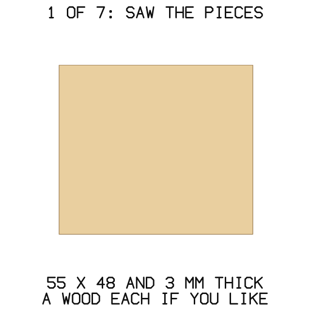 | 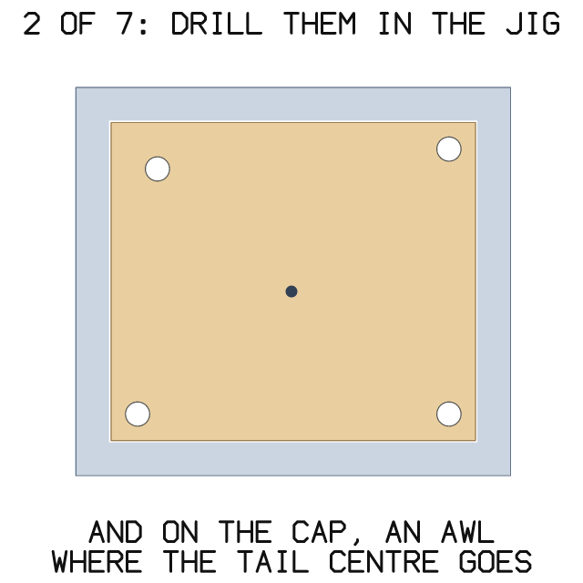 | 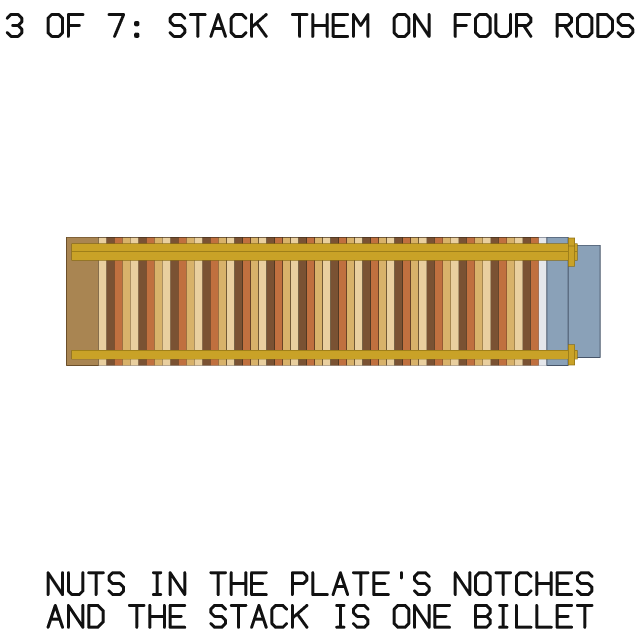 | 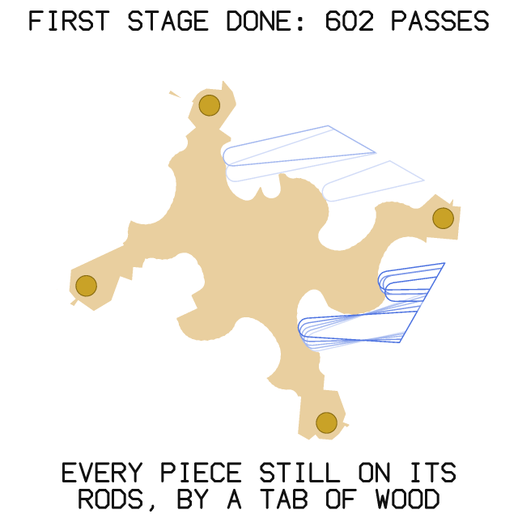 |
| **5** | **6** | **7** | |
| 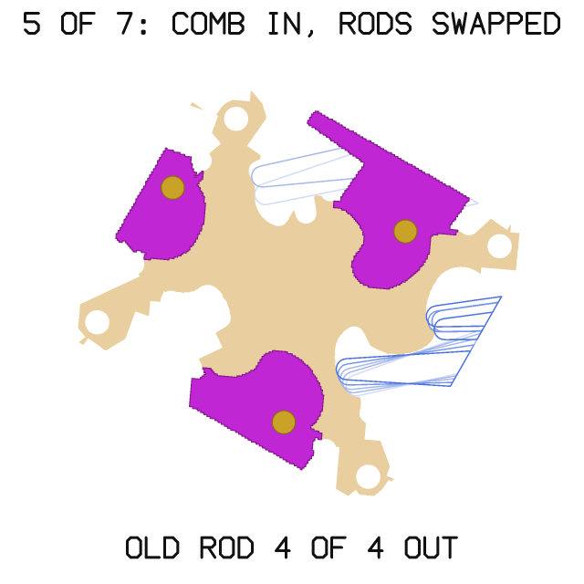 | 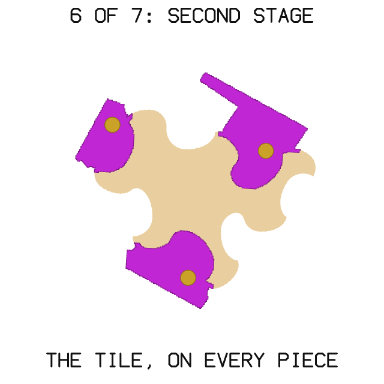 | 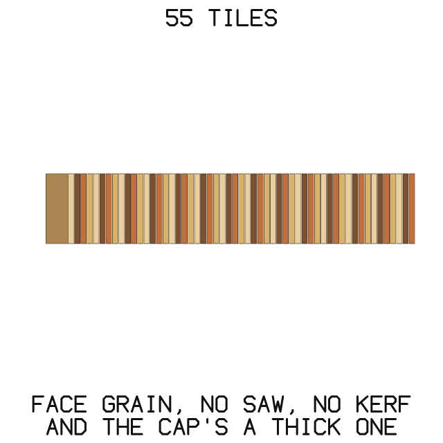 | |

Nothing here has been built. The plan is checked by calculation and
by the test, against the sled's own tile and table. What is a guess
says so.

## The stack

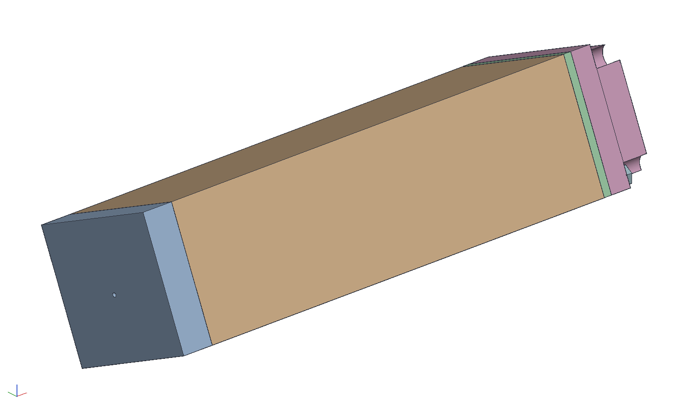

Along the stick from its tail end, 200 mm in all, as the sled's
solid stick was:

| | along | what |
|---|---|---|
| near cap | 0 to 12 | hardwood, the piece's size, drilled in the same jig. The tail centre bites into it, and the four rods thread into it: tapped #6-32 10 mm deep, thin CA run into the threads |
| 55 pieces | 12 to 177 | 3 mm of solid wood each, 55 x 48, four holes. Every one is inside what the ball-nose finishes: a pass stops at 176 and the ball's radius reaches 177.6 |
| spacer | 177 to 180 | one more piece, scrap: the straight bit reaches 2.2 mm into it, so the bit never meets the printed plate |
| far plate | 180 to 188 | printed, 55 x 48. The four rods come through it and are nutted in notches at its boss's corners. The second stage's three rods thread into heat-set inserts in its inner face |
| its boss | 188 to 200 | the sled's own blank, 49 x 42: the sled's socket takes it as it took the stick, jack screw and lock screw and all. The sled is not changed |

**The blank is 55 x 48, not the sled's 49 x 42.** At 49 x 42 the
tile comes within 0.6 mm of one corner, and no rod fits there. Grown
3 mm a side there is room at all four.

**There are no nuts at the tail end.** The bit comes onto the stick
from that end and sweeps the whole of it on every pass, so anything
standing out there is cut. A rod threaded into the cap stays inside
the wood the first stage keeps round it. The nuts are at the socket
end, where no bit goes.

**The collet nut passes a bigger blank.** At the far end of a pass it
is beside the stack as sawn, now 55 x 48. So both bits stand further
out of the nut than the sled's table has them. That is within the
2 mm the sled allows either way, since a bit is set by touch, so
the table's numbers stand.

| bit | out of the collet nut | the sled sets |
|---|---|---|
| Freud 04-110, straight | 43.4 mm | 42.5 |
| Freud 72-405, ball tip | 43.8 mm | 41.9 (its longest is 43.9) |

## The rods, and the tabs that keep them

| as stacked, cut across the middle | after the first stage, seen along the stick |
|---|---|
| 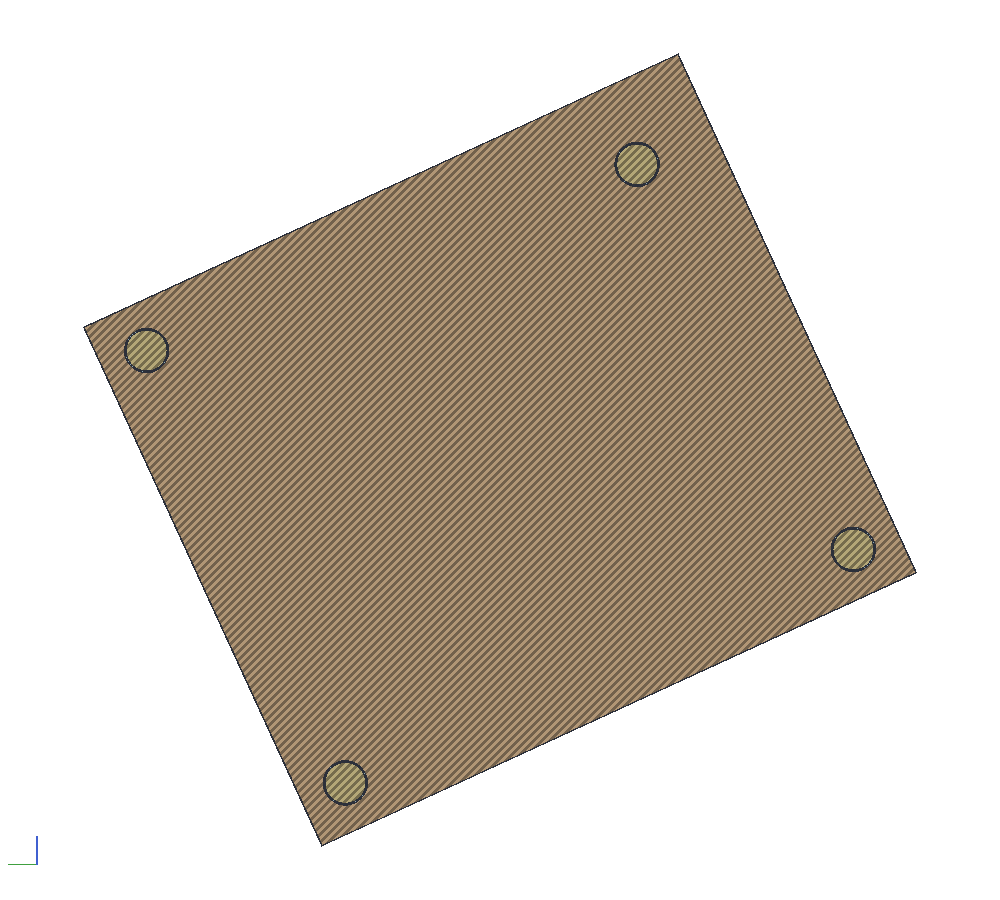 |  |

- **Four #6-32 brass rods,** 3.5 mm, through #27 holes (3.66 mm). Each
  is 4 mm in from both faces at its corner. The fourth, at the corner
  where the comb's flute finger goes, is 7 mm in: at 4 it shaded the
  pass that finishes that flute, and the finger could not go there.
  The owner saw the flute was the place.
- **No first-stage cut comes within 0.7 mm of a rod.** The planner
  keeps them 1 mm off, measured on sampled points.
- **A tab, 4 mm wide, runs from each rod to the tile.** Of the
  straight runs from the rod to the tile's edge, it is the one that
  keeps back the fewest finishing passes, with the tabs already
  chosen counted.
- **What stage 1 does:**
  - Every roughing place goes as deep as it can short of the rods and
    the tabs.
  - Every finishing pass that touches neither is made.
  - The rest wait for stage 2.
  - The test follows every first-stage cut and finds none in a rod
    or a tab, and the build flood-fills the wood that is left and
    finds all four rods joined to the tile.

| | roughing | finishing | runs |
|---|---|---|---|
| first stage | 74 places, 286 runs | 179 passes, 316 runs | 602 |
| second stage | 18 places, 85 runs | 63 passes, 100 runs | 185 |
| the sled's solid stick | | | 573 |

So a billet is 787 runs where a solid stick is 573. Some of the
difference is the bigger blank, 1797 mm² of waste where the stick
has 1214. The rest is finishing passes in stage 1 that meet
more wood than usual, where roughing had to stop short of a rod or
tab. At the sled's own rate that is about 3 h 35 min against
2 h 37 min. That is not timed; nothing has been built.

Every finishing pass of the sled's table is made once, in one stage
or the other, to its own depth. The test checks that pass by pass.
At the end 4.2 mm² of waste stands, where the sled leaves 3.9: the
ridges between passes.

## The comb

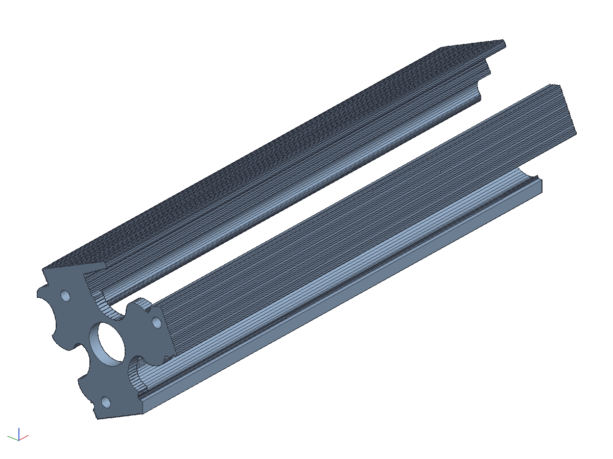

One print, standing on its plate: a plate 4 mm thick over the cap
and three fingers 181 mm long.

- **Where the fingers go:** in what the first stage cut away, and at
  least 1 mm from every cut of the second.
- **How they were chosen:** of the rooms that leave, the three that
  have the stick's axis inside the triangle of their rods, picked so
  that the finger bearing least bears most.
- **How much finished edge each bears on, to its 0.15 mm fit:** about
  44, 43 and 26 mm.
- **Its rods:** each finger carries a #6-32 rod with about 0.9 mm of
  print round it. The rod threads into an insert in the far plate and
  is nutted on the plate.
- **The plate covers only the tile, 0.5 mm in from its edge.** No cut
  goes inside the tile, so the plate and the nuts on it are safe
  wherever the bit is.

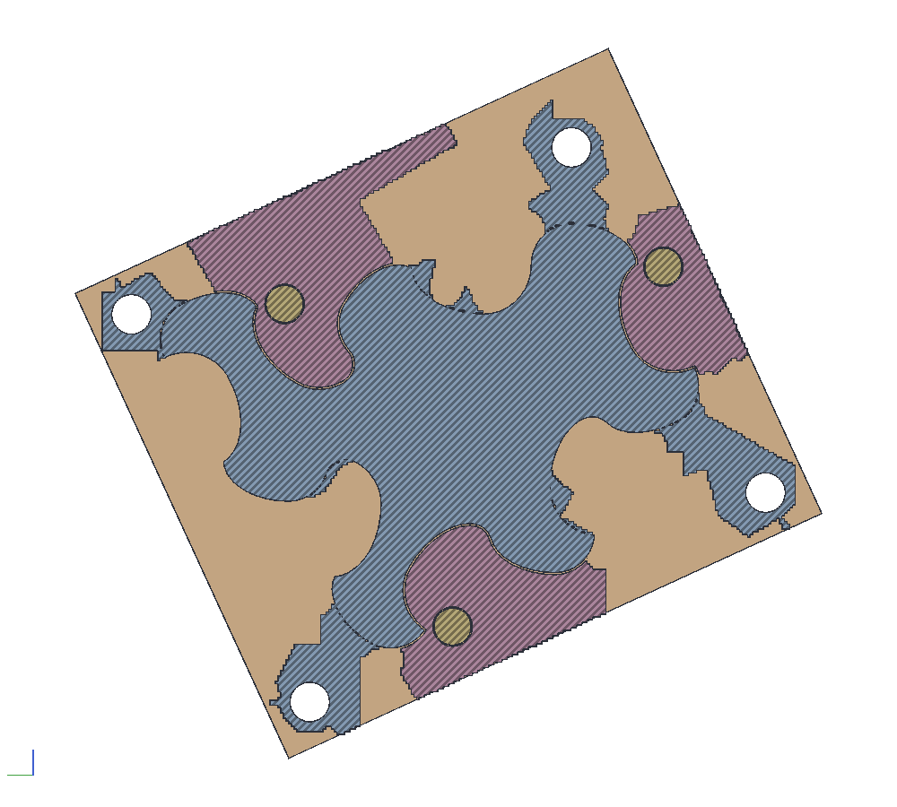

The swap, off the sled:

1. Slide the comb on from the tail end, the fingers along their grooves.
2. Put the three rods through the fingers into the far plate's inserts.
3. Put the nuts on at the plate and tighten them.
4. Undo the four old nuts in the far plate's notches and unscrew the
   old rods out of the cap.

The comb's plate has a 14 mm hole in its middle. The tail spindle's
point goes through it into the cap's same dimple, so the billet goes
back on the sled exactly where it came off.

**The spacer is held only by the clamp.** Its tabs are cut in stage 2
and the fingers stop at 177, where the pieces do. It is scrap, between
the last piece and the far plate.

## Drilling

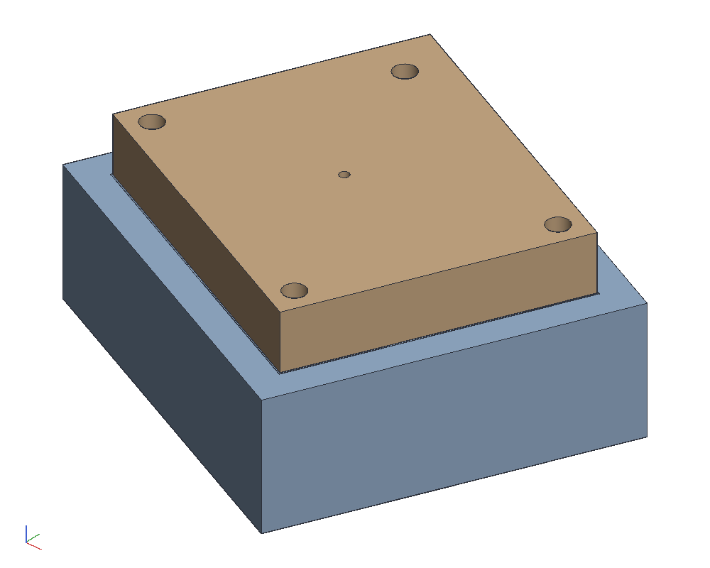

- **The jig:** a printed box the pieces lie in, six at a time, 0.3 mm
  over a piece all round, and a lid that drops onto them.
- **The lid:** a guide hole over each rod for the #27 drill, and an
  awl's hole over the stick's axis for the cap. Under each guide the
  box's floor is open for the drill to come out.
- **Mark one corner of every piece.** The corner rod is 7 mm in, so a
  piece turned over or round does not line up with the rest. Mark the
  corner at the moved rod (the fourth, where the jig's lid has its
  guide furthest in) and put it in the jig the same way every time.
- **Saw the pieces true.** The jig finds a piece by its edges, so a
  piece sawn 0.3 mm big or out of square has its holes that much off.
  The stack does not care, since every piece is milled where it sits.
  The tile does: it is that much off-centre on that piece's blank.
- **The cap:** drill through the guides with the #36 drill for the
  tap, and mark its centre through the awl's hole.

## Measure these first

| what | in the model | how to check |
|---|---|---|
| a piece's thickness | 3.0 mm, `PIECE` | callipers on a few; the stack's length is what counts, 55 of them 165 mm |
| the rod | 3.505 mm over the threads, `billet.ROD` | callipers |
| a small-pattern #6-32 nut | 1/4 in across its flats, 3/32 thick | callipers; a standard nut is 5/16 and does not fit the flute finger's plate |
| the heat-set insert's hole | 4.7 across, 6 deep, `INSERT` | the insert maker's sheet |
| the comb's fit on the finished edge | 0.15 mm, `billet.FIT` | print the comb's plate alone first and try it on the first stage's billet |

## To buy

Brass #6-32 threaded rod, about 1.3 m (seven lengths of 190 to
195 mm). Seven small-pattern #6-32 hex nuts. Three #6-32 heat-set
inserts. A #6-32 tap with its #36 drill, and a #27 drill. Thin CA.
The wood: 56 pieces and a cap's block per billet.

## What is not done

- **The stage tables are not yet the controller's.** `out/stage1.csv`
  and `out/stage2.csv` are the cuts in the controller's units (depth,
  height, turn, along). The sled's `passes.csv` also has the loading
  row, the bit-setting rows, the checks and the path each move takes
  past the master, which its build works out row by row. That has not
  been done for these two.
- **Stage 1's finishing passes meet more wood than the sled's** where
  roughing stopped short, in more bites of the ball-nose. Their
  heaviest bite has not been checked against the belt's hold the way
  the sled's table is.
- **The pictures of the stack after stage 1 and of the comb are
  followed on a quarter-millimetre grid,** so their edges in cut-away
  wood are steps. The tile's edge and the comb's face on it are the
  true curve.
