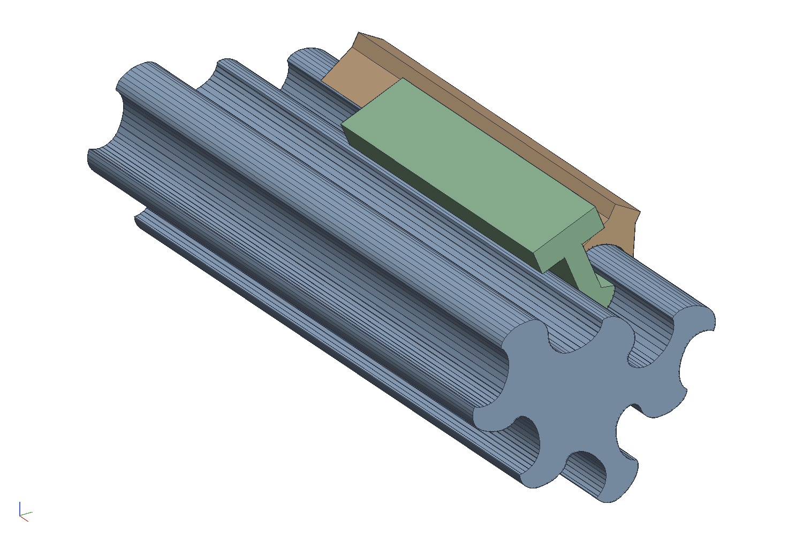
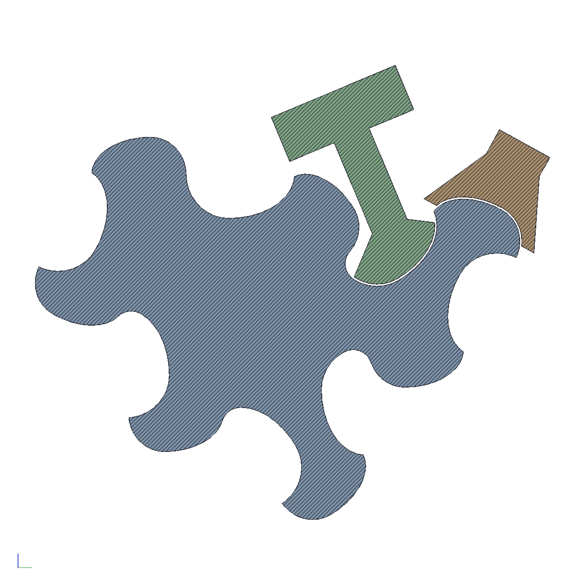
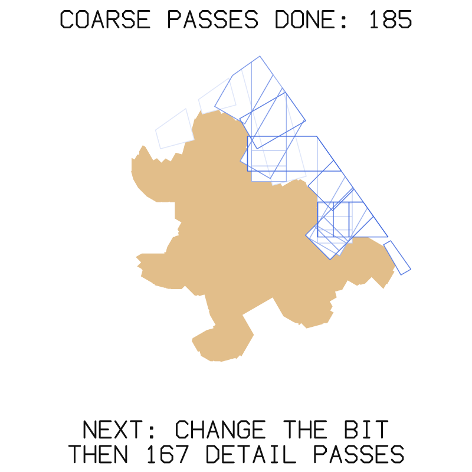
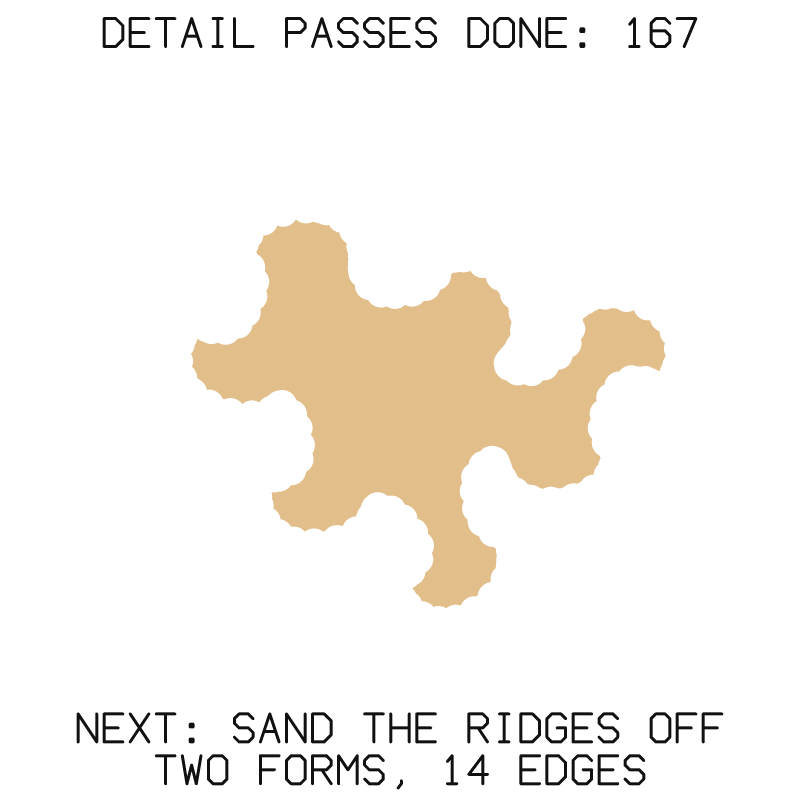
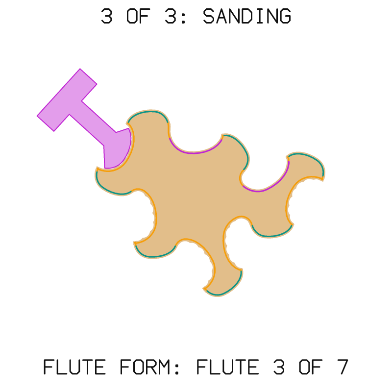
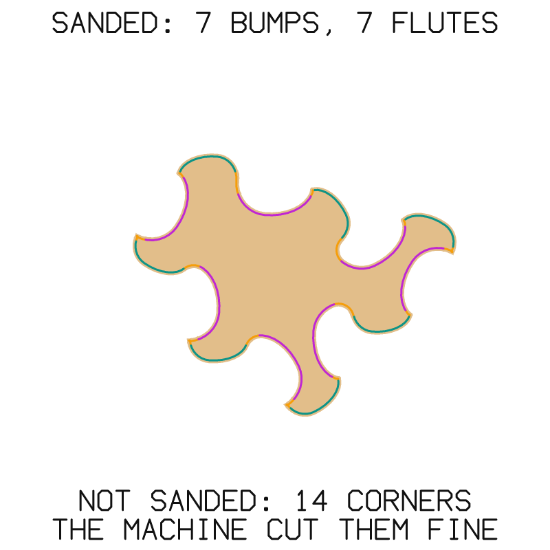

# Finishing the stick: two sanding forms and two scraper templates

The [stick sled](../stick-sled/) mills a stick whose section is the
tile. Between one pass and the next it leaves a ridge, and every ridge
runs the same way: along the stick, with the grain. So a form that is
the negative of an edge, pushed along the stick with abrasive film
stuck to it, takes the ridges off and cannot change the shape: it stops
cutting when it seats. The owner's idea, and the owner's film.

This draws one form for the tile's seven bumps and one for its seven
flutes, from the same outline the sled is planned from, and the ends of
the two blades a scraper would want.

```sh
cargo build --release -p ok-mcp
python3 examples/stick-sled/build.py           # the tile comes from its out/sled.json
python3 examples/stick-finish/build.py
python3 examples/stick-finish/whole.py         # the whole job as one animation
cargo test -p ok-render --test stick_finish    # what CI runs
```

| both forms on the stick | cut across |
|---|---|
|  |  |

Nothing here is printed, and nothing is queued to print. It is built
after the stick sled, like the sled after the positioner: a change to
the tile there means running this again.

## The whole job, animated


`whole.py` puts the machine's work and the hand's in one animation, the
owner's storyboard:

1. **Coarse passes.** The table's 185 roughing rows, the 1/4 in straight
   bit, as the machine makes them: the bit level, the stick turning.
2. **A pause** that says so and says what is next: change the bit, then
   the detail passes.
3. **Detail passes.** The tapered ball tip, and 167 passes where the
   sled's table has 291.
4. **A pause** that says the ridges are sanded off next: two forms,
   fourteen edges.
5. **Sanding.** The bump form on each of the seven bumps and then the
   flute form on each of the seven flutes, a pause after each. A line
   just inside the tile's edge is amber while that edge is still to do;
   where a form has been along, the ridges are gone and the line is
   that form's colour, teal for the bump form and magenta for the flute
   form.

| after the coarse passes | after the detail passes | a form in use | at the end |
|---|---|---|---|
|  |  |  |  |

**This is not the sled's table.** The table finishes the whole outline
to 0.05 mm, and a stick milled by it looks finished: drawn at this
size its ridges are a third of a pixel, and the first version of this
animation, made from the table, showed a perfect tile with nothing for
the forms to do. What is drawn here is the plan the owner means to try
once the machine cuts: fewer detail passes, and the forms to take off
what they leave.

| | the sled's table | drawn here |
|---|---|---|
| what a detail pass may leave where a form goes along afterwards | 0.05 mm | 0.4 mm |
| and at the fourteen corners the forms do not reach | 0.05 mm | 0.05 mm |
| detail passes, counting every bite | 291 | 167 |
| places they are made from | 242 | 132 |
| the ridge they leave, where a form goes | under 0.05 | up to 0.36 mm |
| and at the corners | under 0.05 | 0.06 |

The 0.4 mm is `COARSE` in `whole.py`, and it is a guess at what the
film takes off without labour: a stick and a form will say. `plan.py`
in the sled now takes the ridge allowed at each point of the outline,
so the table can be made this way when it is wanted; it is not, yet.

The last frame shows what the two forms do not reach: the fourteen
amber stretches, 36 mm of the 205 mm round the tile, where a bump runs
into a flute. They are not sanded, and in this plan need not be: they
are the part the machine still cuts fine.

It runs 68 seconds. The captions are strokes, since a flip book draws
shapes and no text (`okmcp.lettering`).

## What the tile is, cut

The kernel draws every one of the tile's fourteen edges as the same
curve, a leaning half ellipse: seven bulge out (bumps) and seven go in
(flutes), and none is mirrored. Cut, they are alike only away from
their ends. The tile is drawn 0.35 mm inside its edge for the gap
between tiles, and its corners are at different angles, so where a bump
runs into a flute differs from corner to corner.

| | bumps | flutes |
|---|---|---|
| across | 9.8 mm | 10.7 mm |
| high, or deep | 3.6 | 4.6 |
| round the curve | 13.4 | 16.2 |
| the stretch all seven share, to 0.03 mm | 12.0 | 13.1 |
| what the form covers of it | 11.5 | 12.6 |
| laid on each of the seven, that is off by at most | 0.027 | 0.006 |
| the whole of one, laid on the others, is off by | 0.38 | 1.63 |

So one form does for all seven, over about six sevenths of a bump and
four fifths of a flute. What it does not reach is the last millimetre
at each end of a bump and the last 3 mm at one end of a flute, under
the lobe next door: a folded edge of film, or a blade's corner.

## The two forms

| | bump form | flute form |
|---|---|---|
| file | [`form_bump.stl`](out/form_bump.stl) | [`form_flute.stl`](out/form_flute.stl) |
| what | a channel in a wedge-shaped stick | a bulb on a thin neck under a grip, like a T |
| section | 12.8 mm across, 10.1 from its face to its back | 14.0 across, 20.6 from its face to its back |
| long | 80 mm | 60 mm |
| prints | lying on its back, channel up | standing on its end |
| strip of film for its face | 12.0 mm wide | 12.2 mm wide |

- **The face is the edge, the film's thickness further out.** With the
  film on, the abrasive is on the tile's own curve. The film is taken
  as 0.2 mm.
- **They fit one way round.** The curve leans, and every edge leans the
  same way as the outline is walked, so a form turned end for end is
  the mirror image and fits nothing. Mark one end. If a form will not
  seat, turn it round before pressing harder.
- **The flute form goes in from the stick's end.** A flute is wider
  inside than at its mouth, so the bulb does not drop in from the side.
- **Why the flute form has a thin neck.** At some corners of the tile
  the lobe next to a flute hooks over it, and at each corner
  differently. Laid over each other, the seven flutes share one way
  out, straight out of the mouth, and it is 5.4 mm wide at its
  narrowest. The neck is 4.0 mm wide and 11.2 long, with 0.7 mm of air
  each side, and the grip starts where the lobes have ended.
- **Why the bump form's walls lean in.** For the same reason: with a
  square back, its corner met the lobe round the next corner on two of
  the seven bumps.
- **Printing.** No supports for either. The bump form lies on its back
  and nothing overhangs but its leaning walls. The flute form's bulb
  would overhang its neck both ways lying down, so it stands on end;
  that also puts its curve in the plane the printer is most accurate
  in. PETG or PLA.

To use: cut a strip of film to the width in the table and as long as
the form, peel it, and lay it into the channel or round the bulb from
the middle outward. 100 micron first, to take the ridges down until the
form seats all along; then 80 and 60. A form for each grade saves
peeling.

## The scraper's two blades

[`templates.pdf`](out/templates.pdf) is the two blade ends at 1:1, and
[`template_bump.stl`](out/template_bump.stl) and
[`template_flute.stl`](out/template_flute.stl) are the same two as
plates 1.2 mm thick to scribe round on card scraper stock. They are the
forms' sections with no film: the bump's is a notch between two
shoulders, the flute's a bulb on a neck. Each is the end of a blade and
no more, 12.4 and 10.3 mm across: the stock's own size is not known
yet, and nothing wider passes the lobes either side of an edge for the
first 11 mm out from the stick. A blade is held square to the stick and
cuts both ways, and like the forms it fits one way round.

A body to hold a blade, the finger plane the owner has in mind, is not
drawn: it wants the stock's thickness and width.

## Measure these first

| what | in the model | how to check |
|---|---|---|
| the film's thickness, stuck on | 0.20 mm: 3M gives the 268L's backing as 3 mil, 0.076 mm, and not the whole | callipers on a sheet with its liner off, or on a strip stuck to a gauge block. `FILM` in `build.py` |
| what the printer makes of a 12 mm channel | as drawn | print the bump form and try it bare on the first stick: it should rock a hair on the lobe's crown. If it sits down tight with no film, the film will not fit |
| the stick | the tile as planned | the forms are the tile's negatives, not the stick's: a stick milled off its plan is sanded toward the plan |

## Where the numbers came from

The tile's outline is the stick sled's, `out/sled.json`, which is
`spectre_tile` at the sled's edge, bulge, gap and bit. The edges are
found on it by where its curvature changes sign. The first bump is
laid on each of the others with the turn fixed to a whole number of
twelfths of a turn, which is what the tile's edges are apart, and only
the shift fitted; the same for the flutes. The stretch all seven share
is taken out from the middle for as long as all seven are within
0.03 mm. The way out of the flutes is measured on the seven laid over
each other, level by level.

## What the test checks

`crates/ok-render/tests/stick_finish.rs`, from the committed document
and numbers and the sled's own tile:

- the tile this was built on is the one the sled cuts now; each of the
  seven bumps is a whole number of twelfths of a turn from the first
  and none is mirrored, and likewise the flutes; the stretch a form
  covers, laid on each of the seven, is within 0.03 mm of the tile,
  while the whole of one is not, which is why a form stops short;
- each form is one solid that stands on the plate, and the section
  written down, pushed along its length, is that solid; put on every
  one of its seven edges it shares nothing with the stick; with the
  stick moved 0.14 mm toward it, still nothing; moved 0.30, it meets
  it; and all along its face it is 0.17 to 0.22 mm from the wood;
- the way out that all seven flutes share, found again from the tile
  and the seven moves, is 5.4 mm wide at its narrowest; the neck is in
  it with 0.7 mm each side, and past the neck the way is open to the
  grip's width;
- each blade template is a plate whose end is the tile's own curve: on
  every one of its seven, the stick drawn back 0.05 mm shares nothing
  with it but a sliver, and pushed 0.2 mm into it does;
- the animation's plan, worked out again from its passes: as many
  coarse passes as the sled's table has roughing rows and under three
  quarters as many detail passes as it has finishing rows; they leave
  a ridge of 0.36 mm on the stretches the forms cover, so there is
  something to sand, and 0.06 at the corners, and no pass is into the
  tile;
- and its frames, read back: each pass with its cutter in the frame
  and its chapter's name over it; the two pauses held, with no cutter,
  written on above and below; fourteen uses of the forms, each form's
  body in its own frame and no other, each followed by a pause in
  which there is less wood, more of the line is that form's colour and
  less of it amber; 16 mm2 of ridge gone from the section by the end;
  and the amber that is left near the 18 % of the outline that the
  forms' lengths say they do not cover.
