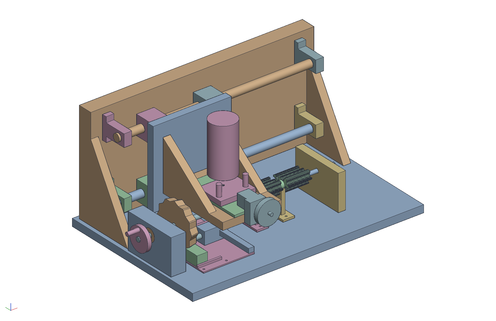
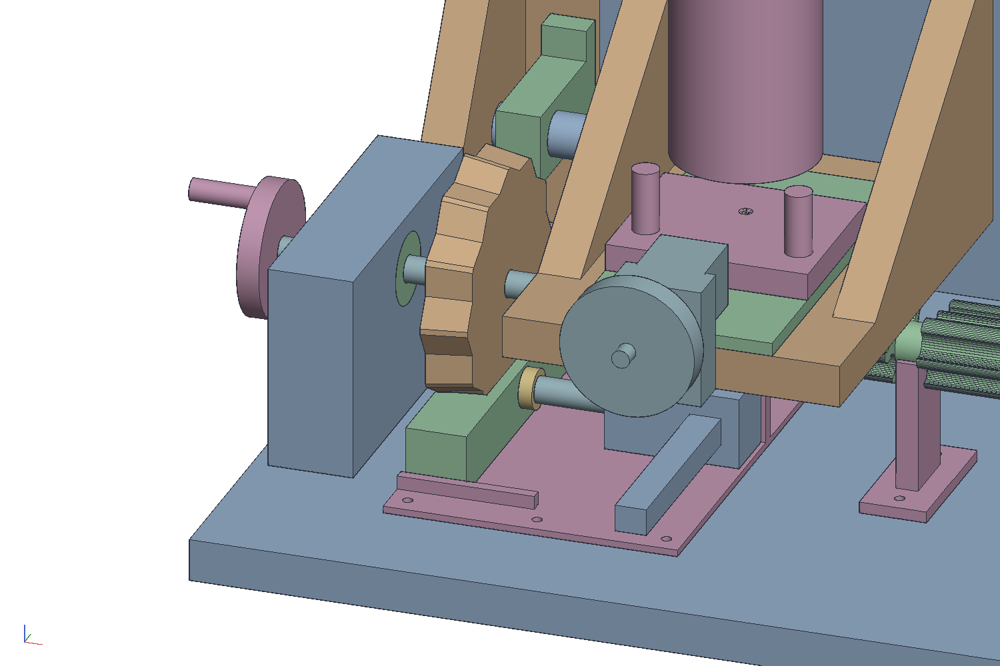
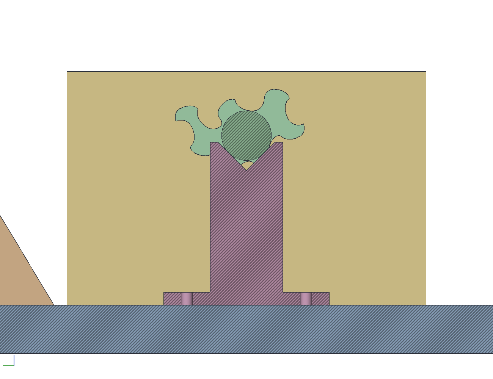

# An indexed stick mill

A reduced duplicator that mills the leaning half-ellipse Spectre's
whole outline round one solid stick, so a tile is one piece of wood
with no glue lines inside it. The stick turns between a headstock and
a tail centre, its spindle in two ball bearings. A printed
twelve-pointed star on the spindle (a hexagon and the same hexagon
turned 30°) is locked at any of twelve stops by one cradle, the only
part that moves: it slides along the axis onto the star, and off it
to let the stick turn. A trim router in its plunge base stands on a shelf out
from a ply square that rides two 20 mm shafts, one above the other
behind the stick, each held at both ends, with a bearing block behind
each corner of the square. On the same spindle as the stick, against
its end, is a printed pattern: the tile's section at full size.

```sh
cargo build --release -p ok-mcp
python3 examples/stick-mill/build.py
cargo test -p ok-render --test stick_mill   # what CI runs
```



## A pass

1. Throw the clamp's lever back: the cradle comes off the star. Turn
   the star a point. Throw the lever forward: the cradle goes home
   and locks. Every stop is the same two throws, and nothing is
   lifted.
2. Bring the carriage over the pattern.
3. Turn the cross screw to the pass's place: every pass is on a mark
   of the handwheel, 0.125 mm.
4. With the router off, plunge until the bit itself touches the
   pattern, and lock the plunge. That is the depth. Nothing is
   measured.
5. Switch on, run the carriage down the stick and back.

The pattern does not have to be followed along the stick, since the
section does not change: set once, lock, cut.

## The star and its cradle



The spindle runs in a 6201 bearing in each face of the headstock, so
its height never changes. The cradle only sets the angle. It is the
negative of the star's lower three points and slides in a guide on
the base, along the spindle's axis, on the plunger of a push-pull
toggle clamp: one throw of the lever is 30 mm, right off the star's
20, and the other brings it home and locks over centre. The cradle is
moved at every one of a stick's twelve stops and for every journal,
so it is a lever, not a screw.

The clamp lies on its side against an upright plate of the guide, so
its lever swings level, toward the front, under the pattern. A toggle
locks at a place, not at a force, so a urethane pad sits between the
plunger and the cradle's back, squeezed 2 mm when home: that is what
presses the taper.

Star and pocket taper 10° a side, narrowing toward the way the cradle
leaves. Pushed home the cradle seats on six flanks as a cone seats,
with no play to become an error in angle, and it lets go when the
lever is thrown back. The star's points are blunted 1.5 mm
and the pocket's two crests cut back 1, so only flanks meet.

With the cradle back, the stick turns freely and a crank outboard of
the headstock turns it: that is how the journals are cut.

The star is what sets the axis's height: its point is 57.7 under the
axis, then 5.3 mm of cradle and the guide's 3 mm floor, so the axis
is 66 over the base.

## Journals and posts

Milled to the tile, the stick is 200 mm of wood with necks of 4.5 mm
in its section, and it would spring away from the bit. So two short
lengths, at a third and two thirds, are turned first, while the blank
is whole and stiff, to a round about the axis: a journal. A printed V
post goes under each, and the stick is then milled in three spans of
60 mm between supports.



- The journal must lie inside the tile, or the profile's passes would
  cut it away. So the axis is not at the tile's middle but where the
  tile is fattest, 2.8 and 3.4 mm from where the kernel puts its
  origin: a circle of 9.8 mm radius fits there (7.0 at the old axis),
  and the journal is 19.4 mm round.
- To turn one: cradle back, the 6 mm straight bit over the journal's
  place, router on, the bit lowered a bite of 3 mm and the crank
  turned once round; again until the bit, tried on the round master
  on the pattern's outer face, is at depth. Eight bites at three
  places along the journal: 24 turns of the crank. (As twelve flats
  cut by plunging at each stop it was 48 plunges, each in bites.)
- Turn against the cutter and keep a hand on the crank: a bit can
  take hold of work that is free to turn.
- No pass of the plan comes within 3.0 mm of a post.
- The posts hold the stick down and, in their V, sideways. Nothing
  holds it up: the bit passes too close over a journal for a cap. And
  nothing here stops the stick twisting.
- Each journal costs 14 mm of stick.

## Roughing

The finishing passes alone would bury a 3 mm ball-nose in solid wood,
so the build follows the waste (the blank less the tile, 767 mm² of
section) on a grid and plans the bites that come first.

1. **The straight bit, 6 mm**, the journals' bit. At each stop it
   works across in places 3 mm apart. At a place, with the router
   off, it is plunged until it touches the pattern and the depth stop
   is set there over a 0.4 mm feeler: that is as deep as it may go
   without reaching the tile, and nothing is measured. Then it goes
   down to the stop in bites of at most 3 mm. 80 places, 133 runs of
   the carriage, the deepest 17.1 mm in six bites: 78 % of the waste.
2. **The ball-nose** then makes its 262 passes. 224 of them find less
   than 1.5 mm standing and are one run. The other 38 take what they
   find in bites of 1.5 mm, set the same way: touch the pattern, set
   the depth stop, come down to it. 343 runs in all.

Three of the ball-nose's passes are the hard ones: slots between
lobes where the straight bit does not fit, 12.6 to 16.7 mm deep and
the bit's own width, 32 runs between them. They are where the bit's
taper and its stick-out matter most.

A blank is taken to be the tile's hull and 2 mm over, as a saw
leaves it.

## The plan

`mill.json` lists every pass: its stop, its place across, and the
height the bit will find. For the tile at a 10.56 mm edge, 0.8 of a
semicircle deep, a 0.7 mm line and a 3 mm ball-nose:

| | |
|---|---|
| finishing passes a stick | 262, 16 to 27 at each stop; 343 runs with their bites, after 133 roughing |
| ridge left between passes | 0.05 mm, to sand |
| outline within 0.08 mm of a pass | 95 % |
| the rest | up to 0.32 mm proud, in the tightest corners, for a file |
| the bit's tip | from 28.3 above the stick's axis to 11.3 below it |

Each point of the outline goes to the stop that faces it most squarely
among those whose bit can get down to it; where a neighbouring lobe is
in the way, the next stop round cuts it with the side of the ball.

## Measure these first

| what | in the model | check |
|---|---|---|
| the bit | a tapered ball-nose, 1.5 radius, 6 mm shank, 50 mm out of the collet | the deepest pass is 49.3 under the base's sole; a shorter bit needs the cross slide lower, which the blank's swing limits |
| the bit's taper in the dents | not modelled: the plan treats the bit as 3 mm all the way up | try the pattern by hand at the deep passes before cutting wood |
| the plunge base | 50 mm of travel, sole 100 square | the Colt's plunge base, or the cross slide's hole and travel change |
| the blank | sawn within 2 mm of the tile, swinging 30.9 about the moved axis | 32 between the axis and the cross slide |
| the star and cradle | two hexagons 100 across their flats, tapered 10° a side, the cradle pushed onto six flanks | a tenth of a millimetre at a steep flank is 0.07 at the tile's edge; printed tapers bed in, so try every stop before trusting one |
| the bearings | two 6201 (12 x 32 x 10), one in each face of the headstock | any pair that takes the M12 studding; the push screw's thrust goes through the spindle's nuts to them |
| the toggle clamp | push-pull, 32 mm of stroke, drawn 60 x 28 x 32 with its plunger 19 over the base; on its side it is 2 mm under the pattern's swing | measure the one bought: its stroke sets the cradle's travel and the pad's squeeze, its size the plate, and its lever must swing clear of the base's front |
| the pad | urethane, 18 dia x 6, squeezed 2 | harder or softer until the star does not shake and the lever still throws; the plunger's thread sets the squeeze |
| the cradle's hold-down | none drawn: the star's wedge presses it onto the guide's floor | if it lifts at its outer end, a strip over each lip |
| the room under the stick | 35 between a blank's swing and the base | enough for chips and a brush; the carriage square's lower edge is 42 over the base |
| the shelf | 195 out from the square, a gusset over each edge | push down on its front edge: if the bit moves, deepen the gussets |
| the stick's stiffness | not checked | 200 mm between centres with necks of 4.5 mm in its section; halve the stick if it sings |

## Parts

| part | size, mm | |
|---|---|---|
| base | 591 x 393 ply | |
| back wall | 571 x 262, two plies, a brace in front at each end, 120 x 200 | the four shaft supports bolt to its face; the braces stand outside the shafts' ends |
| shafts, 2 | 20 dia x 521 | cut from the 700s; one 150 above the other, an SK20 at each end |
| carriage square | 200 x 200 ply, upright | an SC20UU behind each corner: the least that takes two shafts 150 apart and their 50 mm blocks, the blocks 145 apart along the shafts |
| shelf | 150 x 195 ply, two gussets | out over the stick, the cross slide on it |
| cross slide | 165 x 90 x 6 aluminium | the plunge base on it, an M8 screw from the front |
| headstock | two plies, 140 wide, bored 32 | M12 studding in two 6201 bearings |
| crank | 60 dia x 10 with a handle | on the spindle outboard of the headstock, for turning the journals |
| star | 115.5 over its points x 20, tapering to 108.4, printed | on the spindle, outside the shelf's reach, its large end toward the headstock |
| cradle | 150 wide x 26.4 high x 27, printed | slides in the guide; its 7 mm back closes the pocket's small end and takes the clamp's push |
| cradle guide | 131 x 196, a 3 mm floor, 6 mm lips and an upright plate for the clamp, printed | six screws to the base |
| toggle clamp | push-pull, 32 mm stroke | bolted on its side to the guide's plate; a urethane pad on its plunger |
| pattern | the tile's section x 20 and the journal's round master x 10 on its outer face, printed as one | on the spindle against the stick |
| posts, 2 | 28.4 wide x 10, 63.5 high, a right-angled V, on a 30 x 61 foot, printed | under the journals, two screws each to the base; fitted once the journals are cut |
| tail | one ply, an M10 pointed bolt | |

## What the test checks

`crates/ok-render/tests/stick_mill.rs`: each shaft runs through a
support at both ends and the carriage's blocks stay between the
supports wherever the bit goes; the pattern (with the journal's
master) and the stick (with its two journals) regenerate to their
sections' volumes; the star is two hexagons' worth tapering as a
frustum, its points short of the pocket's and the pocket's crests
short of its corners so only flanks meet; the cradle is home on the
star without passing through it, on the guide's floor between its
lips, and its travel takes it right off the star inside the guide;
the toggle clamp's pad is on the middle of the cradle's back, its
body behind the cradle's furthest, and all of it under the pattern's
swing and through nothing; the spindle passes
through a bearing in each face of the headstock; the axis is as low
as the star lets it be; with the carriage over the pattern the bit
stands on it and the square, the shelf and the cross slide clear the
headstock, the star, its cradle, the pattern and the wall; the axis
is at the tile's fattest place, the journals inside the circle that
fits there, no pass touching a journal or coming within a millimetre
of a post, each post's V tangent to its journal, and the crank's
turns enough bites and places for a journal; no roughing bite reaches
the tile less its allowance, every bite of either bit is within its
limit, the straight bit takes over 70 % of the waste and under 1 %
stands at the end; and the plan's passes are a few hundred over all
twelve stops, on the handwheel's marks, within the bit's reach, the
plunge and the cross travel, with 94 % of the outline cut and nothing
left more than 0.4 mm proud.
