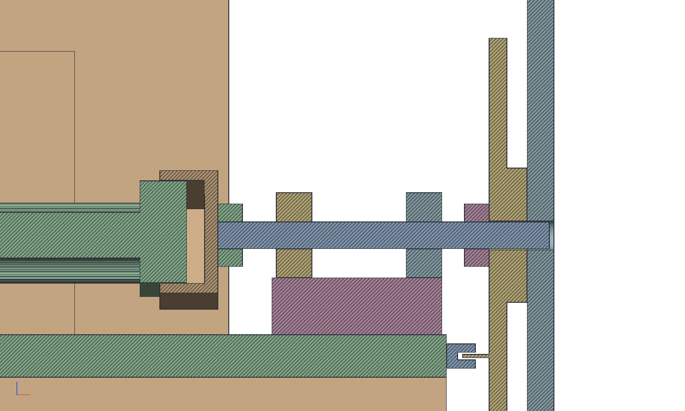
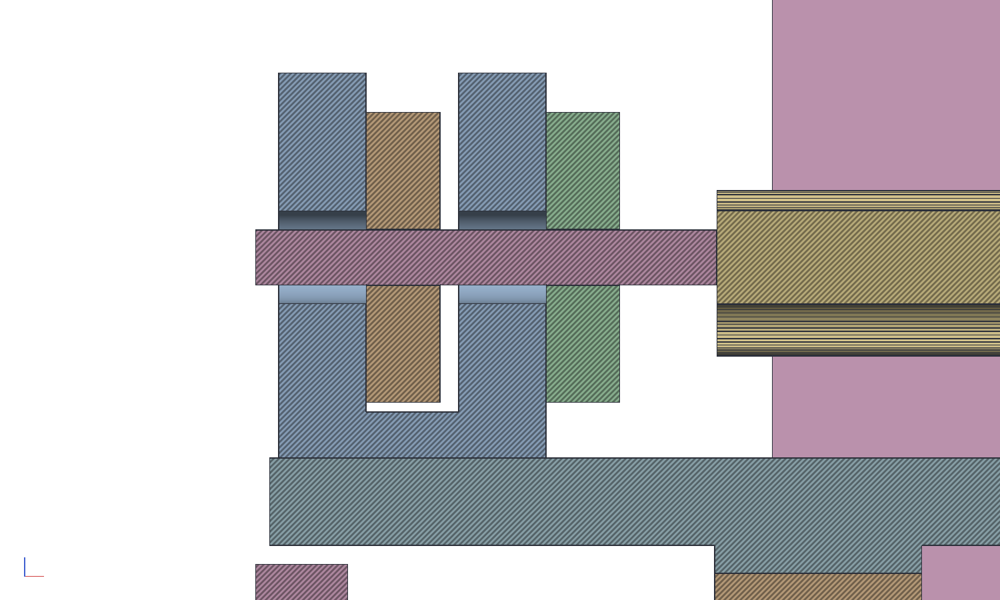
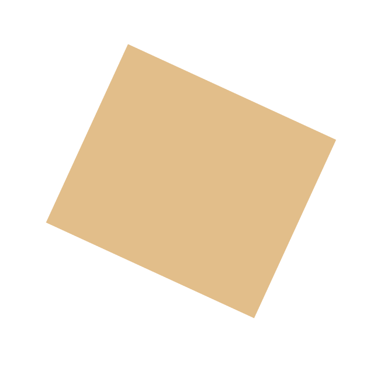
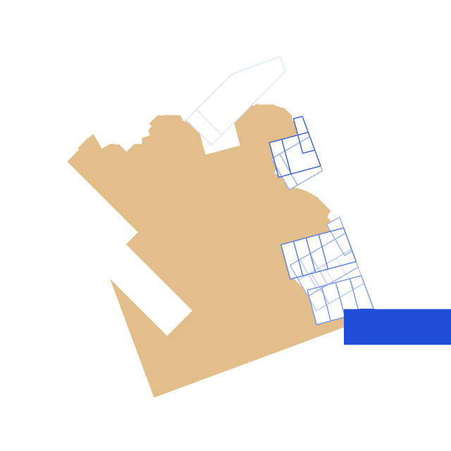
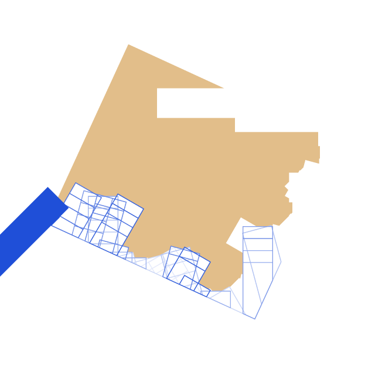
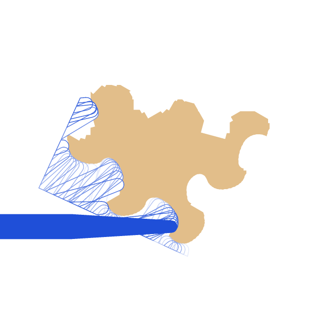

# A stick sled

The leaning half-ellipse Spectre milled round one solid stick. The
stick is held between a printed socket on a spindle and the point of
a second, idle spindle, on a flat sled that slides on the base
between two fences, and it only turns. Beside it, fixed to the base,
lies the [two-axis router positioner](../router-positioner/) with its
bit pointing at the stick: the positioner's X sets how deep the bit
reaches, its Z how high. Three motors go to the next row of a table,
and the sled is pushed past the bit and drawn back by hand.

The motor that turns the stick is not on the sled. It drives a wheel
of 360 teeth on an index head at the end of the base, and a tapered
star on the sled's spindle goes into that wheel's face when the sled
is drawn back. There the stick is turned to its next angle, a clamp
on the sled locks the spindle, and the sled leaves the wheel behind.
The index is the owner's idea, as the fences and the socket are.

It replaces the [hinged sled](../stick-sled-hinged/), which kept the
cutter fixed in a router table and hung the stick from two hinges.
Two straight screws now do what the hinges and their links did.

```sh
cargo build --release -p ok-mcp
python3 examples/router-positioner/build.py   # this reads the positioner's sizes from its out/positioner.json
python3 examples/stick-sled/build.py
python3 examples/stick-sled/animate.py        # out/passes_machine.gif and out/passes.gif: every pass, a frame each
cargo test -p ok-render --test stick_sled   # what CI runs
```


Nothing here has been built or run on a motor, and the positioner's
sizes rest on a router nobody has measured yet. What is checked is
checked by calculation and by the test.

## How it works


- **The stick turns and does nothing else.** Its far end sits in a
  printed socket on a spindle; its near end is on the point of a
  second spindle that turns with it. Every joint from the motor to
  the tail is in [The stick's drive](#the-sticks-drive-joint-by-joint).
- **The positioner places the bit.** It lies on its lid with its Z
  column standing up, so the bit's axis is a stick's height over the
  base. Its face is a wall 46 mm from the stick's axis; the bit comes
  out of the slot in it, and for the deeper cuts the collet nut too.
- **Depth** is the positioner's X: the quill run out along the bit.
  **Height** is its Z. A cut is a direction round the stick, a height
  of the bit over the stick's axis, and a depth. Each is one motor,
  and none of the three moves any other.
- **The sled is a flat plate between two fences.** It slides on the
  base with its far edge along one fence, and each fence has a lip
  over the sled's edge so that it cannot lift. What holds the stick
  is fixed to it. More in [The slide](#the-slide).
- **The wheel that turns the stick stays at the end of the base.** A
  sled can only carry a small wheel: the last one was 105 mm across
  and had to hang off the sled's end to clear the deck and the
  positioner. One that stays behind can be any size. This one has 360
  teeth and is 232 mm across, so the same runout turns the stick less
  than half as far wrong, and the ratio is eighteen to one. The sled
  carries a star to meet it and a clamp to keep the angle. More in
  [The index](#the-index).

## A pass

1. Draw the sled back to its stop, where a magnet holds it. The bit
   is beside the master: the tail spindle's rod, bare between the
   tailstock and the stick. At the other end the star is in the
   index wheel.
2. If the next row is at a new angle the display says so: open the
   clamp. The wheel turns the stick, the display asks for the clamp,
   and you close it. If the row is at the angle the stick already
   has, press the foot switch instead. Either way the positioner's
   two motors go to the row and stop.
3. Push the sled to its forward stop and draw it back. The bit comes
   onto the stick from its near end and stops 21 mm short of its far
   end, with the collet nut 2 mm short of the socket.

The stick goes to a new angle 203 times in the 479 rows; the other
276 are further bites at the angle it has, and need only the foot
switch.

The controller will not move a motor unless the sled is back: a
switch on the back stop. It will not turn the wheel with the clamp
closed, nor run the bit out for a cut until it is closed again: a
switch under the clamp's handle. With the sled back the bit is beside
the master, so a move between passes must not carry it through the
master. The safe way is to draw the bit back until its tip is 2 mm
clear of the master, then up or down and round, then out. Most moves
do not need it: the build follows each one along its own path and
marks it straight if the whole bit passes the master by 1.5 mm. 428
of the 479 are.

## The slide

The sled is a shallow box of 3/4 in plywood: a bottom, 413 x 211,
that slides on the base between two fences; a rail on edge along each
side; and a deck across the rails that everything holding the stick
is fixed to. There are no shafts and no bearing blocks under it. Like
the positioner it has no joinery: edges on faces, glue and brads, and
a fence's lip is a strip nailed along the top of it.

- **The far fence is the datum.** The sled's far edge runs along it.
  Across the sled is the way the bit reaches, so whatever bow that
  fence or that edge has is cut into the stick, one for one. Make the
  pair as straight as you can: a metal bar or an aluminium extrusion
  for the fence, a factory edge for the sled.
- **Two spring plungers in the sled's near edge** push off the near
  fence and keep the far edge on the datum. So there is no fit to get
  right between the fences: the near one stands 1 mm off the sled. A
  cut pushes the stick away from the bit, which is the same way.
- **Each fence has a lip over the sled's edge,** 0.3 mm clear of its
  top: 10 mm over at the datum, 7 at the near fence. They stop the
  sled lifting or tipping. They are not what holds it down: its
  weight and the hand on it do that, and by my estimate a roughing
  cut tips it with about two thirds of what its weight resists.
- **It rides on two slippery strips** on the base, one under each
  edge, 3 mm thick. A chip on a strip lifts the sled, and the sled's
  height is the bit's height on the stick: brush them, or fix a felt
  wiper to each end of the sled.
- **The near fence stands against the positioner's face.** It is
  14 mm wide, which is all the room there is, and the box's near rail
  stands inside its lip. The deck is 52 mm over the fences and
  reaches out over that one, to 6 mm short of the positioner's face.
- **A stop block** on the base meets the sled at each end of its
  188 mm; the back one carries the sled-back switch and the magnet.

The positioner lies on the base itself, and in plywood its bit is
138 mm over the base. The box is what brings the sled's deck up to
it: the stick's axis is 44.4 mm over the deck, and the box's rails
stand inside both lips on a bottom that reaches under them. How straight the datum fence is and how flat the base is
are not in the study under Setting up: the ground shafts this
replaces were taken to be true, and a fence is as true as it is made.

## The index

| the sled home, cut along the axis | the same, from the head's end |
|---|---|
|  |  |

The owner's idea: put the stick mill's tapered star on the sled's
spindle, its negative in the face of a wheel that does not travel,
and a lock on the spindle. A wheel that stays at the end can be far
larger than one a sled carries, and where it is too large for the
board it goes through a slot.

- **The star** is twelve points, two hexagons 100 mm across their
  flats, 115.5 mm over the points at its large end and tapering 10° a
  side over its 20 mm. It is printed in one piece with a disc 176 mm
  across behind it, which is what the clamp pinches and what a hand
  turns the stick by.
- **The wheel** has 360 teeth, 229 mm on the belt's pitch line. The
  pocket is in a boss on its face: the star's own shape with the
  inside corners cut back, and 1.5 mm to spare behind the star's small
  end so that the flanks meet before anything else does. Its rim is
  28 mm over the base and 3 mm over the head's own plate, which is
  slotted under the rim and the belt's lower run to give them room.
- **The head is not fastened down.** Wheel, shaft, bearings, motor
  and home sensor are on one plywood plate that stands on three
  round-headed screws. Behind it a post is screwed to the base, and
  the head hangs back on two bolts through 8 mm holes in that post,
  level with the axis, a spring on each. The star pushes the head
  back 3 mm as it comes home. So the star seats fully every time and
  the head goes where the star puts it: nothing here is lined up to a
  fit, and the bolts' slack lets the head shift a millimetre and a
  half any way.
- **Home, the head stands on the star and two of its feet.** The
  third, by the wheel, is set 0.3 mm short and carries the head only
  while the sled is away. The two that always bear are one under the
  shaft's far end and one out under the motor, and the star's seat is
  330 mm from the line that matters between them: a star 0.03 mm off
  the spindle's centre lifts the wheel's end that much as it turns
  and rolls the head 0.005°. Set the feet once, with the sled home:
  the two until the star's flanks show no light, then the third.
- **The lock** is a push-pull toggle clamp on a riser beside the
  headstock. Its plunger goes through a post and presses the disc,
  80 mm from the axis, against a steel plate that reaches in behind
  the disc from a spacer on the same post. The clamp's riser is glued
  hard against that post: the anvil pulls the post one way and the
  clamp pushes its riser the other, and a post standing alone on its
  edge would be bent at its foot by the whole pinch. The spindle's bearings
  feel none of it, and a plunger that moves along the spindle does
  not drag the disc round as it closes. The motor is still holding
  the stick through the star while the clamp goes on. By my estimate
  a 500 N clamp holds 16 N m there, eight times what 60 N at the
  blank's corner asks.
- **A magnet in the back stop** holds the sled home against the
  head's two springs: a 16 mm pot magnet, flush in the stop's face,
  on a steel disc let into the sled's end.
- **The star goes in twelve ways.** Paint a mark on the disc's rim
  and one on the wheel's, and have them together when a blank goes
  on. A blank put on with them a point apart is 30° round, and the
  first row shows it: its wide face is not level.
- **Come home locked.** The stick comes back at the angle the wheel
  still holds, so the star goes in as it came out. If the spindle has
  been turned in between, open the clamp before pushing home and the
  star turns it to the nearest of its twelve. Do not open the clamp
  anywhere else during a stick.
- **What it costs.** The clamp is thrown and let go 203 times a
  stick, where a motor on the sled needed nobody. The base is 200 mm
  longer. And the bands that line the stick up are turned by hand,
  because away from its back stop the sled has no motor.

Printed fits are untested. A star that prints a quarter of a
millimetre small all round goes 1.5 mm further in, which is all the
room there is: print the star, then the pocket to it.

## What carries the stick

Along the stick's axis, from the tail to the post behind the index
head, and what each thing stands on:

| | what | carried by |
|---|---|---|
| tail spindle | a 12 mm ground rod 91 long, a three-flat point on its end, bare for 26 mm beside the stick: the master | two KP001 pillow blocks, 44 mm between centres, bolted down on a riser |
| the stick | the blank, 49 x 42 x 200 | the tail's point at one end, the socket at the other |
| socket | printed, epoxied on the spindle's end | the spindle |
| spindle | a 12 mm ground rod 147 long | two KP001 pillow blocks, 58 mm between centres, bolted down on a second riser |
| star's hub, lock disc, star | on the spindle's far end, 49 mm out from the last block | the spindle; the disc is pinched between the clamp and its anvil, both on a post glued to the riser, the deck and the clamp's own riser |
| *the sled ends here* | | |
| index wheel, its hub | the pocket in the wheel's face is round the star when the sled is back | the wheel's own shaft, a 12 mm rod 90 long |
| the wheel's shaft | | two KFL001 flange bearings on two uprights, 110 wide, on the index head's plate |
| index head | plate, uprights, motor, home sensor | home, the star and two screw feet; away, three feet |
| two bolts and springs | level with the axis, 40 mm each side of it | a post screwed to the base |

From the base up to the axis on the sled:

| | mm |
|---|---|
| slip | 3 |
| sled's bottom, 3/4 in | 19.05 |
| rail on edge | 58.15 |
| deck, 3/4 in | 19.05 |
| riser, two layers of 1/2 in | 25.4 |
| pillow block, foot to the shaft's centre | 19 |
| the stick's axis | 143.65 |

- **Pillow blocks on the sled.** The two spindles used to run in
  flange bearings on the faces of four thin uprights stood on their
  ends on the deck. A push along the rod, which is what the socket's
  jack screw makes, bent those uprights at glue lines 50 x 19 mm: by
  my estimate 1.4 MPa for 200 N. A pillow block bolts down on a flat,
  so each pair now stands on one solid block glued face down, and the
  same push is 0.04 MPa of shear. There is nothing to stand square
  and no 20 mm hole to bore for the rod.
- **Both risers are sawn from one glued-up strip,** so the two
  spindles start at one height. The blocks are castings, and makers
  differ by a few tenths in the 19: measure the four and put the two
  most alike on the tail.
- **Each block is held by two M6 bolts** through the riser and the
  deck, 56 mm apart, in holes drilled a size over. Sideways it is
  set by sliding in those holes, up by shims under its feet.
- **The foot is 71 mm long,** so the risers are 76 wide and the deck
  was widened to carry them: it now overhangs the near rail by 14 mm.
- **The collet nut is the one thing in their way.** At the deepest,
  lowest cut it comes within 33.5 mm of the axis and 10 mm lower than
  a riser's top, and a riser is 38 mm wide that side. So along the
  sled the nut must never be over one. With the sled back it is 4 mm
  past the tail's riser, which is why the master is 26 mm long where
  it was 21; with the sled forward it is 52 mm short of the head's.
- **The index head keeps its flange bearings.** Its shaft is 113 mm
  over its plate, so blocks would want a pedestal of five layers.
  The uprights there are 110 wide, the loads on them are the belt's
  pull, in their own plane, and 15 N of spring; and their faces are
  where the home sensor and the two bolts are fixed, level with the
  axis.
- **How high the stack comes out does not matter.** Six plywood
  thicknesses are between the base and the axis. The positioner's
  height has 80 mm of travel and the six touches find where the bit
  is level with the stick; the index head's three feet take up the
  rest.

## The stick's drive, joint by joint

| the sled's far end, cut along the stick's axis | the tail end, where the bit waits |
|---|---|
|  |  |

From the motor to the far end of the stick, what each part is joined
to the next by:

| from | to | joined by |
|---|---|---|
| motor, a NEMA 17 on a bracket on the index head's plate | its pulley, 20 teeth | the pulley's two set screws, one on the shaft's flat |
| pulley | index wheel, 360 teeth, printed | a closed GT2 belt of 852 mm, 6.5 of the pulley's teeth in it. The bracket's slots tension it. Motor and wheel are on the one plate, so the belt's pull stays inside the head |
| wheel | its hub | four M4 bolts through slack holes into the flange of a bought 12 mm hub on the wheel's back. The wheel's own bore is 13 and does not touch the shaft |
| hub | the wheel's shaft, a 12 mm ground rod | the hub's set screws, on a flat ground on the rod |
| shaft | index head | two KFL001 flange bearing units, one on each of the head's two uprights, between them |
| wheel | star | the star's twelve tapered points in their negative in the wheel's face, while the sled is back; the head's springs keep them seated |
| star and lock disc, printed in one | their hub | four M4 bolts through slack holes into the flange of a second hub, on the disc's inner face, its boss toward the headstock where a key reaches its set screws |
| hub | spindle, a 12 mm ground rod | the hub's set screws, on a flat ground on the rod |
| lock disc | sled | the toggle clamp, pinching the disc against its anvil whenever the sled is away from the wheel |
| spindle | headstock | two KP001 pillow blocks bolted down on a riser. Their set screws hold the rod endways. No plywood is bored to a fit |
| spindle | socket, printed | the rod's end, roughened, epoxied 22 mm into the socket's boss |
| socket | stick | a pocket the blank's end stands 12 mm into, 0.3 mm slack all round, with two screws: one through the floor that jacks the blank toward the tail, one through a wall that locks it against the wall opposite |
| stick | tail spindle | a point of three flats ground on the end of a second length of the rod |
| tail spindle | tailstock | two more KP001 on a second riser. The rod is bare for 26 mm between the inner one and the stick, and that is the master a bit is set against |
| wheel | controller | a fin on the wheel's back, 34 mm from the axis, through an optical endstop on the head's first upright once a turn |
| clamp | controller | a switch on the lock post that the clamp's handle closes |

The socket is the owner's idea, and it does three things a spur did
not: it cannot slip, it puts the blank on the axis without a centre
mark at that end, and it says which way round the blank is. What it
costs is the stick's far end. A socket big enough for the blank
cannot be where the bit comes onto the stick, so the bit waits at the
tail and each pass stops before the socket: 21 mm of every stick is
not cut.

To buy: four KP001 pillow blocks and two KFL001 flange bearings, two
12 mm flanged hubs, a 20-tooth GT2 pulley of
5 mm bore, an 852 mm closed GT2 belt, an optical endstop, 12 mm
ground rod for lengths of 147, 91 and 90 mm, a push-pull toggle
clamp with a 10 mm plunger, a lever microswitch for it, a 16 mm pot
magnet and a steel disc, two M5 bolts 50 long with a compression
spring each, three round-headed M6 screws and inserts for the head's
feet, two M5 set screws and inserts for the socket, two M6 spring
plungers and inserts for the sled, a piece of 6 mm steel flat for the
anvil, epoxy. The sizes in `build.py` are the catalogue's: measure
the ones that come before drilling for them. To make: the printed
wheel, star and socket, a flat on each rod for its hub, and three
flats for the tail's point.

- **Gluing the socket on.** Which way round it is on the rod is which
  way round the blank is to the controller, so glue it with the
  spindle where the table's first row puts it: run that row, turn the
  socket until a wide wall of its pocket lies flat on a block stood
  on the deck, and leave it there while the epoxy sets.
- **Putting a blank on.** Mark the tail end's centre, 19.5 mm from one
  wide face and 24.8 from one narrow face. Push the other end into
  the socket as far as it goes, bring the mark to the tail spindle's
  point, turn the jack screw until the point is 2 or 3 mm into the
  wood, then tighten the lock screw. Before the jack screw, turn the
  tail spindle so the line scribed on it is uppermost: the master's
  runout was measured that way round.
- **The tail spindle turns with the stick,** which is why its point
  has flats. It is the master, and the half turn that finds its
  runout is the motor's, through the wheel, the star and the stick.
- **Truing the wheel, and the star.** Snug the wheel's four bolts,
  hold a dial indicator on it where the belt runs, turn it, and tap
  it until the needle moves 0.04 mm or less. Then tighten. That 0.04
  is 0.02 off centre. Do the same for the star on its hub, with the
  indicator on the lock disc's rim, to 0.06. What both buy is in
  Setting up.
- **Lining the stick up with the sled's travel** (`out/bands.csv`) is
  moving the tail's two pillow blocks: sideways in their bolt holes,
  up by shims under their feet.
- **The home fin** is on the wheel and is read 34 mm from the axis,
  so 0.02 mm there is 0.017 mm at the tile's edge. It matters only
  when a stick is taken up again after the controller has been off.
  Homing wants the sled back and the clamp open, so that the wheel
  takes the stick with it. The sensor says home
  over the fin's whole 10°, so an axis found already at home is first
  run away until the sensor lets go, and 5° more, and then brought
  back: home is the same edge from the same side every time. The
  build runs the controller's homing from nine places to check it.

## The table: 479 rows a stick

| rows | what | bit |
|---|---|---|
| 1 | put the blank on | |
| 1 | set the straight bit | Freud 04-110: 1/4 in straight, two flutes |
| 185 | roughing: 83 places from 24 directions, in bites of 3 mm | |
| 1 | set the ball-nose | Freud 72-405: a 1/8 in ball tip, tapered to a 1/4 in shank over an inch |
| 291 | finishing: 242 passes, the deep ones in bites of 1.5 mm | |

Both bits have 1/4 in shanks: the router is the North American Colt,
and that is its collet.

### The two bits

| | Freud 04-110 | Freud 72-405 |
|---|---|---|
| what | 1/4 in double-flute straight, 1 in of carbide | 7.2° tapered ball tip, 1/8 in at the tip, 1 in of carbide |
| long, end to end | 2-7/8 in, 73.0 mm | 2-1/2 in, 63.5 mm |
| set, out of the collet nut | 42.5 mm | 41.9 mm |
| of its shank in the collet | 30.5 mm | 21.6 mm |
| what will do | 42.5 to 43.9 out | 39.9 to 43.9 out |
| how | push it in until it bottoms, then draw it back 1.5 to 3 mm | 42 mm from the nut's face to the tip, by a rule |

The table takes a bit to stand 41.9 mm out of the collet nut, and the
controller's touch takes up 2 mm either way. What the owner measured
on the router says which bits can: a 1/4 in shank bottoms 32 mm in
from the tightened nut's face; it should be 1.5 mm off that bottom
and at least 19 mm in. So a bit 58.9 to 74.4 mm long, and both of
these are. The straight one is long for it and sits as deep as it
may; the tapered one is short for it and has 21.6 mm in the collet,
19.6 if it is set as far out as the margin allows.

That 41.9 was 45.9, and at 45.9 the tapered bit had 17.6 mm in the
collet. How far a bit has to stand out is the blank's swing, 33.5 mm,
and how far past the stick's axis its tip goes; the planner, left to
itself, sent two finishing passes 12 mm past, for the angle they met
their faces at. It is now told 8 mm at the most (`TIP_LIM` in
`plan.py`), and the 242 passes still come within 0.05 mm of the whole
outline. At 7 mm three points of it are out of reach.

The collet nut is 20 mm across and the bits 6.35 and less, so at the
far end of a pass the nut is beside the last of the stick that no bit
reaches, and that is the blank as it was sawn, whatever has been cut
off the rest. So the build checks the nut against the uncut blank at
every one of the 476 cuts: with either bit 39.8 mm out or more, the
nut passes it by a millimetre. Set as short as the margin allows, the
tapered bit is 39.9 out.

The cuts are the hinged sled's, planned by the same `plan.py`: every
finishing pass from its own direction, the whole of a tapered bit
kept out of the tile, each pass meeting its face 15° round the ball
from its dead centre, roughing to 0.4 mm of the tile, the order
settled before the bites are counted. Its README has the reasons.
What changed is where the three numbers of a row come from.

- **The blank is a plain rectangle,** 49 x 42 mm, and 200 long of
  which 179 are cut. Its far end goes in the socket; the centre is
  marked on its near end only, 19.5 mm from one wide face and 24.8
  from one narrow face. The first row turns the spindle to where the
  socket holds it with that wide face level and underneath and that
  narrow face toward the router.
- **A bit is set by touch, by the controller.** The probe's clip goes
  on the bit with the router off; the bit is run out at the master,
  level with the stick's axis, until it touches, three times; from
  then on every depth is taken from there. So a bit may stand 2 mm
  further out of the collet than the table takes it to, or less far,
  and the cut is the same. Further off than that it is the collet
  nut or the bit's own shank that says no: see The two bits.
- **The clip has a home.** It is a post wired to ground: parked there
  the probe reads closed, and the controller will not go to a cut
  until it does. The router is never started with the clip on its
  bit.
- **Every move ends going the same way,** away from home, as the
  positioner's brief asks: a move back goes half a millimetre past
  and comes up to its place.

A stick is about three hours: 500 pushes at a quarter of a minute,
the clamp opened and closed 200 times at five or six seconds, and
under half an hour of the motors (3.3 m of the depth's screw and
4.7 m of the height's, at 1280 steps a millimetre; the wheel turns
the stick 744° in all). Estimated.

## Every pass, animated


`animate.py` draws the table: all 476 cutting rows, a frame each. What
is left of the blank is tan, the pass being made is solid blue, and
the passes before it are blue outlines that fade to white.

This first one is **what the machine does**, seen from the
headstock's end with the positioner on the right. The bit stays level.
From one pass to the next it moves up or down (the positioner's Z) and
in or out (its X), and the stick turns to a new angle (the index
wheel). It starts with the blank as the table's first row hangs it, a
wide face level and underneath. A turn of more than 6° is shown on the
way round, with the bit out of the picture. It runs 41 seconds: 185
roughing passes, a pause where the bit is changed and set, 291
finishing passes, and then the tile.



The second is the same passes **fixed to the stick**: the tile stays
still and the bit seems to come from every side. It is the easier one
to judge the plan by, because the tile comes out of the blank in one
place.

| | part way through roughing | part way through finishing | done |
|---|---|---|---|
| as the machine has it |  |  |  |
| fixed to the stick |  |  |  |

```sh
python3 examples/stick-sled/animate.py   # after build.py: it reads out/sled.json
```

They are made with a tool that is not the sled's: `flipbook` in
`ok-mcp` draws any frames of flat shapes to an animated GIF, and can
show a frame turned; `cutting_book` in `examples/okmcp.py` makes the
frames for any blank and any list of cuts in this style, with an
angle for each cut if the work turns. `animate.py` only turns the
table's rows into the bit's outline at each. A roughing cut is drawn
as the bit's whole width to where its end stops; a finishing cut as
the ball, its tapered flank and the shank.

## What the positioner has to be, for this job

| | here | |
|---|---|---|
| X travel | 36.6 to 78.0 mm used of 80 | the far end of it: the deepest cut is 2 mm short of the end, and at home the bit's tip is 70 mm from the stick's axis, 36 clear of the blank's corners |
| Z travel | 21.0 to 59.0 mm used of 80 | 60 would do |
| how it lies | on its lid, on the base | the stage's weight then pulls away from its column, onto the collar that has no thrust bearing yet |
| its face from the stick's axis | 46 mm | the Colt's collet nut, tightened on a bit, is 30 mm in front of the quill by the owner's callipers, so at the deepest cut it is 12.1 out of the face, and the uncut blank's corners swing 33.5. The nut sets the distance, not the face |
| the bit out of the collet nut | 41.9 mm | the blank's swing, and 8 mm past the stick's axis, which is as far as the planner may send the ball's tip. The router does not change it: the positioner stands back by what the nut stands out |
| how long a bit that takes, end to end | 58.9 to 74.4 mm | 19 mm of shank or more in the collet and 1.5 off its bottom, which the owner measured 32 mm in from the tightened nut's face; and set within 2 mm of the table's length. See [The two bits](#the-two-bits) |
| the depth's screw | M8 rod, as the positioner draws | a rod's pitch is nobody's promise, but it matters little here: 0.2 % off costs under a hundredth of a millimetre in the study |
| its two travels, square | not known until it is built | 2 mm in a metre out is 0.07 mm on the tile: the largest thing left. See Setting up |

With a bit set as the table takes it, the collet nut never comes
within the blank's swing: at the deepest cut its face is 33.9 mm
from the axis and the blank's corners swing 33.5. A bit set 2 mm
short brings the nut that much nearer, inside the swing; it still
passes the blank itself by a millimetre at every cut, which is what
the build checks.

## The controller

`firmware/main.py` and `firmware/config.py` are MicroPython for a
Raspberry Pi Pico; `out/passes.csv` is the table. It is the hinged
sled's program with its two screws renamed and three things added: a
bit set by touch, every move ending the same way, and the spindle's
lock. It reads the table a row at a time, says what it wants on a
small display and over USB, and keeps its place: taken up part way
through a stick, it homes and sets the bit again before it cuts.

The lock is one switch and two rules. The wheel is turned only with
the sled back and the clamp open; and after a turn nothing goes on
until the clamp is closed. A row at a new angle is begun by opening
the clamp, which nobody does by accident, so it needs no foot switch.
The simulated run counts the openings, and the build checks the count
against the table: 203.

| | |
|---|---|
| controller | Raspberry Pi Pico |
| drivers | three TMC2209 modules; 8 microsteps for the screws, 16 for the wheel |
| a screw's step | 0.00078 mm (M8 x 1.25) |
| the stick's step | 0.00625°: 57 600 to a turn |
| home switches | the quill drawn back and the stage at its home end (down, as it lies here), wired normally closed; and an optical endstop that the wheel's fin passes once a turn, which has to read high with the fin in it, as an opened switch does |

| pin (GP) | to |
|---|---|
| 2, 3 | depth driver: step, direction |
| 4, 5 | height driver: step, direction |
| 6, 7 | the index wheel's driver: step, direction |
| 8 | all three drivers' enable |
| 9 | the lock's switch, on the sled: closed with the clamp thrown |
| 10, 11, 12 | home switches: depth, height, the wheel's mark |
| 13 | sled-back switch, on the back stop |
| 14 | foot switch |
| 15 | the probe's lead and clip; the spindle and the clip's parking post to ground |
| 16, 17 | display: SDA, SCL |

No motor rides on the sled. Two wires do: the lock switch's, and the
ground lead to the spindle that the probe needs.

## Setting up a built machine

Two straight screws leave little to find, and none of it needs a fit.
The controller runs both steps from tables `build.py` writes;
`calibrate.py` reads the results.

**Depth needs nothing.** Setting a bit by touch measures it every time
one goes in.

### 1. Where the bit's height is: `out/probe.csv`

A ground 1/4 in pin goes in the collet in place of a bit, with the probe's
clip on it, and a scrap blank on the sled, put on as any blank is, so
that the motor turns the tail spindle. The controller brings the pin
against the master from the front, from below and from above, and
again with the spindle half a turn round: six places, three touches
each, a few minutes.

```sh
python3 calibrate.py fit probe_log.csv --master 12.00 --pin 6.35
python3 build.py
```

- The middle of where the pin met the master from below and from
  above is the height at which the bit's axis is level with the
  stick's.
- Those two are the master and the pin apart, whatever the screw
  says, so they give the height screw's true travel.
- What half a turn of the spindle changes is the master's runout,
  and the table's setting rows allow for it.

`calibrate.py study` tries it on 300 machines built wrong at random:
the height's home anywhere in 3 mm, the height's screw 0.3 % off its
pitch and the depth's 0.2 %, the two travels 2 mm in a metre out of
square, the master 0.05 mm off the spindle's centre, a touch
repeating to 0.01 mm. The worst finishing cut of each:

| | median | 95 in 100 | worst of 300 |
|---|---|---|---|
| from the drawing's table | 1.63 mm | 3.00 | 3.22 |
| after the six touches, the spindle turning true | 0.045 mm | 0.073 | 0.083 |
| the same, were the depth's screw true | 0.040 | 0.068 | 0.077 |
| and the two travels square as well | 0.015 | 0.028 | 0.038 |
| after the six touches, with the turning as it would be: wheel trued to 0.02 off centre, pulley 0.03, star and pocket 0.03 each, the star home within 0.01 | 0.051 | 0.081 | 0.089 |
| the same, the wheel left 0.1 off as printed | 0.055 | 0.084 | 0.104 |

One machine is recorded in `out/calibration.json` as probed by the
controller's own program on a computer: 0.81 mm out from the drawing's
table, 0.033 planned for. The test works it again.

**The touches cannot find how far the stick has turned.** The
master is round. A wheel off its turning centre lets the belt in and
out once a turn, and the stick is that much over the wheel's 114.6 mm
pitch radius from where the motor sent it: 0.01 mm off centre is
0.003 mm at the furthest cut. The motor's pulley does the same once a
turn of its own, and the ratio brings it to the same figure. The
index adds two things of its own. The star comes home in the wheel
for every new angle and not quite where it did the time before:
0.01 mm at its flanks is 0.006 mm at the furthest cut. And a star or
a pocket off its centre rolls the head, by 0.03 mm over the head's
330 mm stance: under 0.006 mm for the two together. So the last two
rows: all of it costs 0.006 mm on the median, and a wheel left as
printed, which on the sled's own small wheel cost 0.02, now costs
0.005 more. The star's homecoming is my estimate; nothing has been
printed to measure it.

**What the touches do not find is whether the two travels are
square**, and that is most of what is left. The pin is level with
the stick's axis at the depth the touches were made, 46 mm out; a
bit run in or out from there rises or falls with whatever the quill's
travel is out of square with the stage's. Two millimetres in a metre
is 0.07 mm over the cuts' 45 mm of depth. It can be measured, with
the ball-nose's tip on the top and the side of a 1-2-3 block stood on
the sled's plate; that is not written yet. Until it is, it is the
positioner's to be built square, and its builder's to check with a
square.

### 2. Whether the stick runs true: `out/bands.csv`

The stick's axis has to run parallel to the sled's travel. A scrap
stick goes on with a stop clamped 25 mm in from each
end. The table sets the straight bit and, in three bites, has the
sled pushed to the far stop and drawn back to the near one, and the
stick turned once round at each: first with the bit's end at the
stick from the front, then with its side over the stick. Away from
its back stop the sled has no motor, so those turns are made by
hand: open the clamp, turn the lock disc once round to its mark,
close the clamp, foot switch. Twelve of them. Four bands, four
diameters:

```sh
python3 calibrate.py align FRONT_NEAR FRONT_FAR TOP_NEAR TOP_FAR
```

says how far to move the tail spindle, toward or away from the router
and up or down. All of it is simulation.

## Measure these first

| what | in the model | check |
|---|---|---|
| the router | its body is 70.71 mm, measured; the rest is read off two photographs, with allowances where it matters | see the positioner's own table |
| the probe's pin | 6.35 mm, a 1/4 in dowel pin or drill rod | measure it and give `fit` what it is with `--pin` |
| the datum fence, and the sled's edge on it | straight | lay a straightedge along each: their bow is cut into the stick, one for one |
| the base under the two slips | flat along the travel | the sled's height is the bit's height on the stick, so a hump is cut in too |
| the bit's length | 41.9 mm out of the collet nut, give or take 2 | the controller measures what it is, and stops if a row is out of the quill's reach. Shorter than 39.8 the nut meets the blank; longer than 44.5 the tapered bit has under 19 mm in the collet |
| the wheel | 360 teeth, printed, 232 across; a closed belt of 852; the motor 207.8 from the wheel's shaft, in slots | it fits a 256 mm bed with 12 to spare each side. 0.1 mm off centre is 0.05° once a turn, 0.027 mm at the furthest cut: true it on its hub under an indicator |
| the star and its pocket | 115.5 over the points, 10° a side, 20 deep; printed | try the star in the pocket before anything is bolted up: its flanks must seat with the disc still 1.5 mm off the boss |
| the three rods | 12 mm ground rod: 147 long for the sled's spindle, 91 for the tail, 90 for the wheel's shaft | linear shaft or drill rod. Nothing on it is threaded. On a hardened shaft the flats are ground, not filed |
| the four pillow blocks | KP001: the shaft's centre 19 over the foot, 71 long, 38 high, 16 along the shaft, bolts 56 apart | the 19 is a casting's, and it is the stick's height: measure all four, pair the two most alike on the tail, and shim the rest to them |
| the bought parts | KFL001 16 thick, 38 x 63, bolts 48 apart; the hub's flange 36 across, bolts on a 28 circle; the clamp's body 36 x 24 x 90 with a 10 mm plunger | catalogue sizes, and makers differ: measure before drilling, and before printing the bolt holes in the wheel and the disc. The clamp's riser and the hole in the lock post are made to the clamp in hand |
| the blank's end in the socket | 49 x 42 with 0.3 mm all round | saw and plane the blanks to one size and print the pocket to that; the lock screw takes up what is left |

## Parts

| part | size, mm | |
|---|---|---|
| base | 924 x 474 ply | the positioner lies on it, its tube overhanging behind; the index head stands on its far end |
| datum fence | 647 long, 30 wide, 22 high, and a lip 6 thick reaching 10 over the sled | as straight as can be had: metal for choice |
| near fence | 647 long, 14 wide, 22 high, and a lip 6 thick reaching 7 over the sled | against the positioner's face |
| slips, 2 | 601 x 30 x 3 | something slippery: UHMW tape on a strip, or HDPE |
| sled's bottom | 413 x 211, 3/4 in ply | between the fences; two M6 spring plungers in its near edge, a steel disc let into its far end |
| sled's box | two rails 413 x 58 on edge and a deck 413 x 208, 3/4 in ply | on the bottom, 12 mm in from its far edge; the near rail 9 in from the near edge, the deck 18 out over it |
| tailstock, headstock | each a riser of two 1/2 in layers, 76 wide: 69 long for the tail, 76 for the head | glued face down on the deck; two KP001 pillow blocks bolted down on each |
| tail spindle | 12 mm ground rod, 91 long | a three-flat point on its end; 26 mm bare as the master |
| spindle | 12 mm ground rod, 147 long | its end in the socket's boss; the star's hub outboard, the rod ending inside the star |
| blank socket | printed, 58 x 51 x 26 with a boss 26 across and 22 long | a pocket 20 deep for the blank's end; a jack screw in its floor, a lock screw in a wall |
| star and lock disc | printed in one: a disc 176 across and 8 thick, the star 115.5 over its points and 20 long on its face, bore 13 | on a 12 mm flanged hub, trued by the disc's rim |
| lock post, riser | 3/4 in ply: a post 75 x 72 beside the headstock's riser, a riser 90 x 36 x 32 for the clamp, hard against the post | glued and nailed to the deck and to each other; the plunger's hole through the post is 14 |
| lock | a push-pull toggle clamp; a spacer 29 thick and a 6 mm steel plate 42 x 40 on the post's face | the plate reaches in behind the disc, 0.3 mm clear of it until the clamp closes |
| index wheel | printed: 360 teeth, 232 across, 12 wide, a boss 134 across and 12 long on its face with the star's pocket in it, a fin on its back | on a 12 mm flanged hub on a 90 mm rod in two KFL001 flange bearings |
| index head | 3/4 in ply: a plate 137 x 289 with a slot 20 x 120 under the wheel's rim and the belt, two uprights 110 wide and 159 high | on three round-headed screws, 6 mm off the base; the motor on a bracket at its far side, low |
| home sensor | an optical endstop | on the head's first upright, facing the wheel's back, over the axis |
| spring post | 3/4 in ply, 110 wide and 169 high, on a foot 60 long | screwed to the base 25 mm behind the head; two 8 mm holes, level with the axis and 80 apart, for the head's M5 bolts and springs |
| stops, 2 | blocks 40 x 40 x 22 on the base, between the fences | the back one carries the sled-back switch and the magnet |
| router positioner | 496 x 238 x 533, plywood | its own example |

## What the test checks

`crates/ok-render/tests/stick_sled.rs` has the positioner's two axes
written a second time, in Rust, and works every row forward:

- the bit is where the plan wants it; the finishing bit, its flank and
  shank too, is never in the tile, and a roughing bite never within
  its allowance;
- the last bites of the finishing passes together reach the whole
  outline, from 179 directions;
- the waste, on a grid of the test's own, with the table's rows run
  over it in the table's order: no row meets more than a hair-wide
  fin standing higher than its bit's bite;
- the blank turns clear of the positioner's face and 11 mm clear of
  the sled's deck; the deck stops short of that face, and the collet
  nut, which comes lower than a riser's top, is never over a riser;
  the lock disc is
  clear of the positioner's box with the sled forward; the index
  wheel clears the base and is in its plate's slot or just over it; every row is within the
  positioner's travel with the bit's margin; the collet nut, which
  comes 12.1 mm out of that face, never comes within the blank's
  swing, and the face stands no further off than that takes; each of
  the two bits is set within the margin of the table's length with
  19 mm of its shank or more in the collet and off the collet's
  bottom; the nut passes the uncut blank by a millimetre at every
  cut with the bit as short as it may be set, which the test works
  out for itself from the rows and the blank's corners; and the
  ball's tip is never further past the axis than the planner was
  told;
- every move marked straight, followed along the controller's own
  path, passes the master by 1.5 mm, and drawn back to the safe depth
  the bit is clear of it at any height;
- the controller's program, simulated, ends every row on the table's
  steps, never changes height with the bit further out than the safe
  depth except where the table says, and taken up half way sets the
  bit again before it cuts; and it opens the clamp once for homing
  and once for every row at a new angle, 203 times, which the test
  counts for itself from the table;
- the blank is a rectangle with the tile 2 mm inside every face, and
  the first row hangs it with a wide face level and underneath;
- the document is the sled at one finishing row, the bit's tip on the
  stick and none of its 62 bodies through another; with the sled
  forward nothing that rides on it is through anything else; with it
  back and the index head pushed back 3 mm by the star, the same; and
  with it back and the head not giving way, the star is 22 cm3 into
  the wheel. Lifted a millimetre the plate is in a lip, and pushed a
  millimetre across it is in a fence;
- the index: the star's body is its frustum and its disc; home, the
  star and the wheel share nothing, 0.5 mm deeper they share 439 mm3
  and turned a degree 981, and turned to the next point nothing
  again; the clamp's pad is on the disc and the anvil behind it,
  outside the pocket's boss; the head's three feet are under its
  plate and on the base, and its stance is 330 mm; its bolts pass the
  post's holes clear, and pushed sideways past their slack they do
  not; the magnet and its steel meet with the sled back;
- the stick's drive, from the motor to the tail spindle: six and a
  half of the pulley's teeth in the belt and the controller's steps
  for a turn the two pulleys' ratio; the wheel's hub on its back, its
  shaft whole through two bearings between the head's uprights; the
  star's hub on the disc's inner face and the sled's rod ending
  inside the star, 5.5 mm short of the wheel's shaft; each
  pillow block standing on its riser inside the riser's edges, the
  shaft's centre 19 mm over its foot, and each riser a solid block on
  the deck; the rod its
  whole length, its end in the socket's boss; the socket's pocket
  round the blank's end with its fit, holding it across, and its
  corners clear of the plate and the positioner as it turns; the tail
  spindle's end at the stick's end, bare where the bit is set; the
  sensor on the head's first upright with the wheel's fin in its
  slot;
- the slide: the plate's far edge on the datum fence, a spring's gap
  at the near one with the plungers' noses in it, a lip over each
  edge a hair clear of its top, two slips under it, the fences
  reaching both ends of its travel and the near one against the
  positioner's face; and the stops leave the bit beside the master at
  one end and its collet nut 2 mm short of the socket at the other;
- for setting up: a recorded machine built wrong, its six touches
  touches on it, the arithmetic made again, the height found within
  2 µm at the depth it was probed, and the table planned for it run
  on the real machine with the bit set by touch; what a wheel off
  centre, a star off centre and a star not quite home each cost,
  worked from the furthest cut and compared with the study's; and the
  probing table and the bands are where the reading of them assumes,
  the bands' twelve turns made by hand with no motor moved;
- the two animations, read back frame by frame: a frame for each of
  the 476 cutting rows; the first is the whole blank and the last is
  the tile, to the area the planner says is left; the cutter is in
  every pass's frame; what is left never grows; and the tile's middle
  is never cut. In the machine's version the cutter is level in every
  pass, in from the right edge, within a quarter of a millimetre of
  its row's height and depth; each pass's frame is turned by its row's own angle; the
  frames between two angles far apart have no cutter in them; and the
  tile at the end lies where the last pass's angle puts it.
