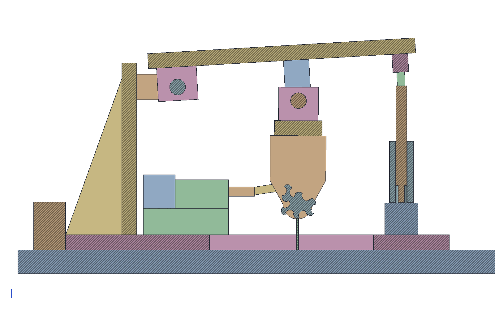

# A stick sled

The leaning half-ellipse Spectre milled round one solid stick, on a
router table (or over a saw), with the stick positioned by three small
motors and pushed over the cutter by hand. It replaces the
[stick mill](../stick-mill/): no carriage, no shafts for it to ride,
no pattern to touch the bit on, nothing dialled.

```sh
cargo build --release -p ok-mcp
python3 examples/stick-sled/build.py
cargo test -p ok-render --test stick_sled   # what CI runs
```


Nothing here has been built or run on a motor. What is checked is
checked by calculation and by the test; what is estimated says so.

## How it works

The cutter stays where it is, up through the table. The sled slides
along the fence, and the stick hangs under it between a spindle and a
tail centre.



- **Height:** a ply plate hinged along the sled's right side and held
  at its left by an upright screw. The stick is between hinge and
  screw, so the plate is a bridge, not an arm.
- **Left and right:** a frame hangs from a second hinge under the
  plate, above the stick. A second screw, level, fixed to the sled,
  swings it by its tail hanger.
- **Held both ways.** Each screw's nose is tied to what it moves by a
  short link with a pin at each end: 30 mm to a clevis under the
  plate, 60 mm to the tail hanger. A lead screw does not run back
  under load, so the stick is held against a cut that lifts it or
  pushes it either way. A light spring on each only keeps the slack
  in nut and pins to one side.
- **Rotation:** a motor on the hanging frame turns the spindle through
  a belt, 16 teeth to 60.

Swinging the plate also shifts and tilts the stick a little, and so
does swinging the frame, and a link leans as its far pin moves. All
of it is exact, so `plan.py` works the hinges and links backwards for
every cut: the table holds three numbers a row, where the two noses
and the spindle stand.

## A pass

1. Pull the sled back to its stop. The cutter is under the master, a
   sleeve on the spindle between the stick and the hanger.
2. Press the foot switch. The motors go to the next row and stop.
3. Push the sled through and pull it back.

The controller will not move a motor unless the sled is back: a switch
the sled closes there. Between passes it lifts the stick first to a
height at which the master clears the cutter, then swings and turns,
then comes down.

The stops are forgiving. Back, the cutter may be anywhere under the
master, 29 mm of it. Forward, past the stick's end there is only the
tail centre for 30 mm, and no pass comes near it; then the tail
hanger, which a stop must keep the cutter short of.

## The table: 440 rows a stick

| rows | what | cutter |
|---|---|---|
| 1 | set the straight bit | 6 mm straight |
| 145 | roughing: 79 places from 24 directions, in bites of 3 mm | |
| 1 | set the ball-nose | 3 mm ball-nose, tapered |
| 293 | finishing: 244 passes, the deep ones in bites of 1.5 mm | |

- **Every finishing pass has its own direction.** With a motor on the
  spindle nothing needs twelve stops, so each pass comes at its face
  as squarely as the tile lets a bit in. The passes reach the whole
  outline: every point within 0.05 mm of one. Twelve stops left 5 %
  for a file.
- **The cutter stays within 19 mm of the axis**, which is all the
  frame has to swing.
- **Roughing takes 79 % of the waste** with the straight bit, to
  0.4 mm of the tile. The ball-nose's deepest cut is 10.1 mm, in
  seven bites.
- **The order is settled first, the bites after.** Roughing and then
  finishing go round the stick in the order of the spindle's angle,
  so it turns a degree or two at a time, 916° in all, and comes up to
  every angle forwards. What a cut meets is what the cuts before it
  left, so the bites are counted in that order and no other.
- **Setting a bit.** The first row, and the row after roughing, bring
  the master to where the cutter's tip should be, and the router is
  raised until the bit touches it. Homing may land a hair differently
  each day; setting the bit on the master takes that up.

A stick is about two and a half hours: 438 pushes at a quarter of a
minute, and three quarters of an hour of the motors moving between
them (8.5 m of lift screw at 800 steps a millimetre). Estimated.

## The bit

Planned for the common tapered ball-nose: 1.5 mm radius at the tip,
widening 2.8° a side to a 6 mm shank over 30.5 mm. The planner keeps
the whole of it out of the tile, flank and shank too, and still
reaches all of the outline. Planned as if 3 mm all the way up, as it
first was, that bit would have cut into the tile on 120 rows, by up to
0.33 mm.

- A straight 3.0 mm ball-nose fits inside the tapered one, so the same
  table is safe for it. A 1/8 in one is 0.09 mm fatter and is not.
- The tapered bit is also about twelve times stiffer at this
  stick-out: 1.3 µm a newton at its tip against 16.
- A steeper taper reaches less: at 5° a side, 98 % of the outline.
  Change `TAPER` and `SHANK` in `plan.py` for the bit bought.
- It stands 39 mm over the table, so about 50 out of the collet.

## How stiff, how hard: estimates

Taking hardwood at 50 J/cm³ to cut, pushed at 20 mm/s, at 25,000 rpm,
with E 10 GPa along the grain and G 0.7 GPa:

| | force | what gives |
|---|---|---|
| roughing, 6 mm bit, a 3 mm bite | 2.3 N | the stick twists 14 µm at its edge, the belt and motor give 30 |
| ball-nose in a full slot, 1.5 mm | 1.2 N | 7 and 15 µm |
| finishing, 0.4 mm left | 0.2 N | 1 and 3 µm |

- **The stick is not limp.** Its section has second moments of 56,000
  and 110,000 mm⁴: between centres, with nothing under it, the
  roughing cut bends it under a micrometre. So it is held at its two
  ends and nowhere else. (It was first drawn with two turned journals
  on steadies, for a limpness that was never calculated; a journal's
  second moment is 7,000, so they were its weakest places.)
- **The necks hold.** A lobe on its 4.5 mm neck splits at about 25 N
  over 20 mm of stick, ten times the roughing cut.
- **The plate's weight** on the lift screw is about 25 N, ten times
  any cut.
- The force that matters is the one these numbers leave out: a bit
  that grabs.

## The controller

`firmware/main.py` and `firmware/config.py` are MicroPython for a
Raspberry Pi Pico; `out/passes.csv` is the table. Copy the three to
the Pico. `config.py` has the pins, the steps for a millimetre and a
degree, and the trims and scales found from a test stick.

`python3 main.py --sim passes.csv steps.json` runs the same program on
a computer, on pins that do nothing. The build does that and the test
checks every row ends on the table's numbers to the step.

| | |
|---|---|
| controller | Raspberry Pi Pico |
| drivers | three TMC2209 modules, step and direction; 8 microsteps for the pushers, 16 for the spindle |
| motors | three NEMA 17, 200 steps |
| a pusher's step | 0.00125 mm (a T8 screw of 2 mm lead) |
| the spindle's step | 0.03° |
| home switches | one each pusher and a mark once round the spindle, wired normally closed: a wire that comes off reads as home and stops the motor. Homing gives up if a switch has not spoken in its travel |
| other switches | sled back, and the foot switch |
| supply | 12 V |

It speaks only over USB: what the next row is and when to set the
bit. Until it has a display, a phone or a laptop
on the cable is part of it. It keeps no place: a stick stopped half
way starts again from the first row.

## Calibration: not yet designed

The table is worked out from the sled as drawn. A built sled differs,
and the hinges turn an error in a length into an error that changes
across the travel.

| every dimension of hinges and links off by | passes off by, after trimming |
|---|---|
| 0.5 mm | 0.06 mm |
| 0.2 mm | 0.025 mm |

That is with six numbers found from a test cut: a trim each for lift,
swing and turn, the cutter's place across, and a scale each for lift
and swing, which `config.py` has. With the trims alone and no scales
it is three times worse. How to get the six from a test cut with
callipers is not worked out.

Play is not trimmed out. The swing screw's link leans up to 21°, so
0.2 mm of its nose rattling in its guide is 0.1 mm at the stick: its
nose wants linear bearings on a ground rod, not a printed bore. The
lift's link leans 7°, and the same play is 0.014 mm.

## Measure these first

| what | in the model | check |
|---|---|---|
| the cutter over the table | 39.0 mm | the blank clears the table by 3.3 at its lowest; a shorter bit needs a smaller tile or a hole in the table |
| the fence | 290 mm right of the cutter | a table whose fence will not go that far wants a bar in its mitre slot under the left runner |
| the lead screws | T8, 2 mm lead | the common T8 is 8 mm lead: a quarter the steps a millimetre, and it runs back under load |
| the shafts, supports and blocks | the 20 mm set from the duplicator: two shafts of 490 and 416, four SK20, four SC20UU | the blocks turn on the shafts as hinges; collars keep them from sliding |
| the hinges and links | hinge 1 at 150 right and 204 up, hinge 2 150 left of it and 26 down, the axis 130 under hinge 2; links 30 and 60 | see Calibration |
| the pushers | drawn as a motor, a screw, a nose and a printed guide | the nose must not turn, and the swing's must not rattle. The lift's tower is drawn 30 square and wants a 42 flange for the motor's screws |
| the pins | not drawn | 5 mm shoulder bolts, a close fit |
| slack | a screw's nut and two pins a link | a light spring from the plate to the sled and from the tail hanger to the riser, not drawn; if a cut still rattles, an anti-backlash nut |
| the pulleys and belt | 60 and 16 teeth, 52 between centres: a closed belt of 184 | a 60 with a 12 mm bore is not the common one |
| the drive | a 16 mm spur on the spindle's end, the tail centre pushing the stick onto it | not drawn in detail |
| the blank | the tile's hull and 2 mm, put on its centres within a millimetre and a few degrees | a card template of the hull with the centre marked |
| the feed | 20 mm/s at 25,000 rpm is a chip of 0.02 mm a tooth | that is fine dust, and may burn: the router's slowest speed, and a brisk push |
| the frame | not checked | lean on the stick with the motors holding: if the cutter's mark moves, stiffen what gave |

## Parts

| part | size, mm | |
|---|---|---|
| sled | 540 x 480 ply: two runners and a tie at each end | open under the stick; its right edge on the fence |
| riser | 540 x 215 ply, a gusset at each end | hinge 1's two supports on its face |
| lift plate | 420 x 335 ply | two blocks under its right edge on hinge 1; hinge 2's supports under its middle |
| beam | 350 x 60 ply | two blocks on hinge 2; the hangers under it |
| head hangers, 2 | ply, 70 wide, round-ended | a 6201 bearing in each, 43 apart |
| tail hanger | ply, 70 wide, round-ended | the tail centre, and link 2's pin 25 over it |
| spindle | M12 studding | the 60-tooth pulley outboard, the master and a drive spur inboard |
| master | printed sleeve, 16 round x 29 | on the spindle between hanger and spur; the cutter is under it with the sled back, and a bit is set on it |
| lift pusher | NEMA 17 on the left runner, a printed tower on its face, a nose of 120 | 79 mm of travel |
| swing pusher | NEMA 17 and a printed guide on the right runner, 73 over the table, a nose of 75 | 32 mm of travel |
| links, 2 | strips, 30 and 60 between pins, and a clevis under the plate | each nose to what it moves |
| spindle motor | NEMA 17 on the head hanger, 52 over the spindle | a closed GT2 belt |
| controller | a box on the right runner | Pico, three drivers |

## What the test checks

`crates/ok-render/tests/stick_sled.rs` has the hinges and links
written a second time, in Rust, and works every row forward through
them:

- the cutter is where the plan wants it to a fiftieth of a millimetre;
  the finishing bit, its flank and shank too, is never in the tile,
  and a roughing bite never within its allowance;
- the last bites of the finishing passes together reach the whole
  outline, from nearly as many directions as passes;
- the waste, on a grid of the test's own, with the table's cutting
  rows run over it in the table's order: no row meets more than a
  hair-wide fin standing higher than its bit's bite;
- at every row the blank clears the table, so does the pulley, and
  each link is its length from pin to pin and leans no more than 30°
  off its screw;
- the controller's program, simulated, ends every row on the table's
  steps, turns the spindle under four turns in all coming up to its angles,
  and never swings the stick below the height at which the master
  clears the cutter;
- the document is the sled at one finishing row, the cutter's tip on
  the stick and no part through another.

The build itself tries the sled at 167 poses, the rows and the ways
between them, with every part as its outline along the stick, and
stops if any is in another or in the cutter's lane.
