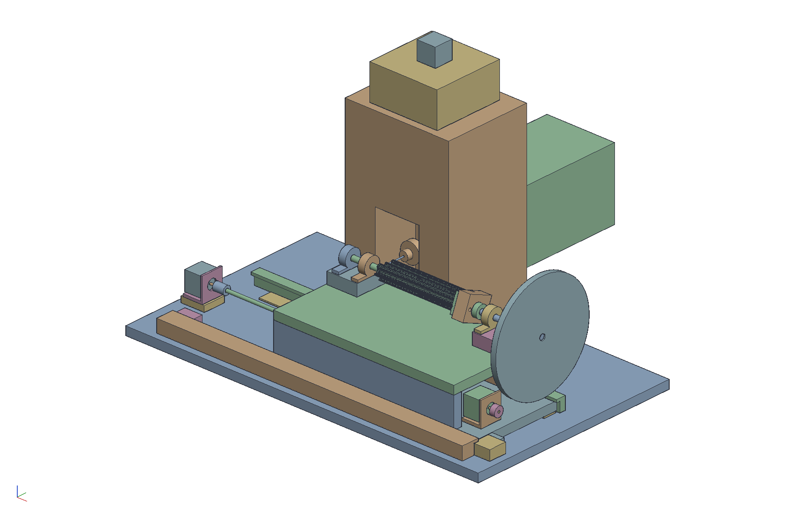
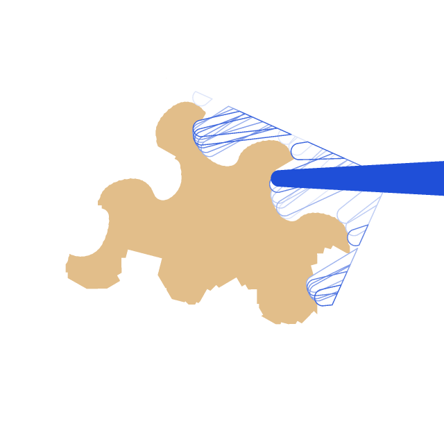
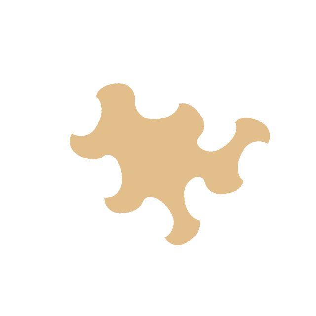

# A stick sled

The leaning half-ellipse Spectre milled round one solid stick. The
stick is held between a printed socket on a spindle and the plain end
of a second, idle spindle, on a flat sled that slides on the base
between two fences, and it only turns. Beside it, fixed to the base,
lies the [two-axis router positioner](../router-positioner/) with its
bit pointing at the stick: the positioner's X sets how deep the bit
reaches, its Z how high. Four motors do all of it: the positioner's
two, one that turns the stick, and one that feeds the sled past the
bit on a screw and brings it back. A blank is put on, two bits are
set, and the rest runs by itself: 573 passes, a little over two and a
half hours.

The wheel that turns the stick rides on the sled, on the sled's own
spindle, with its motor in the sled's box. That is the owner's idea,
and it took three things off the machine: the star that carried the
angle from a wheel on the base to the sled, the clamp that kept it
there, and the hand that threw the clamp 203 times a stick. The belt
holds the stick while it is cut. A lock is drawn, in case the belt
turns out not to, and left off.

It replaces the [hinged sled](../stick-sled-hinged/), which kept the
cutter fixed in a router table and hung the stick from two hinges.
Two straight screws now do what the hinges and their links did.

```sh
cargo build --release -p ok-mcp
python3 examples/router-positioner/build.py   # this reads the positioner's sizes from its out/positioner.json
python3 examples/stick-sled/build.py
python3 examples/stick-sled/animate.py        # out/passes_machine.gif and out/passes.gif: every pass, a frame each
cargo test -p ok-render --test stick_sled   # what CI runs
```


Nothing here has been built or run on a motor. What is checked is
checked by calculation and by the test, and what is only estimated
says so.

## How it works


- **The stick turns and does nothing else.** Its far end sits in a
  printed socket on a spindle; its near end has a hole that the plain
  end of a second spindle sits in, and that spindle turns with it. Every joint from the motor to
  the tail is in [The stick's drive](#the-sticks-drive-joint-by-joint).
- **The positioner places the bit.** It lies on its lid with its Z
  column standing up, so the bit's axis is a stick's height over the
  base. Its face is a wall 46 mm from the stick's axis; the bit comes
  out of the slot in it, and for the deeper cuts the collet nut too.
- **Depth** is the positioner's X: the quill run out along the bit.
  **Height** is its Z. A cut is a direction round the stick, a height
  of the bit over the stick's axis, and a depth. Each is one motor,
  and none of the three moves any other.
- **The sled is a flat plate between two fences.** It slides on the
  base with its far edge along one fence, and each fence has a lip
  over the sled's edge so that it cannot lift. What holds the stick
  is fixed to it. More in [The slide](#the-slide).
- **A screw feeds it.** The screw lies along the base and goes in
  under the sled's deck to a nut on the sled's bottom. More in
  [The travel](#the-travel).
- **The wheel that turns the stick goes with the sled.** It is on the
  sled's own spindle, past the headstock and past the end of the
  sled's box: 360 teeth, 232 mm across, its rim 36 mm over the base.
  Its motor is in the box, under the deck. More in
  [The wheel, on the sled](#the-wheel-on-the-sled).

## A pass

1. The sled is drawn back, at its home switch. The bit is beside the
   master: the tail spindle's rod, bare between the tailstock and the
   stick. It is beside the stick's end, not in the stick.
2. The positioner's two motors and the wheel's go to the next row and
   stop.
3. The sled's motor feeds the stick past the bit at 20 mm a second
   and brings it back at 60. The bit comes onto the stick from its
   near end and stops 21 mm short of its far end, with the collet nut
   2 mm short of the socket. Coming back, the sled runs fast to 3 mm
   short of home and then finds its switch.

The stick goes to a new angle 204 times in the 578 rows; the other
374 are at the angle it already has.

What wants a hand is putting the blank on, setting each of the two
bits (the probe's clip on, then parked), and the router's own switch.
The foot switch starts each of those. Held down while a pass is made,
it stops the table after that pass until it is pressed again.

The positioner and the wheel move only with the sled drawn back,
where the bit is beside the master, so a move between passes must not
carry it through the master. The safe way is to draw the bit back
until its tip is 2 mm clear of the master, then up or down and round,
then out. Most moves do not need it: the build follows each one along
its own path and marks it straight if the whole bit passes the master
by 1.5 mm. 525 of the 578 are.

## The slide

The sled is a shallow box of 3/4 in plywood: a bottom, 465 x 211,
that slides on the base between two fences; a rail on edge along each
side; and a deck across the rails that everything holding the stick
is fixed to. Rails and deck are 413 long. The bottom goes on 52 mm
past them, under the wheel, and the bracket of the wheel's motor is
screwed to it there. There are no shafts and no bearing blocks under
it. Like
the positioner it has no joinery: edges on faces, glue and brads, and
a fence's lip is a strip nailed along the top of it.

- **The far fence is the datum.** The sled's far edge runs along it.
  Across the sled is the way the bit reaches, so whatever bow that
  fence or that edge has is cut into the stick, one for one. Make the
  pair as straight as you can: a metal bar or an aluminium extrusion
  for the fence, a factory edge for the sled.
- **Two spring plungers in the sled's near edge** push off the near
  fence and keep the far edge on the datum. So there is no fit to get
  right between the fences: the near one stands 1 mm off the sled. A
  cut pushes the stick away from the bit, which is the same way.
- **Each fence has a lip over the sled's edge,** 0.3 mm clear of its
  top: 10 mm over at the datum, 7 at the near fence. They stop the
  sled lifting or tipping. They are not what holds it down: its
  weight does that. Pushed by hand, a roughing cut was taken to tip
  it with about two thirds of what its weight resists; fed by the
  screw, the heaviest cut is estimated at under a quarter of that
  push.
- **It rides on two slippery strips** on the base, one under each
  edge, 3 mm thick. A chip on a strip lifts the sled, and the sled's
  height is the bit's height on the stick: brush them, or fix a felt
  wiper to each end of the sled.
- **The near fence stands against the positioner's face.** It is
  14 mm wide, which is all the room there is, and the box's near rail
  stands inside its lip. The deck is 60 mm over the fences and
  reaches out over that one, to 6 mm short of the positioner's face.
- **A stop block** stands on the base a millimetre beyond each end of
  the sled's 188 mm. The screw puts the sled where it goes. Only a
  sled that has lost its place meets a block, and it meets it before
  the collet nut meets the socket. The travel's home switch is
  beside the back one.

The positioner lies on the base itself, and its bit is 104 mm over
the base at the bottom of its height and 184 at the top. The stick's
axis is at 152, which is 8 mm above the middle: see
[The wheel, on the sled](#the-wheel-on-the-sled). The box is what
brings the sled's deck up to it: the stick's axis is 44.4 mm over the
deck, and the box's rails stand inside both lips on a bottom that
reaches under them. How straight the datum fence is and how flat the base is
are not in the study under Setting up: the ground shafts this
replaces were taken to be true, and a fence is as true as it is made.

## The wheel, on the sled

| the sled drawn back, cut along the axis | the same, from the far end |
|---|---|
|  |  |

The owner's idea, in two steps. A wheel that stays at the end of the
base can be far larger than one a sled carries, and where it is too
large for the board under it, it goes through a slot: that was the
last machine. Then: if a slot is all a large wheel needs, the sled
can carry it after all, and the star, the clamp and the hand that
worked it are not needed. On the sled it does not even need the slot.

- **The wheel** has 360 teeth: 229 mm on the belt's pitch line, 232
  over its flanges, 12 wide, printed. It is past the end of the
  sled's box, so the deck and the rails are not in its way, and it
  hangs 72 mm below the deck's top there.
- **What it passes,** all the way along the travel:

  | under the wheel's rim | clear by |
  |---|---|
  | the sled's own bottom, which goes on under it | 13.6 mm |
  | the back stop and the home switch, which are no higher than that bottom | 13.6 mm |
  | the near fence's lip | 9.8 mm |
  | the controller's box, on the base beside the positioner | 8.0 mm |
  | the base | 35.7 mm |

  Across the stick it is wider than the positioner's face is near, as
  the disc is. With the sled forward, which is as near as they come,
  the disc is 40 mm beyond the end of the positioner's box.
- **The stick's axis is 8 mm above the middle of the positioner's
  height.** Level with the middle, the rim passed the near fence's
  lip by 1.8 mm. The height has the room: the rows use 29.0 to 67.0
  of its 80.
- **The motor is in the sled's box:** on the bottom, under the deck,
  between the rails, 147.6 mm from the spindle. Its shaft comes out
  past the box's end and through its bracket to a pulley of 30 teeth
  in the wheel's plane. The belt is a closed GT2 of 760 mm. The
  bracket's foot is screwed to the sled's bottom through slots across
  the sled, which tension the belt, and the belt's pull stays inside
  the sled. Any closed belt from 738 to 774 mm puts the motor
  somewhere it fits.
- **Twelve to one.** The pulley had 20 teeth while the motor stood
  208 mm off on the base. At 148 mm a pulley of 20 would have 4.8
  teeth in the belt, and six is the least a toothed belt is usually
  given. Thirty has 7.4. The stick's step is 0.0094°, 38 400 to a
  turn. Half a degree is not a whole number of those, so an angle can
  be half a step out: 0.0024 mm at the tile's edge.
- **The disc** is between its clamp collar and the wheel: 176 across and 8
  thick, printed in one with a neck 60 across and 9 long toward the
  wheel. It is bolted to the collar's face. The wheel is screwed to
  the neck's end by four screws on a 44 mm circle, through slack
  holes, so the disc and then the wheel are each trued under an
  indicator by their own rims. The disc carries the home flag, is
  what a hand turns the stick by, and is what a lock would pinch:
  the neck is the room an anvil needs behind it.
- **Home** is a fin on the disc's inner face, 54 mm from the axis,
  through an optical endstop screwed to the end of the deck under the
  spindle.
- **A cable follows the sled:** the motor's four wires, the sensor's
  three and the probe's ground lead. It wants 188 mm of slack and
  somewhere to lie. It is not drawn.

Printed fits are untested.

## The travel


- **The screw** is a T8 lead screw of four starts, 8 mm a turn and
  250 long. It lies along the base, 42 mm over it and 74 mm from the
  stick's axis on the far side, which is under the middle of the
  sled's bottom: it pushes where the slips' drag is.
- **Its motor** is a NEMA 17 on its bracket on a block of 1/2 in
  plywood at the tail end of the base, beyond where the sled's end
  comes. A rigid coupler joins the two. The screw's other end is
  free and is carried by the nut. What a cut pushes back along the
  screw goes into the motor's own bearings.
- **The nut** is the screw's flanged nut, bolted to the outer face of
  a block that stands on the sled's bottom just inside the tail end
  of its box. Screw the block down last, with the sled at the
  motor's end, so that it takes its place from the screw.
- **Inside the box** the screw is between the rails, under the deck
  and over the bottom. With the sled forward the nut's flange is
  8 mm from the coupler; with it back, 20 mm of screw are past the
  nut's block. Forward, the screw's end is 166 mm short of the
  wheel's motor at the box's other end.
- **A step is a hundredth of a millimetre:** the driver at 4
  microsteps. The feed is 20 mm a second and the return 60, both set
  in `firmware/config.py`.
- **Coming home is checked every pass.** The sled runs back fast to
  3 mm short of home and then slowly until its switch opens. How far
  that was from where its steps said is what it lost on the way. Up
  to half a millimetre it carries on, home again at the switch; more
  and it stops, because the pass was not the one the table asked for.
  The build runs the controller's own pass on a sled that loses
  steps:

  | lost | going | the controller |
  |---|---|---|
  | nothing | | home, 0.00 mm out |
  | 0.3 mm | out | home, 0.30 out, carries on |
  | 2 mm | out | stops: "the sled came home 2.0 mm out" |
  | 10 mm | out | stops |
  | 0.3 mm | back | home, 0.30 out, carries on |
  | 12 mm | back | stops: its switch never opens |

By the pauses the controller asks for between steps, the 573 passes
take 2 h 37 min, in which the sled's screw turns 26 900 times. A
Pico's own overhead adds to that; nothing has been timed.

## What holds the stick: the belt

While a hand pushed the sled, a toggle clamp held the stick, and it
was sized for 60 N at the blank's corner, which is what a hand can
push. A motor feeds the sled now, at a speed it is told, and only the
belt and the wheel's motor hold the stick. So the build works out
what every cut asks of them. **It is an estimate: none of it has been
measured.**

For each cutting row, in the table's order:

1. The area of section the bite removes, followed on a grid of the
   waste, 0.2 mm a cell.
2. How hard the bit pushes: the power the cut takes, which is that
   area, the feed and what it costs to cut a cubic millimetre, over
   how fast the bit's edge passes; doubled, for the most a two-flute
   bit pushes over what it pushes on average.
3. The turning that is on the stick, taking the whole push at the
   furthest thing the bite cuts.
4. How far the tile's edge moves: that turning over how stiffly the
   stick is held, which is the belt's two runs and the motor's own
   hold, one after the other.

| taken as | | why |
|---|---|---|
| cutting hardwood | 0.15 J a cubic millimetre | published figures run from 0.03 to 0.15; chips this thin are at the dear end |
| the router | 16 000 rpm | the Colt's slowest: the slower the bit, the harder each tooth pushes |
| the feed | 20 mm a second | `FEED_MM_S` in the controller's config |
| a 6 mm GT2 belt | 8 000 N to stretch it by its own length | within a factor of two |
| the motor's hold | 0.40 N m | a 40 mm NEMA 17 standing still |

| | |
|---|---|
| held by the belt's two runs, 104 mm each | 2 025 N m a radian |
| by the motor, through 12 to 1 | 2 880 |
| the two together | 1 189 |
| the heaviest cut: row 192, a roughing bite of 11.8 mm² | 13.3 N, 0.37 N m |
| what stalls the motor | 13 times that |
| the tile's edge moves, roughing | 0.009 mm at most |
| in a finishing pass's earlier bites | 0.003 mm |
| in a bite that leaves a finished face | 0.005 mm |

The limits the build holds the table to are 0.010 mm at any cut and
0.005 at one that leaves a face: a twentieth of the 0.4 mm that
roughing leaves on, and a fifth of the 0.05 mm ridge a pass may leave.
The bites are the deepest that pass: 2 mm for the straight bit, where
it was 3, and 1 mm for the ball-nose, where it was 1.5. That is 97
more rows than the 479 the table had, and nobody has to make them.
At the old bites the heaviest roughing cut would have moved the edge
0.013 mm.

What the estimate leaves out: the bit's own bending, which for the
slender ball-nose is of the same order; the belt's teeth giving in
the pulley; and any backlash between belt and teeth, which a cut that
changes the way it pushes would take up. If the stick is found to
turn in the cut, the first thing to change is `FEED_MM_S`: half the
feed is half the push. The second is the lock.

### A lock, if it is ever wanted

The lock the last machine had is still drawn: a post beside the
headstock's riser, a push-pull toggle clamp on its own riser against
the post, its plunger through the post to a pad on the disc's inner
face, and a steel anvil on a spacer that comes round the disc's rim
and in behind it, between the disc and the wheel. Each part has its
own tab in the document, and none is in the assembly. The test moves
them with the sled along its whole travel, so their place on the deck
and behind the disc stays clear of everything else.

To fit it, build those four parts and set `LOCK = True` in
`firmware/config.py`. The build then puts them on the machine. The
controller will not turn the stick until the lock's switch says it is
let go, nor cut until it says it is thrown; it says so on the display
for a hand, and raises a pin while it wants the spindle free, for
whatever might work the clamp instead. The build runs the controller
that way as well: it lets the lock go 204 times a stick. By hand that
is the last machine again, at two and a half hours of standing by.

## What carries the stick

Along the stick's axis, from the tail to the wheel, and what each
thing stands on:

| | what | carried by |
|---|---|---|
| tail spindle | a 12 mm ground rod 99 long, its plain end 8 mm into a hole in the stick's end, bare for 26 mm beside the stick: the master | two KP001 pillow blocks, 44 mm between centres, bolted down on a riser |
| the stick | the blank, 49 x 42 x 200 | the tail spindle's end at one end, the socket at the other |
| socket | printed, bolted to the face of a clamp collar on the spindle's end | the spindle |
| spindle | a 12 mm ground rod 148 long | two KP001 pillow blocks, 58 mm between centres, bolted down on a second riser |
| *the sled's box ends here; its bottom goes on under what follows* | | |
| collar, disc, wheel | on the spindle's far end; the wheel's middle is 44 mm out from the last block | the spindle |

From the base up to the axis on the sled:

| | mm |
|---|---|
| slip | 3 |
| sled's bottom, 3/4 in | 19.05 |
| rail on edge | 66.15 |
| deck, 3/4 in | 19.05 |
| riser, two layers of 1/2 in | 25.4 |
| pillow block, foot to the shaft's centre | 19 |
| the stick's axis | 151.65 |

- **Pillow blocks on the sled.** The two spindles used to run in
  flange bearings on the faces of four thin uprights stood on their
  ends on the deck. A push along the rod, which is what the socket's
  jack screws make, bent those uprights at glue lines 50 x 19 mm: by
  my estimate 1.4 MPa for 200 N. A pillow block bolts down on a flat,
  so each pair now stands on one solid block glued face down, and the
  same push is 0.04 MPa of shear. There is nothing to stand square
  and no 20 mm hole to bore for the rod.
- **Both risers are sawn from one glued-up strip,** so the two
  spindles start at one height. The blocks are castings, and makers
  differ by a few tenths in the 19: measure the four and put the two
  most alike on the tail.
- **Each block is held by two M6 bolts** through the riser and the
  deck, 56 mm apart, in holes drilled a size over. Sideways it is
  set by sliding in those holes, up by shims under its feet.
- **The foot is 71 mm long,** so the risers are 76 wide and the deck
  was widened to carry them: it now overhangs the near rail by 14 mm.
- **The collet nut is the one thing in their way.** At the deepest,
  lowest cut it comes within 33.5 mm of the axis and 10 mm lower than
  a riser's top, and a riser is 38 mm wide that side. So along the
  sled the nut must never be over one. With the sled back it is 4 mm
  past the tail's riser, which is why the master is 26 mm long where
  it was 21; with the sled forward it is 52 mm short of the head's.
- **How high the stack comes out does not matter.** Six plywood
  thicknesses are between the base and the axis. The positioner's
  height has 80 mm of travel and the six touches find where the bit
  is level with the stick.

## The stick's drive, joint by joint

| the sled's far end, cut along the stick's axis | the tail end, where the bit waits |
|---|---|
|  |  |

From the motor to the far end of the stick, what each part is joined
to the next by:

| from | to | joined by |
|---|---|---|
| motor, a NEMA 17 on a bracket on the sled's bottom, in the sled's box | its pulley, 30 teeth | the pulley's two set screws, one on the shaft's flat |
| pulley | wheel, 360 teeth, printed | a closed GT2 belt of 760 mm, 7.4 of the pulley's teeth in it. The bracket's slots tension it. Motor and wheel are both on the sled, so the belt's pull stays inside it |
| wheel | the disc's neck | four screws on a 44 mm circle, through slack holes, into inserts in the neck's end. The wheel's own bore is 13 and does not touch the rod |
| disc, printed in one with its neck and the home fin | its collar | four M4 bolts through slack holes into the tapped face of a bought clamp collar on the disc's inner face, 8 mm clear of the box's end so a key reaches its screw |
| collar | spindle, a 12 mm ground rod | the collar's clamp: one piece, split, a screw across the split. It grips the round rod as it is |
| spindle | headstock | two KP001 pillow blocks bolted down on a riser. Their set screws hold the rod endways. No plywood is bored to a fit |
| spindle | socket, printed | a second clamp collar on the rod's end, the socket's floor bolted to its face by flat-head M4 screws from inside the pocket |
| socket | stick | a pocket the blank's end stands 12 mm into, 0.3 mm slack all round, with three screws: two through the floor, 19 mm either side of the axis, that jack the blank toward the tail, and one through a wall that locks it against the wall opposite |
| stick | tail spindle | a 12 mm hole 8 deep in the stick's end, on its centre mark, that the plain end of a second length of the rod sits in. This joint only centres and pushes: it need not grip |
| tail spindle | tailstock | two more KP001 on a second riser. The rod is bare for 26 mm between the inner one and the stick, and that is the master a bit is set against |
| disc | controller | a fin on the disc's inner face, 54 mm from the axis, through an optical endstop on the end of the deck once a turn |
| sled | base | the screw's flanged nut, on a block on the sled's bottom; the screw, in a rigid coupler on a NEMA 17 on the base |
| sled | controller | a switch beside the back stop, which the end of the sled's bottom opens with the sled drawn back |

The socket is the owner's idea, and it does three things a spur did
not: it cannot slip, it puts the blank on the axis without a centre
mark at that end, and it says which way round the blank is. What it
costs is the stick's far end. A socket big enough for the blank
cannot be where the bit comes onto the stick, so the bit waits at the
tail and each pass stops before the socket: 21 mm of every stick is
not cut.

To buy: four KP001 pillow blocks, two face-mount clamp collars for a
12 mm shaft (Ruland FHT-MCL-12-F or its like: 28 across, 11 wide,
tapped holes in the face), a 30-tooth GT2
pulley of 5 mm bore, a 760 mm closed GT2 belt, an optical endstop,
12 mm ground rod for lengths of 148 and 99 mm, two NEMA 17 motors
with their angle brackets (one more motor than the last machine had,
and a fourth driver for it), a T8 lead screw 250 long of 8 mm a turn
with its flanged nut, a rigid coupler from 5 mm to 8, a lever
microswitch for the travel's home, three M5 set screws and inserts for
the socket and flat-head M4 screws to bolt it to its collar, four inserts for the disc's neck, two M6 spring plungers
and inserts for the sled. The sizes in `build.py` are the
catalogue's: measure the ones that come before drilling for them. To
make: the printed wheel, disc and socket. Nothing is ground on
either rod: a hardened rod is used as it is bought, cut to length
with an abrasive wheel, or bought cut.

**Why collars.** Every joint from the wheel to the wood has to hold
without slipping, and the controller's look for the wheel's mark
sees only as far as the disc: a slip at the disc's collar, at the
socket's, or in the socket goes unseen. The first design put set
screws on ground flats and epoxied the socket on. The owner cannot
grind hardened rod, and a clamp collar wants nothing ground: it
grips the round rod all the way round, many times harder than the
0.4 N m the heaviest cut turns the stick with. The tail end is the
other way about. It only centres and pushes, so a plain end in a
hole does.

- **Clamping the socket on.** Which way round it is on the rod is
  which way round the blank is to the controller, so clamp it with
  the spindle where the table's first row puts it: run that row, turn
  the socket until a wide wall of its pocket lies flat on a block
  stood on the deck, and tighten the collar's screw. It can be let go
  and set again.
- **Putting a blank on.** Mark the tail end's centre, 19.5 mm from one
  wide face and 24.8 from one narrow face, and drill a 12 mm hole
  8 mm deep there. Push the other end into the socket as far as it
  goes, bring the hole to the tail spindle's end, and turn the two
  jack screws by turns, the same amount each, until the rod is on the
  bottom of the hole and the blank is snug: no more than that, since
  it is the pillow blocks' set screws on round rod that push back.
  Then tighten the lock screw. Before the jack screws, turn the tail
  spindle so the line scribed on it is uppermost: the master's runout
  was measured that way round.
- **The tail spindle turns with the stick,** carried round in its own
  bearings by the stick's end on it. It is the master, and the half turn that finds its
  runout is the motor's, through the wheel and the stick.
- **Truing the disc, and then the wheel.** Snug the disc's four
  bolts, hold a dial indicator on its rim, turn it, and tap it until
  the needle moves 0.06 mm or less. Then tighten. Do the same for the
  wheel on the disc's neck, with the indicator where the belt runs,
  to 0.04: that is 0.02 off centre. What it buys is in Setting up.
- **Lining the stick up with the sled's travel** (`out/bands.csv`) is
  moving the tail's two pillow blocks: sideways in their bolt holes,
  up by shims under their feet.
- **The home fin** is on the disc and is read 54 mm from the axis,
  so 0.02 mm there is 0.011 mm at the tile's edge. It matters only
  when a stick is taken up again after the controller has been off.
  Homing wants nothing but the foot switch: the bit is drawn back
  first, out of whatever it was left in, then the sled, then the
  height, then the wheel. The sensor says home
  over the fin's whole 6.4°, so an axis found already at home is first
  run away until the sensor lets go, and 5° more, and then brought
  back: home is the same edge from the same side every time. The
  build runs the controller's homing from nine places to check it.

## The table: 578 rows a stick

| rows | what | bit |
|---|---|---|
| 1 | put the blank on | |
| 1 | set the straight bit | Freud 04-110: 1/4 in straight, two flutes |
| 250 | roughing: 83 places from 24 directions, in bites of 2 mm | |
| 1 | the wheel's mark looked for again | |
| 1 | set the ball-nose | Freud 72-405: a 1/8 in ball tip, tapered to a 1/4 in shank over an inch |
| 323 | finishing: 242 passes, the deep ones in bites of 1 mm | |
| 1 | the wheel's mark looked for again | |

Both bits have 1/4 in shanks: the router is the North American Colt,
and that is its collet. The bites are as deep as the belt's hold
allows: see [What holds the stick](#what-holds-the-stick-the-belt).
Each row also says how far the sled is fed: 188 mm for a cut, nothing
for the rest.

Twice the controller looks for the wheel's mark: it turns the stick
to 5° past the mark and brings it back until the sensor says home,
three times, and compares that with where its steps say the mark is.
Lost steps, a belt over a tooth and a pulley round on its shaft all
show there. More than 0.1° and it stops: after the roughing there is
still 0.4 mm on the tile and the stick can be taken up again, which
homes the wheel afresh.

### The two bits

| | Freud 04-110 | Freud 72-405 |
|---|---|---|
| what | 1/4 in double-flute straight, 1 in of carbide | 7.2° tapered ball tip, 1/8 in at the tip, 1 in of carbide |
| long, end to end | 2-7/8 in, 73.0 mm | 2-1/2 in, 63.5 mm |
| set, out of the collet nut | 42.5 mm | 41.9 mm |
| of its shank in the collet | 30.5 mm | 21.6 mm |
| what will do | 42.5 to 43.9 out | 39.9 to 43.9 out |
| how | push it in until it bottoms, then draw it back 1.5 to 3 mm | 42 mm from the nut's face to the tip, by a rule |

The table takes a bit to stand 41.9 mm out of the collet nut, and the
controller's touch takes up 2 mm either way. What the owner measured
on the router says which bits can: a 1/4 in shank bottoms 32 mm in
from the tightened nut's face; it should be 1.5 mm off that bottom
and at least 19 mm in. So a bit 58.9 to 74.4 mm long, and both of
these are. The straight one is long for it and sits as deep as it
may; the tapered one is short for it and has 21.6 mm in the collet,
19.6 if it is set as far out as the margin allows.

That 41.9 was 45.9, and at 45.9 the tapered bit had 17.6 mm in the
collet. How far a bit has to stand out is the blank's swing, 33.5 mm,
and how far past the stick's axis its tip goes; the planner, left to
itself, sent two finishing passes 12 mm past, for the angle they met
their faces at. It is now told 8 mm at the most (`TIP_LIM` in
`plan.py`), and the 242 passes still come within 0.05 mm of the whole
outline. At 7 mm three points of it are out of reach.

The collet nut is 20 mm across and the bits 6.35 and less, so at the
far end of a pass the nut is beside the last of the stick that no bit
reaches, and that is the blank as it was sawn, whatever has been cut
off the rest. So the build checks the nut against the uncut blank at
every one of the 573 cuts: with either bit 39.8 mm out or more, the
nut passes it by a millimetre. Set as short as the margin allows, the
tapered bit is 39.9 out.

The cuts are the hinged sled's, planned by the same `plan.py`: every
finishing pass from its own direction, the whole of a tapered bit
kept out of the tile, each pass meeting its face 15° round the ball
from its dead centre, roughing to 0.4 mm of the tile, the order
settled before the bites are counted. Its README has the reasons.
What changed is where a row's numbers come from, and that there is a
fourth.

- **The blank is a plain rectangle,** 49 x 42 mm, and 200 long of
  which 179 are cut. Its far end goes in the socket; the centre is
  marked on its near end only, 19.5 mm from one wide face and 24.8
  from one narrow face. The first row turns the spindle to where the
  socket holds it with that wide face level and underneath and that
  narrow face toward the router.
- **A bit is set by touch, by the controller.** The probe's clip goes
  on the bit with the router off; the bit is run out at the master,
  level with the stick's axis, until it touches, three times; from
  then on every depth is taken from there. So a bit may stand 2 mm
  further out of the collet than the table takes it to, or less far,
  and the cut is the same. Further off than that it is the collet
  nut or the bit's own shank that says no: see The two bits.
- **The clip has a home.** It is a post wired to ground: parked there
  the probe reads closed, and the controller will not go to a cut
  until it does. The router is never started with the clip on its
  bit.
- **Every move ends going the same way,** away from home, as the
  positioner's brief asks: a move back goes half a millimetre past
  and comes up to its place.

A stick is 2 h 37 min of the machine's own moving, by the pauses the
controller asks for between steps: 573 passes of 188 mm, out at 20 mm
a second and back at 60, and between them 3.0 m of the depth's screw
and 4.5 m of the height's at 1280 steps a millimetre, and 744° of the
wheel. Add the blank and the two bits, a few minutes of a hand. Not
timed: nothing has been built.

## Every pass, animated


`animate.py` draws the table: all 573 cutting rows, a frame each. What
is left of the blank is tan, the pass being made is solid blue, and
the passes before it are blue outlines that fade to white.

This first one is **what the machine does**, seen from the
headstock's end with the positioner on the right. The bit stays level.
From one pass to the next it moves up or down (the positioner's Z) and
in or out (its X), and the stick turns to a new angle (the wheel). It starts with the blank as the table's first row hangs it, a
wide face level and underneath. A turn of more than 6° is shown on the
way round, with the bit out of the picture. It runs 47 seconds: 250
roughing passes, a pause where the bit is changed and set, 323
finishing passes, and then the tile.


The second is the same passes **fixed to the stick**: the tile stays
still and the bit seems to come from every side. It is the easier one
to judge the plan by, because the tile comes out of the blank in one
place.

| | part way through roughing | part way through finishing | done |
|---|---|---|---|
| as the machine has it |  |  |  |
| fixed to the stick |  |  |  |

```sh
python3 examples/stick-sled/animate.py   # after build.py: it reads out/sled.json
```

They are made with a tool that is not the sled's: `flipbook` in
`ok-mcp` draws any frames of flat shapes to an animated GIF, and can
show a frame turned; `cutting_book` in `examples/okmcp.py` makes the
frames for any blank and any list of cuts in this style, with an
angle for each cut if the work turns. `animate.py` only turns the
table's rows into the bit's outline at each. A roughing cut is drawn
as the bit's whole width to where its end stops; a finishing cut as
the ball, its tapered flank and the shank.

## What the positioner has to be, for this job

| | here | |
|---|---|---|
| X travel | 36.6 to 78.0 mm used of 80 | the far end of it: the deepest cut is 2 mm short of the end, and at home the bit's tip is 70 mm from the stick's axis, 36 clear of the blank's corners |
| Z travel | 29.0 to 67.0 mm used of 80 | 60 would do. The stick's axis is 8 mm above the middle of it, to lift the wheel's rim over the near fence's lip |
| how it lies | on its lid, on the base | the stage's weight then pulls away from its column, onto the collar that has no thrust bearing yet |
| its face from the stick's axis | 46 mm | the Colt's collet nut, tightened on a bit, is 30 mm in front of the quill by the owner's callipers, so at the deepest cut it is 12.1 out of the face, and the uncut blank's corners swing 33.5. The nut sets the distance, not the face |
| the bit out of the collet nut | 41.9 mm | the blank's swing, and 8 mm past the stick's axis, which is as far as the planner may send the ball's tip. The router does not change it: the positioner stands back by what the nut stands out |
| how long a bit that takes, end to end | 58.9 to 74.4 mm | 19 mm of shank or more in the collet and 1.5 off its bottom, which the owner measured 32 mm in from the tightened nut's face; and set within 2 mm of the table's length. See [The two bits](#the-two-bits) |
| the depth's screw | M8 rod, as the positioner draws | a rod's pitch is nobody's promise, but it matters little here: 0.2 % off costs under a hundredth of a millimetre in the study |
| its two travels, square | not known until it is built | 2 mm in a metre out is 0.07 mm on the tile: the largest thing left. See Setting up |

With a bit set as the table takes it, the collet nut never comes
within the blank's swing: at the deepest cut its face is 33.9 mm
from the axis and the blank's corners swing 33.5. A bit set 2 mm
short brings the nut that much nearer, inside the swing; it still
passes the blank itself by a millimetre at every cut, which is what
the build checks.

## The controller

`firmware/main.py` and `firmware/config.py` are MicroPython for a
Raspberry Pi Pico; `out/passes.csv` is the table. It is the hinged
sled's program with its two screws renamed and these added: a bit set
by touch, every move ending the same way, a fourth motor that feeds
the sled and finds its switch after every pass, and a lock on the
spindle that is switched off. It reads the table a row at a time,
says what it wants on a small display and over USB, and keeps its
place: taken up part way through a stick, it homes and sets the bit
again before it cuts.

What it waits for a foot on: finding home; the blank put on; each
bit, with the probe's clip on it; the clip parked; and the router
switched on. Then it cuts by itself to the next bit or the end. The
foot switch held down while a pass is made stops it after that pass.
It stops itself if a touch disagrees with the one before, if a home
switch never speaks, or if the sled comes home more than half a
millimetre from where its steps said.

The lock is an option, `LOCK` in `config.py`, and off. With it on,
the wheel is turned only with the lock let go, and after a turn
nothing goes on until it is thrown again. The simulated run counts
how often that would be, and the build checks the count against the
table: 204.

| | |
|---|---|
| controller | Raspberry Pi Pico |
| drivers | four TMC2209 modules; 8 microsteps for the positioner's screws, 16 for the wheel, 4 for the sled's screw |
| a positioner screw's step | 0.00078 mm (M8 x 1.25) |
| the sled's step | 0.01 mm (a T8 of 8 mm a turn) |
| the stick's step | 0.0094°: 38 400 to a turn |
| home switches | the quill drawn back, the stage at its home end (down, as it lies here) and the sled drawn back, wired normally closed; and an optical endstop that the disc's fin passes once a turn, which has to read high with the fin in it, as an opened switch does |

| pin (GP) | to |
|---|---|
| 2, 3 | depth driver: step, direction |
| 4, 5 | height driver: step, direction |
| 6, 7 | the wheel's driver: step, direction |
| 18, 19 | the sled's driver: step, direction |
| 8 | all four drivers' enable |
| 10, 11, 12, 13 | home switches: depth, height, the wheel's mark, the sled drawn back |
| 14 | foot switch |
| 15 | the probe's lead and clip; the spindle and the clip's parking post to ground |
| 16, 17 | display: SDA, SCL |
| 9, 20 | if a lock is fitted: its switch, closed with the clamp thrown; and a pin raised while the controller wants it let go |

One motor rides on the sled, and the home sensor. Their wires and
the probe's ground lead to the spindle follow it.

## Setting up a built machine

Two straight screws leave little to find, and none of it needs a fit.
The controller runs each step from a table `build.py` writes;
`calibrate.py` reads the results. **No real stick is cut until all
four have been done, in this order:** the precheck, the two set-ups,
and one whole stick in scrap.

**Depth needs nothing.** Setting a bit by touch measures it every time
one goes in.

### 0. The precheck: `out/precheck.csv`

Four things on this machine are trusted and not proven: that the sled
does not lose steps; that nothing slips between the wheel's motor and
the stick; that the belt holds the stick as stiffly as the bites were
sized for; and that the pillow blocks' set screws, which are all that
stops a rod sliding endways, hold against the socket's jack screws.
The precheck tries all four before anything is cut, so that the
machine can be put right first.

It wants callipers and a weight of 2 kg that hangs within 150 mm: two
1 kg bags on their sides in a carrier will do. Router off, **no bit
in the collet**, a scrap blank on with its jack screws as tight as for
a cut. Copy `out/precheck.csv` to the Pico as `passes.csv`.

1. With the callipers' depth rod, measure how far the tail rod's end
   stands out of its outer block: 5 mm as drawn. Write it down.
2. The controller makes 28 of the table's own passes, spread through
   it, with nothing in the collet: the same depths, heights, angles
   and feed, the four at the ends of the positioner's reach among
   them. Each ends with the sled finding its switch, and it stops if
   the sled comes home half a millimetre out.
3. It looks for the wheel's mark. More than 0.1° from where its steps
   say, and it stops.
4. It looks again; asks for the weight to be hung from a cord round
   the disc's rim, on the positioner's side; looks; asks for it to be
   taken off; and looks once more.
5. Measure the tail rod's end again.

```sh
python3 calibrate.py holds check_log.csv --tail 5.02 5.03   # the two calliper readings
```

| it says | which means | so |
|---|---|---|
| the controller stopped: the sled came home out | the sled lost steps with nothing being cut | look at the lips and the slips, loosen and reset the nut's block, lower `RETURN_MM_S` |
| the mark was off after the dry passes, or did not come back when the weight came off | something slipped between the motor and the spindle | the pulley's set screws on the motor's flat, the belt's tension, the hub's set screws on the rod's flat, the disc's four bolts and the wheel's four screws |
| softer than the table was sized for | the weight turned the stick more than a sound machine's 0.083°, by more than one step of the motor | tension the belt and tighten the bracket's foot; if it stays, set `FEED_MM_S` to what it says, or fit the lock |
| the tail rod's end moved more than 0.05 mm | the set screws let the rod slide | a small flat or a dimple under one screw of each pillow block, or a collar on the rod between the two blocks |

Whatever is wrong it says in capitals, and that no real stick is to be
cut until the precheck has been run again and passed.

The weight is 1.73 N m at the disc's rim: 4.7 times the turning the
heaviest cut is estimated to ask, and a third of what stalls the
motor. A look is good to one step of the wheel's motor, 0.009°, so
how stiffly the stick is held is read to about a tenth. The build
tries the reading on a computer: on a wheel held as the estimate says
it reads 1 172 N m a radian for 1 189 and passes; on one half as
stiff it reads 586, does not pass, and says to feed at 10 mm a second.

What it cannot try. The weight hangs, so it turns the stick one way
only: the wheel's motor is under the disc's other side. Nothing is
cut, so the rods are pushed by the jack screws and not shaken by a
cut: that is why the rod's end is measured once more after the trial
stick. And the bit's own bending is not in it at all.

### 1. Where the bit's height is: `out/probe.csv`

A ground 1/4 in pin goes in the collet in place of a bit, with the probe's
clip on it, and a scrap blank on the sled, put on as any blank is, so
that the motor turns the tail spindle. The controller brings the pin
against the master from the front, from below and from above, and
again with the spindle half a turn round: six places, three touches
each, a few minutes.

```sh
python3 calibrate.py fit probe_log.csv --master 12.00 --pin 6.35
python3 build.py
```

- The middle of where the pin met the master from below and from
  above is the height at which the bit's axis is level with the
  stick's.
- Those two are the master and the pin apart, whatever the screw
  says, so they give the height screw's true travel.
- What half a turn of the spindle changes is the master's runout,
  and the table's setting rows allow for it.

`calibrate.py study` tries it on 300 machines built wrong at random:
the height's home anywhere in 3 mm, the height's screw 0.3 % off its
pitch and the depth's 0.2 %, the two travels 2 mm in a metre out of
square, the master 0.05 mm off the spindle's centre, a touch
repeating to 0.01 mm. The worst finishing cut of each:

| | median | 95 in 100 | worst of 300 |
|---|---|---|---|
| from the drawing's table | 1.63 mm | 3.00 | 3.24 |
| after the six touches, the spindle turning true | 0.045 mm | 0.073 | 0.083 |
| the same, were the depth's screw true | 0.040 | 0.068 | 0.077 |
| and the two travels square as well | 0.015 | 0.028 | 0.038 |
| after the six touches, with the turning as it would be: wheel trued to 0.02 off centre, pulley 0.03 | 0.047 | 0.075 | 0.083 |
| the same, the wheel left 0.1 off as printed | 0.052 | 0.082 | 0.094 |

One machine is recorded in `out/calibration.json` as probed by the
controller's own program on a computer: 0.83 mm out from the drawing's
table, 0.033 planned for. The test works it again.

**The touches cannot find how far the stick has turned.** The
master is round. A wheel off its turning centre lets the belt in and
out once a turn, and the stick is that much over the wheel's 114.6 mm
pitch radius from where the motor sent it: 0.01 mm off centre is
0.003 mm at the furthest cut. The motor's pulley does the same once a
turn of its own, and the ratio brings it to the same figure. The
wheel is on the stick's own spindle, so there is nothing between the
motor and the stick but the belt, and those two are all there is to
add: the last two rows. Trued, they cost 0.002 mm on the median; with
the wheel left as printed, 0.005 more. The star and its pocket, which
the last machine had between the wheel and the stick, cost 0.004 of
their own, and are gone.

**What the touches do not find is whether the two travels are
square**, and that is most of what is left. The pin is level with
the stick's axis at the depth the touches were made, 46 mm out; a
bit run in or out from there rises or falls with whatever the quill's
travel is out of square with the stage's. Two millimetres in a metre
is 0.07 mm over the cuts' 45 mm of depth. It can be measured, with
the ball-nose's tip on the top and the side of a 1-2-3 block stood on
the sled's plate; that is not written yet. Until it is, it is the
positioner's to be built square, and its builder's to check with a
square.

### 2. Whether the stick runs true: `out/bands.csv`

The stick's axis has to run parallel to the sled's travel. A scrap
stick goes on. The table sets the straight bit and, in three bites,
has the sled's screw take the stick to a place near its far end and
then to one 150 mm nearer the tail, and the wheel's motor turn it
once round at each: first with the bit's end at the stick from the
front, then with its side over the stick, 10 mm nearer the tail so
that neither cuts where the other has. Twelve turns, by the machine.
Four bands, four diameters:

```sh
python3 calibrate.py align FRONT_NEAR FRONT_FAR TOP_NEAR TOP_FAR
```

says how far to move the tail spindle, toward or away from the router
and up or down. All of it is simulation.

### 3. One whole stick, in scrap

The real table, `out/passes.csv`, on a scrap blank of the real size.
The machine checks itself as it goes: the sled's switch after every
pass, and the wheel's mark after the roughing and at the end. Then:

- **The tail rod's end,** by callipers, a third time. A cut shakes
  what the precheck only pushed. More than 0.05 mm from the first
  reading and the set screws want their flat or their collar.
- **Callipers across the stick,** jaws flat on it and square to the
  faces of the uncut end in the socket: 44.72 mm the way the blank is
  49, and 37.85 the way it is 42. Within 0.2.
- **The two sanding forms** from [stick-finish](../stick-finish/),
  with no film on them, on each of their seven edges. Each should go
  on with the film's 0.2 mm of rattle and no more.
- **Two slices** sawn off the stick and put edge to edge. They are
  made to meet with a line of 0.7 mm between them.

If all of that is right, the next stick can be a real one.

## Measure these first

| what | in the model | check |
|---|---|---|
| the router | its body is 70.71 mm, measured; the rest is read off two photographs, with allowances where it matters | see the positioner's own table |
| the probe's pin | 6.35 mm, a 1/4 in dowel pin or drill rod | measure it and give `fit` what it is with `--pin` |
| the datum fence, and the sled's edge on it | straight | lay a straightedge along each: their bow is cut into the stick, one for one |
| the base under the two slips | flat along the travel | the sled's height is the bit's height on the stick, so a hump is cut in too |
| the bit's length | 41.9 mm out of the collet nut, give or take 2 | the controller measures what it is, and stops if a row is out of the quill's reach. Shorter than 39.8 the nut meets the blank; longer than 44.5 the tapered bit has under 19 mm in the collet |
| the wheel | 360 teeth, printed, 232 across; a closed belt of 760; the motor 147.6 from the spindle, in slots | it fits a 256 mm bed with 12 to spare each side. 0.1 mm off centre is 0.05° once a turn, 0.027 mm at the furthest cut: true it on the disc's neck under an indicator |
| the belt | a closed GT2 of 760 mm, 380 teeth | anything from 738 to 774 mm fits: the slots take up a tooth or two, and for more the bracket is screwed down somewhere else on the sled's bottom |
| whether the belt holds the stick | estimated: the tile's edge moves 0.009 mm at the heaviest cut | the precheck hangs a weight on the disc and reads how stiffly the stick is really held: see [The precheck](#0-the-precheck-outprecheckcsv) |
| whether the set screws hold the rods endways | trusted: nothing but a pillow block's two set screws stops a rod sliding | the precheck has the tail rod's end measured before and after: the same link |
| the two rods | 12 mm ground rod: 148 long for the sled's spindle, 99 for the tail | linear shaft, hardened, as bought. Nothing on it is threaded and nothing ground |
| whether the tail spindle turns with the stick | trusted: its end sits in a hole in the stick and nothing grips it | put a mark on the rod and on the stick and look after a few dry passes. If it creeps, a drop of glue or a tighter hole: the master's runout is measured with it turning |
| the travel's screw | a T8 of four starts, 8 mm a turn, 250 long | lead screws are sold with 2, 4 and 8 mm a turn under one name: `TRAVEL_STEPS_PER_MM` is 800 over what this one has |
| the four pillow blocks | KP001: the shaft's centre 19 over the foot, 71 long, 38 high, 16 along the shaft, bolts 56 apart | the 19 is a casting's, and it is the stick's height: measure all four, pair the two most alike on the tail, and shim the rest to them |
| the bought parts | the two clamp collars 28 across and 11 wide, their tapped holes where the maker's sheet says; the nut's flange 22 across and its body 10.2; a motor's shaft 24 long | catalogue sizes, and makers differ: measure before drilling, and before printing the bolt holes in the disc and the socket. A shaft shorter than 22 mm does not reach the wheel's plane: move the bracket out |
| the blank's end in the socket | 49 x 42 with 0.3 mm all round | saw and plane the blanks to one size and print the pocket to that; the lock screw takes up what is left |

## Parts

| part | size, mm | |
|---|---|---|
| base | 807 x 474 ply | the positioner lies on it, its tube overhanging behind; the travel's motor stands on its tail end |
| datum fence | 700 long, 30 wide, 22 high, and a lip 6 thick reaching 10 over the sled | as straight as can be had: metal for choice |
| near fence | 700 long, 14 wide, 22 high, and a lip 6 thick reaching 7 over the sled | against the positioner's face |
| slips, 2 | 653 x 30 x 3 | something slippery: UHMW tape on a strip, or HDPE |
| sled's bottom | 465 x 211, 3/4 in ply | between the fences; two M6 spring plungers in its near edge |
| sled's box | two rails 413 x 66 on edge and a deck 413 x 208, 3/4 in ply | on the bottom, 12 mm in from its far edge; the near rail 9 in from the near edge, the deck 18 out over it; the bottom 52 longer at the far end |
| tailstock, headstock | each a riser of two 1/2 in layers, 76 wide: 69 long for the tail, 76 for the head | glued face down on the deck; two KP001 pillow blocks bolted down on each |
| tail spindle | 12 mm ground rod, 99 long | its plain end 8 mm into the stick; 26 mm bare as the master |
| spindle | 12 mm ground rod, 148 long | its end in the socket's collar; the disc's collar, the disc and the wheel outboard, the rod ending inside the wheel |
| blank socket | printed, 58 x 51 x 26 | a pocket 20 deep for the blank's end; two jack screws in its floor, a lock screw in a wall; bolted to its collar |
| two clamp collars | bought: 12 bore, 28 across, 11 wide, face-mount | one on the rod's end behind the socket, one on the disc's inner face |
| disc | printed in one: 176 across and 8 thick, a neck 60 across and 9 long, a fin 12 long on its inner face, bore 13 | on its clamp collar, trued by its rim |
| wheel | printed: 360 teeth, 232 across, 12 wide, bore 13 | on the end of the disc's neck, four screws on a 44 circle, trued by its own rim |
| wheel's motor | a NEMA 17 on its angle bracket, a 30-tooth pulley, a 760 mm closed belt | in the sled's box at its far end, the bracket's foot on the sled's bottom, slotted across the sled |
| home sensor | an optical endstop | on the end of the deck, under the spindle, facing the disc |
| travel | a T8 screw 250 long, 8 mm a turn; its flanged nut on a block 19 x 44 x 34; a NEMA 17 on its bracket on a block 54 x 50 of 1/2 in ply; a rigid coupler | the nut's block on the sled's bottom inside the box's tail end; the motor's on the base's tail end |
| stops, 2 | blocks 40 x 40 x 22 on the base, between the fences | a millimetre beyond each end of the travel; the travel's home switch beside the back one |
| a lock, not fitted | 3/4 in ply: a post 75 x 72 beside the headstock's riser, a riser 90 x 36 x 32 for a push-pull toggle clamp, hard against the post; a spacer 29 thick and a 6 mm steel plate 42 x 40 on the post's face | see [A lock, if it is ever wanted](#a-lock-if-it-is-ever-wanted) |
| router positioner | 496 x 238 x 533, plywood | its own example |

## What the test checks

`crates/ok-render/tests/stick_sled.rs` has the positioner's two axes
written a second time, in Rust, and works every row forward:

- the bit is where the plan wants it; the finishing bit, its flank and
  shank too, is never in the tile, and a roughing bite never within
  its allowance;
- the last bites of the finishing passes together reach the whole
  outline, from 179 directions;
- the waste, on a grid of the test's own, with the table's rows run
  over it in the table's order: no row meets more than a hair-wide
  fin standing higher than its bit's bite;
- the blank turns clear of the positioner's face and 11 mm clear of
  the sled's deck; the deck stops short of that face, and the collet
  nut, which comes lower than a riser's top, is never over a riser;
  the disc is clear of the positioner's box with the sled forward;
  the wheel's rim passes the sled's bottom, the near fence's lip and
  the controller's box by what the build says, worked again from the
  circle, and would have passed that lip by under 2 mm with the
  stick's axis level with the middle of the height; every row is
  within the positioner's travel with the bit's margin; the collet
  nut, which comes 12.1 mm out of that face, never comes within the
  blank's swing, and the face stands no further off than that takes;
  each of the two bits is set within the margin of the table's length
  with 19 mm of its shank or more in the collet and off the collet's
  bottom; the nut passes the uncut blank by a millimetre at every cut
  with the bit as short as it may be set, which the test works out
  for itself from the rows and the blank's corners; and the ball's
  tip is never further past the axis than the planner was told;
- every move marked straight, followed along the controller's own
  path, passes the master by 1.5 mm, and drawn back to the safe depth
  the bit is clear of it at any height;
- the controller's program, simulated, ends every row on the table's
  steps with the sled drawn back, never changes height with the bit
  further out than the safe depth except where the table says, and
  taken up half way sets the bit again before it cuts; it makes a
  pass for each of the 573 cutting rows and feeds the sled nowhere
  else; its own pauses come to no less than the feeding alone and
  not much more; and with no lock it lets nothing go, while run as if
  one were fitted it lets it go 204 times, which the test counts for
  itself from the table;
- the blank is a rectangle with the tile 2 mm inside every face, and
  the first row hangs it with a wide face level and underneath;
- the document is the sled at one finishing row, the bit's tip on the
  stick and none of its 54 bodies through another, a lock's four
  among them; drawn back, forward and at three places between,
  nothing that rides on the sled is through anything that stands on
  the base; 60 mm further forward than it goes, the disc and the
  wheel are in the positioner's box, so the check can tell. Lifted a
  millimetre the plate is in a lip, and pushed a millimetre across
  it is in a fence;
- the belt alone holds the stick: for every cutting row the area its
  bite removes is followed again on the planner's grid, and the push,
  the turning and how far the tile's edge moves are worked again from
  the same assumptions; each agrees with the figure the table carries
  for the row and is within the build's limits;
- the travel: the screw is where the build says, the nut on it from
  one end of the travel to the other with the screw through the nut
  and its block and in neither, and a millimetre off its line it is
  in the nut; the stop blocks are a millimetre beyond the travel's
  ends, which is less than the collet nut has to the socket; a step
  is a hundredth of a millimetre; and of the build's six runs of the
  controller's own pass on a sled that loses steps, those that lost
  half a millimetre or less came home to a step and carried on, and
  those that lost more stopped, going out and coming back both;
- the precheck: its dry passes are the table's own, the first, the
  last and the four at the ends of the positioner's reach among them,
  each come to by the safe depth; the weight is more than three times
  the heaviest cut and under half of what stalls the motor, and turns
  a sound machine enough steps to read; the controller's own look
  finds a wheel that is ahead of its steps to a step and a half and
  keeps the steps' count; the limit that stops a stick is more than
  the weight turns a sound machine and less than one lost step of the
  motor; the reading, worked again from the four looks, passes a
  wheel held as the estimate says and fails one half as stiff, with
  the feed it is told to keep to; and the cutting table has the mark
  looked for after the roughing and at the end;
- a lock: its four parts are in the document and in neither assembly;
  the post and the clamp's riser stand on the deck beside the
  headstock; the clamp's pad is on the disc and the anvil behind it, a
  hair off, short of the wheel and outside the disc's neck; and the
  disc pushed that hair is on the anvil;
- the stick's drive, from the motor to the tail spindle: 7.4 of the
  pulley's teeth in the belt, where a pulley of 20 would have under
  six, and the controller's steps for a turn the two pulleys' ratio;
  the collar on the disc's inner face, the disc's neck against the
  wheel, and the rod ending inside the wheel; the motor in the sled's
  box, between the rails and under the deck, the belt's length from
  the spindle, its shaft no longer than a NEMA 17's and its bracket
  clear of the disc; each pillow block standing on its riser inside
  the riser's edges, the shaft's centre 19 mm over its foot, and each
  riser a solid block on the deck; the rod its whole length, its end
  in the socket's collar; two jack screws either side of the axis,
  outside the collar and on the blank's end; the socket's pocket round the blank's end
  with its fit, holding it across, and its corners clear of the plate
  and the positioner as it turns; the tail spindle's plain end in a hole in the
  stick's end, bare where the bit is set; the sensor on the end of
  the deck with the disc's fin in its slot, and homing ending on the
  same edge of the fin from nine places;
- the slide: the plate's far edge on the datum fence, a spring's gap
  at the near one with the plungers' noses in it, a lip over each
  edge a hair clear of its top, two slips under it, the fences
  reaching both ends of its travel and the near one against the
  positioner's face; rails and deck the box's length and the bottom
  going on under the wheel; and drawn back the bit is beside the
  master, forward its collet nut 2 mm short of the socket;
- for setting up: a recorded machine built wrong, its six touches
  on it, the arithmetic made again, the height found within 2 µm at
  the depth it was probed, and the table planned for it run on the
  real machine with the bit set by touch; what a wheel off centre
  costs, worked from the furthest cut and compared with the study's;
  and the probing table and the bands are where the reading of them
  assumes, each band where the sled's screw takes the stick and
  turned by the wheel's own motor;
- the two animations, read back frame by frame: a frame for each of
  the 573 cutting rows; the first is the whole blank and the last is
  the tile, to the area the planner says is left; the cutter is in
  every pass's frame; what is left never grows; and the tile's middle
  is never cut. In the machine's version the cutter is level in every
  pass, in from the right edge, within a quarter of a millimetre of
  its row's height and depth; each pass's frame is turned by its row's own angle; the
  frames between two angles far apart have no cutter in them; and the
  tile at the end lies where the last pass's angle puts it.
