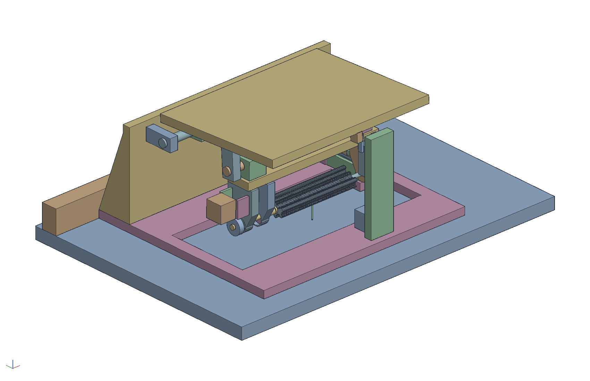

# A stick sled

The leaning half-ellipse Spectre milled round one solid stick. The
stick is held between a spindle and a tail centre on a sled that
slides on two shafts, and it only turns. Beside it, fixed to the base,
lies the [two-axis router positioner](../router-positioner/) with its
bit pointing at the stick: the positioner's X sets how deep the bit
reaches, its Z how high. Three motors go to the next row of a table,
and the sled is pushed past the bit and drawn back by hand.

It replaces the [hinged sled](../stick-sled-hinged/), which kept the
cutter fixed in a router table and hung the stick from two hinges.
Two straight screws now do what the hinges and their links did.

```sh
cargo build --release -p ok-mcp
python3 examples/router-positioner/build.py   # this reads the positioner's sizes from its out/positioner.json
python3 examples/stick-sled/build.py
cargo test -p ok-render --test stick_sled   # what CI runs
```



Nothing here has been built or run on a motor, and the positioner's
sizes rest on a router nobody has measured yet. What is checked is
checked by calculation and by the test.

## How it works


- **The stick turns and does nothing else.** A spindle in two bearings
  in a headstock, a spur on its end, a tail centre in a tailstock,
  both standing on the sled's plate. A motor turns the spindle through
  a belt, 16 teeth to a wheel of 160.
- **The positioner places the bit.** It lies on its lid with its Z
  column standing up, so the bit's axis is a stick's height over the
  base. Its face is a wall 54 mm from the stick's axis; the bit comes
  out of the slot in it, and for the deeper cuts the collet nut too.
- **Depth** is the positioner's X: the quill run out along the bit.
  **Height** is its Z. A cut is a direction round the stick, a height
  of the bit over the stick's axis, and a depth. Each is one motor,
  and none of the three moves any other.
- **The sled rides the two 20 mm shafts** on four bearing blocks: the
  set the duplicator had, doing what it was made for. The longer
  shaft is under the stick, the shorter 150 mm out to the left.
- **The wheel hangs off the sled's head end.** At 105 mm across it
  comes lower than the sled's plate and within 2 mm of the
  positioner's face, so it sits beyond both. At 2.7 times the radius of the
  60-tooth pulley it replaces, the same runout turns the stick 2.7
  times less far wrong, and by my estimate the belt gives about a
  fifth as much. The ratio is ten to one.

## A pass

1. Draw the sled back to its stop. The bit is beside the master, a
   ground sleeve on the spindle between the headstock and the stick.
2. Press the foot switch. The motors go to the next row and stop.
3. Push the sled past the bit and draw it back.

The controller will not move a motor unless the sled is back: a
switch on the back stop. With the sled back the bit is beside the
master, so a move between passes must not carry it through the
master. The safe way is to draw the bit back until its tip is 2 mm
clear of the master, then up or down and round, then out. Most moves
do not need it: the build follows each one along its own path and
marks it straight if the whole bit passes the master by 1.5 mm. 399
of the 485 are.

A stop post on the base meets the sled's plate at each end of its
218 mm. The shafts set how far apart the bearing blocks can be: 180 mm
on the 490 shaft and 104 on the 416, with 3.5 and 4.5 mm to spare at
each end.

## The table: 485 rows a stick

| rows | what | bit |
|---|---|---|
| 1 | put the blank on | |
| 1 | set the straight bit | 1/4 in straight |
| 185 | roughing: 83 places from 24 directions, in bites of 3 mm | |
| 1 | set the ball-nose | 3 mm ball-nose, tapered to a 1/4 in shank |
| 297 | finishing: 244 passes, the deep ones in bites of 1.5 mm | |

Both bits have 1/4 in shanks: the router is the North American Colt,
and that is its collet.

The cuts are the hinged sled's, planned by the same `plan.py`: every
finishing pass from its own direction, the whole of a tapered bit
kept out of the tile, each pass meeting its face 15° round the ball
from its dead centre, roughing to 0.4 mm of the tile, the order
settled before the bites are counted. Its README has the reasons.
What changed is where the three numbers of a row come from.

- **The blank is a plain rectangle,** 49 x 42 mm. Mark the centre on
  each end 19.5 mm from one wide face and 24.8 from one narrow face.
  The first row turns the spindle to where the blank goes on with
  that wide face level and underneath and that narrow face toward
  the router.
- **A bit is set by touch, by the controller.** The probe's clip goes
  on the bit with the router off; the bit is run out at the master,
  level with the stick's axis, until it touches, three times; from
  then on every depth is taken from there. So a bit may stand 2 mm
  further out of the collet than the table takes it to, or less far,
  and it makes no difference.
- **The clip has a home.** It is a post wired to ground: parked there
  the probe reads closed, and the controller will not go to a cut
  until it does. The router is never started with the clip on its
  bit.
- **Every move ends going the same way,** away from home, as the
  positioner's brief asks: a move back goes half a millimetre past
  and comes up to its place.

A stick is about two and a half hours: 500 pushes at a quarter of a
minute, and under half an hour of the motors (3.3 m of the depth's
screw and 4.7 m of the height's, at 1280 steps a millimetre).
Estimated.

## What the positioner has to be, for this job

| | here | |
|---|---|---|
| X travel | 12.6 to 58.0 mm used of 60 | all of it: the deepest cut is 2 mm short of the end |
| Z travel | 21.0 to 59.0 mm used of 80 | 60 would do |
| how it lies | on its lid, on a 19 mm plinth | the stage's weight then pulls away from its column, onto the collar that has no thrust bearing yet |
| its face from the stick's axis | 54 mm | the Colt's collet nut is 34 mm in front of the quill, so at the deepest cut it is 20.5 out of the face, and the uncut blank's corners swing 33.5. The nut sets the distance, not the face |
| the bit out of the collet nut | 45.5 mm | the blank's swing, and 12 mm past the stick's axis. The router does not change it: the positioner stands back by what the nut stands out. A 3 in tapered ball-nose on a 1/4 in shank does; the 1/4 in straight bit must be as long, 3 in overall |
| the depth's screw | M8 rod, as the positioner draws | a rod's pitch is nobody's promise, but it matters little here: 0.2 % off costs under a hundredth of a millimetre in the study |
| its two travels, square | not known until it is built | 2 mm in a metre out is 0.07 mm on the tile: the largest thing left. See Setting up |

The collet nut never comes within the blank's swing: at the deepest
cut its face is 33.5 mm from the axis.

## The controller

`firmware/main.py` and `firmware/config.py` are MicroPython for a
Raspberry Pi Pico; `out/passes.csv` is the table. It is the hinged
sled's program with its two screws renamed and two things added: a
bit set by touch, and every move ending the same way. It reads the
table a row at a time, says what it wants on a small display and over
USB, and keeps its place: taken up part way through a stick, it homes
and sets the bit again before it cuts.

| | |
|---|---|
| controller | Raspberry Pi Pico |
| drivers | three TMC2209 modules; 8 microsteps for the screws, 16 for the spindle |
| a screw's step | 0.00078 mm (M8 x 1.25) |
| the spindle's step | 0.011° |
| home switches | the quill drawn back, the stage at its home end (down, as it lies here), and a mark once round the spindle; wired normally closed |

| pin (GP) | to |
|---|---|
| 2, 3 | depth driver: step, direction |
| 4, 5 | height driver: step, direction |
| 6, 7 | spindle driver: step, direction |
| 8 | all three drivers' enable |
| 10, 11, 12 | home switches: depth, height, the spindle's mark |
| 13 | sled-back switch, on the back stop |
| 14 | foot switch |
| 15 | the probe's lead and clip; the spindle and the clip's parking post to ground |
| 16, 17 | display: SDA, SCL |

Only the spindle's motor and its home switch ride on the sled; the
rest of the wiring stays still.

## Setting up a built machine

Two straight screws leave little to find, and none of it needs a fit.
The controller runs both steps from tables `build.py` writes;
`calibrate.py` reads the results.

**Depth needs nothing.** Setting a bit by touch measures it every time
one goes in.

### 1. Where the bit's height is: `out/probe.csv`

A ground 1/4 in pin goes in the collet in place of a bit, with the probe's
clip on it, and no stick on the sled. The controller brings the pin
against the master from the front, from below and from above, and
again with the spindle half a turn round: six places, three touches
each, a few minutes.

```sh
python3 calibrate.py fit probe_log.csv --master 15.98 --pin 6.35
python3 build.py
```

- The middle of where the pin met the master from below and from
  above is the height at which the bit's axis is level with the
  stick's.
- Those two are the master and the pin apart, whatever the screw
  says, so they give the height screw's true travel.
- What half a turn of the spindle changes is the master's runout,
  and the table's setting rows allow for it.

`calibrate.py study` tries it on 300 machines built wrong at random:
the height's home anywhere in 3 mm, the height's screw 0.3 % off its
pitch and the depth's 0.2 %, the two travels 2 mm in a metre out of
square, the master 0.05 mm off the spindle's centre, a touch
repeating to 0.01 mm. The worst finishing cut of each:

| | median | 95 in 100 | worst of 300 |
|---|---|---|---|
| from the drawing's table | 1.62 mm | 2.97 | 3.19 |
| after the six touches | 0.044 mm | 0.070 | 0.076 |
| the same, were the depth's screw true | 0.038 | 0.066 | 0.075 |
| and the two travels square as well | 0.013 | 0.025 | 0.033 |

One machine is recorded in `out/calibration.json` as probed by the
controller's own program on a computer: 0.80 mm out from the drawing's
table, 0.040 planned for. The test works it again.

**What the touches do not find is whether the two travels are
square**, and that is most of what is left. The pin is level with
the stick's axis at the depth the touches were made, 50 mm out; a
bit run in or out from there rises or falls with whatever the quill's
travel is out of square with the stage's. Two millimetres in a metre
is 0.07 mm over the cuts' 45 mm of depth. It can be measured, with
the ball-nose's tip on the top and the side of a 1-2-3 block stood on
the sled's plate; that is not written yet. Until it is, it is the
positioner's to be built square, and its builder's to check with a
square.

### 2. Whether the stick runs true: `out/bands.csv`

The stick's axis has to run parallel to the sled's shafts. A scrap
stick goes between the centres with a stop clamped 25 mm in from each
end. The table sets the straight bit and, in three bites, has the
sled pushed to the far stop and drawn back to the near one, the
spindle turning the stick once round at each while the foot switch is
held: first with the bit's end at the stick from the front, then with
its side over the stick. Four bands, four diameters:

```sh
python3 calibrate.py align FRONT_NEAR FRONT_FAR TOP_NEAR TOP_FAR
```

says how far to move the tail centre, toward or away from the router
and up or down. All of it is simulation.

## Measure these first

| what | in the model | check |
|---|---|---|
| the router | its body is 70.71 mm, measured; the rest of the positioner rests on two photographs of it | see the positioner's own table |
| the probe's pin | 6.35 mm, a 1/4 in dowel pin or drill rod | measure it and give `fit` what it is with `--pin` |
| the two shafts | 490 and 416 long | they set the blocks' spacing and the travel; shorter ones want a shorter stick |
| the shafts' supports and blocks | SK20 51 to the centre, 70 high; SC20UU 25 to the centre, 42 high | they set the sled's height, and with the plinth, the blank's 9 mm over the plate |
| the bit's length | 45.5 mm out of the collet nut, give or take 2 | the controller measures what it is, and stops if a row is out of the quill's reach |
| the wheel | 160 teeth, printed; a closed belt of 400; the motor 101.7 from the spindle, in slots | it has to run true: 0.1 mm off centre is 0.11° once a turn, 0.06 mm at the tile's edge. Bolted to a hub through slack holes it can be tapped true under an indicator |
| the spindle | a 12 mm ground rod | not studding: see the hinged sled |
| the shafts, parallel | 150 apart | a stick cut to fit between them at one end, tried at the other |

## Parts

| part | size, mm | |
|---|---|---|
| base | 687 x 411 ply, and a 19 plinth 174 x 142 under the positioner | the positioner's column overhangs it behind |
| shafts, supports, blocks | the 20 mm set: two shafts, four SK20, four SC20UU | the sled's rails |
| sled plate | 359 x 214 ply | on the four blocks; its edge 20 mm short of the positioner's face |
| headstock | two uprights 60 wide, 19 thick, tied at the foot | a 6201 bearing in each, 43 apart |
| tailstock | an upright 60 wide | the tail centre, M10 pointed, in a slack hole |
| spindle | 12 mm ground rod | the wheel outboard, the master and a 14 mm spur inboard |
| master | ground steel sleeve, 16 x 12 x 29 | a bit is set on it; with the sled back the bit is beside it |
| wheel | 160 teeth, 105 across, 12 wide | and a 16-tooth pulley on a NEMA 17 on a bracket on the plate |
| stops, 2 | posts 40 x 40 x 87 on the base | the back one carries the sled-back switch |
| router positioner | 440 x 174 x 451 | its own example |

## What the test checks

`crates/ok-render/tests/stick_sled.rs` has the positioner's two axes
written a second time, in Rust, and works every row forward:

- the bit is where the plan wants it; the finishing bit, its flank and
  shank too, is never in the tile, and a roughing bite never within
  its allowance;
- the last bites of the finishing passes together reach the whole
  outline, from 179 directions;
- the waste, on a grid of the test's own, with the table's rows run
  over it in the table's order: no row meets more than a hair-wide
  fin standing higher than its bit's bite;
- the blank turns clear of the positioner's face and 9 mm clear of
  the sled's plate; the uprights pass that face; the wheel is clear
  of the positioner's box with the sled back; every row is within the
  positioner's travel with the bit's margin; the collet nut, which
  comes 20.5 mm out of that face, never comes within the blank's
  swing, and the face stands no further off than that takes;
- every move marked straight, followed along the controller's own
  path, passes the master by 1.5 mm, and drawn back to the safe depth
  the bit is clear of it at any height;
- the controller's program, simulated, ends every row on the table's
  steps, never changes height with the bit further out than the safe
  depth except where the table says, and taken up half way sets the
  bit again before it cuts;
- the blank is a rectangle with the tile 2 mm inside every face, and
  the first row hangs it with a wide face level and underneath;
- the document is the sled at one finishing row, the bit's tip on the
  stick and none of its 36 bodies through another;
- every bearing block stays on its shaft over the whole travel, and
  the stops leave the bit beside the master and past the stick;
- for setting up: a recorded machine built wrong, its six touches
  touches on it, the arithmetic made again, the height found within
  2 µm at the depth it was probed, and the table planned for it run
  on the real machine with the bit set by touch; and the probing
  table and the bands are where the reading of them assumes.
