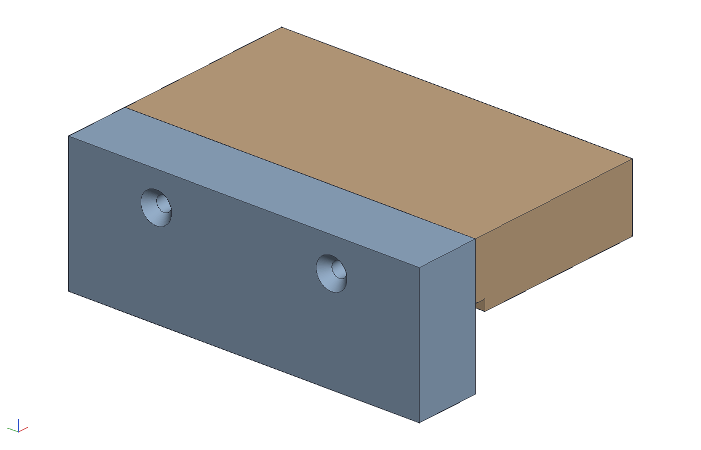
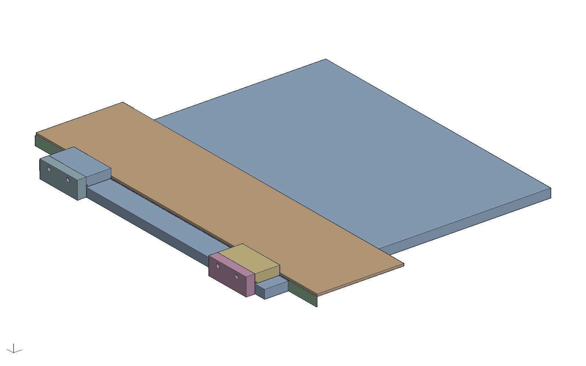

# Track saw edge gauge, 2 in

A fixed marking gauge for a track saw: hook it over the edge of a
sheet, slide the track's edge up against it, lift it off, cut. The
track lands 2 in plus the blade's kerf from the edge, so the strip the
blade leaves between the edge and the cut is 2 in. Not settable, and
that is the point: no measuring, no pencil line, the same strip every
time. Make two and put one at each end of the track, and the track is
parallel to the edge as well.

    cargo build --release -p ok-mcp
    python3 examples/track-gauge/build.py       # the document, pictures and sheets
    cargo test -p ok-render --test track_gauge  # what CI runs

## Why 2 in plus the kerf

A track saw cuts along the track's splinter-guard edge, with the whole
kerf outside the track. Put the track's edge at 2 in from the sheet
edge and the strip comes out 2 in less a kerf. The gauge's face is
therefore `WIDTH + KERF` from its fence: 2 in plus 2.2 mm, 2.087 in, for
a Festool or Makita blade. `KERF` at the top of `build.py` is the
number to change for a thin-kerf blade (1.5 or 1.6 mm); `width` and
`kerf` are also document variables, and the base's width is bound to
their sum, so the client shows the same thing.

## What it is

Two pieces of 3/4 hardwood, glued and screwed into an L:

| piece | size | notes |
|-------|------|-------|
| base | 3/4 x 2.087 x 4 | lies on the sheet; its outer face is what the track butts against |
| fence | 3/4 x 1-1/2 x 4 | glued and screwed to the base's inner edge, flush on top, hanging 3/4 below it over the sheet edge |
| screws | 2 x #8 x 1-1/2 | through the fence, countersunk, into 7/64 pilots in the base's edge at 1 and 3 in |

A 1/8 square dust groove runs along the base's inside bottom edge,
where it meets the fence, so a crumb of sawdust in the corner cannot
hold the fence off the sheet edge. The base's width is the one
dimension that matters: rip it to 2.087 (2-3/32 is 2.094, a hair
over) and check the first strip you cut with it.

## The model

- `gauge`: the fence first, with its two countersunk holes cut while it
  is the only body in the studio; then the base, extruded from the
  fence's inner face by `#width + #kerf`, the dust groove and the pilot
  holes. Both bodies carry their name and material (maple).
- `sheet` and `track`: a 24 x 24 corner of 3/4 ply with its top at
  z = 0 and its edge at x = 0, a 7-1/4 x 0.2 track bar with its edge at
  `WIDTH + KERF`, and the kerf as a 2.2 mm body through the sheet from
  `WIDTH` to `WIDTH + KERF`, so the picture shows where the blade goes.
- `in use`: an assembly of those with two gauges hooked on the edge, at
  each end of the track.
- Outputs in `out/`: `track_gauge.okpart`, `gauge.png`,
  `gauge_below.png` (the groove), `in_use.png`, `gauge.pdf` (front,
  top, right and iso with the parts list) and `in_use.pdf` (the gauge
  on the sheet, and a section across it through the track and kerf).
- The test checks the fence and base at their sizes, the base 53.0 mm
  from the fence's inner face with its groove and pilots by volume and
  the fence with its two countersunk holes, and in use the sheet edge,
  fence, base face, track edge and kerf lining up so the strip is
  exactly 2 in.
