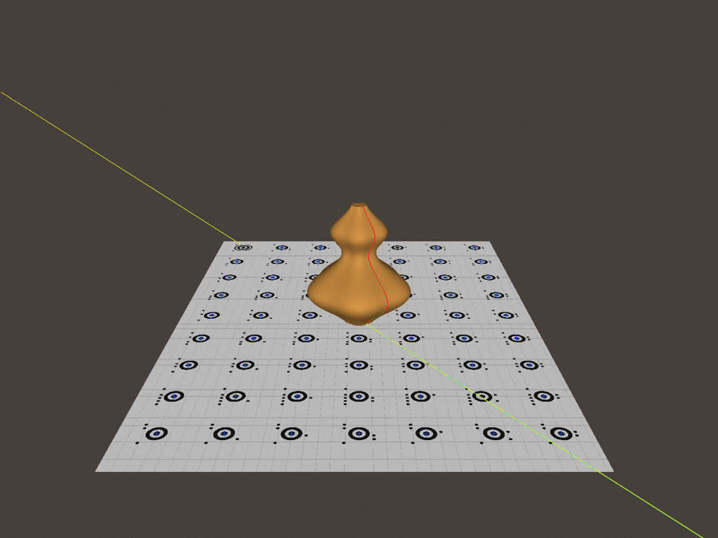
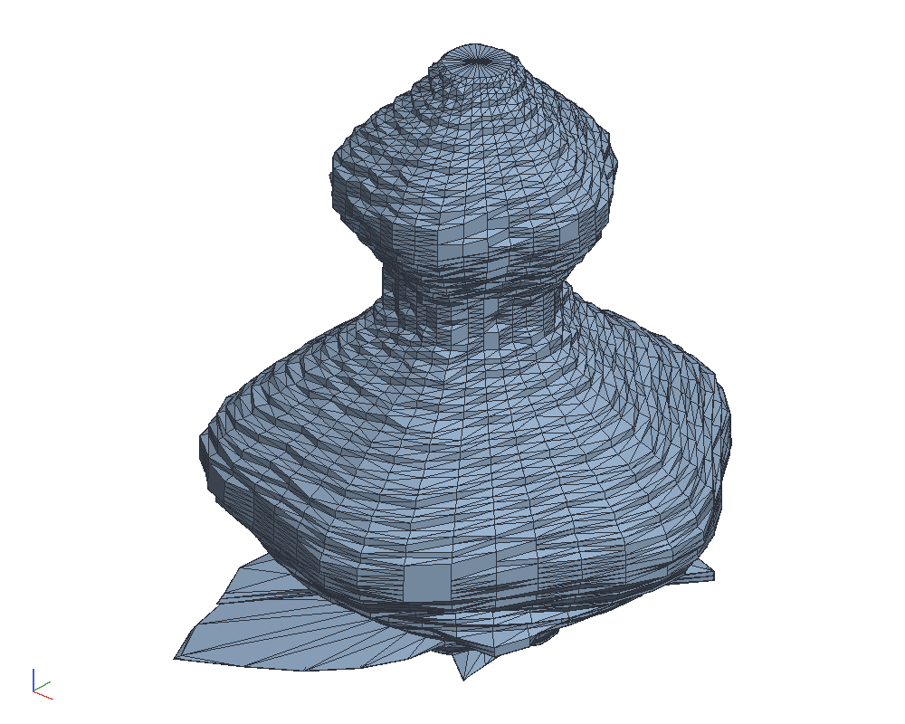
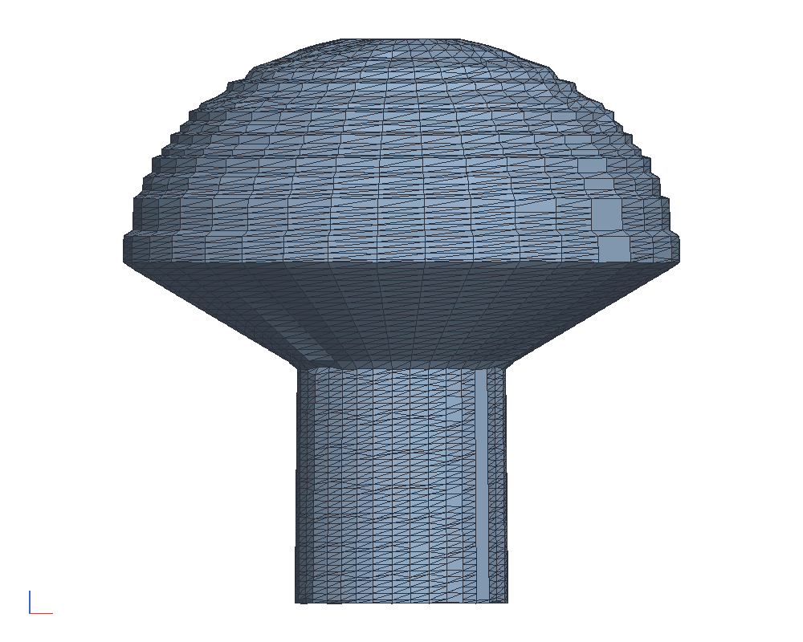
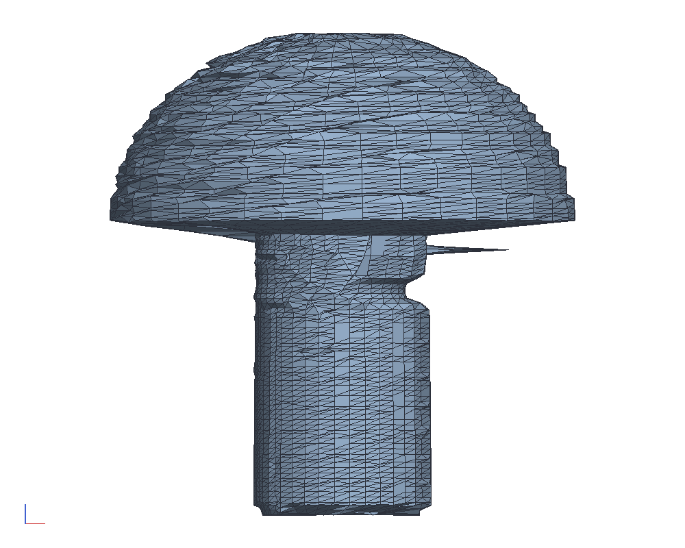
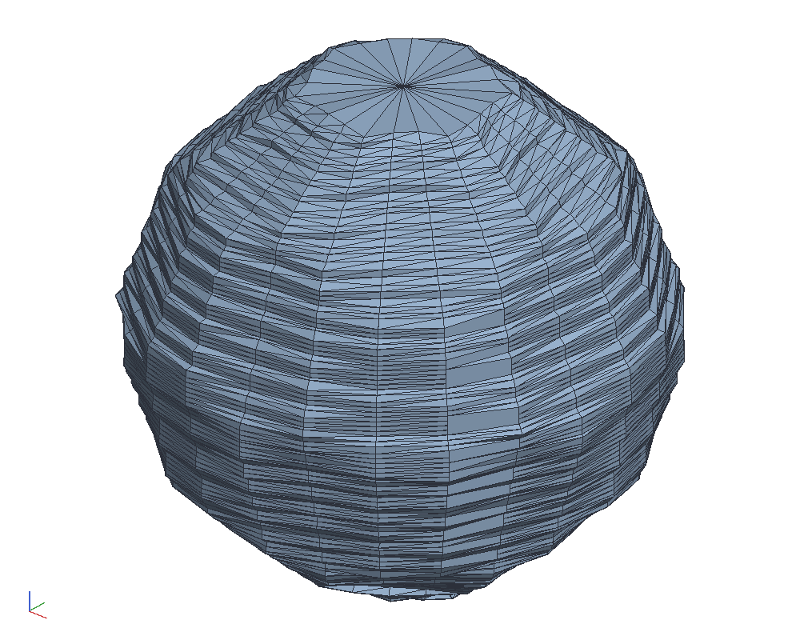

# A turntable laser scanner, built against its own simulation

An object on the measuring field, on a lazy Susan, turned under a
phone and a line laser fixed to each other, scans into a point cloud
and a mesh in the field's millimetres. Before any such video existed
the scanner was built against a rendered one, and the loop stays
closed: a lobed gourd of known shape is rendered going round, scanned,
and held against the shape it was rendered from; so are the five
Platonic solids and a bucky ball; and a mushroom, whose cap hides
its underside from any camera above the table, is scanned standing
and on its side and the two scans merged.

```sh
cargo test -p ok-photo --test scan --test merge --test solids   # renders the frames (git-ignored) and scans them; the closed-loop checks
cargo build --release -p ok-mcp
python3 examples/turntable-scan/build.py   # encodes the frames to videos with ffmpeg, scans and merges them through the MCP server
cargo test -p ok-photo --test example_scan  # what CI checks against the committed scan.json files
```










## How it works

1. **Pose from the field.** Each frame's coded marks give the
   homography from the picture to the field's plane. Its columns are
   images of two orthonormal directions, which fixes the focal length
   (taken as the median over the frames), and with that the homography
   factors into the camera's rotation and position over the field.
   The field turns with the object, so this is the object's frame.
2. **The line.** The laser line is the green ridge in each row of the
   picture (green over the larger of red and blue), located to a
   fraction of a pixel by its centroid.
3. **The laser's plane.** On the paper the line is straight in the
   picture, so the straight line most of its pixels lie on separates
   paper from object. Each paper pixel is a ray meeting the field's
   plane, a known point. With the rig fixed and the table turning that
   is the same line in the camera's frame in every frame, which gives
   the plane only one of its directions; the other is the turntable's
   axis, which the camera's centres describe a circle about, and
   through which the laser is aimed. The plane is fitted to the paper
   points and the axis together, and the scan says how far the line
   passes from the axis.
4. **Points.** Each pixel of the line on the object is a ray meeting
   that plane; the pose takes the point into the field's frame.
5. **Mesh.** The points go into sectors of azimuth about the cloud's
   own centre line (one per frame for a single scan) and 1 mm height
   bins, a bin the sectors either side disagree with dropped as a
   stray, gaps bridged, and consecutive sectors round the turn are
   stitched quad by quad, capped at the top and bottom. The volume is
   taken by slices through the profiles, which a hole in the mesh does
   not reach. The mesh takes the object to be one a horizontal ray
   from its centre line leaves once at every height: anything convex,
   most things that stand; not a torus.
6. **A second pose.** A camera 22 degrees above the table sees any
   face leaning out over it by up to about 68 degrees, so a bucky
   ball or a dodecahedron on a face scans whole in one pass; what it
   cannot see is a surface facing down, the underside of a cap or a
   lip, and one scan bridges across it. Scanned again upside down or
   on its side, the second cloud is registered onto the first by
   point-to-plane iterative closest point seeded by what was done to
   the object (a flip, a roll, a move, or only the camera moved: a
   cube looks the same from every side, so the search is told which),
   and the merged cloud is meshed as above. `merge_scans` is the tool.

## The closed loop

`crates/ok-photo/src/simulate.rs` renders the rig: the gourd's
triangles into a depth buffer, the field's plane behind them, a shadow
map from the laser so its line falls only where the laser can reach,
the line mixed in as a green that does not saturate, and a little
sensor noise. The gourd is 120 mm tall with five lobes, on the 2x2
Letter field, under a 1400 x 1050 camera of 1300 px focal length 650 mm
from the axis and 22 degrees above the table, the laser 35 degrees
round from it and 30 degrees up. Thirty-six frames.

`crates/ok-photo/tests/scan.rs` scans them and checks: every frame
read, the focal length within 1.5 %, the axis within 1 mm, every
point's radius against the gourd's at that height and azimuth (median
under 0.3 mm, 90 % under 0.8), and the volume within 2 % of the
gourd's over the heights scanned. It comes out at 0.14 mm median,
0.38 mm at the 90th percentile, and 1.3 % on volume, the last mostly
the chords between profiles 10 degrees apart across the lobes.

`tests/solids.rs` stands each Platonic solid and the bucky ball on a
face (100 mm tall, 24 frames) and checks every point against the true
surface (0.07 to 0.12 mm median) and the mesh's volume against the
true shape sampled at the same azimuths and filled across the same
gaps (within 0.3 % for all six; against the true volume they read 85
to 98 %, the rest the chords a 24-gon cuts off a corner, a tetrahedron
worst); then a tetrahedron rolled onto a side, an octahedron set down
elsewhere, a dodecahedron and the bucky ball turned over, and a cube
under a camera at 50 degrees, each registered onto the first scan to
0.1 to 0.3 mm and merged, the merged points still on the surface.
`tests/merge.rs` has the mushroom, whose one-scan volume is 117 % by
the cone under the cap and whose merge with its side-on scan reads
101 %, and the gourd upside down, registered to 0.18 mm and merged
without harm.

`build.py` then pushes the same frames through real video files:
encoded at crf 18, frames pulled back out with ffmpeg by the MCP tool,
the mushroom's two scans merged with `merge_scans`, and the
`scan.json` and `merged.json` files under `out/` record what came
through: the gourd at 340.7 cm³ against 340.4, the mushroom at 117 %
from one scan and 102 % from two. `tests/example_scan.rs` checks those
records in CI.

## Shooting a real one

- The 2x2 field taped flat to the turntable's disc, the object near
  its centre, held so it cannot rock.
- The phone on something steady, a little above the object's middle,
  close enough that the marks' dots resolve (the field filling most of
  the frame), and the whole field in view all the way round.
- The laser's vertical line through the turntable's centre, 30 to 45
  degrees round from the phone, fixed to the same thing the phone is
  fixed to. The scan takes the laser's plane to hold the axis, and says
  how far off the aim was.
- A dim room and the exposure locked on the line, so the line is the
  brightest thing in the frame and the paper comes out grey.
- One slow turn, 20 to 40 seconds. Then
  `scan_turntable {video: "IMG_1234.MOV", out: "scan"}`.

What neither the camera nor the laser reaches from above stays
bridged: the underside of a cap or a lip. Turn the object over or roll
it onto its side, scan again, and
`merge_scans {scans: [{dir: "scan"}, {dir: "scan2", placed: "on its side"}], out: "merged"}`.
The answer says how closely the second scan registered; a loose
number means the placement was not what was said.
